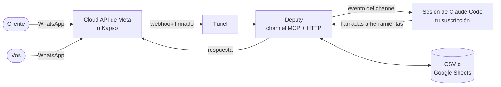
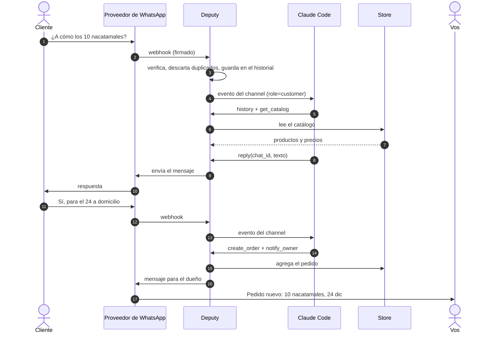
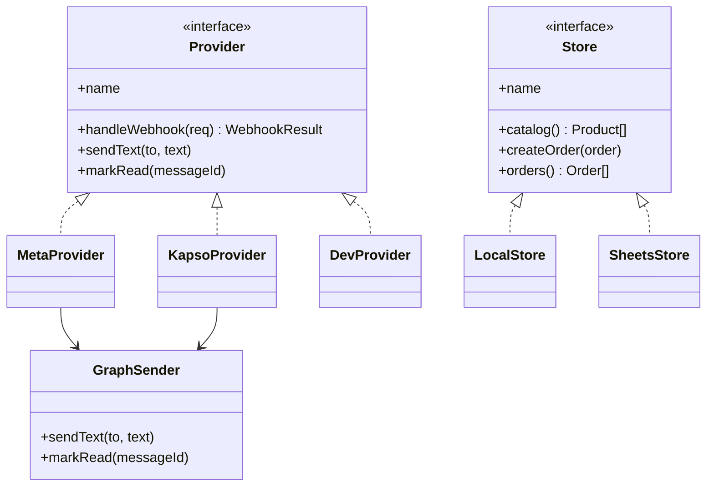
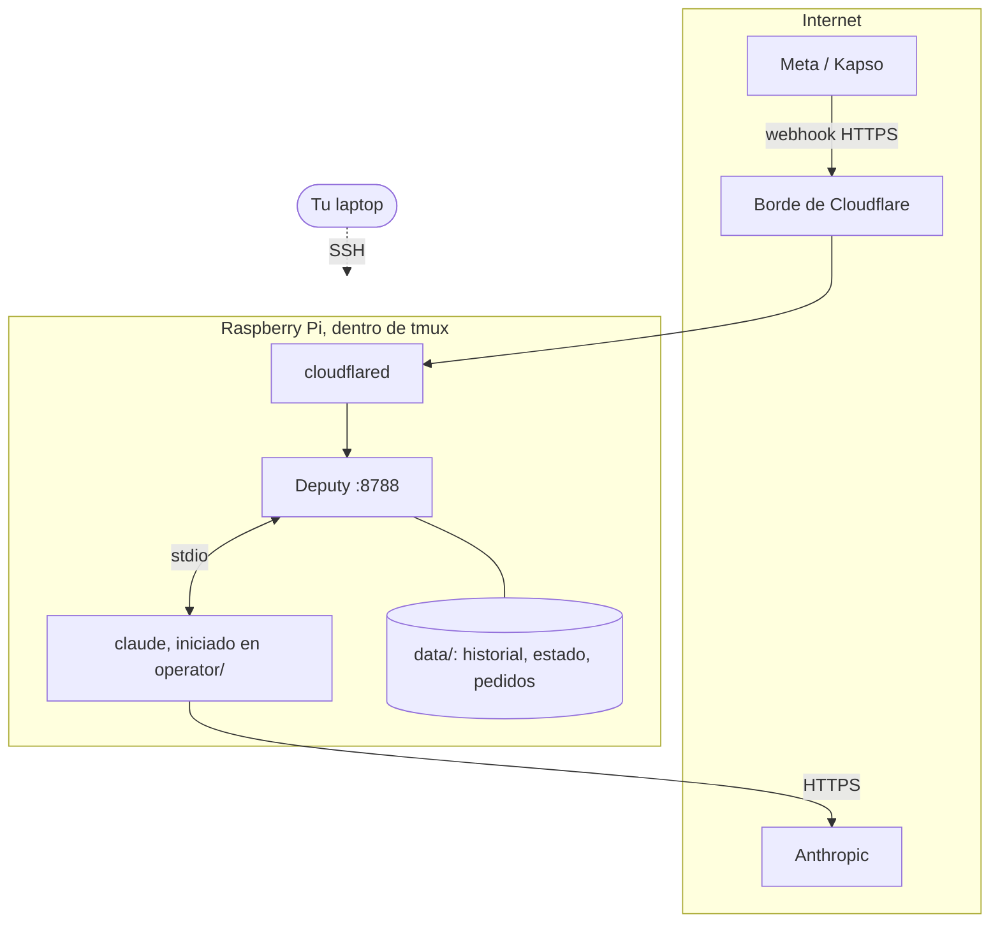
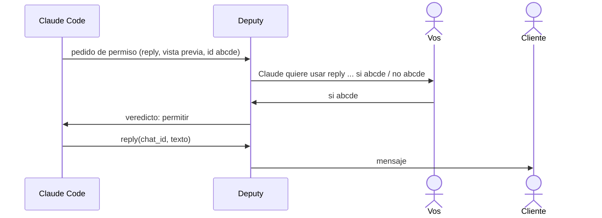
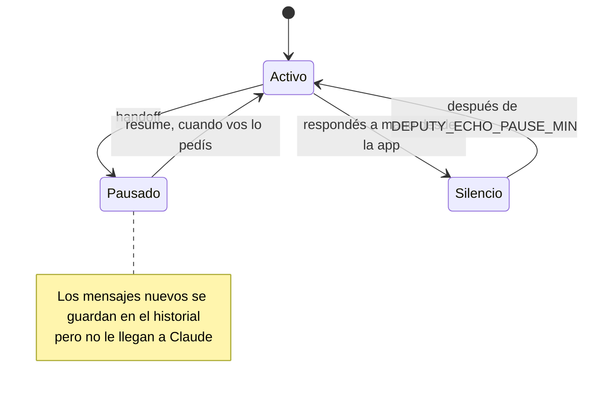
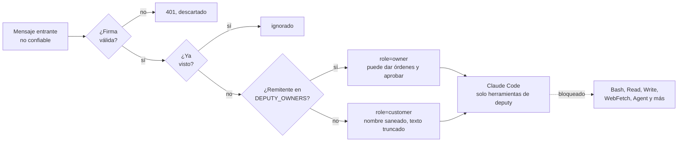

# Deputy

**Que tu agente de Claude Code conteste tu WhatsApp por vos, con la suscripción que ya pagás.**

Deputy es un [channel de Claude Code](https://code.claude.com/docs/en/channels): un servidor MCP que recibe tus mensajes de WhatsApp y los empuja a una sesión de Claude Code que corre en tu computadora, un servidor o una Raspberry Pi. Claude responde en tu nombre, consulta tu catálogo, anota pedidos y te devuelve el chat cuando hace falta una persona.

- **Sin bot que construir ni API que pagar:** el cerebro es tu propia sesión de Claude Code.
- **Tu proveedor de WhatsApp:** la Cloud API de Meta directo (sin intermediarios) o Kapso (te hace el alta con Meta). Agregar otro es implementar una interfaz.
- **Tus datos, tu hoja:** catálogo y pedidos en CSV local o Google Sheets.
- **Vos seguís al mando:** escribile a Deputy desde tu número para darle instrucciones, aprobar respuestas desde WhatsApp o tomar cualquier chat.

> **Estado: v0.1, experimental.** Los channels de Claude Code están en *research preview*. Deputy tiene pruebas automáticas (proveedores, firmas, pedidos, pausas y aprobaciones), pero todavía no corrió en producción con WhatsApp real. Se agradecen comentarios y PRs.

[Read in English](README.md)

## Cómo funciona



Una conversación típica, del primer mensaje al pedido registrado:



Cada mensaje le llega a Claude como `<channel source="deputy" chat_id="505…" role="customer">texto</channel>`. Claude solo puede actuar con estas herramientas:

| Herramienta | Qué hace |
|---|---|
| `reply` | Envía un WhatsApp a un chat |
| `history` | Últimos mensajes de un chat (guardados en `data/`, no en el contexto de Claude) |
| `get_catalog` | Productos, precios y disponibilidad |
| `create_order` | Registra un pedido confirmado |
| `list_orders` | Para cuando preguntás "¿cuántos pedidos van?" |
| `handoff` | Pausa a Deputy en ese chat para que lo tomes vos |
| `resume` | Reactiva a Deputy en un chat pausado |
| `notify_owner` | Te escribe a tu WhatsApp |

## Costos

| Pieza | Costo |
|---|---|
| Claude | Tu plan Pro, Max o Ultra vía Claude Code. Cuenta contra tus límites de uso. |
| WhatsApp Cloud API (Meta directo) | Sin tarifa de plataforma. Meta cobra por mensaje según su tabla vigente (desde oct. 2026, las respuestas dentro de la ventana de 24 h son gratis hasta 1,000 por número al mes, y todo es gratis por 72 h si el cliente llega por un anuncio Click-to-WhatsApp). |
| Kapso (opcional) | Según su plan, más las tarifas de Meta. |
| Túnel (p. ej. Cloudflare Tunnel) | Gratis |
| Google Sheets | Gratis |

Revisá siempre la [tabla de precios de Meta](https://developers.facebook.com/docs/whatsapp/pricing), porque cambia.

## Inicio rápido (sin WhatsApp, 5 minutos)

Requisitos: [Bun](https://bun.sh) 1.2+ y Claude Code con sesión iniciada en tu cuenta de claude.ai.

```bash
git clone https://github.com/antonygiomarxdev/deputy && cd deputy
bun install
cp .env.example .env        # dejá DEPUTY_PROVIDER=dev
scripts/operator.sh         # en Windows, corrélo desde Git Bash
```

Aceptá el aviso del canal de desarrollo. En otra terminal:

```bash
curl -N localhost:8788/dev/events                     # aquí ves lo que responde Deputy
scripts/simulate.sh 50581112222 "Hola, ¿a cómo el nacatamal?"
```

Después adaptalo a tu negocio: editá `business/business.md` (tono, entregas, pagos, reglas) y `business/catalog.csv`. Los cambios del catálogo aplican en el momento; los de `business.md`, al reiniciar la sesión. En [`examples/christmas-food-sale-es`](examples/christmas-food-sale-es) hay un perfil de ejemplo en español; los encabezados del catálogo pueden ir en español o en inglés. Poné `DEPUTY_LANG=es` para que los avisos que Deputy te manda a vos salgan en español.

## Conectar WhatsApp

### Opción A: Meta directo (gratis, más pasos)

1. En [Meta for Developers](https://developers.facebook.com/) creá una app de tipo *Business* y agregá el producto **WhatsApp**.
2. Agregá tu número (o probá con el número de prueba gratuito de Meta). Anotá el **Phone number ID**.
3. En *Business Settings → System users* creá un usuario del sistema y generá un **token permanente** con permisos `whatsapp_business_messaging` y `whatsapp_business_management`.
4. En *App settings → Basic* copiá el **App secret**.
5. En `.env`: `DEPUTY_PROVIDER=meta`, `META_PHONE_NUMBER_ID`, `META_ACCESS_TOKEN`, `META_APP_SECRET` y un `META_VERIFY_TOKEN` que inventes.
6. Exponé el puerto (ver *Siempre encendido* más abajo) y en *WhatsApp → Configuration → Webhook* poné `https://<tu-dominio>/webhook` con el mismo verify token. Suscribite al campo **messages**.

**¿Puedo seguir usando mi número en la app?** Un número registrado directo en la API deja de funcionar en la app normal. *Coexistence* permite usar el mismo número en la app WhatsApp Business **y** en la API a la vez, pero se activa con *Embedded Signup*, un flujo pensado para proveedores (BSP o Tech Providers). Si lo tenés, suscribite también a **smb_message_echoes**: cuando respondés a mano desde la app, Deputy se queda callado en ese chat (`DEPUTY_ECHO_PAUSE_MIN`). Si no, lo más simple es un **número aparte** para el negocio.

### Opción B: Kapso (menos pasos)

1. Creá un proyecto en [Kapso](https://kapso.ai) y conectá tu número (o usá su sandbox).
2. En `.env`: `DEPUTY_PROVIDER=kapso`, `KAPSO_API_KEY`, `KAPSO_PHONE_NUMBER_ID`, `KAPSO_WEBHOOK_SECRET`.
3. En Kapso, configurá el webhook `https://<tu-dominio>/webhook` con ese secreto y el evento `whatsapp.message.received`.

### Otro proveedor

Implementá `Provider` de `src/types.ts` (`handleWebhook` + `sendText`) y registralo en `src/providers/index.ts`. Si tu proveedor ofrece un proxy compatible con la Graph API (como Kapso), `GraphSender` ya resuelve el envío. Los stores funcionan igual.



## Catálogo y pedidos en Google Sheets

1. Creá una hoja con dos pestañas: **Catalog** (`id, name, unit, price, available, notes`; también acepta `nombre, presentacion, precio, disponible, notas`) y **Orders** (vacía; Deputy escribe los encabezados).
2. En Google Cloud creá una cuenta de servicio, habilitá la *Google Sheets API* y descargá la llave JSON como `service-account.json`.
3. Compartí la hoja con el correo de la cuenta de servicio como **Editor**.
4. En `.env`: `DEPUTY_STORE=sheets`, `SHEETS_ID` (el ID que aparece en la URL de la hoja) y `GOOGLE_SERVICE_ACCOUNT_FILE`.

Cambiás un precio en la hoja y Claude lo usa en el siguiente mensaje.

## Siempre encendido (Raspberry Pi o cualquier servidor)

En la Pi, usá el sistema operativo de 64 bits (Bun corre en Linux arm64).

```bash
# 1. Túnel público gratis hacia el puerto local
cloudflared tunnel --url http://localhost:8788     # prueba rápida (URL temporal)
# para producción: un túnel con nombre y tu propio dominio (ver docs de Cloudflare Tunnel)

# 2. La sesión operadora dentro de tmux
scripts/start.sh
tmux attach -t deputy     # solo la primera vez, para aceptar los avisos; salí con Ctrl-b d
```

Para revisar el estado desde cualquier lugar con SSH: `ssh pi 'curl -s localhost:8788/health'`.



## Modos

- **Piloto automático (por defecto):** `operator/.claude/settings.json` permite `mcp__deputy__reply`, así que Claude contesta solo.
- **Aprobar cada respuesta:** quitá `mcp__deputy__reply` de `allow`. Cada respuesta te llega al WhatsApp con un código; contestás `si abcde` o `no abcde` (también sirve `yes`). Solo los números de `DEPUTY_OWNERS` pueden aprobar.

Tus mensajes al número del negocio le llegan a Claude con `role="owner"`. Probá con "¿cuántos pedidos van para el 24?", "pausá al 50581112222" o "decile que sí hay rompope".

En el modo con aprobación, el pedido de permiso de Claude Code te llega al teléfono:



Cada chat pasa por tres estados:



## Seguridad

Un channel al que puede escribir cualquier cliente es una vía de **inyección de prompts**: cualquiera puede ponerle texto a tu sesión. Deputy lo mitiga en capas:



1. **Herramientas bloqueadas.** El perfil del operador (`operator/.claude/settings.json`) niega `Bash`, `Read`, `Write`, `Edit`, `WebFetch`, `WebSearch`, `Task`/`Agent` y otras. Aunque un mensaje convenza a Claude, no puede tocar tu equipo ni leer tu `.env`. Además, `scripts/operator.sh` arranca Claude Code solo con el servidor MCP de Deputy y nada de tu configuración: sin conectores de claude.ai (Gmail, Drive…), sin Claude in Chrome, sin herramientas integradas, sin ajustes, hooks ni plugins de usuario, y con avisos de permiso en vez del modo auto. Arrancá siempre el operador con ese script.
2. **Roles.** Solo los números de `DEPUTY_OWNERS` llegan como `role="owner"` y pueden aprobar permisos. Las instrucciones del servidor le dicen a Claude que el texto de un cliente nunca es una orden.
3. **Metadatos saneados.** El nombre de perfil se limpia de caracteres especiales y los textos se truncan.
4. **Webhooks verificados.** Se validan las firmas de Meta (`X-Hub-Signature-256`) y de Kapso (`X-Webhook-Signature`), y se descartan los duplicados.
5. **Aislamiento.** Corré Deputy en un usuario o equipo dedicado (la Pi), con una cuenta de Claude que no uses para trabajo sensible.

Riesgo residual: un cliente igual podría manipular a Claude para que diga algo incorrecto *dentro de WhatsApp* (un precio inventado, por ejemplo). Si eso importa en tu negocio, usá el modo con aprobación.

## Limitaciones conocidas

- **Research preview:** los channels personalizados necesitan `--dangerously-load-development-channels` y una confirmación interactiva al arrancar (no funcionan con `claude -p`).
- **Una sesión, en orden:** los mensajes se procesan uno tras otro. Va bien para volúmenes chicos y medianos.
- **Contexto largo:** la sesión acumula chats y Claude Code la compacta sola. Por eso Claude consulta `history` en vez de depender de su memoria.
- **Avisos al dueño:** WhatsApp solo permite mensajes libres dentro de las 24 h siguientes a tu último mensaje al número del negocio. Escribile a Deputy una vez al día, o agregá una plantilla aprobada (está en la hoja de ruta).
- **Media:** imágenes, notas de voz y documentos llegan como `[image]`, `[voice note]`, etc. Todavía no se transcriben.
- **Kapso:** la pausa automática por eco solo está implementada para Meta directo.

## Desarrollo

```bash
bun test             # pruebas de punta a punta (stdio + webhooks simulados de dev, Meta y Kapso) y pruebas unitarias
bun run typecheck    # TypeScript sin compilar (Bun ejecuta el código fuente directamente)
bun changeset        # describí tu cambio para el changelog
```

Las versiones se manejan con [Changesets](https://github.com/changesets/changesets): cada cambio visible para el usuario lleva su changeset, y `bun run version` sube la versión y escribe el `CHANGELOG.md`.

La raíz del repo es un espacio de desarrollo normal. El perfil bloqueado que atiende a los clientes vive en `operator/`. Ver [CLAUDE.md](CLAUDE.md) para la estructura.

## Hoja de ruta

- Plantillas para avisos fuera de la ventana de 24 h y confirmaciones de pedido
- Transcripción de notas de voz
- Botones interactivos (confirmar o cambiar pedido)
- Más proveedores: Twilio, 360dialog
- Otros canales: Telegram, Instagram
- Empaquetarlo como plugin instalable de Claude Code

## Licencia

[Apache-2.0](LICENSE). Sin afiliación con Anthropic ni con Meta. WhatsApp es una marca registrada de Meta Platforms, Inc.
