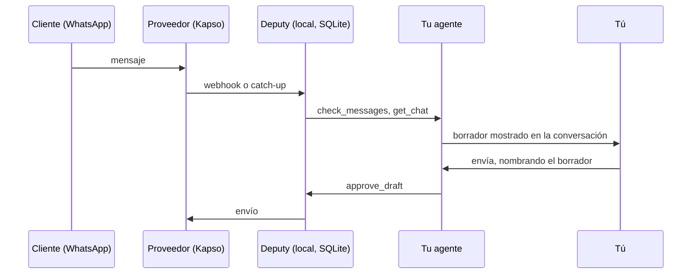

# Deputy

**Tu bandeja de WhatsApp Business dentro de tu propio agente de IA. Nada sale sin tu visto bueno.**

[](https://github.com/antonygiomarxdev/deputy/actions/workflows/ci.yml)
[](LICENSE)
[](https://bun.sh)
[](https://modelcontextprotocol.io)

[Read in English](README.md) · [Visión del producto](docs/PRODUCT.md)

<!-- GIF DE DEMO (lo graba el dueño, 20-30 s, solo con el proveedor dev y datos falsos, nunca un número ni un cliente reales):
     le preguntas al agente "¿qué hay pendiente?", lee un chat, redacta una respuesta, dices "envía" y se confirma el envío.
     Pon el archivo en docs/assets/ e insértalo aquí. -->

Deputy es un servidor [MCP](https://modelcontextprotocol.io) que corre en tu computadora y habla con tu agente por stdio (primero Claude Code; sirve cualquier agente MCP). Tu agente ve los mensajes que envían tus clientes, investiga lo que necesita y redacta respuestas. Tú decides qué sale. Es un asistente, no un bot autónomo.

## Por qué Deputy

- **Tu agente, tus reglas.** Funciona con cualquier agente que hable MCP. Sigues usando el agente que ya pagas.
- **Tú apruebas cada envío.** El agente muestra el borrador en tu conversación y lo envía solo después de tu visto bueno, que debe nombrar el borrador.
- **Tus datos se quedan en tu máquina y solo se usan APIs oficiales.** Las conversaciones viven en un solo archivo SQLite. Nada de puentes no oficiales de WhatsApp.

## Cómo funciona



- **Proveedores:** [Kapso](https://kapso.ai) (plan gratis, funciona con un número que sigue en la app WhatsApp Business) y `dev` (pruebas locales, sin WhatsApp). Agregar un proveedor es implementar el puerto `Provider` en `src/intake/ports/provider.ts`.
- **Un proceso dueño:** solo un proceso de Deputy a la vez tiene el arrendamiento (lease) sobre `deputy.db` y hace el trabajo; un segundo proceso queda en solo lectura.
- **Transporte stdio:** stdout es el transporte MCP; los logs van a stderr.

## Inicio rápido

Requisitos: [Bun](https://bun.sh) 1.4 o superior.

```bash
git clone https://github.com/antonygiomarxdev/deputy && cd deputy
bun install
claude mcp add deputy -- bun /ruta/absoluta/a/deputy/src/main.ts serve
```

Cualquier agente MCP tiene un equivalente de `claude mcp add`. Sin `config.json`, Deputy usa el proveedor `dev`, así que puedes probarlo sin WhatsApp. Para conectar Kapso, mira [Configuración](#configuración).

Luego pídele a tu agente, por ejemplo:

- "Revisa si hay mensajes nuevos de WhatsApp."
- "Lee el chat con María y redacta una respuesta."
- "Muéstrame los borradores pendientes."
- "Envía el borrador 2." (tu visto bueno debe nombrar el número del borrador)

## Qué hace hoy

Estas son las herramientas que recibe el agente (registradas en `src/main/tools.ts`).

| Herramienta | Qué hace |
|---|---|
| `status` | Dice si este Deputy es el proceso dueño o está en solo lectura, y el estado de cada parte. |
| `check_messages` | Consulta ahora al proveedor por mensajes y dice qué tan al día está la bandeja. |
| `get_chat` | Lee un chat en orden. El texto del cliente va etiquetado como dato, nunca como instrucción. |
| `rejected_deliveries` | Lista las entregas que Deputy se negó a guardar: hora y motivo, nunca su contenido. |
| `list_owner_numbers` | Lista los números que cuentan como tú y el registro de cambios. Solo lectura. |
| `create_draft` | Redacta un borrador de respuesta. No se envía nada. |
| `change_draft` | Cambia un borrador a petición tuya; esto anula cualquier aprobación previa. |
| `reject_draft` | Rechaza un borrador que no quieres. |
| `list_drafts` | Lista los borradores que esperan por ti, con el mensaje del cliente que responde cada uno. |
| `approve_draft` | Envía un borrador después de tu visto bueno. Una llamada por borrador; no hay aprobar-todo ni permiso permanente. |
| `drafts_log` | Lee el registro de solo añadir de lo que se propuso, cambió, aprobó, envió o rechazó. |
| `check_approvals` | Comprueba que cada mensaje enviado tenga su aprobación. |

## Seguridad y confianza

Cada mensaje de un cliente es entrada no confiable para tu agente.

Vigentes hoy:

1. El texto del cliente llega al agente etiquetado como dato (`customer_text`), nunca como instrucción.
2. Nada se envía sin `approve_draft`, y tu visto bueno debe nombrar el borrador por su número. El registro de borradores guarda cada paso con tus palabras.
3. Los webhooks se verifican por firma antes de guardar nada.
4. Los secretos se muestran como `[secret]` en todas partes y nunca van en errores ni logs.
5. Los cambios a tus números de dueño quedan en un registro de solo añadir: la base de datos rechaza editarlo o borrarlo. El agente puede leer los números pero no tiene herramienta para cambiarlos.

Límite conocido: Deputy solo controla su propio camino de envío. Un agente que tenga otras herramientas, como una terminal, podría llegar al proveedor sin pasar por Deputy; elige y limita las herramientas del agente.

## Configuración

| Dónde | Qué |
|---|---|
| `DEPUTY_DATA_DIR` (por defecto `data`) | Guarda `deputy.db`, tus conversaciones y ajustes. Las copias de seguridad previas a una migración son `deputy.db.bak-v<N>`. |
| `DEPUTY_CONFIG_DIR` (por defecto `~/.deputy`) | Guarda `config.json` y `secrets.env`. |
| `DEPUTY_PORT` (por defecto `8788`) | Puerto del receptor local (loopback) de entregas en vivo (un número entero de 1 a 65535). |
| `DEPUTY_KAPSO_BASE_URL` (por defecto `https://api.kapso.ai`) | La dirección de la API de Kapso. |

`config.json` acepta `provider` (`kapso` o `dev`; vacío significa `dev`), `receiving_mode` (`catch-up` o `live`) y, para Kapso, `kapso_phone_number_id`. Los secretos se leen del almacén de secretos del sistema operativo y luego de `secrets.env` (líneas `nombre=valor`): `kapso-api-key` y `kapso-webhook-secret` (solo para `live`). Los comandos de configuración que los escriben todavía no existen, así que por ahora edítalos a mano. Al arrancar, Deputy se niega a seguir si falta algo, lo nombra y nunca imprime un secreto.

## Estado y hoja de ruta

**v0.1, experimental.** Construido: el servidor MCP por stdio y las herramientas de arriba, el lease de dueño, el almacén SQLite y sus migraciones, los números del dueño, las validaciones de arranque, los proveedores Kapso y `dev`, la recepción por catch-up y por webhook en vivo, los borradores, su aprobación y el registro de borradores. Probado con tráfico real de WhatsApp en un negocio piloto.

Planeado, con documentos pero sin código todavía (mapa de rebanadas en [docs/PRODUCT.md](docs/PRODUCT.md)):

| Rebanada | Qué | Estado |
|---|---|---|
| Inbox | Detección de pendientes, triage, resumen | planeado |
| Notify | Avisos agrupados a la sesión del agente | planeado |
| Knowledge | Perfil del negocio, catálogo, conocimiento aprendido | planeado |
| Orders | Registro y listado de pedidos | planeado |
| Setup | Configuración guiada y los comandos que escriben config y secretos | planeado |

Fuera de la v1: reglas de piloto automático (responder sin tu visto bueno), Meta Cloud API directo, otros canales (Instagram, Telegram), notas de voz, botones y plantillas.

## Contribuir

Lee [CONTRIBUTING.md](CONTRIBUTING.md) y [CLAUDE.md](CLAUDE.md) (estructura y convenciones). Las versiones usan [Changesets](https://github.com/changesets/changesets). Reporta los problemas de seguridad en privado, mira [SECURITY.md](SECURITY.md).

```bash
bun install
bun test
bun run typecheck
```

## Licencia

[Apache-2.0](LICENSE). Sin afiliación con Anthropic ni Meta. WhatsApp es una marca de Meta Platforms, Inc.
