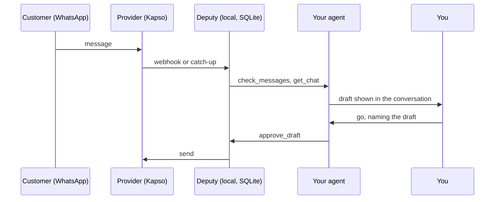

# Deputy

**Your WhatsApp Business inbox, inside your own AI agent. Nothing goes out without your go.**

[](https://github.com/antonygiomarxdev/deputy/actions/workflows/ci.yml)
[](LICENSE)
[](https://bun.sh)
[](https://modelcontextprotocol.io)

[Leer en español](README.es.md) · [Product overview](docs/PRODUCT.md)

<!-- DEMO GIF (owner to record, 20-30 s, dev provider with fake data only, never a real number or customer):
     ask the agent "what is pending?", it reads a chat, drafts a reply, you say "go", the send is confirmed.
     Place the file in docs/assets/ and embed it here. -->

Deputy is an [MCP](https://modelcontextprotocol.io) server that runs on your computer and talks to your agent over stdio (Claude Code first; any MCP agent works). Your agent sees the messages your customers send, researches what it needs and drafts replies. You decide what goes out. It is an assistant, not an autonomous bot.

## Why Deputy

- **Your agent, your rules.** It works with any agent that speaks MCP. You keep using the agent you already pay for.
- **You approve every send.** The agent shows the draft in your conversation and sends it only after your go, which must name the draft.
- **Your data stays local, and only official APIs are used.** Conversations live in one SQLite file on your machine. No unofficial WhatsApp bridges.

## How it works



- **Providers:** [Kapso](https://kapso.ai) (free plan, works with a number that stays in the WhatsApp Business app) and `dev` (local testing, no WhatsApp). Adding a provider means implementing the `Provider` port in `src/intake/ports/provider.ts`.
- **One owner process:** only one Deputy process at a time holds the lease on `deputy.db` and does the work; a second one is read-only.
- **Stdio transport:** stdout is the MCP transport; logs go to stderr.

## Quick start

Requirements: [Bun](https://bun.sh) 1.4 or newer.

```bash
git clone https://github.com/antonygiomarxdev/deputy && cd deputy
bun install
claude mcp add deputy -- bun /absolute/path/to/deputy/src/main.ts serve
```

Any MCP agent has an equivalent of `claude mcp add`. Without a `config.json`, Deputy uses the `dev` provider, so you can try it without WhatsApp. To connect Kapso, see [Configuration](#configuration).

Then ask your agent, for example:

- "Check for new WhatsApp messages."
- "Read the chat with María and draft a reply."
- "Show me the pending drafts."
- "Send draft 2." (your go must name the draft number)

## What it does today

These are the tools the agent gets (registered in `src/main/tools.ts`).

| Tool | What it does |
|---|---|
| `status` | Says whether this Deputy is the owner process or read-only, and the state of each part. |
| `check_messages` | Checks the provider for messages now and says how up to date the inbox is. |
| `get_chat` | Reads one chat in order. Customer text is labeled as data, never as instructions. |
| `rejected_deliveries` | Lists deliveries Deputy refused to store: time and reason, never their content. |
| `list_owner_numbers` | Lists the numbers treated as you, and the log of changes. Read only. |
| `create_draft` | Writes a draft reply. Nothing is sent. |
| `change_draft` | Changes a draft at your request; this voids any earlier approval. |
| `reject_draft` | Rejects a draft you do not want. |
| `list_drafts` | Lists the drafts waiting for you, with the customer message each one answers. |
| `approve_draft` | Sends a draft after your go. One call per draft; no approve-all, no standing permission. |
| `drafts_log` | Reads the append-only log of what was proposed, changed, approved, sent or rejected. |
| `check_approvals` | Checks that every message that went out has its approval. |

## Safety and trust

Every customer message is untrusted input to your agent.

Holding today:

1. Customer text reaches the agent labeled as data (`customer_text`), never as instructions.
2. Nothing is sent without `approve_draft`, and your go must name the draft by its number. The drafts log records each step with your words.
3. Webhooks are verified by signature before anything is stored.
4. Secrets are shown as `[secret]` everywhere and never put in errors or logs.
5. Changes to your owner numbers are kept in an append-only log: the database refuses edits and deletes of it. The agent can read the numbers but has no tool to change them.

Known limit: Deputy controls only its own send path. An agent that has other tools, such as a shell, could reach the provider without Deputy, so choose and limit the agent's tools.

## Configuration

| Where | What |
|---|---|
| `DEPUTY_DATA_DIR` (default `data`) | Holds `deputy.db`, your conversations and settings. Back-ups of it before a migration are `deputy.db.bak-v<N>`. |
| `DEPUTY_CONFIG_DIR` (default `~/.deputy`) | Holds `config.json` and `secrets.env`. |
| `DEPUTY_PORT` (default `8788`) | Loopback listener port for live delivery (a whole number from 1 to 65535). |
| `DEPUTY_KAPSO_BASE_URL` (default `https://api.kapso.ai`) | The Kapso API address. |

`config.json` takes `provider` (`kapso` or `dev`; empty means `dev`), `receiving_mode` (`catch-up` or `live`) and, for Kapso, `kapso_phone_number_id`. Secrets are read from the operating system's secret store, then from `secrets.env` (`name=value` lines): `kapso-api-key` and `kapso-webhook-secret` (only for `live`). Setup commands that write them are not built yet, so edit them by hand for now. At start-up, Deputy refuses to run if an item is missing, names it and never prints a secret.

## Status and roadmap

**v0.1, experimental.** Built: the MCP stdio server and the tools above, the owner lease, the SQLite store and migrations, the owner numbers, start-up checks, the Kapso and `dev` providers, receiving by catch-up and live webhook, drafts, approval and the drafts log. Nothing here has run against real WhatsApp traffic yet.

Planned, with docs but no code yet (slice map in [docs/PRODUCT.md](docs/PRODUCT.md)):

| Slice | What | Status |
|---|---|---|
| Inbox | Pending detection, triage, summary | planned |
| Notify | Batched notices to the agent session | planned |
| Knowledge | Business profile, catalog, learned knowledge | planned |
| Orders | Recording and listing orders | planned |
| Setup | Guided onboarding and the commands that write config and secrets | planned |

Not in v1: autopilot rules (answering without your go), Meta Cloud API direct, other channels (Instagram, Telegram), voice notes, buttons and templates.

## Contributing

Read [CONTRIBUTING.md](CONTRIBUTING.md) and [CLAUDE.md](CLAUDE.md) (layout and conventions). Releases use [Changesets](https://github.com/changesets/changesets). Report security problems privately, see [SECURITY.md](SECURITY.md).

```bash
bun install
bun test
bun run typecheck
```

## License

[Apache-2.0](LICENSE). Not affiliated with Anthropic or Meta. WhatsApp is a trademark of Meta Platforms, Inc.
