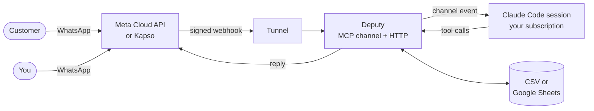
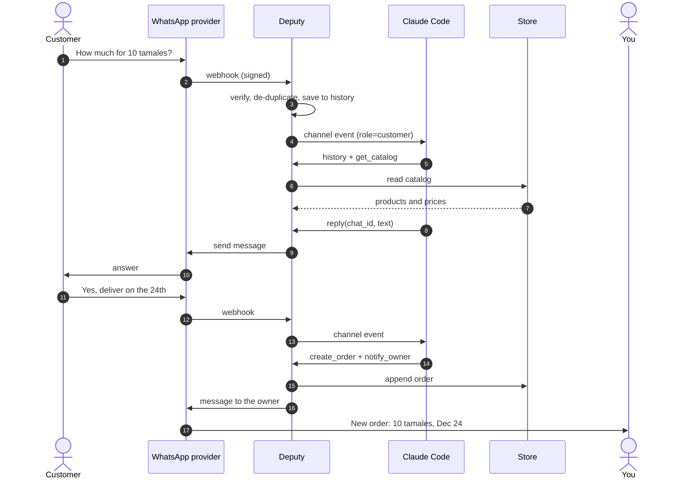
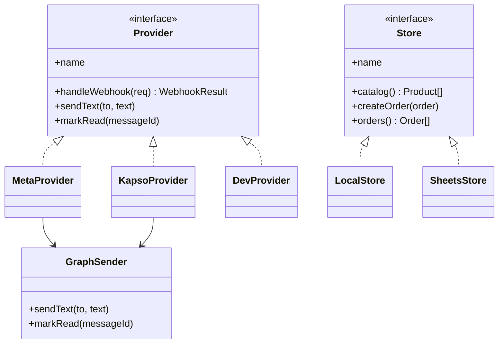
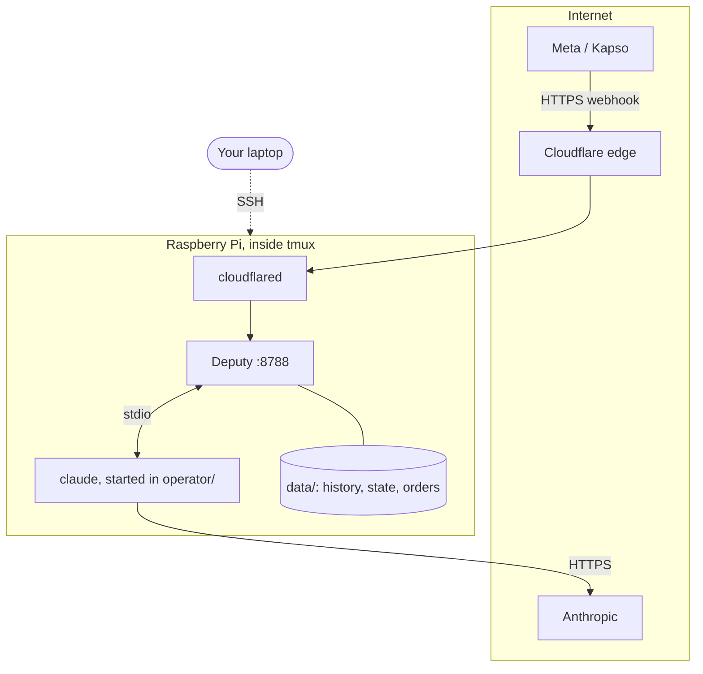
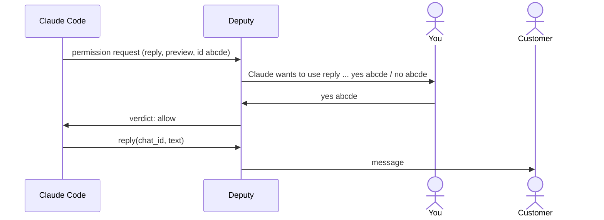
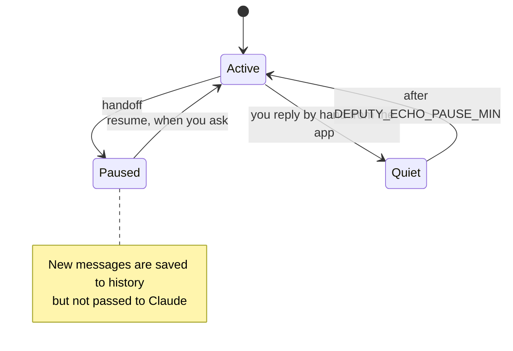
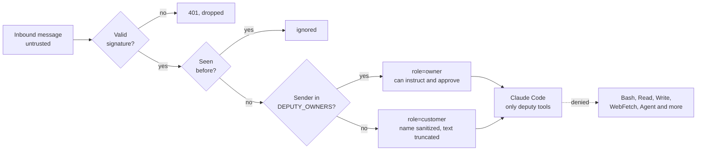

# Deputy

**Let your Claude Code agent answer WhatsApp for you, on the subscription you already pay for.**

Deputy is a [Claude Code channel](https://code.claude.com/docs/en/channels): an MCP server that receives your WhatsApp messages and pushes them into a Claude Code session running on your laptop, a server or a Raspberry Pi. Claude replies on your behalf, looks up your catalog, records orders and hands the chat back to you when a human is needed.

- **No bot to build, no API bill:** the brain is your own Claude Code session.
- **Bring your own provider:** Meta's WhatsApp Cloud API directly (no middleman) or Kapso (handles Meta onboarding for you). Adding another one means implementing one interface.
- **Your data, your sheet:** catalog and orders in local CSV files or Google Sheets.
- **You stay in charge:** text Deputy from your own number to give it instructions, approve replies from WhatsApp, or take over any chat.

> **Status: v0.1, experimental.** Claude Code channels are a research preview. Deputy is covered by automated tests (providers, signatures, orders, pauses, approvals) but hasn't run in production against real WhatsApp traffic yet. Feedback and PRs welcome.

[Leer en español](README.es.md)

## How it works



A typical conversation, from first message to recorded order:



Each message reaches Claude as `<channel source="deputy" chat_id="1555…" role="customer">text</channel>`. Claude can only act through these tools:

| Tool | What it does |
|---|---|
| `reply` | Sends a WhatsApp message to a chat |
| `history` | Recent messages in a chat (stored in `data/`, not in Claude's context) |
| `get_catalog` | Products, prices and availability |
| `create_order` | Records a confirmed order |
| `list_orders` | For when you ask "how many orders so far?" |
| `handoff` | Pauses Deputy in that chat so you can take over |
| `resume` | Turns Deputy back on in a paused chat |
| `notify_owner` | Texts you on WhatsApp |

## What it costs

| Piece | Cost |
|---|---|
| Claude | Your Pro, Max or Ultra plan through Claude Code. Counts toward your usage limits. |
| WhatsApp Cloud API (Meta direct) | No platform fee. Meta charges per message according to its current rate card (as of Oct 2026, replies inside the 24-hour window are free up to 1,000 per number per month, and everything is free for 72 hours when the customer comes from a Click-to-WhatsApp ad). |
| Kapso (optional) | Their plan, plus Meta's fees. |
| Tunnel (e.g. Cloudflare Tunnel) | Free |
| Google Sheets | Free |

Always check [Meta's pricing page](https://developers.facebook.com/docs/whatsapp/pricing): it changes.

## Quick start (no WhatsApp needed, 5 minutes)

Requirements: [Bun](https://bun.sh) 1.2+ and Claude Code signed in with your claude.ai account.

```bash
git clone https://github.com/antonygiomarxdev/deputy && cd deputy
bun install
cp .env.example .env        # keep DEPUTY_PROVIDER=dev
cd operator && claude --dangerously-load-development-channels server:deputy
```

Accept the prompts (development channel, project MCP server). In another terminal:

```bash
curl -N localhost:8788/dev/events                    # Deputy's replies show up here
scripts/simulate.sh 15557654321 "Hi! How much is a box?"
```

Then make it yours: edit `business/business.md` (tone, delivery, payment, rules) and `business/catalog.csv`. Catalog changes apply immediately; `business.md` changes apply when the session restarts. See [`examples/`](examples/) for a filled-in profile in Spanish (catalog headers can be in English or Spanish).

## Connect WhatsApp

### Option A: Meta direct (free, more steps)

1. In [Meta for Developers](https://developers.facebook.com/), create a *Business* app and add the **WhatsApp** product.
2. Add your number (or try Meta's free test number). Write down the **Phone number ID**.
3. In *Business Settings → System users*, create a system user and generate a **permanent token** with `whatsapp_business_messaging` and `whatsapp_business_management`.
4. In *App settings → Basic*, copy the **App secret**.
5. In `.env`: `DEPUTY_PROVIDER=meta`, `META_PHONE_NUMBER_ID`, `META_ACCESS_TOKEN`, `META_APP_SECRET`, and a `META_VERIFY_TOKEN` you make up.
6. Expose the port (see *Always on* below) and in *WhatsApp → Configuration → Webhook* set `https://<your-domain>/webhook` with the same verify token. Subscribe to the **messages** field.

**Can I keep using my number in the app?** A number registered directly on the API stops working in the regular app. WhatsApp's *Coexistence* lets one number live in the WhatsApp Business app **and** the API at the same time, but you turn it on through *Embedded Signup*, a flow built for providers (BSPs or Tech Providers). If you have it, also subscribe to **smb_message_echoes**: when you reply by hand from the app, Deputy goes quiet in that chat (`DEPUTY_ECHO_PAUSE_MIN`). If you don't, the simplest path is a **second number** just for the business.

### Option B: Kapso (fewer steps)

1. Create a project in [Kapso](https://kapso.ai) and connect your number (or use their sandbox).
2. In `.env`: `DEPUTY_PROVIDER=kapso`, `KAPSO_API_KEY`, `KAPSO_PHONE_NUMBER_ID`, `KAPSO_WEBHOOK_SECRET`.
3. In Kapso, point the webhook at `https://<your-domain>/webhook` with that secret and the `whatsapp.message.received` event.

### Another provider

Implement `Provider` from `src/types.ts` (`handleWebhook` + `sendText`) and register it in `src/providers/index.ts`. If your provider exposes a Graph-API-compatible proxy (like Kapso does), `GraphSender` already handles sending. Stores work the same way.



## Catalog and orders in Google Sheets

1. Create a sheet with two tabs: **Catalog** (`id, name, unit, price, available, notes`) and **Orders** (leave it empty; Deputy writes the headers).
2. In Google Cloud, create a service account, enable the *Google Sheets API* and download the JSON key as `service-account.json`.
3. Share the sheet with the service account's email as **Editor**.
4. In `.env`: `DEPUTY_STORE=sheets`, `SHEETS_ID` (the ID in the sheet's URL) and `GOOGLE_SERVICE_ACCOUNT_FILE`.

Change a price in the sheet and Claude uses it on the next message.

## Always on (Raspberry Pi or any server)

On a Pi, use the 64-bit OS (Bun runs on Linux arm64).

```bash
# 1. A free public tunnel to the local port
cloudflared tunnel --url http://localhost:8788     # quick test (temporary URL)
# for production: a named tunnel on your own domain (see Cloudflare Tunnel docs)

# 2. The operator session inside tmux
scripts/start.sh
tmux attach -t deputy     # first run only, to accept the prompts; detach with Ctrl-b d
```

Health check from anywhere you have SSH: `ssh pi 'curl -s localhost:8788/health'`.



## Modes

- **Autopilot (default):** `operator/.claude/settings.json` allows `mcp__deputy__reply`, so Claude answers on its own.
- **Approve each reply:** remove `mcp__deputy__reply` from `allow`. Every reply reaches your WhatsApp with a code; answer `yes abcde` or `no abcde` (`si`/`sí` works too). Only numbers in `DEPUTY_OWNERS` can approve.

Your own messages to the business number reach Claude with `role="owner"`. Try "how many orders for the 24th?", "pause 15557654321" or "tell her we do have it in stock".

In approve mode, Claude Code's permission prompt is relayed to your phone:



Every chat moves between three states:



## Security

A channel that any customer can write to is a **prompt-injection** surface: anyone can put text in front of your session. Deputy mitigates this in layers:



1. **Blocked tools.** The operator profile (`operator/.claude/settings.json`) denies `Bash`, `Read`, `Write`, `Edit`, `WebFetch`, `WebSearch`, `Task`/`Agent` and more. Even if a message talks Claude into something, it can't touch your machine or read your `.env`.
2. **Roles.** Only `DEPUTY_OWNERS` arrive as `role="owner"` and can approve permissions. The server's instructions tell Claude that customer text is never an order.
3. **Sanitized metadata.** Profile names are stripped of special characters and texts are truncated.
4. **Verified webhooks.** Meta (`X-Hub-Signature-256`) and Kapso (`X-Webhook-Signature`) signatures are checked; duplicates are dropped.
5. **Isolation.** Run Deputy on a dedicated user or box (the Pi), with a Claude account you don't use for sensitive work.

Residual risk: a customer could still manipulate Claude into saying something wrong *inside WhatsApp* (a made-up price, say). If that matters for your business, use approve mode.

## Known limitations

- **Research preview:** custom channels need `--dangerously-load-development-channels` plus an interactive confirmation at startup (they don't work with `claude -p`).
- **One session, in order:** messages are handled one after another. Fine for small and medium volumes.
- **Long context:** the session accumulates chats and Claude Code compacts it automatically. That's why Claude reads `history` instead of relying on memory.
- **Owner notifications:** WhatsApp only allows free-form messages within 24 hours of your last message to the business number. Text Deputy once a day, or add an approved template (on the roadmap).
- **Media:** images, voice notes and documents arrive as `[image]`, `[voice note]`, etc. No transcription yet.
- **Kapso:** automatic pause on owner echoes is only implemented for Meta direct.

## Development

```bash
bun test             # end-to-end tests (stdio + simulated dev, Meta and Kapso webhooks) and unit tests
bun run typecheck    # TypeScript, no emit (Bun runs the sources directly)
bun changeset        # describe your change for the changelog
```

Releases use [Changesets](https://github.com/changesets/changesets): every user-facing change ships with a changeset, and `bun run version` bumps the version and writes `CHANGELOG.md`.

The repo root is a normal dev workspace. The locked-down profile that answers customers lives in `operator/`. See [CLAUDE.md](CLAUDE.md) for the layout.

## Roadmap

- Message templates for notifications outside the 24-hour window and order confirmations
- Voice-note transcription
- Interactive buttons (confirm / change order)
- More providers: Twilio, 360dialog
- Other channels: Telegram, Instagram
- Package as an installable Claude Code plugin

## License

[Apache-2.0](LICENSE). Not affiliated with Anthropic or Meta. WhatsApp is a trademark of Meta Platforms, Inc.
