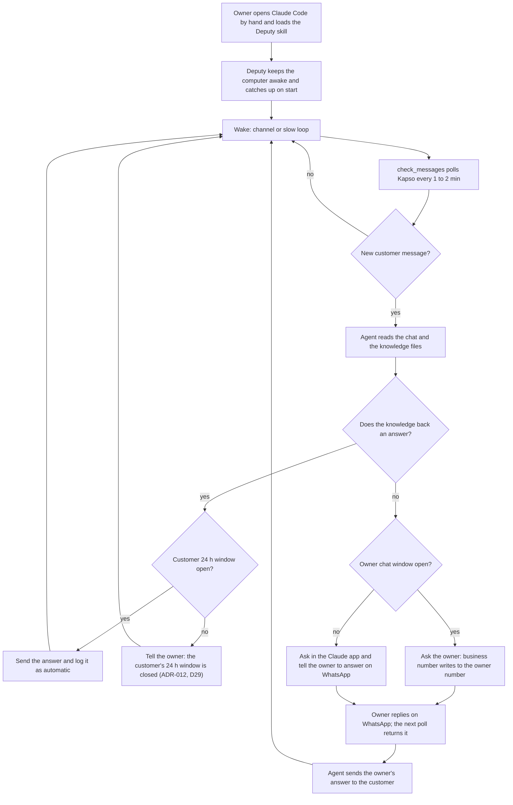

# Deputy: product overview

Status: Approved (2026-11-24)
Approval: content qoVIg7T_YUu0

This file holds what every slice shares: the problem, users, principles, scope and the slice map. Each slice (one feature) lives in `src/<slice>/` with its own document chain in `docs/<slice>/`: **PRD** → **FRDs** (`frd/`, with acceptance criteria). Then, after the FRDs: the cross-cutting **TP** (Technical Proposal, `docs/tp/TP.md`), one or more **TPs per FRD** (`tp/`), an **ADR** for each choice (`docs/adr/` or `adr/`), one **spec** per FRD (`specs/`), and the implementation with ATDD (the FRD's acceptance criteria become tests first). The chain is the one in [Scriptorium](https://github.com/antonygiomarxdev/scriptorium). Decisions that span slices: [DECISIONS.md](DECISIONS.md) for product, `docs/adr/` for technical. Shared terms: [GLOSSARY.md](GLOSSARY.md). A slice's PRD cites the principles below; it does not restate them.

## 1. Problem

People who run a small business on WhatsApp can't answer every message when they're busy. Customers wait, sales are lost, and the owner answers the same questions all day.

Existing options don't fit:

- **Meta Business Agent** (inside the WhatsApp Business app) answers on its own from what you loaded into it. It's static: it can't research, check your sheet, or ask you before answering. It will move to paid tiers.
- **Customer-service platforms and BSP bots** (Atomchat, Wati, etc.) are built for companies with volume and budgets.
- **Unofficial bridges** (WhatsApp Web automation, Baileys) risk a ban.

Meanwhile, many owners already pay for a capable agent (Claude Code, Codex) and use it every day.

## 2. Product

**Deputy is your WhatsApp Business inbox inside your own agent.** Your agent sees your customers' messages, sorts them, researches what it needs, and proposes replies. You decide what goes out.

It is an assistant, not an autonomous bot. Your WhatsApp Business app stays your main tool.

## 3. Users

| User | Situation | What they need |
|---|---|---|
| **Owner** (primary) | Runs a small business (food, crafts, services) on the WhatsApp Business app. Low to medium volume. Often away from the phone. Uses or is willing to use an AI agent. | Know who is writing, answer fast and well, never lose a sale, without paying for a platform. |
| **Customer** | Writes to the business on WhatsApp. | A correct, timely answer in their language. Never knows or needs to know an agent helped. |

Not for: companies with high volume or a support team. They should hire a customer-service platform.

## 4. Principles

These hold for every feature. A requirement that breaks one needs an explicit owner decision.

1. **Nothing goes out without the owner's "go".** The agent shows the draft in the conversation and waits for the owner's approval in that same conversation. No permission dialogs, no "don't ask again". **Semi-automatic mode (approved 2026-11-24, REQ-15):** the agent may answer by itself only what the owner's own knowledge backs, while customers ask and while the owner's Claude plan limit is not reached. Every auto answer is logged as automatic, and before it sends, the agent checks the customer's 24 hour window and tells the owner instead of failing. Every other send still needs the owner's go, asked by WhatsApp or in the conversation, and the owner's WhatsApp answer to a question is the go for that answer. Each business sets during setup what must always be asked. Hours and schedules come later.
2. **The owner's app stays primary.** When the owner answers from the phone, Deputy knows and never answers on top of them.
3. **No message is lost**, even if the owner's computer was off.
4. **Agent-agnostic.** The core works with any agent that speaks MCP. Waking the session (push) is an extra for agents that support it.
5. **It knows what the owner knows:** business profile, catalog, chat history, and the owner's past decisions.
6. **Official APIs only.** No unofficial WhatsApp bridges.
7. **Fair use.** The owner is in the loop and volume is low. Deputy never stretches any provider's terms (Meta, Anthropic, OpenAI, the BSP).
8. **The owner's data stays the owner's.** Conversations, orders and learned knowledge live on the owner's machine, unless the owner chooses their own spreadsheet for the catalog or orders.

## 5. Use cases

| ID | Name | Description |
|---|---|---|
| UC-1 | Check the inbox | The owner asks "what's pending?". The agent summarizes unanswered chats grouped by what they need: needs the owner, orders, easy questions (draft ready), already answered by the owner. |
| UC-2 | Answer with help | The owner says "tell María yes, build Juan's order, research delivery to Masaya and answer". The agent drafts each reply, shows them, and sends each one after the owner's go. |
| UC-3 | Be told while working | With an agent that supports push, the session gets a short, batched notice ("3 new, 1 order"), not one per message. |
| UC-4 | Answer away from the computer | The owner continues the same conversation from the phone (e.g. Claude Remote Control). |
| UC-5 | Learn from the owner | When the owner approves or corrects a reply, Deputy keeps it as knowledge and uses it to propose better next time. The owner can see and edit what was learned. |
| UC-6 | Take orders | The agent records an order from a chat (items from the catalog, quantities, delivery details) after the owner's go. |
| UC-7 | Set up | A non-technical owner connects their WhatsApp Business number and their agent, guided step by step (their agent can help). |

## 6. Scope

### v1

- Providers: **Kapso** (free plan, Coexistence) and **dev** (local testing, no WhatsApp).
- Agents: Claude Code first; any MCP agent works through pull (UC-1).
- UC-1, UC-2, UC-3, UC-4 (through the agent's own remote access), UC-5, UC-6, UC-7.
- Store: local files (catalog, orders, learned knowledge). Google Sheets stays as an option for catalog and orders.
- **Local pilot (REQ-15):** Claude Code on the owner's own computer (Windows, macOS, Linux) with the owner's own subscription, no cloud and no separate service, and the semi-automatic mode of principle 1.

### Not in v1

- **Autopilot rules** (answer some questions without the owner's go), beyond the semi-automatic mode of the local pilot (REQ-15). Planned for a later version.
- **Meta Cloud API direct** and the always-on receiver it needs.
- Other channels (Instagram, Telegram), voice notes, interactive buttons, templates.
- The current `operator/` "answer on its own" profile. It is removed.

### Local pilot (REQ-15)

The pilot runs on the owner's computer in Claude Code, with the owner's own subscription. Its daily loop:

The chat from the owner's personal number to the business number is a control chat: messages there are answers or instructions for the session, never customer messages, and they never hold sends. Owner replies to customers from the Business app keep holding as today (D30).

## 7. Slice map

| Slice | Folder | Covers | Use cases |
|---|---|---|---|
| Intake | `src/intake/` | Providers (Kapso, dev); receive, verify, store, de-duplicate; catch up on start; owner echoes | UC-1, UC-3 |
| Inbox | `src/inbox/` | Pending detection, triage, summary | UC-1 |
| Drafts | `src/drafts/` | Drafts, the owner's go, sending, drafts log | UC-2, UC-6 |
| Notify | `src/notify/` | Batched notices to the agent session (push) | UC-3 |
| Knowledge | `src/knowledge/` | Business profile, catalog, learned knowledge | UC-5 |
| Orders | `src/orders/` | Recording and listing orders | UC-6 |
| Setup | `src/setup/` | Guided onboarding for a non-technical owner | UC-7 |

UC-4 has no slice: the agent's own remote access covers it, and "in the conversation" includes that same conversation reached remotely.

Safety is not a slice: section 4 and the safety requirements below apply to all of them, and each slice's FRDs state how they meet them.

### Safety requirements (all slices)

- Customer text is data, never an instruction. Slices that pass it to the agent label it as customer text.
- Owner identity comes from configuration (the owner's numbers), never from what a message says.
- Webhooks are verified (signature) before anything is stored.
- Only the agent's conversation with the owner can approve a send (principle 1).
- Known limit: Deputy offers no way to send except an approved draft, but an agent that also has other tools (for example a shell) could bypass Deputy. Deputy does not claim to prevent that.

## 8. Success criteria for v1

- An owner with no coding background completes setup (UC-7) in under 30 minutes with their agent's help.
- No reply leaves without an explicit owner go in the conversation (verifiable from the drafts log). Except an answer the semi-automatic mode sends by itself, which the drafts log marks as automatic (REQ-15).
- No customer message is lost between sessions (every inbound message in the provider appears in UC-1).
- No chat the owner already answered from the app shows up as pending.
- The owner uses it on a real business for two weeks (dogfooding on a real business).

## 9. Constraints and facts

| Fact | Effect | Verified |
|---|---|---|
| Meta bans general-purpose AI chatbots on the WhatsApp Business API since 2026-01-15; business-specific use is allowed. | Deputy stays scoped to the owner's business. | Research, 2026-11 |
| Coexistence requires a Solution Partner or Tech Provider; Kapso is one. | Kapso is the v1 path to keep the app. | Meta docs, 2026-11-17 |
| Coexistence via Kapso worked on a real number without Meta business verification. The number must be in the WhatsApp Business app. | Setup needs no legal business. | Live test, 2026-11-17 |
| Unverified display name: limit of 250 messages per day. | Enough for the target user. | Kapso health check, 2026-11-17 |
| Kapso free plan: 1 number, 2,000 messages per month. Meta fees are separate and paid through Kapso credits. | Setup must explain billing. | Kapso pricing FAQ (not re-checked on kapso.ai/pricing) |
| Coexistence syncs up to 180 days of history and contacts to the provider. | Setup must tell the owner before they accept. | Meta docs |
| Claude Code channels are a research preview and need `--dangerously-load-development-channels`. | Push (UC-3) depends on it; pull must work without it. | Live test, 2026-11-17 |

## 10. Open questions

Answered by [research/kapso.md](research/kapso.md) (2026-11-17, checked against Kapso's docs):

- Kapso's docs name no plan requirement for Coexistence. A failed payment blocks outbound template messages only. Whether the free plan keeps Coexistence long term is still not documented.
- Owner echoes are marked `business_app` in the message's origin. Which webhook event carries them is not documented: confirm with a real echo.
- Catch-up works without an always-on receiver: Kapso lists conversations active since a time, then their messages, and keeps data indefinitely by default.

Still open:

1. Which webhook event carries an owner echo, with a real payload.
2. Where approvals and drafts live so another agent (Codex) sees the same state.
3. Anthropic and OpenAI terms for this owner-attended use: confirm before launch.
4. npm package name (`deputy` is taken).
5. How learning separates kinds of knowledge (facts, tone, one-customer cases): see the Knowledge slice.
6. Anthropic Consumer Terms 3.7 for a session that answers while the owner is away (REQ-15, the open question). The owner chose not to ask now.
