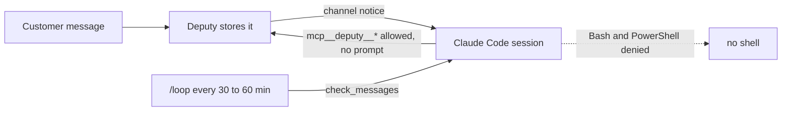

# ADR-018: Wake the session with channels and a slow loop, and pre-allow only Deputy's tools

## Status
Accepted (2026-11-24)

## Summary
The pilot wakes an idle Claude Code session in two ways: a slow `/loop` every 30 to 60 minutes, which is the reliable fallback, and a channel notice from Deputy, which is expected to wake the session at once but is unverified (events are documented as delivered on the next turn). No permission prompt may wait for the owner: the project settings allow only `mcp__deputy__*` and deny the shell tools. Two facts are not verified yet and the pilot checks them.

## Context
REQ-15 and decisions D34 (wake) and D35 (no blocking prompts), approved 2026-11-24. An open session does nothing until a turn happens, and an unanswered permission prompt stops the session when the owner is away. Evidence is in the Claude Code docs and in throwaway tests with a dummy server (Claude Code 2.1.331 on Windows): STATED means a doc page says so, TESTED means a test showed it.
- Channels push events into a running session. A custom server needs `--dangerously-load-development-channels server:deputy` at launch, which shows a consent dialog; the flag is interactive only and is a research preview (STATED). Events queue and arrive on the next turn, only while the session is open (STATED). Whether an event wakes a session that is idle is not documented (UNVERIFIED).
- `/loop` runs between turns, never mid-response, one minute at the shortest; a recurring task expires after 30 days (STATED).
- An allow rule such as `mcp__deputy__*` pre-approves the tools (TESTED); the glob works only after the literal `mcp__<server>__` prefix (STATED). A plugin cannot ship permission rules: a plugin `settings.json` did not pre-approve the tool (TESTED).
- Denying `Bash` and `PowerShell` removed both shell tools (TESTED). A tool that sets `requiresUserInteraction` forces a prompt in every mode (STATED).

## Options considered
| Option | For | Against |
|---|---|---|
| Channels only | Expected to be instant with no model turn while idle (unverified: events are documented as delivered on the next turn) | Needs the launch flag and a consent dialog; research preview; events are lost if the session is closed |
| `/loop` only | No flag; documented; survives with `--resume` | Each fire is a model turn; delay of up to the interval; self-paced loops are not restored |
| A blocking wait tool | One call waits for the next message | Calls past about two minutes go to a background task and the idle window is 30 minutes; not proven in Claude Code |

## Decision
- Wake: a shortcut the owner clicks launches Claude Code with `--dangerously-load-development-channels server:deputy`. Deputy sends its notices through the channel, batched as the notices decision designs (ADR-007); instant wake is the expected result and the pilot verifies it. A `/loop` every 30 to 60 minutes calls `check_messages` as the backup.
- Permissions: the installer writes `{"permissions":{"allow":["mcp__deputy__*"],"deny":["Bash","PowerShell"]}}` to the project settings. The owner loads the skill by typing `/deputy`, which is not a tool call, so it should raise no Skill prompt (UNVERIFIED in an interactive session; in a non-interactive run the Skill tool call itself needed permission). No Deputy tool sets `requiresUserInteraction`. The `allowed-tools` field of the skill is a second layer only: it pre-approved the tool in a non-interactive test (TESTED), but the docs do not mention MCP patterns there.
- The owner's go still travels in the conversation (principle 1); a pre-allowed tool does not approve a send, because `approve_draft` checks the owner's words itself (ADR-006).

## Consequences
- Easier: a pilot owner gets notices without watching the terminal once the channel is verified, and no prompt waits for them.
- Harder: the owner must start Claude Code from the shortcut, and the consent dialog appears the first time. An agent with other tools could bypass the guard (D11), so the shell deny rule matters.
- Unverified, and the pilot checks all of them: that a channel event wakes an idle session, that the shortcut keeps the flag and its consent across restarts, that `/loop` keeps firing after the context is compacted, and that typing the skill command raises no prompt, and that a notice written while no client listener is registered is ignored without harm (the server cannot see the launch flag, so Deputy offers the channel whenever it is on), and that a finished background helper wakes an idle main session, and that a helper's transcript carries its agent name (docs/adr/ADR-019). If the channel fails, the loop alone carries the wake (the reliable fallback); if the loop fails after compaction, the owner restarts the session.
- Watch: a loop that answers while the owner is away may count as automated use under the provider's terms; a written read is tracked in issue 144.
- Unverified, checked by the pilot: that the consent dialog of the wake option appears once, on the first launch from the shortcut, while the owner is present.
