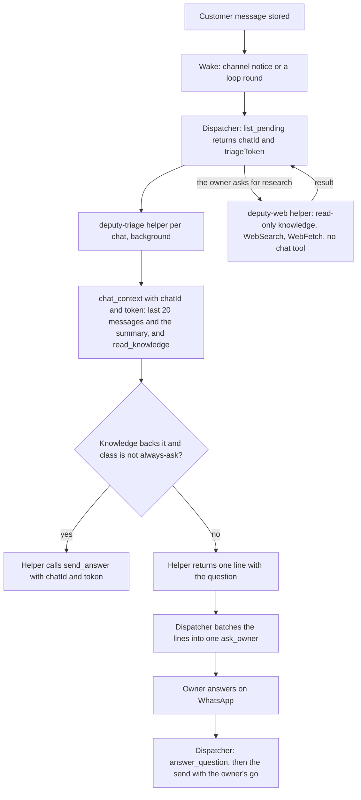

# ADR-019: The Deputy session dispatches and background helpers do the work

## Status
Proposed (2026-11-24), pending owner approval of the lead's choices marked Proposed

## Summary
The pilot's main session works like the lead of an agent team: it never blocks. It checks messages, answers quick questions, asks the owner, and hands each incoming chat to a cheap background helper. Long work the owner asks for goes to a background helper that reports back. The main session has no internet and no send tool; a helper sends only for the one chat it was given, with a token Deputy checks. Nothing here changes who may approve a send.

## Context
The owner decided on 2026-11-24 that the Deputy session works like an agent-team lead: the main session never blocks, long work (research the owner asks for, building the catalog, summaries) goes to a background helper that reports back, and there is no internet unless the owner asks. Without it one long task would stop the loop of ADR-018 and a pending chat would wait.

Facts from the researcher's report for this decision (Claude Code 2.1.x; they are not re-checked in this repository and the unverified ones are listed under Consequences):
- A session started with `--agent <name>` runs as that custom agent, and its `tools` field is an allowlist.
- A custom agent file may set `model`, `permissionMode` (`dontAsk` answers a would-be prompt with a refusal instead of asking), `omitClaudeMd`, and `tools`. An inline `mcpServers` entry for Deputy, or an empty tool set, makes the helper load every connector inline, which is costly, so neither is used.
- The folder must be trusted before the project's allow rules apply, so the install order matters.
- Helper prompts that reach a terminal break FR-SETUP-05-20, so every helper runs with `dontAsk`.

Related: ADR-018 (wake and permissions), ADR-006 (the owner's go), D11 (an agent with its own tools can pass wrong inputs), D35 (no blocking prompt in the daily loop).

## Options considered
| Option | For | Against |
|---|---|---|
| One session does everything | Nothing new to install | One long task blocks the loop; one prompt can stop it; every chat is read in the main context |
| Dispatcher plus background helpers (chosen) | The main session stays free; a cheap model reads the chat; a helper holds only the tools it needs | Helper results arrive later; whether a finished helper wakes an idle main is unverified; an agent file is installed |
| A separate process for each chat | Strong isolation | A new process and a new queue to build, and no plan cost gain |
| Deny the web tools in settings and allow them in one helper | One rule file | Deny rules also reach the helper, so the helper loses the web too; the `tools` allowlist already keeps the web out of main |

## Decision
- (a) The main session runs as the agent `deputy-dispatcher` (the shortcut passes `--agent deputy-dispatcher`). Its `tools` allowlist holds the pending list, `ask_owner`, `answer_question`, `send_owner_go` (it holds the owner's answer, so it sends with the go; nothing else does), the Knowledge tools and the agent tool. It has no web tool, no shell tool and no `send_answer`.
- (b) Each pending chat goes to a `deputy-triage` helper: model `haiku`, `permissionMode: dontAsk`, `omitClaudeMd: true`, and `tools` limited to `chat_context`, `read_knowledge` (read only) and `send_answer` (their full `mcp__deputy__` names). The helper reads the knowledge itself, because passing the files through the dispatcher's prompt would put them in the main context, which is the token cost the owner wants to avoid. When the knowledge backs an answer and its class is not in the always-ask list, the helper sends it itself; otherwise it returns one line with the question, and the dispatcher batches the lines into one `ask_owner`.
- (c) A `deputy-web` helper gets the read-only knowledge tool plus WebSearch and WebFetch with `dontAsk`, and no chat tool. It gets only what the dispatcher puts in its prompt, so customer text cannot leave through a fetched address. It runs only when the owner asks. No deny rules are written.
- (d) Helpers never call `ask_owner`. Proposed (lead's choice): only the dispatcher talks to the owner, so one numbered message carries every question.
- (e) Proposed (lead's choice): `list_pending` returns `{ chatId, triageToken }`, where the token is an HMAC of the chat id with a secret Deputy holds. `chat_context` and `send_answer` refuse a token that does not match their chat id, so a helper can read and answer only the chat it was given.
- (f) `chat_context` returns at most the last 20 messages and the stored per-chat summary. A `save_chat_summary` tool, with the same token, replaces the summary. The summary is untrusted text and is labeled so.
- (g) Proposed (lead's choice): a `token_stats` tool reads only usage, model and timestamp from the Deputy session's transcripts and returns, per day, per part (main, triage, web) and per model, the four token counts and nothing else. The transcript format is undocumented, so a change of format makes it return nothing and say so. OpenTelemetry is an option for later; it attaches email and ids by default, so it would need stripping.
- (h) Setup writes `.claude/agents/*.md` as plain files and the allow rule for `mcp__deputy__send_answer`, in an order that trusts the folder first.
- (i) The loop round also collects the results of finished helpers. Whether a finished helper wakes an idle main session is unverified and is added to the unverified list of ADR-018.
- Nothing here changes the go: a send for a customer still needs the knowledge to back it (D38) or the owner's answer as the go (ADR-018, Drafts ADR-013). The token narrows which chat a helper may touch; it does not prove the helper's text is right (D11).

## Consequences
- Easier: the main session answers the owner while helpers work; the cheap model reads chats; the web is off by construction.
- Harder: one agent file per helper is installed and kept in step with the tool names; a helper can still pass a wrong answer class to `send_answer` (D11); the token secret is a new thing to protect.
- Unverified, and the pilot checks it: that a finished helper wakes an idle main session, that `--agent` and the shortcut keep each other across restarts, the transcript format behind `token_stats`, and that a helper's transcript carries its agent name (otherwise `token_stats` reports the part as "helper").
- Answered by the lead on 2026-11-24: the dispatcher holds `send_owner_go`, and the triage helper has `read_knowledge`.
