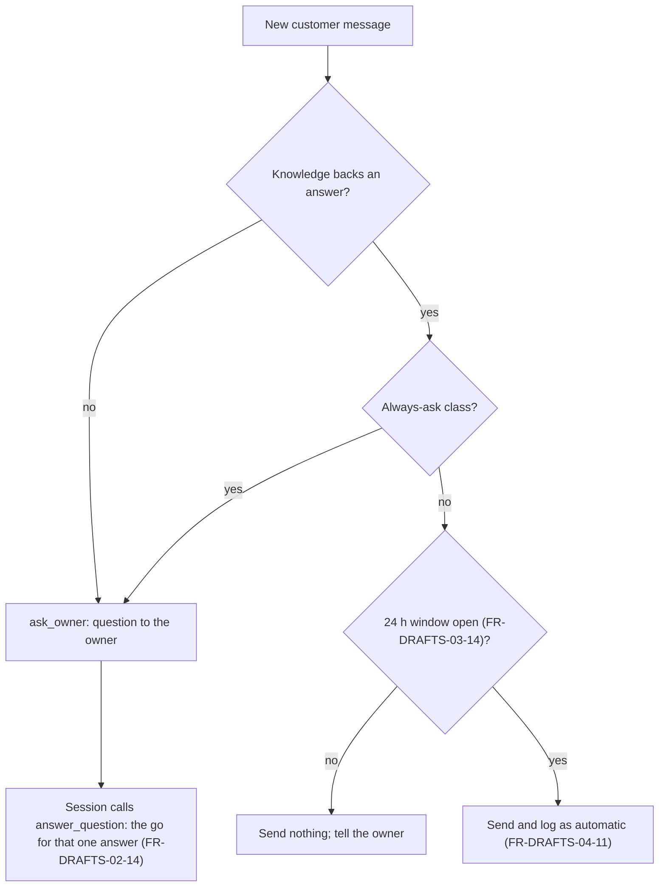

# ADR-013: The local pilot sends a knowledge-backed answer without the owner's go

## Status
Proposed (2026-11-24), pending owner approval of the REQ-15 amendments

## Context
REQ-15 and owner decision D31 (approved in PRODUCT): in the local pilot Deputy answers by itself what the business knowledge backs and asks the owner for the rest. This is an exception to R-DRAFTS-2 (never sent at creation) and R-DRAFTS-19 (a go must identify its drafts). D38 sets the always-ask classes per business.

## Decision
- An automatic send is a send with no owner go. It is allowed only when the answer's class is not in the business's always-ask list (D38). The list is Knowledge's always-ask.md (FR-KNOWLEDGE-04-1, PR #205).
- Each automatic send is logged as automatic (FR-DRAFTS-04-11).
- The 24 hour window check of ADR-012 applies to a first send too: a closed window sends nothing and tells the owner (FR-DRAFTS-03-14).
- The session maps the owner's free-text answers to the `ask_owner` questions and calls `answer_question` with `{ questionId, text }`; that call is the go for that one answer (FR-DRAFTS-02-14). Deputy does not parse which question a reply answers.
- The pilot has no daily cap and no kill switch (REQ-15).

## Flow

## Alternatives
- Keep the go on every send (principle 1 unchanged): the owner must approve each draft by hand, and a busy owner cannot use the pilot.
- A daily cap on automatic sends: rejected by the owner; a kill switch and hours come later.

## Consequences
- Easier: knowledge-backed answers go out while the owner is away.
- Harder: the guarantee of principle 1 is weakened for the pilot; the log and the always-ask list carry the evidence.
- Open: Anthropic Consumer Terms for an answer sent while the owner is away (REQ-15 Q-1).
