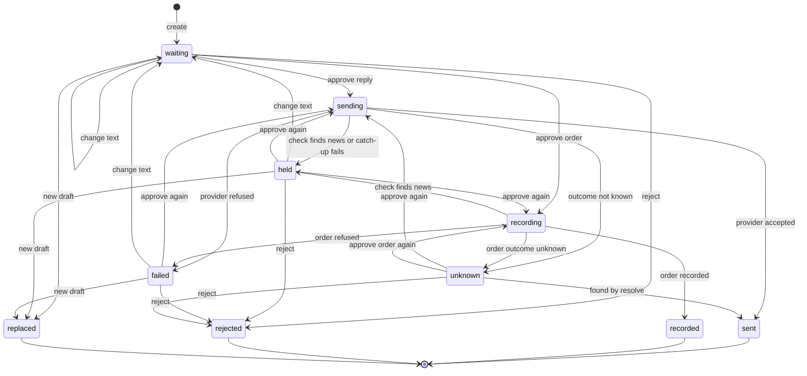

# TP-01-draft-lifecycle: Architecture

Part of [TP-01-draft-lifecycle.md](../tp/TP-01-draft-lifecycle.md). Moved verbatim from there; nothing changed.

## Architecture



Layout of `src/drafts/`:

| Folder | Holds |
|---|---|
| `domain/` | `Draft`, `Approval`, `DraftNumber`, `DraftKind`, `DraftState`, `MessageMark`, `OwnerWordsPolicy` (TP-02), `FreshnessPolicy` (TP-03), `LogEntry` and `DraftLog` (TP-04), domain events |
| `application/` | one file per use case: `CreateDraft`, `ListDrafts`, `ChangeDraft`, `RejectDraft`, `WaitingChats`, then those of TP-02 to TP-04 |
| `ports/` | the inbound ports of `index.ts`, and the outbound ports below |
| `adapters/` | `sqlite/` (repositories, unit of work), `intake/` (`ChatReader`, and TP-02 to TP-03 ports), `orders/` (`OrderPreparer`, `OrderRecorder`), `mcp` tool definitions live in `src/adapters/mcp/` and call the inbound ports |

Domain model.

- `Draft` (aggregate root). Fields:
  - `number: DraftNumber`, `kind: 'reply' | 'order'`, `chat: ChatId`, `state: DraftState`.
  - `proposedText`, `currentText` (verbatim, never trimmed or reformatted; this answers FRD-01 open question 1), `textVersion` (rises on each text change), `shownVersion: number | null`, `revision` (rises on every save; TP-02).
  - `madeAt`, `dev: boolean` (the world it was made in), `answers: MessageMark | null`, `basis: MessageMark`, `checkedThrough: { sentAt, storedAt }` (TP-03), `pendingChoice: boolean` (TP-03), `holdReason`, `failReason`, `orderPayload: string | null`, `orderId: string | null`.
  - `approval: Approval | null` (the live approval, TP-02).
- `MessageMark = { messageId: MessageId; sentAt: Instant }`.
- Invariants: text non-empty after trimming; one open draft per `(chat, kind)` where open means waiting, held, failed, unknown, sending or recording (the approved state is transient); a draft in "sending" or "recording" cannot be replaced, changed or rejected; a draft in "unknown" cannot be replaced or changed; a closed draft (sent, recorded, rejected, replaced) accepts nothing; the number never changes.
- Methods return domain events and change nothing outside the aggregate: `Draft.propose(...)`, `changeText(text, words, now)`, `reject(words, now)`, `replaceBy(number, now)`, `markShown()`, and those of TP-02 and TP-03 (`approve`, `startSending`, `hold`, `finishSent`, `finishFailed`, `finishUnknown`).
- Events: `DraftProposed`, `DraftReplaced`, `TextChanged`, `DraftRejected`, `ApprovalVoided` (TP-02), `DraftHeld`, `OwnerChose`, `SendStarted`, `DraftSent`, `SendFailed`, `OutcomeUnknown`, `OrderRecorded`. Each carries the draft number, chat and time. The use case turns them into log entries (TP-04) in the same transaction.
- Voiding rule: `changeText`, `reject` and `replaceBy` void a live approval and emit `ApprovalVoided` (FR-DRAFTS-01-5, FR-DRAFTS-01-7).

Use cases (inbound ports, in `ports/` and re-exported by `index.ts`):

```ts
type OrderInput = Readonly<Record<string, unknown>>; // validated by Orders' PrepareOrder

interface CreateDraft {
  run(input:
    | { kind: 'reply'; chat: string; text: string }
    | { kind: 'order'; chat: string; order: OrderInput }
  ): Promise<CreateDraftResult>;
}
type CreateDraftResult = {
  number: number; kind: 'reply' | 'order'; state: 'waiting';
  text: string;                       // exactly what would be sent (order: Orders' summary)
  answers: MessageView | null;
  replaced: { number: number; state: 'waiting' | 'held' | 'failed' } | null;
};
// Errors: NotOwner, ChatNotFound, NoCustomerMessage, DevMessagesOnly, EmptyText,
//         OrderRejected(reasons), SendInProgress(number), OutcomeUnknownOpen(number)

interface ListDrafts {
  run(input: { chat?: string }): Promise<DraftView[]>;
}
type DraftView = {
  number: number; kind: 'reply' | 'order'; chat: string; state: DraftState;
  text: string; madeAt: string; answers: MessageView | { unavailable: true } | null;
  catalogChanged: boolean; holdReason: string | null; failReason: string | null;
  fromEarlierSession: boolean;        // D25: madeAt is before this session started
  retryAt: string | null;             // TP-03: a rate-limited send waits until then
};
// Lists drafts in waiting, held, failed, unknown, sending and recording; closed drafts are not listed.

interface ChangeDraft {
  run(input: { number: number; text?: string; order?: OrderInput; ownerWords: string }): Promise<ChangeDraftResult>;
}
type ChangeDraftResult = { number: number; state: 'waiting'; approvalVoided: boolean };
// Errors: NotOwner, DraftNotFound, DraftClosed(state), SendInProgress, OutcomeUnknownOpen,
//         EmptyText, OrderRejected, WrongKind (text on an order, or order on a reply)

interface RejectDraft {
  run(input: { number: number; ownerWords: string }): Promise<{ number: number; state: 'rejected' }>;
}
// Errors: NotOwner, DraftNotFound, DraftClosed(state), SendInProgress

interface WaitingChats {
  run(): Promise<WaitingChat[]>;
}
type WaitingChat = { number: number; kind: 'reply' | 'order'; chat: string; writtenAt: string;
                     state: 'waiting' | 'held' | 'failed' | 'unknown';
                     earlierSession: boolean };   // D25: made before this session started
// approved, sending and recording are reported as "waiting"; no draft text is returned (FR-DRAFTS-01-4).
```

`MessageView = { id, sentAt, text, source }`. The MCP adapter wraps `text` in a labeled block (cross-cutting Interfaces).

`CreateDraft` flow: lease check; `ChatReader.describe(chat)`; read the clock first, then ask Intake (so `checked_stored_at` is earlier than anything Intake can already hold, and a late echo stored in between still counts as new); refuse when the chat is unknown, has no customer message, or (when `activeWorldIsDev` is false) has no non-dev message; for an order, `OrderPreparer.prepare`; then one unit of work: load the open draft of the same kind; refuse if it is sending, recording or unknown; `nextNumber`; `Draft.propose`; replace the old one (events `DraftReplaced`, `ApprovalVoided` when it had one); save both; append the log entries.

`ChangeDraft` on an order draft calls `OrderPreparer.prepare` again with the new order and stores the new summary and payload.

Drafts never calls Knowledge. For an order draft, `ListDrafts` sets `catalogChanged` from `OrderPreparer.revalidate(payload)`, which compares the snapshotted item prices. The "catalog changed since this draft" mark for every draft, reply or order (FR-KNOWLEDGE-01-14), is composed by the `list_drafts` MCP adapter: it calls `ListDrafts`, then Knowledge's `CatalogChangedSince({ since: [each draft's madeAt] })` once, and merges the answers into the tool result (cross-cutting Interfaces; Knowledge TD-8). `changed: true` is the mark; `'unknown'` (the catalog is unreachable or has no baseline) shows the code `catalog_check_unavailable` and no mark, so the agent tells the owner to check the prices itself. The mark is set when either source says changed.

`ListDrafts` wraps every customer-derived field in `<customer_text>` after escaping with the shared helper `src/adapters/mcp/customer-text.ts` (it escapes `&`, `<` and `>`; Inbox's `get_chat` and Inbox's tools use the same one). Those fields are the message answered and the draft text, which may carry customer words (FR-INBOX-02-10).

Outbound ports for this TP (the others are in TP-02 and TP-03):

```ts
interface DraftRepository {                       // all methods take part in the UnitOfWork
  nextNumber(): Promise<DraftNumber>;
  get(number: DraftNumber): Promise<Draft | null>;
  openFor(chat: ChatId, kind: DraftKind): Promise<Draft | null>;
  listOpen(filter?: { chat?: ChatId }): Promise<Draft[]>;
  save(draft: Draft): Promise<void>;              // throws StaleDraft (TP-02)
  hasDraftText(normalized: string): Promise<boolean>; // TP-02
}
interface UnitOfWork {
  run<T>(work: (tx: { drafts: DraftRepository; approvals: ApprovalRepository; log: DraftLogRepository }) => Promise<T>,
         options?: { requireLease?: boolean }): Promise<T>;
}
interface ChatReader {
  describe(chat: ChatId): Promise<ChatInfo | null>;   // null when unknown
  message(chat: ChatId, id: MessageId): Promise<ChatMessage | null>;
  messagesSince(chat: ChatId, since: { sentAt: Instant; storedAt: Instant }): Promise<ChatMessage[]>; // TP-03
}
type ChatInfo = { hasCustomerMessage: boolean; hasNonDevMessage: boolean;
                  activeWorldIsDev: boolean;   // Intake: is the active provider dev (requested addition to ChatExists)
                  latestCustomer: ChatMessage | null; latest: ChatMessage | null };
type MessageSource = 'customer' | 'owner_app' | 'sent_through_deputy';   // Intake's names
type ChatMessage = { id: MessageId; sentAt: Instant; storedAt: Instant; source: MessageSource;
                     text: string; dev: boolean; history: boolean };   // text is Intake's readerText
interface OrderPreparer {
  prepare(chat: ChatId, order: OrderInput): Promise<
    | { ok: true; payload: string; summary: string }
    | { ok: false; reasons: string[] }>;
  revalidate(payload: string): Promise<{ catalogChanged: boolean }>;
}
interface Clock { now(): Instant }                // shared kernel
interface OwnerLease { isOwner(): boolean }       // shared kernel
```

`ChatReader` is implemented by an adapter that calls Intake's published `ChatExists` and `ReadChat` (signatures from the Intake TP: `ChatExists({chat}) -> {exists, hasNonDevMessage}`, `ReadChat({chat, limit?}) -> ChatView | null`; times are `Instant` epoch milliseconds, which the adapter converts to the ISO text Drafts stores; `describe` combines both calls; `messagesSince` calls `ReadChat({ chat, limit: 50, storedSince })`, which returns the newest 50 by sent order plus every message stored at or after `storedSince`, so a late echo with an old sent time is never cut off; it needs `storedAt` on each message). `OrderPreparer` calls Orders' `PrepareOrder`. `revalidate` is an addition to Orders' surface that the lead should confirm. `ChatInfo.activeWorldIsDev` is a requested addition to Intake's `ChatExists` result: it lets Drafts apply FR-DRAFTS-01-8 and filter messages by the draft's world without knowing a provider name.
