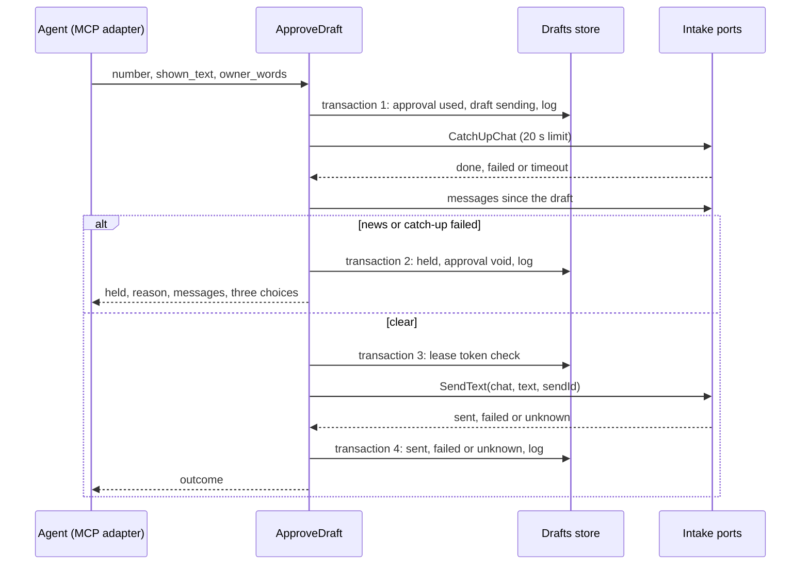

# TP-03-safe-send: Architecture

Part of [TP-03-safe-send.md](../tp/TP-03-safe-send.md). Moved verbatim from there; nothing changed.

## Architecture



Transaction 1 is step 2 of TP-02. The steps here:

3. `ChatFreshness.catchUp(chat, 20000)` (20 seconds: the 15-second request timeout of Intake plus 5 to store, and far under the 60-second tool timeout of the agents checked, so the owner is not left waiting on a hung tool). Not fresh: hold with reason `catch_up_failed` or `catch_up_timeout`. Marks do not move. Intake's `waitMs` only bounds the wait for a shared run, so the adapter also enforces the 20 seconds in total (a race against a timer); a lost race is `catch_up_timeout` and the Intake work that continues is harmless.
4. `ChatReader.messagesSince(chat, { sentAt: checked_sent_at, storedAt: checked_stored_at })`, then `FreshnessPolicy.evaluate(messages, draft.dev)`. Only messages whose `dev` flag equals the draft's `dev` count (the draft learns its world at creation, TP-01), so the dev provider holds like any other. Reasons: `owner_answered` (a new message with source `owner_app`), `customer_wrote` (a new `customer` message), `unattributed_echo` (the `fresh` result of step 3 carries Intake's `unattributedStoredAt`, the time of the newest owner echo it could not tie to a chat; when it is later than `checked_stored_at`, in any chat, every send holds). Any of them holds. The hold moves both marks to the newest message seen (for `unattributed_echo`, the stored mark moves to `unattributedStoredAt`).
5. Transaction 3 checks the lease token and that the draft is still "sending" with the same revision. Then `Sender.send`. Then transaction 4.

Hold (transaction 2): `Draft.hold(reasons, seen)` sets "held", `pending_choice = 1`, `shown_version = null`, voids the approval (`void_reason = 'held'`), and the use case appends `approval_voided` and `held` entries. The result carries the reasons, the new messages (the agent shows them: FR-DRAFTS-03-5) and the three choices.

After a hold, a new go is an ordinary `approve_draft` (TP-02). It needs `list_drafts` first because `shown_version` is cleared. The check runs again and sees only messages newer than the moved marks. "Send as is" after a customer-only hold needs the draft number in the words like every go (FR-DRAFTS-03-11). The same happens after "failed" and "unknown": `shown_version` is cleared so a fresh list is required before a new go (FR-DRAFTS-03-7).

Outcome (transaction 4):
- Accepted: `Draft.finishSent`, state "sent", log `sent` pointing to the approval entry (TP-04).
- Failed: state "failed", `fail_reason` from a fixed set, log `failed`. The approval stays used. A retry is a new go (FR-DRAFTS-03-7).
- Unknown (connection dropped after the request; a split reply that sent only some parts; any result Intake does not call sent or failed): state "unknown", log `unknown`, and the owner is told. No retry (FR-DRAFTS-03-8).
- A provider message that the owner will see is never taken from the provider's text: reasons come from fixed sets.

Fixed reasons (codes with an English default text, never a provider body, cross-cutting threat model). D20: Deputy returns the code and the English default; it ships no other language. The server instructions tell the agent to say the reason to the owner in the owner's language. A test checks that each code has a default text, and that a result carries the code next to the text, so an agent can translate from the code.

| Code | English default text |
|---|---|
| `catch_up_failed` | "I could not check the chat, so I held the send." |
| `catch_up_timeout` | "Checking the chat took too long, so I held the send." |
| `owner_answered` | "You already answered this chat from the app." |
| `customer_wrote` | "The customer wrote again after this draft." |
| `fail_not_reachable` | "The provider could not be reached. Nothing was delivered." |
| `fail_credentials` | "The provider refused the key. Nothing was delivered." |
| `send_queued` | "The provider asked to slow down. Nothing was delivered. I will retry at 2026-11-18T14:05:00Z and check the chat again first." (the time is ISO UTC and the agent renders it in local time, D20, L7; a status, not a failure; the log records it as a `sending` entry with reason `send_queued`) |
| `fail_window_closed` | "The provider asked to wait until 2026-11-18T14:05:00Z, which is after WhatsApp's 24-hour window for this customer closes. Nothing was delivered. The customer must write first, then draft again." |
| `draft_changed` | "The draft changed after you approved it, so I held the send. Say go again if it is still right." |
| `fail_rejected` | "The provider refused this message. Nothing was delivered." (also the code for a provider `quota` failure, with reason `quota` in the log, L7) |
| `unattributed_echo` | "I found a reply from your number that I cannot match to any chat, so I stopped every send to be safe. Open WhatsApp and see which customer you answered. If that customer is waiting here, drop or change the draft. Then say send as is." |
| `unknown_outcome` | "I cannot tell if it was delivered. Check the chat before you decide." |
| `unknown_partial` | "Part 2 of 3 failed after part 1 was delivered. Check the chat." (numbers filled in; used only when `partsSent` is 1 or more) |
| `unknown_first_part` | "The first part may not have been delivered. Check the chat before you decide." (`partsSent` is 0) |

Recovery of interrupted work:
- On every lease acquisition (at start, and when a process takes over from a dead owner), before the scheduler starts, `main.ts` runs `RecoverInterrupted`, then a catch-up, then `ResolveUnknownSends`, then `RedriveRecording`. Without this a draft left "sending" by a dead owner would stay wedged, because a "sending" draft cannot be changed, rejected or replaced.
- `RecoverInterrupted` (owner process only): every draft in "sending" with no `retry_at` becomes "unknown" with a log entry (reason `session_ended`). Every draft in "recording" is passed to `RedriveRecording`.
- `RedriveRecording`: calls `RecordOrder` again. It is idempotent (Orders keys it by install and draft number), so it is safe. On success the draft becomes "recorded"; on a refusal it becomes "failed"; on `outcome_unknown` it becomes "unknown" with reason `order_outcome_unknown`, the owner is shown it as unknown, and Deputy never calls `RecordOrder` for it again by itself: only the owner's go on that draft (`approve_draft` accepts an unknown draft) calls it again, and Orders starts with its lookup, so no second order is made.
- `ResolveUnknownSends` runs after the first catch-up at start and after every `CatchUpFinished` that stored messages. For each reply draft in "unknown" it takes the latest approval and calls `OutgoingFinder.find({ chat, since: approvedAt, text, sendId })`. One match: Intake links it to the send id, the draft becomes "sent" and the log gets a `sent` entry (reason `found_after_unknown`). None or several: nothing changes, so a later run tries again (FR-DRAFTS-03-13). Only a failure the provider reported is "failed". Intake widens `since` by `OUTGOING_SKEW = 120 s` (one constant, stated in Intake TP-04) to cover the clock difference between Deputy and the provider; Drafts passes the approval time as is.

Outbound ports for this TP:

```ts
interface ChatFreshness {                // calls Intake CatchUpChat({ chat, waitMs })
  catchUp(chat: ChatId, waitMs: number): Promise<
    | { kind: 'fresh'; unattributedStoredAt: Instant | null }   // from ChatStateView
    | { kind: 'failed'; reason: 'unreachable' | 'credentials' | 'quota' | 'usage_limit' | 'timeout' | 'storage' }
    | { kind: 'refused'; reason: 'not_owner' }>;
}
interface Sender {                       // calls Intake SendText; used only by ApproveDraft
  send(chat: ChatId, text: string, sendId: string): Promise<
    | { kind: 'sent' }
    | { kind: 'failed'; reason: 'credentials' | 'unreachable' | 'quota' | 'rejected' | 'unsupported_chat' }
    | { kind: 'rate_limited'; retryAt: Instant }   // nothing delivered; D29, TD-3
    | { kind: 'unknown'; partsSent: number; partsTotal: number }
    | { kind: 'refused'; reason: 'not_owner' }>;
}
interface OutgoingFinder {               // calls Intake FindOutgoing; Intake links a match to sendId
  find(input: { chat: ChatId; since: Instant; text: string; sendId: string }): Promise<
    | { kind: 'found' }
    | { kind: 'none' }
    | { kind: 'ambiguous' }
    | { kind: 'partial'; found: number; expected: number }
    | { kind: 'refused'; reason: 'not_owner' }>;
}
```

`ChatReader.messagesSince` is in TP-01. The adapter returns messages of the chat that are not dev, ordered by sent time then arrival, with `source`, `sentAt`, `storedAt`, `history`.

Retry queue (TD-3). New outbound port and constant:

```ts
interface RetryScheduler {               // one timer per chat; adapter uses the Clock port's sleep, never setTimeout in a use case
  schedule(chat: ChatId, draft: number, at: Instant): void;   // replaces the chat's timer
  cancel(chat: ChatId): void;
}
const CUSTOMER_WINDOW_MS = 24 * 60 * 60 * 1000;   // WhatsApp's customer service window
```

`ApproveDraft` step 5 on `rate_limited`: if `retryAt` is after `latestCustomer.sentAt + CUSTOMER_WINDOW_MS`, transaction 4 ends in "failed" with `fail_window_closed`; otherwise transaction 4 stores `retry_at = retryAt` and `attempts + 1`, keeps the state "sending", logs `send_queued` and calls `RetryScheduler.schedule`. The result is `{ queued: true, retryAt }` with the `send_queued` text. `RetrySend` is the use case the timer calls. It reuses the approve pipeline (the one send function of `ApproveDraft`, L7) and does not copy it: the lease check, the draft check (`draft_changed`), the window check, steps 3 and 4, and then step 5 and the outcome with the new send id. A queued send is logged as `sending` with reason `send_queued`. Holds and failures publish `SendNeedsOwner { reason, at }` (a signal in `src/shared/signals.ts`, with no chat and no text; L8) after the commit, with `reason` `held_after_retry` (a hold), `window_closed` (`fail_window_closed`) or `retry_failed` (any other retry that ends unsent, L7); Notify turns it into a notice. The queue is rebuilt at start by `RecoverInterrupted` from the drafts with `retry_at` set.

Domain additions: `Draft.queueRetry(retryAt, now)`, `Draft.failWindowClosed`; `FreshnessPolicy.evaluate(messages, marks)` returns `{ ownerAnswered: ChatMessage[]; customerWrote: ChatMessage[]; newestSeen: { sentAt; storedAt } }`; `Draft.hold`, `Draft.finishSent`, `Draft.finishFailed`, `Draft.finishUnknown`, `Draft.recover`.

Inbound ports added:

```ts
interface RetrySend           { run(input: { draft: number }): Promise<'sent' | 'queued' | 'held' | 'failed' | 'unknown' | 'skipped'> }
interface ResolveUnknownSends { run(): Promise<{ resolved: number; stillUnknown: number }> }
interface RecoverInterrupted  { run(): Promise<{ toUnknown: number; redriven: number }> }
interface RedriveRecording    { run(): Promise<{ recorded: number; failed: number; unknown: number }> }
```

Called by the scheduler adapter and `main.ts` (start order: lease, `RecoverInterrupted`, catch-up, `ResolveUnknownSends`, `RedriveRecording`), and by the `CatchUpFinished` subscription.
