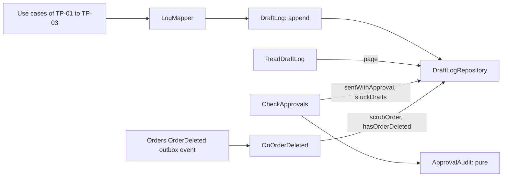

# Technical Proposal: The drafts log (Drafts FRD-04)

Status: Approved (2026-11-18). Follows the cross-cutting TP (`docs/tp/TP.md`) and builds on TP-01 to TP-03, whose events become log entries. "Cross-cutting TD-n" means a decision there.

## Context

Fixed by the cross-cutting TP, so not decided again:
- The log is the `drafts_log` table in the one SQLite file. Triggers reject UPDATE and DELETE, with one narrow exception for the order scrub of L6 and D15 (cross-cutting TD-3).
- A log entry is written in the same transaction as the state change it records (the send step, cross-cutting TD-6). If the write fails, the change does not happen, and nothing is sent, because the provider is called only after the transaction commits.
- The scrub is one named function in Drafts. It runs when Drafts handles Orders' `OrderDeleted` outbox event, idempotently, in a Drafts-only transaction (cross-cutting TD-3).
- The lesson MCP adapter reads the log through Drafts' `ReadDraftLog` and hands the entries to Knowledge, which imports nothing of Drafts; Drafts never pushes (FR-DRAFTS-04-3).
- The tools are `drafts_log` and `check_approvals`.

Decisions here: how a sent entry is tied to its approval, how the log is paged, and how the trigger limits the scrub.

Two points beyond the FRD text, flagged for the lead:
- The order scrub must also clear order text kept elsewhere in Drafts, or "no personal data about the order remains" would be false: `drafts.current_text`, `drafts.order_payload` and `approvals.text` of the order's drafts become "deleted" in the same Drafts transaction. The draft rows stay, so numbers are never reused.
- Order log entries hold no draft text at all (a CHECK enforces it), which meets FR-DRAFTS-04-9. Reply entries hold proposed and final text.

## Requirements served

FR-DRAFTS-04-1, FR-DRAFTS-04-2, FR-DRAFTS-04-3, FR-DRAFTS-04-4, FR-DRAFTS-04-5, FR-DRAFTS-04-6, FR-DRAFTS-04-7, FR-DRAFTS-04-8, FR-DRAFTS-04-9, FR-DRAFTS-04-10.

## Decisions

### TD-1: How is a sent entry tied to its approval?

- **Option A** Each entry after an approval carries `approval_entry_id`, the id of the `approved` entry that started the attempt. `CheckApprovals` reports a sent entry with no pointer, a wrong pointer, a text that differs from the approved text, or an approval shared by two sent entries. Cost: every writer passes the pointer. Risk: a forgotten pointer shows as a defect (a loud error, which is wanted).
- **Option B** No stored link. At check time, find the latest `approved` entry before each `sent` entry of the same draft. Cost: no extra column. Risk: when a draft is approved twice it cannot show "exactly one", and a missing approval looks like a wrong one.

Chosen: Option A, because FR-DRAFTS-04-4 says "points to exactly one approval entry" and only a stored pointer can be checked. Recorded in ADR-008.

### TD-2: How is the log paged?

- **Option A** By entry id: `before` for the owner paging back, `after` for the lesson MCP adapter reading forward. Ordering uses the id, never the time. Cost: one cursor value. Risk: none known.
- **Option B** Offset and limit, ordered by time. Cost: simplest to write. Risk: a new entry shifts the pages while the owner reads back, and two events in the same second can swap.

Chosen: Option A. Recorded in ADR-009.

### TD-3: How does the trigger limit the scrub?

- **Option A** The `BEFORE UPDATE` trigger allows only one change: `scrubbed` 0 to 1 with `owner_words` unchanged or "deleted", every other column equal, on an order row. DELETE always aborts. Cost: a long trigger condition. Risk: a new column must be added to it (the safe error).
- **Option B** Keep order owner words in a side table, delete the row on scrub, and make the log table fully immutable. Cost: a join on every read and a second place a word can sit. Risk: it departs from the exception that D15 and cross-cutting TD-3 describe.

Chosen: Option A, because it is the exception the owner accepted, and the schema shows it. Recorded in ADR-010.

## Architecture



Domain (`src/drafts/domain/`):
- `LogEntry` (value object): `id`, `at`, `kind`, `draft`, `draftKind`, `chat`, `proposedText`, `finalText`, `reason`, `ownerWords`, `approvalEntryId`, `sendId`, `orderRef`, `scrubbed`.
- `DraftLog` (aggregate): append-only. The only operations are `append(entries)` and, for the scrub, `scrubOrder`. No update, no delete method exists.
- `LogKind`: `proposed`, `replaced`, `text_changed`, `approved`, `approval_voided`, `rejected`, `held`, `owner_choice`, `sending`, `sent`, `failed`, `unknown`, `recorded`, `order_command`, `order_deleted`.
- `LogMapper`: turns each draft event (TP-01 to TP-03) into one entry. The use case appends the entries and saves the draft in one unit of work.
- `ApprovalAudit` (pure): given `sent` entries with their approval entries and the list of drafts in "sending" or "unknown", returns defects and gaps (ADR-008).

Use cases (inbound ports):

```ts
interface ReadDraftLog {
  run(input: { chat?: string; limit?: number; before?: number; after?: number }):
    Promise<{ entries: LogEntryView[]; nextBefore: number | null }>;
}
// limit 1..100, default 20 (about 3k to 6k tokens, ADR-009); max 100 (about 15k to 30k tokens). Without `after`: newest first, entries with id < before.
// With `after`: oldest first, entries with id > after (the lesson MCP adapter). Not owner-gated (a read).

interface CheckApprovals {
  run(): Promise<{
    defects: { entryId: number; draft: number; chat: string;
               problem: 'no_approval' | 'wrong_approval' | 'approval_after_sent'
                      | 'text_differs' | 'approval_shared' }[];
    gaps: { draft: number; chat: string; state: 'sending' | 'unknown'; since: string }[];
  }>;
}

interface OnOrderDeleted {                         // handler of Orders' OrderDeleted outbox event
  run(event: { eventId: string; orderId: string; draftNumber: number | null; chat: string }):
    Promise<{ scrubbed: number }>;
}
```

`LogEntryView` carries `id`, `at`, `kind`, `draft`, `chat`, `proposedText`, `finalText`, `reason`, `ownerWords`, `scrubbed` and `answersMessageId: string | null`. `answersMessageId` is set for `approved` and `rejected` entries of a reply draft (the customer message the draft answered, so Knowledge can find the exact source of a lesson) and is null for every other entry and for order drafts. It is read at query time from `drafts.answers_message_id` by the entry's draft number (ADR-002); the log table gains no column, and the reference is an id, not customer text, so the order scrub (L6) leaves it. The MCP adapter wraps texts and words in labeled blocks.

Outbound ports for this TP:

```ts
interface DraftLogRepository {                     // takes part in the UnitOfWork
  append(entries: NewLogEntry[]): Promise<number[]>;     // ids in order; fails the whole transaction on error
  page(filter: { chat?: ChatId; before?: number; after?: number; limit: number }): Promise<LogEntry[]>;
  sentWithApproval(): Promise<{ sent: LogEntry; approval: LogEntry | null }[]>;
  stuckDrafts(): Promise<{ draft: number; chat: string; state: 'sending' | 'unknown'; since: string }[]>;
  scrubOrder(orderId: string, draftNumber: number | null): Promise<number>; // the one update path
  approvalEntryIdFor(sendId: string): Promise<number | null>;  // the `approved` entry with that send id; a retry or a link finds its pointer (L7)
  hasOrderDeleted(orderRef: string): Promise<boolean>;         // an `order_deleted` entry exists; makes the scrub idempotent (L7)
}
```

Flows:
- Every use case of TP-01 to TP-03 appends its entries inside its unit of work. `approved` is appended first; its id is passed to `sending`, `sent`, `held`, `failed`, `unknown` and `recorded`.
- A log that cannot be written stops the action: the unit of work rolls back, the use case returns `LogUnavailable`, and nothing is sent. The "sending" entry is written before the provider is asked (transaction 1 of TP-03).
- A `sent` entry that cannot be written after the provider accepted: the use case retries transaction 4 three times (now, 1 second, 3 seconds). If it still fails it returns `sent` with `logged: false`, tells the owner, never sends again, and a scheduler task retries every 10 seconds while the process lives. The draft stays "sending", which `CheckApprovals` lists as a gap. If the process ends, `RecoverInterrupted` turns it into "unknown" and `ResolveUnknownSends` links the message and writes `sent` (TP-03).
- `OnOrderDeleted`: in one Drafts-only transaction, `scrubOrder` sets `scrubbed = 1` and `owner_words = 'deleted'` on entries with that `order_ref` or that `draft_number` (and `order_command` entries of that order), sets `drafts.current_text`, `drafts.proposed_text`, `drafts.current_norm`, `drafts.proposed_norm`, `approvals.text`, `approvals.owner_words` and `approvals.text_hash` of that order's drafts to "deleted", clears `drafts.order_payload`, and appends one `order_deleted` entry (once; a second run finds it with `hasOrderDeleted` and does nothing). Log times are ISO-8601 UTC text (L7).

## Information

```sql
CREATE TABLE drafts_log (
  id                INTEGER PRIMARY KEY AUTOINCREMENT,
  at                TEXT NOT NULL,
  kind              TEXT NOT NULL CHECK (kind IN
    ('proposed','replaced','text_changed','approved','approval_voided','rejected','held',
     'owner_choice','sending','sent','failed','unknown','recorded','order_command','order_deleted')),
  draft_number      INTEGER REFERENCES drafts(number),
  draft_kind        TEXT CHECK (draft_kind IN ('reply','order')),
  chat              TEXT NOT NULL,
  proposed_text     TEXT,
  final_text        TEXT,
  reason            TEXT,
  owner_words       TEXT,
  approval_entry_id INTEGER REFERENCES drafts_log(id),
  send_id           TEXT,
  order_ref         TEXT,
  scrubbed          INTEGER NOT NULL DEFAULT 0,
  CHECK (draft_number IS NOT NULL OR order_ref IS NOT NULL),
  CHECK (draft_kind IS NOT 'order' OR (proposed_text IS NULL AND final_text IS NULL))
);
CREATE INDEX drafts_log_by_chat  ON drafts_log (chat, id);
CREATE INDEX drafts_log_by_draft ON drafts_log (draft_number, id);
CREATE INDEX drafts_log_by_order ON drafts_log (order_ref);

CREATE TRIGGER drafts_log_no_delete BEFORE DELETE ON drafts_log
BEGIN SELECT RAISE(ABORT, 'drafts_log is append-only'); END;

CREATE TRIGGER drafts_log_scrub_only BEFORE UPDATE ON drafts_log
WHEN NOT (
      OLD.scrubbed = 0 AND NEW.scrubbed = 1
  AND (NEW.owner_words IS OLD.owner_words OR NEW.owner_words = 'deleted')
  AND (OLD.draft_kind = 'order' OR OLD.kind IN ('order_command','order_deleted'))
  AND NEW.id IS OLD.id AND NEW.at IS OLD.at AND NEW.kind IS OLD.kind
  AND NEW.draft_number IS OLD.draft_number AND NEW.draft_kind IS OLD.draft_kind
  AND NEW.chat IS OLD.chat AND NEW.proposed_text IS OLD.proposed_text
  AND NEW.final_text IS OLD.final_text AND NEW.reason IS OLD.reason
  AND NEW.approval_entry_id IS OLD.approval_entry_id AND NEW.send_id IS OLD.send_id
  AND NEW.order_ref IS OLD.order_ref
)
BEGIN SELECT RAISE(ABORT, 'drafts_log is append-only'); END;
```

Which fields each kind fills:

| Kind | Fields besides time, draft and chat |
|---|---|
| `proposed` | proposed and final text (equal) |
| `replaced` | reason "replaced by N" |
| `text_changed` | proposed text (original), final text (new), owner words |
| `approved` | proposed text, final text (the text approved), owner words, send id |
| `approval_voided` | reason (changed, replaced, rejected, held), pointer to the approved entry |
| `rejected` | owner words |
| `held` | reason codes, pointer to the approved entry |
| `owner_choice` | reason "send_as_is", "edit" or "drop", owner words |
| `sending`, `sent` | pointer, send id, final text (for `sent`, equal to the approved text) |
| `failed`, `unknown` | pointer, reason code |
| `recorded` | pointer, `order_ref` = order id |
| `order_command` | owner words, `order_ref`, reason = the field-and-status summary |
| `order_deleted` | `order_ref` |

For order drafts all text fields are null. The `chat` of an order entry is the chat id (an identifier, not a name or address).

## Interfaces

| Tool | Input (zod) | Output | Use case |
|---|---|---|---|
| `drafts_log` | `{ chat?: string, limit?: int 1..100 (default 20), before?: int }` | entries newest first, with id, time, kind, draft, the proposed and final text and the owner's words; "nothing yet" when empty; "no entries for this chat"; `before` of the oldest shown entry when older ones exist | `ReadDraftLog` |
| `check_approvals` | none | defects with the entry id and problem, gaps ("sending" or "unknown" with no `sent` entry), or "every sent message has an approval" | `CheckApprovals` |

No tool changes or deletes an entry; a request to delete one is refused with "the log is a record" by the instructions and by the absence of a tool (FR-DRAFTS-04-7). The lesson MCP adapter calls `ReadDraftLog` with `after`; the tool does not expose it. Orders delivers `OrderDeleted` to `OnOrderDeleted` through its outbox, and `ApproveOrderCommand` (TP-02, called from the change and delete tools) appends the `order_command` entry before it calls Orders.

## Threat model

- The log holds the owner's words, draft texts and chat ids: personal data on the owner's machine (principle 8). Order entries hold no draft text and lose the owner's words when the order is deleted.
- The agent cannot rewrite history: no tool, no repository method, and database triggers refuse UPDATE and DELETE except the narrow scrub.
- The scrub function is the only code that updates. A test tries every other update and a delete and expects the trigger to abort.
- An agent that invents owner words leaves them in the log; `check_approvals` and a reading owner can see them (D11).
- An agent with a shell can edit the database (D11). Accepted.
- Entry text can contain customer words: the MCP adapter wraps text in labeled blocks so the agent does not read it as an instruction.
- `order_command.reason` must hold only field names. Drafts builds it from the field names of the change; a test in the e2e layer checks it carries no customer name.

## Testing

Layers as in TP-02 (UC, D, C, E, X).

| Test | FR ids | Layer |
|---|---|---|
| FR-DRAFTS-04-1 a draft that is proposed, changed, approved and sent yields the entries in that order, one per event | FR-DRAFTS-04-1, FR-DRAFTS-04-2 | UC |
| FR-DRAFTS-04-1 every event kind of the list produces an entry that names the draft and the chat | FR-DRAFTS-04-1 | UC |
| FR-DRAFTS-04-1 two events in the same second keep their order | FR-DRAFTS-04-1 | C |
| FR-DRAFTS-04-2 the log holds both the proposed and the final text of an edited draft | FR-DRAFTS-04-2 | UC |
| FR-DRAFTS-04-3 each entry has an id; `ReadDraftLog` with `after` returns entries in id order for the lesson MCP adapter | FR-DRAFTS-04-3 | UC |
| FR-DRAFTS-04-3 no use case of Drafts writes to Knowledge | FR-DRAFTS-04-3 | ARCH |
| FR-DRAFTS-04-3 `ReadDraftLog` with `after` returns `answersMessageId` equal to the draft's answered message on its `approved` and `rejected` entries, and null on `proposed`, `sent` and order entries | FR-DRAFTS-04-3 | UC, C |
| FR-DRAFTS-04-4 each approval entry keeps the owner's words; each sent entry points to one earlier approval entry with the same text | FR-DRAFTS-04-4 | UC |
| FR-DRAFTS-04-5 `check_approvals` over three sent messages reports none | FR-DRAFTS-04-5 | UC |
| FR-DRAFTS-04-5 a sent entry with no approval entry is reported | FR-DRAFTS-04-5 | UC, C |
| FR-DRAFTS-04-5 a sent entry whose text differs from the approved text is reported | FR-DRAFTS-04-4, FR-DRAFTS-04-5 | UC |
| FR-DRAFTS-04-5 the provider accepted and the `sent` write fails: the owner is told, no second send, the gap is listed | FR-DRAFTS-04-5 | UC, X |
| FR-DRAFTS-04-6 the log of one chat shows only that chat, newest first; a long log pages with `before` | FR-DRAFTS-04-6 | UC, E |
| FR-DRAFTS-04-6 an empty log and a chat with no entries are said plainly | FR-DRAFTS-04-6 | UC |
| FR-DRAFTS-04-7 UPDATE and DELETE on `drafts_log` abort, except the scrub update | FR-DRAFTS-04-7 | C |
| FR-DRAFTS-04-7 the tool list has no tool that changes or deletes an entry | FR-DRAFTS-04-7 | E |
| FR-DRAFTS-04-7 a log that cannot be written stops the action and nothing is sent | FR-DRAFTS-04-7 | UC |
| FR-DRAFTS-04-8 an order approved under FRD-02 and an order command appear with the owner's words | FR-DRAFTS-04-8 | UC |
| FR-DRAFTS-04-9 an order entry holds a reference and the owner's words, and the schema refuses any draft text or name field | FR-DRAFTS-04-9 | UC, C |
| FR-DRAFTS-04-10 deleting an order: its entries show "deleted", the words read "deleted", every personal column listed above in `drafts` and `approvals` reads "deleted" or null (the test asserts each column), the reference and the approval fact stay | FR-DRAFTS-04-10 | UC, C |
| FR-DRAFTS-04-10 the `OrderDeleted` event handled twice scrubs once; killed between the order delete and the scrub, the outbox resend completes it | FR-DRAFTS-04-10 | UC, X |

Every FR id of FRD-04 (04-1 to 04-10) appears above.

## Risks

| Risk | Effect | Mitigation |
|---|---|---|
| The scrub exception weakens "append-only" | A path that alters entries | One function, a narrow trigger, a test for every other update (ADR-010). |
| A new column added without the trigger | Updates of it abort | The safe error; a schema test lists the columns. |
| Order data kept outside the log | "No personal data remains" would be false | The scrub also clears `drafts` and `approvals` text. |
| `order_command.reason` carries a name | A name stays after deletion | Drafts builds it from field names only; an e2e test checks it. |
| The log grows without bound | A bigger file | Paged reads; archiving is a later decision (FRD-04 open question 1: kept for the life of the database in v1, no archive). |
| The id cursor kept by Knowledge is lost | Re-reads | Entries are immutable, so a re-read is harmless. |

## Open questions

None beyond the cross-cutting TP (TD-3). Decided here, for the owner to confirm: the log is kept as long as the database and has no archive in v1 (FRD-04 open question 1); the owner's words are the whole sentence (FRD-04 open question 2, see TP-02).
