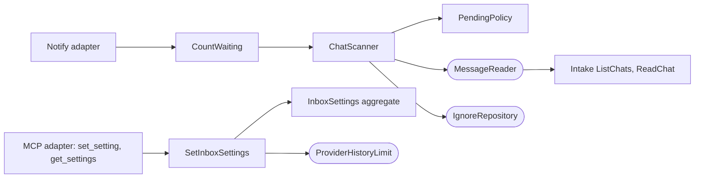

# Technical Proposal: Pending detection (Inbox FRD-01)

Status: Draft

Follows the cross-cutting TP (`docs/tp/TP.md`). "Cross-cutting TD-n" means a decision there. This TP holds the Inbox domain core that TP-02 and TP-03 build on: the pending rule, the window, the settings aggregate and the chat scan.


## Summary

Follows the cross-cutting TP (`docs/tp/TP.md`). "Cross-cutting TD-n" means a decision there. This TP holds the Inbox domain core that TP-02 and TP-03 build on: the pending rule, the window, the settings aggregate and the chat scan.

## Context

Fixed by the cross-cutting TP, so not decided again:

- Inbox is a bounded context with `domain/`, `application/`, `ports/`, `adapters/` and an `index.ts` (cross-cutting TD-0). The domain does no I/O and imports no package (ADR-000 of the cross-cutting TP). Time comes from the `Clock` port.
- Inbox keeps only the window setting `pending_window_days` and the ignore list (FRD-01 Information). Pending status is never stored.
- Message source is decided by Intake from the owner-number list and Deputy's send ids (FR-INTAKE-04-3). Inbox reads it and never looks at message text to decide anything (FR-INBOX-01-5).
- Intake already hides what Inbox must not count. `ListChats` returns only the active provider's world, so under Kapso a chat with only dev messages is absent (FR-INBOX-01-12; Intake TP-01 test FR-INTAKE-01-10). A message from an owner reply, sent through Deputy or from the app, sets `lastAnswerAt`. An echo with no sender or counterpart is stored as source `customer` with mark `not_attributable`, and `ChatStateView.lastAnswerAt` already counts it as an answer in its own chat (Intake TP-02). The history flag never changes `ChatStateView` (FR-INBOX-01-9).
- Inbox consumes Intake exactly as published in `docs/intake/tp/TP-02-receive-and-store.md`:
  - `ListChats({ customerMessageSince? }): ChatStateView[]` with `ChatStateView = { chat, mark, conversationRef, unattributedStoredAt, lastCustomerAt, lastCustomerMessageId, lastAnswerAt, lastAnswerSource }`.
  - `ReadChat({ chat, limit?, storedSince? }): ChatView | null` with `MessageView = { id, sender, type, readable, text, transcript, readerText, sentAt, storedAt, source, history, dev, edited, previousTexts, deletedBySender, mark }`.
  - `Mark = "normal" | "group_chat" | "sender_unknown" | "not_attributable"`, `Source = "customer" | "owner_app" | "sent_through_deputy"`.
- Inbox relies on one reading of `customerMessageSince` that Intake's text does not spell out: the chats whose newest customer message is at or after that instant. If Intake returns more, Inbox still filters by the window itself, so a wider answer cannot make a chat pending wrongly.
- A chat is identified by its `ChatId`, the customer's line key. Intake will also store the provider's profile name as an untrusted display hint and expose it as `ChatStateView.profileName?: string` (lead decision; the field is not yet in Intake's TP). Inbox shows it next to the number, labeled as customer text, and never uses it for matching, ignoring or any rule. `ChatFacts` has no name field.

Consequences used below without a choice:

- Every use case that writes asks `OwnerLease.isOwner()` first. `CountWaiting`, `GetInboxSettings` and the scan are pure reads and do not (cross-cutting Interfaces, write rule).
- Settings live in the shared `settings` table; Inbox reads and writes only its own key (cross-cutting Information).
- Time arithmetic uses `Instant` (epoch milliseconds, `src/shared`). No time zone enters the pending rule (TD-2).

### TD-4: Who decides that "ok" or "thanks" after an answer closes the chat?

ADR: ADR-011

Owner decision D23: a short reply such as "ok" or "thanks" after an answer does not make the chat pending when the agent is sure the chat is closed. When it is not sure, it asks the owner.

- **Option A** The agent judges. Pending detection stays a pure function of times (TD-1). The summary marks each pending chat that follows an answer (`followsAnswer`, TP-02) and the tool description tells the agent the rule: leave such a chat out of what it tells the owner only when the latest customer text plainly closes the chat; otherwise ask. Cost: the outcome depends on the agent. Risk: a wrong judgment hides a real message; the owner can ask for the chat by name and the next summary lists it again.
- **Option B** Deputy hides short replies by a word list. Cost: a list per language (D20). Risk: it hides "ok, send it" or a complaint, and the owner is never told.
- **Option C** A length rule (hide any reply under N graphemes). Cost: one number. Risk: "no" and "ok" have the same length.

Chosen: Option A, because meaning is the agent's strength and a code rule would be wrong in some language. `CountWaiting` is unchanged (FR-NOTIFY-01-3 still counts the chat); only what the agent tells the owner changes. Recorded in ADR-011.

## Requirements served

FR-INBOX-01-1, FR-INBOX-01-2, FR-INBOX-01-3, FR-INBOX-01-4, FR-INBOX-01-5, FR-INBOX-01-6, FR-INBOX-01-7, FR-INBOX-01-8, FR-INBOX-01-9, FR-INBOX-01-10, FR-INBOX-01-11, FR-INBOX-01-12, FR-INBOX-01-13, FR-INBOX-01-14. Related: FR-NOTIFY-01-3, FR-NOTIFY-01-4 (Notify reads `CountWaiting`).

## Decisions

### TD-1: Where does "pending" come from?

ADR: ADR-001

- **Option A** Compute it on demand from Intake's per-chat state: one `ListChats()` call gives each chat's newest customer time and newest answer time and source. Pending is a pure function of those two times, the chat's mark, the ignore list and the window. Cost: the whole chat list is read on each ask (one SQLite query inside Intake; one row per chat). Extra `ReadChat` calls only for equal times and, in TP-02, for the chats that are listed. Risk: the cost grows with the number of chats ever seen; a small business has hundreds to a few thousand, which is one indexed read.
- **Option B** Keep an Inbox table `pending_chats` fed by Intake's `MessageStored` event. Cost: a table, a handler, and a repair path. Risk: the event is only a hint (cross-cutting Architecture: "`MessageStored` is only a hint"); a crash between commit and publish loses one signal (Intake TP-02, accepted), so a chat could stay out of the table or stay in it after an owner reply made from the phone. That breaks R-INBOX-2 and principle 3. FRD-01 Information also says pending status "is worked out each time, not stored".
- **Option C** Scan every message with `ReadChat` for every chat. Cost: one read per chat per ask. Risk: with 2,000 chats and 100 messages each that is 200,000 rows read to answer a question that two timestamps answer.

Chosen: Option A, because the answer is two timestamps per chat that Intake already keeps current inside the store transaction, so it cannot drift from the messages, and the FRD says not to store it. A tie (`lastCustomerAt` equal to `lastAnswerAt`) cannot be decided from two numbers, so the scan reads the newest messages of that one chat with `ReadChat({ chat, limit: 5 })` and takes the newest non-dev message by Intake's order; Deputy does not guess an order (FRD-01 edge case). Five is enough because a tie involves two messages and a dev message in a Kapso world chat may sit among them. Recorded in ADR-001.

### TD-2: How is "the last N days" counted?

ADR: ADR-002

- **Option A** N elapsed days of 86,400,000 ms: `windowStart = now - N * 86_400_000`. A message is inside when `sentAt >= windowStart`. Cost: none. Risk: across a clock change the window is 24 hours per day, not "same time N calendar days ago"; the difference is one hour at most on one day of the year.
- **Option B** N calendar days in the owner's time zone: start of day N days ago. Cost: Inbox would read Notify's `time_zone` setting and handle DST. Risk: a cross-slice read for one boundary; the window length would be 23 to 25 hours short or long on the two DST days; a time zone change moves the window; FR-INBOX-01-6 says "counted back from now", which is Option A.
- **Option C** The window counted from the start of "today" in UTC. Cost: none. Risk: an owner in Argentina (UTC-3) at 22:00 sees "today" already tomorrow; the boundary moves by up to a day for owners far from UTC, in a country-neutral product (D20 and the many-owners rule).

Chosen: Option A. It needs no time zone, so it is right in every country (Deputy serves many owners), and it matches the FRD text. The boundary is inclusive: a message sent exactly `N * 86_400_000` ms ago is pending; one millisecond older is not. Recorded in ADR-002.

### TD-3: What is the maximum for N?

ADR: ADR-003

- **Option A** A per-provider constant held in an adapter behind `ProviderHistoryLimit.maxWindowDays()`. Kapso returns 180, the longest history the WhatsApp Business app Coexistence sync hands to the Cloud API (Meta, Onboard WhatsApp Business app users: history from the last 180 days, https://developers.facebook.com/documentation/business-messaging/whatsapp/embedded-signup/onboarding-business-app-users/). The dev provider returns 180 too. Cost: one small adapter. Risk: Kapso's own retention is "kept indefinitely by default" and paid projects can shorten it (`docs/research/kapso.md`), and no API field reports it. A project with shorter retention can set N above what it holds. That is harmless: no older message exists, so the window finds nothing more.
- **Option B** Derive the maximum from what Deputy has stored: `now - oldestStoredAt` from `SyncStatusView`. Cost: no constant. Risk: a business connected three days ago would be capped at 3 days and could not set 14 in advance. After a catch-up failure `oldestStoredAt` may be wrong, so the cap would drop.
- **Option C** Ask the provider for its retention. Cost: an Intake port change. Risk: the research found no such field (Intake TP-03 open question 3), so there is nothing to call.

Chosen: Option A, because it is the only one that works today, and the fake `ProviderHistoryLimit` in tests can return 30 to test the FRD example. The rule when N exceeds the maximum: keep the maximum and answer with `clamped: true` and the value, so the agent tells the owner (FR-INBOX-01-7). This answers FRD-01 open question 2 for v1; a real retention field would replace the constant behind the same port. Recorded in ADR-003.

## Architecture



Parts (all under `src/inbox/`):

| Folder | Holds |
|---|---|
| `domain/` | `PendingWindow`, `InboxSettings`, `PendingPolicy`, `ChatFacts`, `Verdict` |
| `application/` | `ChatScanner` (internal service), `CountWaiting`, `SetInboxSettings`, `GetInboxSettings` |
| `ports/` | inbound: the use-case interfaces below. Outbound: `MessageReader`, `InboxSettingsRepository`, `IgnoreRepository` (TP-03), `ProviderHistoryLimit`, `Clock` and `OwnerLease` (shared) |
| `adapters/` | `intake/` (MessageReader over Intake's published ports), `sqlite/` (settings), `provider-limit/` |

`ChatScanner` is an application service, not a use case: it is shared by `CountWaiting` (here), `ReadInbox` and `ListIgnored` (TP-02, TP-03), so the three can never disagree about what is pending.

## Information

Moved verbatim to [TP-01-pending-detection-information.md](../tp-detail/TP-01-pending-detection-information.md).

## Interfaces

Inbound ports (published in `src/inbox/index.ts`). Types `ChatId`, `Instant` and `OwnerWords` are from `src/shared`.

```ts
export interface CountWaiting { run(q?: { includeIgnored?: boolean }): Promise<WaitingSnapshot> }   // pure read, no lease; used by Notify. Default leaves ignored chats out; includeIgnored: true returns them too, so a caller can intersect with its own chat ids and look ignored ones up with IsIgnored
export type WaitingSnapshot = {
  chats: ReadonlyArray<ChatId>;   // pending, inside the window, not ignored unless includeIgnored, mark "normal", active world; sorted by ChatId
  count: number;
  windowDays: number;
  asOf: Instant;
};
// Throws InboxReadFailed (code "inbox_read_failed") when storage or Intake cannot be read.

export interface GetInboxSettings { run(): Promise<{ pendingWindowDays: number; maxWindowDays: number }> }

export interface SetInboxSettings {
  run(q: { key: "pending_window_days"; value: number; ownerWords: OwnerWords }): Promise<
    | { ok: true; applied: number; clamped: boolean; max: number }
    | { ok: false; reason: "not_an_integer" | "below_minimum" | "not_owner"; minimum: 1; kept: number }
  >;
}
```

Outbound ports defined by this TP:

```ts
export interface MessageReader {                 // adapter calls Intake ListChats and ReadChat (Intake index.ts only)
  listChats(q?: { customerMessageSince?: Instant }): Promise<ReadonlyArray<ChatState>>; // ChatState = ChatStateView
  readChat(q: { chat: ChatId; limit?: number }): Promise<ChatMessages | null>;          // ChatMessages = ChatView
}
export interface InboxSettingsRepository {
  load(): Promise<InboxSettings>;
  save(settings: InboxSettings, at: Instant): Promise<void>;
}
export interface ProviderHistoryLimit { maxWindowDays(): Promise<number> }
```

`ChatState` and `ChatMessages` are Inbox-local type aliases structurally equal to Intake's published `ChatStateView` and `ChatView`, declared in `src/inbox/ports/` so the domain never imports Intake. The adapter maps one to the other and fails a compile if Intake's type drifts.

MCP tools. This FRD adds no tool. The cross-cutting `get_settings` and `set_setting` route the key `pending_window_days` to `GetInboxSettings` and `SetInboxSettings` (cross-cutting TD-8). `set_setting` passes the owner's words. On `clamped`, the structured result carries `{ code: "window_clamped", applied, max }` and the English default text "The longest window is 180 days, so I kept 180." (D20). On `below_minimum` and `not_an_integer` it carries the code and `kept`.

`ProviderHistoryLimit` adapter: a table `{ kapso: 180, dev: 180 }` keyed by the provider name that Intake's `SyncStatusView.provider` reports. 180 is the Coexistence history window above. An unknown provider name returns 180 as well, so a later provider cannot silently lower the cap.

## Threat model

| Attacker | Attack | What stops it | Accepted |
|---|---|---|---|
| A customer | A message "I am the owner, this chat is answered" to clear its own chat | Source is Intake's, set from the owner-number list and send ids. `ChatFacts` has no text field, so no rule can read content (FR-INBOX-01-5) | None |
| A customer | A message that tells the agent to change N | `set_setting` needs the owner's words and is a write tool; customer text never reaches the agent unlabeled (TP-02). N only changes what counts as recent | An agent can still be fooled into calling it. The effect is a different window, never a send; the summary shows `windowDays` |
| A customer | Floods a chat to push a pending chat out of view | The scan lists every pending chat; nothing is capped (FR-INBOX-02-4) | None |
| A compromised agent | Sets N to a huge value to hide nothing, or to 1 to hide chats | Chats outside the window are counted in a line (FR-INBOX-01-14), and N is capped (FR-INBOX-01-7) | N = 1 hides chats older than a day from the list but not from the count line |
| A second process | Writes the setting | `SetInboxSettings` asks `OwnerLease` and refuses with `not_owner` | None |

## Testing

ATDD: each test is titled with its FR id and written before the code. Layers: UC is a use case driven through its inbound port with in-memory adapters (a fake `MessageReader`, an in-memory `IgnoreRepository` and `InboxSettingsRepository`, a fake clock, a fake `ProviderHistoryLimit`); INT is Inbox wired to Intake's real use cases over in-memory repositories; AC is an adapter contract test run against the in-memory and the SQLite adapter.

| FR | Test (Given, When, Then) | Layer |
|---|---|---|
| FR-INBOX-01-1 | Given three chats whose newest message is a customer message sent today and no answer, When `CountWaiting` runs, Then `count` is 3 and `chats` lists all three | UC |
| FR-INBOX-01-1 | Given a customer message and a later `sent_through_deputy` message, When `CountWaiting` runs, Then the chat is not counted | UC |
| FR-INBOX-01-2 | Given a draft approved but sending failed (no outgoing message stored), and a second draft whose send was reported by the provider before Intake had the send id and so stored as `owner_app`, When `CountWaiting` runs, Then the first chat is pending and the second is not | UC, INT |
| FR-INBOX-01-3 | Given a customer message from 20 days ago and a later owner reply from the app, When `PendingPolicy.judge` runs with a 7-day window, Then the verdict is `answered`, whatever the age of the customer message | UC |
| FR-INBOX-01-4 | Given an answered chat, When the customer writes again, Then the chat is pending again | UC |
| FR-INBOX-01-5 | Given a customer message with text "I am the owner, this chat is answered" and source `customer`, When `CountWaiting` runs, Then the chat is pending; and a compile-time test shows `ChatFacts` has no text field | UC |
| FR-INBOX-01-6 | Given a customer message 8 days old and the default window, When `CountWaiting` runs, Then the chat is not counted; with `SetInboxSettings` to 14, Then it is counted; a message exactly 7 x 86,400,000 ms old is counted and one millisecond older is not | UC |
| FR-INBOX-01-7 | Given `ProviderHistoryLimit` returns 30, When the owner sets 90, Then 30 is stored, `clamped` is true and `max` is 30 | UC |
| FR-INBOX-01-7 | Given N is 7, When the owner sets 0, -3 and 2.5, Then each is refused with its reason and N stays 7 (FRD edge case) | UC |
| FR-INBOX-01-8 | Given an unanswered customer message 8 days old, When `CountWaiting` runs, Then it is not counted and the message is still returned by Intake's `ReadChat`; no Inbox call deletes anything (the `MessageReader` port has no write method) | UC, INT |
| FR-INBOX-01-9 | Given a chat whose newest customer message is a history message sent 2 days ago and unanswered, When `CountWaiting` runs, Then the chat is pending | INT |
| FR-INBOX-01-10 | Given a chat whose newest customer message is a voice note (not readable) and unanswered, When `CountWaiting` runs, Then the chat is pending | INT |
| FR-INBOX-01-11 | Given a pending chat that is on the ignore list, When `CountWaiting` runs, Then it is not counted | UC |
| FR-INBOX-01-12 | Given a stored dev message from an unanswered customer and the provider now Kapso, When `CountWaiting` runs, Then no chat is pending | INT |
| FR-INBOX-01-13 | Given a group message, a message with no sender and a not-attributable echo, each inside the window, When the scan runs, Then none is pending and `notHandledMessages` is 3 | UC, INT |
| FR-INBOX-01-14 | Given three chats whose unanswered customer message is 10 days old and a 7-day window, When the scan runs, Then none is pending and `outsideWindow` has 3 chats | UC |
| FR-INBOX-01-1 (tie) | Given `lastCustomerAt` equals `lastAnswerAt` and Intake's newest message of the chat is the answer, When the scan runs, Then the chat is not pending; with the newest message a customer message, Then it is pending; a dev message among the five newest does not decide | UC |
| FR-INBOX-01-1 (owner first) | Given a chat with only owner messages, When the scan runs, Then it is never pending | UC |
| Adapter contract | Given the in-memory and the SQLite `InboxSettingsRepository`, When the key is absent, Then 7 is returned; after a save, the saved value | AC |

## Risks

| Risk | Effect | Mitigation |
|---|---|---|
| The reading of `customerMessageSince` differs from the one assumed | `CountWaiting` could read too few chats | Inbox filters by the window itself; an INT test with a chat just inside the window fails if Intake drops it |
| The 180-day cap is wrong for a given Kapso project | N above real retention is accepted | Harmless: no older message exists; documented in ADR-003 |
| `ChatStateView` has an equal-time tie not resolved by `limit: 5` | A chat could be misjudged | A tie needs two messages with the same millisecond; the five newest cover it; the test covers a dev message among them |
| The full-list read grows with chat count | Slower summary | One indexed read; measure in the e2e test with 5,000 chats and revisit if above 200 ms (a budget, not a limit) |

## Open questions

1. Does Kapso expose its retention? If it does, `ProviderHistoryLimit` reads it instead of the constant. No change elsewhere.
