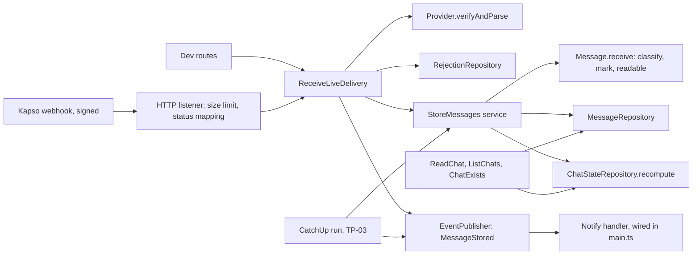

# TP-02-receive-and-store: Architecture

Part of [TP-02-receive-and-store.md](../tp/TP-02-receive-and-store.md). Moved verbatim from there; nothing changed.

## Architecture



Domain (all in `src/intake/domain/`, no I/O):

- **Aggregate `Message`.** Root and only entity. Fields below. Invariants: `(provider, providerMessageId)` is never empty; `readable` implies `type = "text"`; `source` is set once, at `receive`, and changes only through `Message.reclassifyAsDeputySend` (TP-04); `history` never changes; `text` changes only through `applyEdit`, which appends the old text to `versions`.
- **Value objects.** `ChatId`, `MessageId = { provider, providerMessageId }`, `Source` (`customer`, `owner_app`, `sent_through_deputy`), `Mark`, `PhoneNumber` (TP-04).
- **Domain service `SourceClassifier`** (TP-04) is called by `Message.receive`.
- **Domain events.** `MessageStored` and `CatchUpFinished` are defined in `src/intake/domain/events.ts` and re-exported by `index.ts`. `OwnerReplyUnlinked` is a cross-slice signal defined in `src/shared/signals.ts` (L8).
- **Entity `RejectionNote`** (separate small aggregate): `at`, `reason`, `recoverable`, `resolvedAt`. No content field exists, so none can be stored.

```ts
export type Source = "customer" | "owner_app" | "sent_through_deputy";
export type Mark = "normal" | "group_chat" | "sender_unknown" | "not_attributable";
export type RejectionReason =
  | "bad_signature" | "missing_signature" | "no_secret" | "no_identifier" | "malformed" | "dev_entry_refused";

export interface MessageProps {
  id: MessageId;
  chat: ChatId;
  conversationRef: string | null;
  sender: PhoneNumber | null;
  type: string;
  readable: boolean;
  text: string | null;
  transcript: string | null;
  sentAt: Instant;
  storedAt: Instant;
  origin: string | null;
  source: Source;
  mark: Mark;
  history: boolean;
  dev: boolean;
  edited: boolean;
  deletedBySender: boolean;
}

export interface ReceiveContext {
  provider: ProviderName;
  owners: OwnerNumbers;          // snapshot read in the same transaction
  matchesSend: boolean;          // an outgoing_parts row has this provider id (TP-04)
  history: boolean;              // decided by the caller (TP-03, TD-3)
  now: Instant;
}

export class Message {
  static receive(p: ProviderMessage, ctx: ReceiveContext): Message | { rejected: "no_identifier" };
  applyEdit(text: string): MessageVersion;      // returns the version that was replaced
  markDeletedBySender(): void;
  readerText(): string;
}
```

Domain events:

```ts
export interface MessageStored {
  readonly name: "MessageStored";
  readonly origin: "live" | "catch_up";
  readonly items: ReadonlyArray<{ chat: ChatId; source: "customer" | "owner_app"; count: number }>;
  readonly at: Instant;
}
```

`OwnerReplyUnlinked { name: "OwnerReplyUnlinked"; at: Instant }` is published once per unit of storage (live delivery or catch-up run) that stored an owner echo it could not tie to a chat (mark `not_attributable`, TP-04). It has no text, no chat and no number. Owner decision D30: Notify turns it into a notice that says why every send is stopped and what the owner must do.

`items` has one entry per chat and source. It holds only messages that were newly stored, not history, not `sent_through_deputy` and not repeats (FR-INTAKE-02-9). It holds no text and no name.

Application: `StoreMessages.store(tx, { provider, events, historyOf })` is async, runs inside one `IntakeUnitOfWork` transaction and returns `{ stored, duplicates, ignored, edits, rejected, summaries }`. `ReceiveLiveDelivery` and the catch-up run call it. After the transaction they fold `summaries` into one `MessageStored` and publish.
