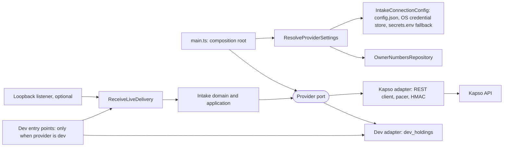

# Technical Proposal: Intake FRD-01, Providers

Status: Approved (2026-11-18). Written 2026-11-17. Cross-cutting TP: `docs/tp/TP.md` (cited as "cross-cutting TD-n"). FRD: `../frd/FRD-01-providers.md`. This TP also defines the `Provider` port and the shared Intake types that TP-02, TP-03 and TP-04 use.

## Context

What the cross-cutting TP already fixes. Intake owns the provider connection (cross-cutting TD-4). One outbound port `Provider` has two adapters, Kapso and dev. The Meta provider and its code are deleted. One client paces every request, sends included. Connection settings (`provider`, `receiving_mode`) live in `~/.deputy/config.json` and secrets in `~/.deputy/secrets.env`; neither is settable through a tool (cross-cutting TD-8). This FRD adds no new tool.

What this TP settles without a choice, as consequences of those decisions:

- **Start-up validation.** `ResolveProviderSettings` is a pure use case run once by `main.ts` before any adapter is built. It reads `IntakeConnectionConfig` and `OwnerNumbersRepository` and returns the active provider or a refusal. The process exits with the refusal text when it is a refusal (FR-INTAKE-01-1, FR-INTAKE-01-8). An empty setting returns dev with the notice "no provider set, using dev" (edge case). It never guesses Kapso.
- **Kapso details are not validated here.** Wrong keys are a connection failure that catch-up reports (TP-03), not a setting error.
- **Provider identity.** Every stored message carries `provider` and the provider's own message id. The unique key is `(provider, provider_message_id)`, so the same id from two providers never collides (edge case).
- **Receiving mode.** With Kapso, `receiving_mode` is `catch-up` (default) or `live`. `catch-up` starts no HTTP listener. `live` starts the listener, and periodic catch-up still runs (FR-INTAKE-01-11, FR-INTAKE-03-16). Both values are read at start.
- **Kapso adapter.** It sends through the Graph-compatible proxy already used by `src/providers/graph.ts` (`https://api.kapso.ai/meta/whatsapp/<version>/<phone_number_id>/messages`, header `X-API-Key`) and reads through the platform API (`/platform/v1/whatsapp/conversations` and `/messages`, `docs/research/kapso.md` Q3). `splitText` and the HMAC check move into the adapter. Nothing else is kept from the old `providers/`.
- **Profile name.** `ProviderMessage.profileName` (the WhatsApp profile name) is kept only as an untrusted display hint for the chat (TP-02, Profile name): it is sender-controlled, so Intake stores it as received, bounded, and never interprets it (FR-INTAKE-02-10).

Facts that bind this TP: Kapso lists conversations by `last_active_after` and messages per conversation or per phone number, newest first, with Base64 cursors; every response carries `X-RateLimit-Remaining`; webhooks are signed with HMAC-SHA256 of the raw body in `X-Webhook-Signature` (`docs/research/kapso.md` Q3, Q4, rate limits).

## Requirements served

FR-INTAKE-01-1, FR-INTAKE-01-2, FR-INTAKE-01-3, FR-INTAKE-01-4, FR-INTAKE-01-5, FR-INTAKE-01-6, FR-INTAKE-01-7, FR-INTAKE-01-8, FR-INTAKE-01-9, FR-INTAKE-01-10, FR-INTAKE-01-11. Shapes: FR-INTAKE-02-1, FR-INTAKE-03-1, FR-INTAKE-04-12 (the `Provider` port carries what those need).

## Decisions

### TD-1: Where do the dev test entry points live?

FR-INTAKE-01-3, 01-5 and 01-6 need ways to create messages, forged deliveries and "missed" messages. FR-INTAKE-01-9 says they exist only under dev.

- **Option A** Loopback HTTP routes (`/dev/deliver`, `/dev/hold`, `/dev/forge`) on the listener, registered only when the provider is dev. A dev message is signed with a fixed dev secret and goes through `ReceiveLiveDelivery`, so it takes the Kapso path. Cost: a small adapter and a loopback port in dev mode. Risk: a constant secret, so dev mode must stay on loopback.
- **Option B** MCP tools such as `dev_message`. Cost: no extra port, the agent can drive tests. Risk: an agent, or a customer's text that steers it, could inject messages. The cross-cutting threat model rules this out.
- **Option C** A command-line subcommand (`deputy dev message ...`) that writes into the database. Cost: no listener. Risk: it bypasses the verify path, so forged deliveries and live-versus-catch-up order cannot be tested, and a second writer touches the database without the lease.

Chosen: Option A. The old code already has dev routes, tests post to them, and they reuse the verify path (FR-INTAKE-01-4). Option B fails the threat model and Option C cannot test FR-INTAKE-01-5. Under Kapso the routes are not registered; a request to a `/dev/` path answers 404 and writes a rejection note (FR-INTAKE-01-9). Recorded in ADR-001.

### TD-2: How are dev messages kept out of real use after a switch?

FR-INTAKE-01-7 keeps stored messages; FR-INTAKE-01-10 and L3 hide dev messages once the provider is Kapso.

- **Option A** A `dev` flag on each message and on the chat state key `(chat_id, dev)`. Intake's list and signal paths return only the world that matches the active provider. Cost: a column and one repository filter. Risk: under dev, real chats are hidden too (stricter than L3).
- **Option B** Every consumer filters by provider name. Cost: no flag. Risk: Inbox, Notify and Drafts each repeat the rule, and one forgets it; they would learn provider names, against FR-INTAKE-01-4.
- **Option C** One database file per provider. Cost: complete separation. Risk: after a switch the old file is invisible, against FR-INTAKE-01-7, and exports and logs would span two files.

Chosen: Option A. The rule sits in one place and other slices never see a provider name. Recorded in ADR-002.

## Architecture



Parts of the slice, shared by all four TPs (`src/intake/`):

| Folder | Holds |
|---|---|
| `domain/` | `Message`, `SyncState`, `RejectionNote`, `OwnerNumbers`, `OutgoingSend`, `SourceClassifier`, domain events |
| `application/` | use cases (one file each): `ResolveProviderSettings`, `ReceiveLiveDelivery`, `CatchUp`, `CatchUpChat`, `SendText`, `FindOutgoing`, `ReadChat`, `ListChats`, `ChatExists`, `GetSyncStatus`, `ListRejections`, `GetOwnerNumbers`, `ApplyPendingChanges`, `SetIntakeSettings`, `CheckProviderAccess`, `DeliverDevMessage`, and the shared `StoreMessages` service |
| `ports/` | inbound port types and outbound ports: `Provider`, `MessageRepository`, `ChatStateRepository`, `SyncStateRepository`, `RejectionRepository`, `OutgoingRepository`, `OwnerNumbersRepository`, `IntakeSettingsRepository`, `IntakeConnectionConfig`, `IntakeUnitOfWork`, `EventPublisher` |
| `adapters/` | `kapso/`, `dev/`, `sqlite/`, `http/` (listener and dev routes), `scheduler/`, `config/` |

`Clock` and `OwnerLease` come from `src/shared`. The shared kernel also gets `PhoneNumber` (TP-04, TD-2), `Instant` (epoch milliseconds, a number) and `SendId` (a non-empty string of at most 100 characters).

## Information

Owned by this FRD:

```sql
-- What the dev provider "holds" at its side. Catch-up lists it like a provider listing.
CREATE TABLE dev_holdings (
  seq                 INTEGER PRIMARY KEY AUTOINCREMENT,
  provider_message_id TEXT    NOT NULL UNIQUE,
  conversation_ref    TEXT,
  counterpart         TEXT,
  sender              TEXT,
  direction           TEXT    NOT NULL CHECK (direction IN ('inbound','outbound')),
  type                TEXT    NOT NULL,
  text                TEXT,
  transcript          TEXT,
  origin              TEXT,
  sent_at             INTEGER NOT NULL,
  owner_mark          INTEGER NOT NULL DEFAULT 0
);
```

`/dev/deliver` stores a copy in `dev_holdings` too, as a real provider would, so a later catch-up sees it and de-duplicates it. `/dev/hold` writes only here.

Columns this FRD fixes on `messages` (full table in TP-02): `provider TEXT NOT NULL CHECK (provider IN ('kapso','dev'))`, `provider_message_id TEXT NOT NULL`, `dev INTEGER NOT NULL`, with `UNIQUE (provider, provider_message_id)`. Chat state is keyed `(chat_id, dev)` (TP-02).

No provider name is stored in settings. The active provider comes from `config.json` at start.

## Interfaces

Moved verbatim to [TP-01-providers-interfaces.md](../tp-detail/TP-01-providers-interfaces.md).

## Threat model

| Attacker | Attack | What stops it | Accepted |
|---|---|---|---|
| A customer or injected agent | Create dev messages to fake a customer or an owner | Dev entry points are absent under Kapso; an attempt is 404 and noted (FR-INTAKE-01-9); there is no MCP tool for them (TD-1); `provider` is not settable by any tool (cross-cutting TD-8) | None |
| Someone on the machine | Use the dev routes in dev mode | Loopback bind; dev mode is for testing | The fixed dev secret |
| A misconfigured owner | `provider = kapso` without keys, or a typo | Refused at start with a message that lists what is missing and never prints a value (FR-INTAKE-01-1, FR-INTAKE-01-8) | None |
| A secret leaking through a log | A `Secret` printed in an error | `Secret` prints `[secret]`; `ProviderError` messages hold only the kind, never a response body (cross-cutting threat model) | None |
| Old dev data acting as real | A dev message drafted or notified under Kapso | The `dev` flag and the `(chat_id, dev)` key (TD-2) | None |

## Testing

ATDD: each test is written from the FRD line first and is titled with its FR id. Layers: UC is a use case with in-memory adapters and a fake clock; AC is an adapter contract test (the same test runs against the in-memory and the real adapter, the Kapso adapter against a fake Kapso HTTP server); E2E starts the server over stdio with the dev provider.

| FR | Test | Layer |
|---|---|---|
| FR-INTAKE-01-1 | Given the setting `provider` is `meta`, When `ResolveProviderSettings` runs, Then it refuses and names `kapso` and `dev`. Given the setting is empty, Then dev is chosen with a notice and Kapso is never guessed | UC |
| FR-INTAKE-01-2 | Given the fake Kapso server holds a message, When catch-up runs, Then the message is stored; Given a signed live delivery, Then it is stored | AC, E2E |
| FR-INTAKE-01-3 | Given the dev provider, When the tester posts "How much is the cake?" to `/dev/deliver`, Then it is stored with all fields and `ReadChat` returns it. A body without `chat` returns 400 naming `chat` and stores nothing | E2E, UC |
| FR-INTAKE-01-4 | Given a dev message and a Kapso message with the same text and chat, When `ReadChat` returns both, Then the views have the same fields and source meaning; the Kapso and dev adapters map to the same `ProviderMessage` shape | AC, UC |
| FR-INTAKE-01-5 | Given the dev provider, When the tester sends each of: an unreadable type, a transcript, a repeated message, reversed order, an owner reply, a history message, a bad signature, Then each produces the stored or rejected result of its FRD | E2E |
| FR-INTAKE-01-6 | Given a message posted to `/dev/hold`, When catch-up runs, Then it is stored once and flagged as found by catch-up | UC |
| FR-INTAKE-01-7 | Given stored dev messages, When the provider switches to Kapso, Then `ReadChat` still returns them marked `dev`, and no row was deleted | UC |
| FR-INTAKE-01-8 | Given `provider = kapso` and no API key, When `ResolveProviderSettings` runs, Then it refuses, lists the missing items, mentions Setup and prints no value | UC |
| FR-INTAKE-01-8 | Given the fake Kapso server serves the phone-number record "+505 8888 1111", When `CheckProviderAccess` runs, Then it returns `ok` with `businessNumber` "+50588881111"; Given the record has no number or the provider is dev, Then `businessNumber` is null; Given a `401`, Then `ok` is false with reason `credentials` and no number | UC, AC |
| FR-INTAKE-01-9 | Given the provider is Kapso, When `DeliverDevMessage` is called, Then it returns `not_dev`, nothing is stored and a rejection note `dev_entry_refused` exists; Given the dev provider, Then it stores the message through `ReceiveLiveDelivery` and `ReadChat` returns it | UC |
| FR-INTAKE-01-9 | Given the provider is Kapso, When a client posts to `/dev/deliver`, Then the answer is 404, nothing is stored and a rejection note with reason `dev_entry_refused` exists | E2E |
| FR-INTAKE-01-10 | Given a stored dev message from an unanswered customer and the provider is now Kapso, When `ListChats` runs, Then the chat is absent and no signal was emitted for it (Inbox and Notify repeat this at their layers) | UC |
| FR-INTAKE-01-11 | Given Kapso with `receiving_mode` empty, When the server starts, Then no listener port is bound and catch-up runs; Given `receiving_mode = live`, Then the listener is bound and catch-up still runs | UC, E2E |

Architecture test: `domain/` has no import of `adapters/`, `Secret` is the only type that holds a key, and `src/main.ts` is the only place a `Provider` adapter is built.

## Risks

| Risk | Effect | Mitigation |
|---|---|---|
| Kapso field paths (`kapso.transcript`, group marker, edit flag) are not confirmed by the research | A transcript or group message is mapped wrong | The adapter contract test uses recorded real payloads; one live check per release (cross-cutting TD-11). Unknown shapes are stored as unreadable `unknown`, never dropped |
| The Kapso platform API or the Graph proxy changes | Catch-up or send breaks | Both live in one adapter folder; the contract test catches the shape |
| Hiding real chats under dev surprises the owner | They think data was lost | `status` names the active provider; switching back shows everything (FR-INTAKE-01-7) |
| The listener in dev mode is reachable by another local user | Fake test messages | Loopback only; documented as test mode |

## Open questions

1. Which Kapso response fields carry the transcript, the group marker and the edit flag? The research did not open those pages. The adapter test fixtures settle this before the adapter is written.
2. Does the Kapso messages listing accept `phone_number_id` without `conversation_id` and without `direction`? A live call with `direction=outbound` worked (`docs/research/kapso.md`); the other form is unverified. It does not change this design.
3. FRD-01 open question 1 (delete dev test data in one step): not designed here. `deputy` could offer `deputy dev clear` later; it needs no change to the port.
