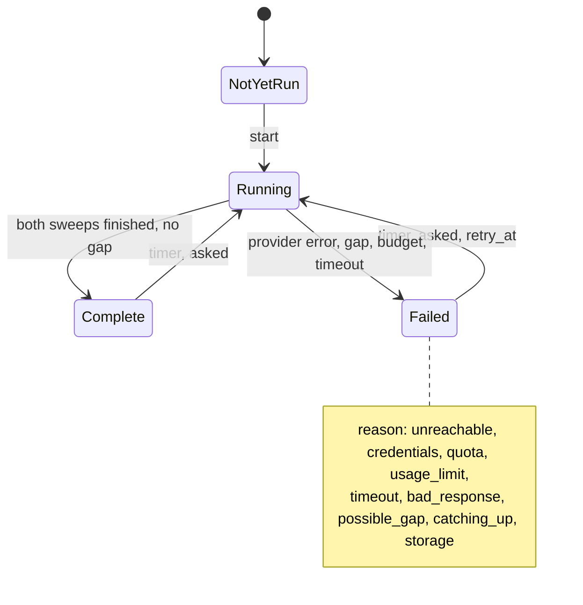
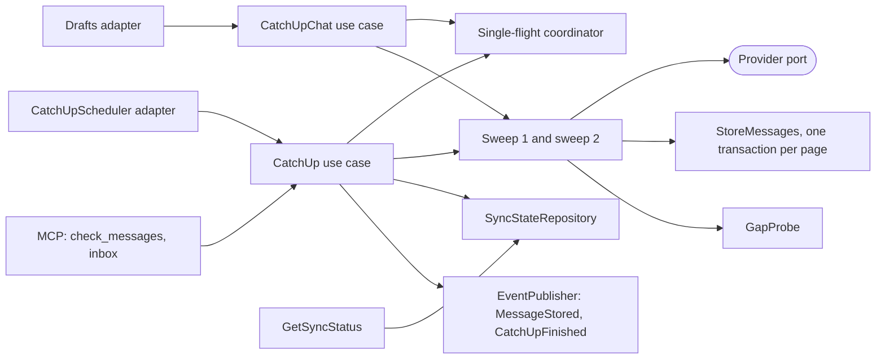

# Technical Proposal: Intake FRD-03, Catch-up and history

Status: Approved (2026-11-24). Written 2026-11-17. Cross-cutting TP: `docs/tp/TP.md`, in particular TD-5 (two sweeps on the provider's clock). FRD: `../frd/FRD-03-catch-up-and-history.md`. The `Provider` port and the store path are in `TP-01-providers.md` and `TP-02-receive-and-store.md`.

## Context

Fixed by the cross-cutting TP and kept as is (cross-cutting TD-5, TD-2, D12, D16):

- Two sweeps on the provider's clock. Sweep 1 lists conversations active since `mark - overlap` and reads each one's messages. Sweep 2 lists the number's outbound messages (owner echoes). Each pages its whole window and de-duplicates by `(provider, message id)`. It never stops at the first known message.
- The overlap is 10 minutes and covers provider lag only. The inbox window (D3) never limits catch-up.
- The first connect imports the whole retention window as history. Later runs read from `mark - overlap`, however long Deputy was off.
- At most one run at a time. A process that is not the owner runs none.
- Status has two values, `complete` and `failed`. A rate-limited run is stored as `failed`, reason `usage_limit`.

What this TP settles without a choice:

- **Constants.** Page size 100. Overlap 10 minutes. Request timeout 15 seconds. Run budget 60 seconds. Caller wait 20 seconds. Owner told of a usage limit after 10 minutes. Minimum period 1 minute, default 2. All are domain constants except the period. Why each value:
  - Page size 100: the largest page Kapso accepts, so the fewest requests against 100 per minute.
  - Overlap 10 minutes: five periods at the default of 2 minutes. It must exceed the provider's lag between an event and its appearance in a listing. Kapso documents no lag and Coexistence is called less stable, so 10 minutes is a margin, not a measurement. The live check at launch records the real lag; raise the overlap if it passes 5 minutes. Cost: one message read per conversation active in the last 10 minutes on every run (FR-INTAKE-03-18).
  - Request timeout 15 seconds: a listing page is one HTTP call that normally takes well under a second; 15 seconds is long enough for a slow mobile or tunnel link and short enough to stay under the caller wait.
  - Caller wait 20 seconds: the 15-second timeout plus 5 seconds to store, so a timed-out request shows as `timeout` and not as a lost race. It is also well below the tool timeout of the agents checked (Codex 60 seconds), so the owner is never left staring at a hung tool.
  - Run budget 60 seconds: one rate-limit window (100 requests per minute), so a run never queues more than a window of work. A run that ends on budget with progress is `failed`, reason `catching_up`, and the next starts at once.
  - Reserve 10 requests: 10 per cent of the limit, enough for about three sends in the same minute (each send, with its `CatchUpChat` reads, uses three to four requests).
  - 2,000 pages: 200,000 items per listing at page size 100, and at 100 requests per minute 20 minutes of reading, so a real first import fits and a hostile endless listing stops.
  - Owner told after 10 minutes: five default periods. A `Retry-After` is normally seconds to one minute, so a streak of 10 minutes means another tool is using the key or the plan is too small, and only then is an interruption worth it.
  - Minimum period 1 minute: one listing plus one message read plus one outbound page is at least three requests per run, so shorter periods would crowd the reserve on a busy shop.
- **The period is a setting.** `catch_up_minutes` is kept by Intake in `settings`. `SetIntakeSettings` refuses a value below 1 and keeps the previous one (FR-INTAKE-03-21). "The allowed minimum" in the FRD edge case is that 1 minute; after a `429`, the scheduler also waits for `retry_at` (TD-2).
- **Authenticated only.** `CatchUp` is the only code that calls `Provider.listConversations` and `listMessages`, and no inbound port accepts a list of messages. `check_messages` takes no input. Something that "claims to be a catch-up" can reach Intake only as a live delivery, which needs the signature (FR-INTAKE-03-3).
- **Single-flight.** An in-process coordinator holds the running promise. A second caller awaits it for at most its `waitMs`. One process owns the data (cross-cutting TD-2), so no database lock is needed.
- **Status per provider.** `catchup_status` has one row per provider, so a switch from dev to Kapso starts a new first import with its own `connected_at`. The cross-cutting Information lists one row; this is a refinement.
- **Status reasons come from a fixed set** and fixed wording. Provider error text never reaches the agent (cross-cutting threat model).
- **Time and sleep.** `Clock` in the shared kernel gets `sleep(ms)` beside `now()`. The fake clock advances time in tests. Use cases never call `setTimeout`.
- **Newest stored time** is computed on read as `MAX(sent_at)` over non-dev messages of the provider, not stored. It includes owner and Deputy messages.
- **Messages from a failed run stay** (FR-INTAKE-03-8): each page is committed in its own transaction.

Facts: `X-RateLimit-Remaining` on every response; `429` with `Retry-After`; Free plan 100 requests per minute; listings newest first with cursors (`docs/research/kapso.md`).

## Requirements served

FR-INTAKE-03-1, FR-INTAKE-03-2, FR-INTAKE-03-3, FR-INTAKE-03-4, FR-INTAKE-03-5, FR-INTAKE-03-6, FR-INTAKE-03-7, FR-INTAKE-03-8, FR-INTAKE-03-9, FR-INTAKE-03-10, FR-INTAKE-03-11, FR-INTAKE-03-12, FR-INTAKE-03-13, FR-INTAKE-03-14, FR-INTAKE-03-15, FR-INTAKE-03-16, FR-INTAKE-03-17, FR-INTAKE-03-18, FR-INTAKE-03-19, FR-INTAKE-03-20, FR-INTAKE-03-21. Related: FR-DRAFTS-03-1 (`CatchUpChat`), FR-DRAFTS-03-13, FR-INBOX-02-2 (status header).

## Decisions

### TD-1: How is a possible gap detected?

FR-INTAKE-03-15 says: when a listing is read to its end and its oldest returned message is O, a gap is possible only if Deputy holds a stored message of that scope older than O, and Deputy's coverage mark for that scope, read before this run's sweeps, is null or older than O. A mark at or after O means Deputy already read up to O. The mark counts only when the previous run finished all its sweeps (ADR-007, rule A); after a stopped run it counts as null.

- **Option A** The comparison as the FRD words it, once per run, over all returned messages. Cost: one number to compare. Risk: false alarms. A quiet shop's newest stored message is old; a brand-new conversation's whole listing is newer and exhausted; the first reply the owner ever sends has the same shape.
- **Option B** Per listing scope. For every listing a run read to its end (one conversation, or the outbound listing), ask whether Deputy already stores a message of that scope older than the oldest one returned. If it does, the provider no longer holds it. Cost: one repository query per exhausted listing. Risk: a conversation not touched in the run is not checked.
- **Option C** A daily probe: page the whole outbound listing to its end and compare the provider's oldest message with the oldest Deputy stores. Cost: many requests each day on a busy number. Risk: it checks only one kind of message and runs too rarely to name a recent gap.

Chosen: Option B. It raises the status for the FRD's own example (stored 10 days ago, oldest returned 3 days ago, nothing older) and stays silent for quiet periods. The text says "possible". Recorded in ADR-007.

Refined by the coverage mark (2026-11-19, ADR-007). Option B alone reads only the stored side, so the same stretch raised the alarm again on every run while the provider kept dropping it. The probe now also reads the coverage mark: `SyncState.markConversations` for a conversation and `markOutbound` for owner/Deputy, saved in step 2 of the run before the sweeps advance them. A gap needs the pre-run mark null or below O. A mark at or after O means that stretch was already read, so older messages the provider drops are provider retention, not a gap, and the same stretch is not reported again. Accepted limit: with a null mark (before the first catch-up), rows delivered live and older than a short provider retention can raise one `possible_gap`. Rule A (2026-11-20): a stopped run counts as null for the next run, so a run stopped by the budget before a conversation it never read cannot hide a gap there; the accepted cost is one extra `possible_gap` after an interrupted run.

### TD-2: How does a run wait for the rate limit?

FR-INTAKE-03-19 and 03-20: slow down when few requests remain; on refusal wait as long as the provider says, keep what is stored, retry, tell the owner only after 10 minutes.

- **Option A** The run ends on `429`, saves its marks, writes `failed` with reason `usage_limit` and `retry_at`, and the scheduler starts the next run at `retry_at`. The Kapso adapter paces reads below a reserve of 10 remaining requests; sends skip the reserve. Cost: a second timer in the scheduler. Risk: none beyond the extra state.
- **Option B** The run sleeps for `Retry-After` and goes on. Cost: simpler control flow. Risk: it holds the single-flight lock while sleeping, so an inbox read waits on it; a long wait looks like a hang; fake-clock tests must stop inside a use case.
- **Option C** Hybrid: sleep inside the run when `Retry-After` is 10 seconds or less, end the run and reschedule when it is longer. Cost: two paths to test. Risk: the short sleep still holds the lock, and the 10-second line is arbitrary.

Chosen: Option A. A run also has a budget of 60 seconds: one that ends on budget with progress is `failed`, reason `catching_up`, and the scheduler starts the next at once. `tellOwner` turns true for `usage_limit` only after 10 minutes. Recorded in ADR-008.

### TD-3: What makes a message "history"?

FR-INTAKE-03-11 and 03-12: history is flagged and raises no signal. FR-INTAKE-04-11 names the origin `history_sync`, which was documented but not seen live.

- **Option A** Connect time, plus origin for customer messages: history when `sent_at < connected_at`, or `origin = history_sync` on a customer message, where `connected_at` is the provider's clock at the first response of the provider's first run. Cost: one saved timestamp. Risk: needs the provider's `Date` header.
- **Option B** Age against the local clock at the first run: history when `sent_at` is before the local time of that run. Cost: no provider header needed. Risk: clock skew moves the boundary, so a new message can be flagged history or an old one not.
- **Option C** Origin only. Cost: trivial. Risk: depends on an unverified label; a wrong one floods Notify or hides a new message.

Chosen: Option A. Dev uses the origin only, so a tester controls it with `history: true`. Recorded in ADR-009.

### TD-4: What does `CatchUpChat` do before a send?

FR-DRAFTS-03-1 needs the chat fresh. Cross-cutting TD-5 has the timer, `check_messages` and `CatchUpChat` share one lock.

- **Option A** Join the running run and return its result. Cost: no extra requests. Risk: the run may have read the listing before the owner answered from the app, so Deputy could answer after the owner.
- **Option B** Wait for any running run, then read that chat's conversation and one page of the outbound listing. Cost: two to three requests per send. Risk: a chat with no known conversation needs a lookup.
- **Option C** Always run a full catch-up. Cost: a conversation listing plus one request per active conversation on every send. Risk: slow, and heavy on the 100-requests-per-minute limit.

Chosen: Option B. It refines the cross-cutting text (the others wait and return the result) with one chat-scoped read, because only that closes the window that matters (principle 2). It moves no mark and never waits for a rate limit; on `429` it fails and Drafts holds the send. Recorded in ADR-010.

## Architecture

Status state machine (`SyncState`, per provider):

`NotYetRun` is a view state, stored as no row. It reads as `failed` with reason `not_yet_run`, so nothing says "complete" before the first run.

Parts:

Domain: **aggregate `SyncState`** (one per provider). Fields: `status`, `reason`, `lastAttemptAt`, `lastSuccessAt`, `connectedAt`, `markConversations`, `markOutbound`, `outboundResume`, `failedSince`, `rateLimitedSince`, `retryAt`, `gap`, `finishedAt`. Invariants: `status = complete` implies `reason` is null and `lastSuccessAt` is set; a mark never moves back; `connectedAt` is set once; `rateLimitedSince` is set when the first `usage_limit` of a streak starts and cleared by any complete run. Methods: `begin(providerTime)`, `advanceConversations(to)`, `saveOutboundResume(r)`, `complete(providerTime, now)`, `fail(reason, now, retryAfterMs?)`, `tellOwner(now)`, `view(...)`.

Algorithm, one run (`CatchUp`), steps in order:

1. Refuse with `not_owner` unless this process holds the lease. The lease token is checked again inside every page transaction (the `StoreMessages` transaction asks `OwnerLease`), and `SyncStateRepository.save` is a conditional write: it runs only while the token is still ours, and marks are written as `MAX(old, new)`. A run that lost its lease stops at the next page with no write, and a stale in-memory state can never move a mark back. Join the coordinator: a second caller awaits the running run for at most `waitMs`.
2. Load `SyncState`. Read the first page of the conversation listing. Its `serverTime` is `T0`. If `connectedAt` is empty, set and save it to `T0` before anything is stored. `runStart = T0`; `deadline = now + 60 s`.
3. **Sweep 1.** `from1 = markConversations - overlap`, or none on the first import. List conversations active after `from1` (every page; the listing is newest first). Sort ascending by `lastActiveAt`. For each: list its messages newest first until an item is older than `from1`, or the listing is exhausted. Store each page in its own transaction, oldest item first. After the conversation, save `markConversations = lastActiveAt`. Check the deadline between conversations. When all are done, `markConversations = runStart`.
4. **Sweep 2.** `from2 = markOutbound - overlap`, or none. List the outbound messages newest first until an item is older than `from2` or the listing is exhausted. Store each page as above and save `outboundResume = { cursor, from2, runStart }` after each page. When the sweep ends, clear the resume and set `markOutbound = runStart`. If the saved resume has the same `from2`, continue from its cursor; if the provider refuses the cursor, restart the window (storing is idempotent). This refines the cross-cutting wording "a page of outbound messages advances the mark": pages arrive newest first, so a mark could not move per page without leaving a hole.
5. **Gap probe.** For each listing that was read to its end, compare with stored messages of the same scope and with the pre-run coverage mark of that scope (step 2, TD-1). A hit sets `gap`.
6. **Finish.** No error and no gap: `complete`, `lastSuccessAt = now`. Else `failed` with the reason. Publish one `MessageStored` if any non-history message was stored (FR-INTAKE-03-5), then `CatchUpFinished`. Resolve open `no_identifier` rejection notes older than this run's local start when the run is complete (TP-02).

History flag: for Kapso `history = sentAt < connectedAt || (origin == "history_sync" && source == customer)`; for dev the origin only (TD-3). Owner and Deputy messages after `connected_at` are never history, and consumers must not read the flag as proof of age.

Failure mapping: `unreachable`, `credentials`, `quota`, `timeout`, `bad_response` map to the same reason names; `rate_limited` maps to `usage_limit` with `retryAfterMs`. A storage error maps to `storage`. Language (D20): the status carries the code (`reason`) and `reasonText`, its English default. Deputy ships no other language; the server instructions tell the agent to say the reason in the owner's language. A test checks that every `SyncReason` has a `reasonText` and that none contains provider text. A listing that repeats a cursor or exceeds 2,000 pages is `bad_response`.

Scheduler adapter (`CatchUpScheduler`): started and stopped by the `LeaseSupervisor`. It runs once at start (`trigger = start`), then waits `period`, where `period = catch_up_minutes` read again before each wait. After a run it waits until `retry_at` when the status is `usage_limit`, runs again at once when the status is `catching_up`, and otherwise waits `period`. After a failure of any other kind it keeps its normal period; it does not retry faster (edge case). A run that throws is logged to stderr and does not stop the loop.

## Information

Moved verbatim to [TP-03-catch-up-and-history-information.md](../tp-detail/TP-03-catch-up-and-history-information.md).

## Interfaces

Moved verbatim to [TP-03-catch-up-and-history-interfaces.md](../tp-detail/TP-03-catch-up-and-history-interfaces.md).

## Threat model

| Attacker | Attack | What stops it | Accepted |
|---|---|---|---|
| Anyone | A "catch-up" handed in as text, an unsigned delivery or a tool argument | No port takes a message list; `check_messages` has no input; only the Kapso adapter, with the owner's key, supplies listings (FR-INTAKE-03-3). A delivery needs the signature | None |
| A hostile or broken provider response | Endless pages, a repeated cursor, huge or malformed items | Page size 100; a repeated cursor or more than 2,000 pages is `bad_response`; each item goes through the same classification and size handling as a live one; request timeout 15 seconds | A very large valid listing takes many runs |
| Another tool using the same key | Uses up the 100 requests per minute | `429` handling and the reserve (TD-2); the owner is told only after 10 minutes | Slower catch-up |
| A customer | Message text that tries to set a status or a reason | Status reasons come from a fixed set and wording; no stored text is copied into a status | None |
| A wrong provider clock | Messages lost or reordered | Marks use provider time with an overlap; order uses the provider's send time; local time is only used for `last_*` | Skew above the overlap can lose a message; the possible-gap probe and the hourly-skew test cover it |
| Stolen owner's key | Reads all history | Out of scope (principle 8): the key lives in `secrets.env` (cross-cutting TD-8) | None |

## Testing

Layers: UC is a use case with in-memory adapters, a fake provider with scripted pages, a fake clock; AC is an adapter contract against a fake Kapso HTTP server (cursors, `X-RateLimit-*`, `429`, `Date` header, delays); E2E starts the server over stdio.

| FR | Test | Layer |
|---|---|---|
| FR-INTAKE-03-1 | Given Deputy has stored nothing and the provider holds 3 customer messages and 1 owner reply, When the session starts, Then catch-up runs before `ReadInbox` and stores all four. The first run lists conversations with no lower bound | UC |
| FR-INTAKE-03-2 | Given no listener ever ran, When the first session asks, Then the messages that arrived while Deputy was off are stored | UC |
| FR-INTAKE-03-3 | Given a delivery that claims to be a catch-up with no signature, When it arrives, Then it is rejected and nothing is stored; `check_messages` has no input | UC, E2E |
| FR-INTAKE-03-4 | Given a catch-up returns an unreadable message, an owner echo, a duplicate and an out-of-order pair, When stored, Then the TP-02 rules apply and the echo has source `owner_app` | UC |
| FR-INTAKE-03-5 | Given a run finds three new messages, When it ends, Then exactly one `MessageStored` with three items is published; a run that stores nothing publishes none | UC |
| FR-INTAKE-03-6 | Given the last success was 6 hours ago, When `GetSyncStatus` runs, Then `lastSuccessAt` is that time and `newestStoredAt` is set; before any run the view is `failed`, reason `not_yet_run` | UC |
| FR-INTAKE-03-7 | Given the provider is unreachable, When catch-up runs, Then status is `failed`, reason `unreachable`, the text says "Could not reach Kapso." and `newestStoredAt` is present. The same for `credentials` and `quota` | UC |
| FR-INTAKE-03-8 | Given a run stored 2 of 5 messages and then failed, When the status is read, Then it is `failed`, the 2 messages remain, and no reader gets `complete` | UC |
| FR-INTAKE-03-9 | Given a finished run, When the owner asks again and nothing is new, Then no row is added, no `MessageStored` is published, and two concurrent asks produce one run | UC |
| FR-INTAKE-03-10 | Given a fake clock and the default period, When 10 minutes pass with messages arriving at minute 3 and 7, Then runs happen at 0, 2, 4, 6, 8 and 10 and both messages are stored without being asked | UC |
| FR-INTAKE-03-11 | Given a number connected with 90 days of history, When the first run ends, Then the messages are stored once each with the history flag, including ones whose origin is not labelled `history_sync` but whose time is before `connected_at`; a message sent after `connected_at` is not history | UC |
| FR-INTAKE-03-12 | Given the history above, When the first run ends, Then no `MessageStored` item counts a history message | UC |
| FR-INTAKE-03-13 | Given the provider holds only 3 days while 10 days are stored and the pre-run mark is 10 days ago, When the run ends, Then status is `possible_gap` and the text names the WhatsApp Business app; `oldestStoredAt` is exposed. A stretch the mark already covers is not reported | UC |
| FR-INTAKE-03-14 | Given the provider does not answer within 15 seconds, When catch-up runs, Then status is `failed`, reason `timeout`, and `ReadInbox` returns with stored data after at most 20 seconds | UC |
| FR-INTAKE-03-15 | Given the newest stored message is 10 days old, the pre-run mark is 10 days ago, and the exhausted listing's oldest item is 3 days old, When the run ends, Then status is `possible_gap` naming both times. Given a second run with the same listing, Then status is `complete`. Given the mark at O exactly, Then no gap. Given a quiet shop and a new conversation, Then there is no gap | UC |
| FR-INTAKE-03-15 (rule A) | Given run 1 stopped by the budget after c1 and before c2, c2 holding a message stored from 20 days ago and a listing back to 6 days ago, When run 2 runs, Then status is `possible_gap` naming both times | UC |
| FR-INTAKE-03-15 (outbound) | Given run 1 complete with `markOutbound` at T and an outbound listing whose oldest item is at or after T less `OVERLAP_MS`, When run 2 runs with an older stored owner message, Then no gap; the mutant that ignores the outbound mark fails | UC |
| FR-INTAKE-03-15 (resumed) | Given run 1 stopped in the outbound sweep with `outboundResume` saved, When run 2 resumes, Then status is `complete` with no gap when nothing older is stored | UC |
| FR-INTAKE-03-15 (crashed) | Given run 1 complete, and run 2 that reads c1 (mark saved) and dies before its failure is saved, When run 3 runs, Then status is `possible_gap` naming both times: run 2's marks do not count (finishedAt is cleared when run 2 begins) | UC |
| FR-INTAKE-03-16 | Given live delivery is on, When a message arrives live, Then periodic catch-up still runs and later returns it | UC |
| FR-INTAKE-03-17 | Given a message was stored live, When the next run lists it, Then it is stored once and signalled once; a run that finds nothing emits no signal | UC |
| FR-INTAKE-03-18 | Given an idle shop, When a periodic run finds nothing new, Then it makes one conversation listing, one message read for each conversation active in the last 10 minutes (the overlap), and one outbound page; with no recent activity that is two requests | AC |
| FR-INTAKE-03-19 | Given a long absence and `remaining` falling toward 10, When the run goes on, Then the adapter waits for the next minute and `remaining` never reaches 0 | AC |
| FR-INTAKE-03-20 | Given a `429` with `Retry-After: 30`, When the run handles it, Then stored messages and marks are kept, status is `failed`, reason `usage_limit`, `retryAt` is 30 seconds ahead, `tellOwner` is false; the scheduler retries at `retryAt`; after 10 minutes of the same streak `tellOwner` is true | UC, AC |
| FR-INTAKE-03-21 | Given `SetIntakeSettings` with `country` "US", When it runs, Then the value is stored and `get_settings` shows it; Given "XX", Then it refuses with `unknown_country` and keeps the old value | UC |
| FR-INTAKE-03-21 | Given the owner sets 30 seconds (0.5 minute), When `SetIntakeSettings` runs, Then it refuses, `kept` is the previous value and the period is unchanged; 1 is accepted | UC |

Extra tests: a lease lost between two pages stops the run, stores nothing more and leaves the new owner's marks unchanged (in-memory lease). From the cross-cutting TD-5 list: a live-delivered message is stored while two earlier ones are missing and catch-up stores both; a run killed by `429` after half the conversations resumes from the saved mark and cursor; a provider clock one hour off loses nothing; an echo that does not move `last_active` is found by sweep 2; Deputy is off 10 days with a 7-day inbox window and nothing is lost; raising the window triggers no extra reads; `CatchUpChat` sees an owner reply made after the running run began.

## Risks

| Risk | Effect | Mitigation |
|---|---|---|
| The `last_active_after` semantics or the `Date` header differ from the docs | Marks or `connected_at` are off | Contract test with recorded real responses; the overlap absorbs small error; one live check per release |
| A first import of many conversations is slow (100 requests per minute) | The inbox is incomplete for several minutes | Status `catching_up` says so; marks save per conversation; runs go back to back |
| A cursor expires between runs | Sweep 2 restarts its window | Idempotent storing; the cost is repeated requests only |
| Laptop sleep during a run | A run is cut | Pages are committed one by one; the next run resumes; the lease supervisor handles ownership (cross-cutting TD-2) |
| The gap probe flags a message that the provider deleted | A false "possible gap" | The text says "possible" and names the period; the owner checks the app |
| Requests per run are 1 + conversations active in the last 10 minutes + 1, because of the overlap | A busy shop at a 1-minute period approaches the 100 per minute limit | The reserve of 10 and `retry_at`; the minimum period is a setting the owner can raise |
| `catch_up_minutes` is set very low on a busy shop | Rate limit pressure | Minimum 1 minute; the reserve and `retry_at` protect sends |

## Open questions

1. FRD-03 open question 1 (the owner's recourse when retention is shorter than the time away). This design only tells the owner and points to the WhatsApp Business app; it cannot recover messages.
2. FRD-03 open question 2 (does Kapso offer the history sync as a bulk listing, live events, or both). The design uses the listing only and works either way; if Kapso also pushes history live, those messages carry `history_sync` and are flagged the same.
3. Which header or field reports the provider's retention and the 180-day history window (cross-cutting open question 5)? If one exists, it could replace the probe of TD-1 as a second check.
4. The shared `Clock` needs `sleep(ms)`. The cross-cutting TP lists `Clock` without it.
