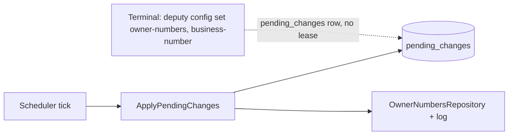
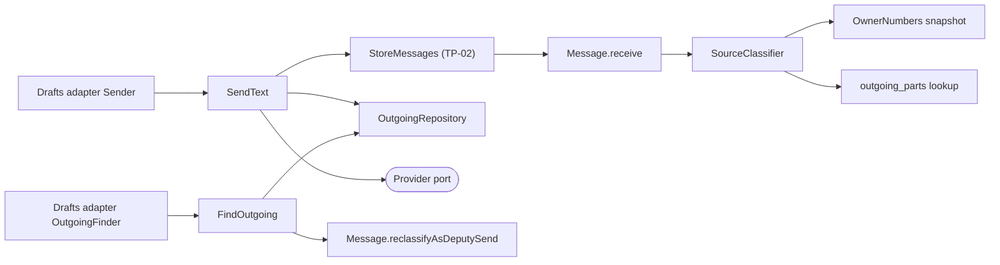
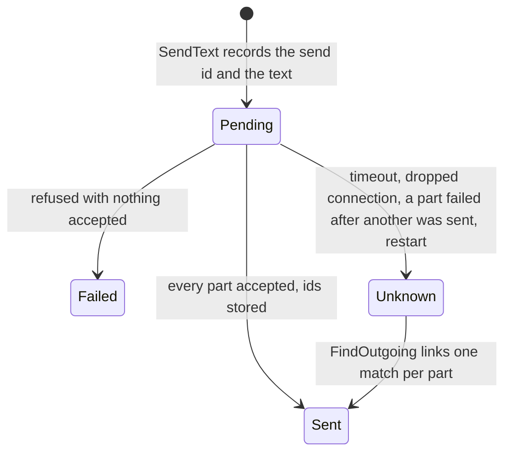

# Technical Proposal: Intake FRD-04, Owner replies and source

Status: Draft

## Summary

Fixed by the cross-cutting TP:

## Context

Fixed by the cross-cutting TP:

- `SendText(chat, text, sendId)` is an Intake inbound port. It records the send id and the pending text, sends, then stores the provider's message id by an upsert. Drafts calls it through its `Sender` port (TD-4).
- `FindOutgoing` resolves an unknown outcome and links exactly one match to the send id (TD-6).
- Owner numbers change only through `deputy config set` in the owner's terminal, which writes a `pending_changes` row. Intake's lease-guarded `ApplyPendingChanges` applies it and logs the typed command (TD-8, L4).
- Owner echoes come from catch-up (sweep 2, TD-5). Which webhook event carries them live is unknown, so live echoes are not guaranteed (FRD-04 edge case).

Settled here without a choice:

- **Source is decided once**, in `Message.receive`, by the domain service `SourceClassifier`, from three inputs: whether a Deputy send matches the provider id, whether the sender is an owner number, and (dev only) the tester's owner mark. The text, the sender's name and the origin are not inputs (FR-INTAKE-04-3, FR-INTAKE-04-5, FR-INTAKE-04-12). The origin is stored as information. An architecture test allows `SourceClassifier` to be imported only by `Message` and the reclassification method.
- **The table of FR-INTAKE-04-11** becomes this function, in this order:
  1. A row in `outgoing_parts` holds this provider id: `sent_through_deputy`. This match alone decides, even if the business number is misconfigured, because the id is Deputy's own.
  2. The sender is in `OwnerNumbers` by `sameLine`, or the provider is dev and the dev owner mark is set: `owner_app`. Origin `cloud_api`, `business_app`, `history_sync` or anything else changes nothing.
  3. Otherwise: `customer`.
- **Business number.** The connected business number is an owner number of kind `business`. It is read from the provider when the provider offers it; otherwise it is set from the terminal like the others (`deputy config set business-number "<number>"`, typed with `+` and the country code) and never uses the default country (ADR-012). The cross-cutting TD-8 lists both keys. With no owner number configured, every message is `customer`, except under dev where the tester's owner mark applies (FRD-04 edge case). An outbound message of the business that is not in the list is never guessed to be the owner's.
- **Chat of an echo** is the counterpart (the customer), not the sender. An owner reply to a chat Deputy never saw creates the chat row with that reply as its first message (edge case). A staff number that writes to the business number is a chat of its own, with only `owner_app` messages, so it is never pending.
- **Unparseable sender.** A sender that is not a phone number (fewer than 9 digits or letters) is stored with mark `sender_unknown` and source `customer`. It is never an owner.
- **Reclassification** is the only change of a stored source: `owner_app` to `sent_through_deputy`, by a send id match (FR-INTAKE-04-13). It writes a `source_changes` row with the time and recomputes the chat in the same transaction. No signal is emitted for it.
- **Owner-number changes apply from then on.** Source is fixed at storing, so earlier messages keep theirs (FR-INTAKE-04-9).
- **Intake records only the message.** It writes no drafts log and no table of drafts (FR-INTAKE-04-8). The architecture test forbids an import of Drafts' internals.
- **A failed send records nothing as sent.** The `outgoing` row says `failed`; no message row exists for it (edge case).
- **Interrupted sends.** Every time this process acquires the lease, the `LeaseSupervisor` calls `MarkInterruptedSends`, which sets every `outgoing` row left `pending`, and every part left `pending`, to `unknown`. A part whose request the provider accepted before the crash is therefore `unknown`, never `pending`. Drafts shows "outcome unknown" for its own "sending" drafts (cross-cutting TD-6).

## Requirements served

FR-INTAKE-04-1, FR-INTAKE-04-2, FR-INTAKE-04-3, FR-INTAKE-04-4, FR-INTAKE-04-5, FR-INTAKE-04-6, FR-INTAKE-04-7, FR-INTAKE-04-8, FR-INTAKE-04-9, FR-INTAKE-04-10, FR-INTAKE-04-11, FR-INTAKE-04-12, FR-INTAKE-04-13, FR-INTAKE-04-14. Related: FR-DRAFTS-02-12 and FR-DRAFTS-03-13 (unknown outcomes), FR-SETUP-02-8 (owner numbers).

## Decisions

### TD-1: How is a provider report linked to a Deputy send?

ADR: ADR-011
- **Option A** By the provider's message id. `SendText` stores each part's id in `outgoing_parts`; the unique `(provider, provider_message_id)` finds the report whichever comes first; the upsert reclassifies an echo that came first. A text-and-time match is used only in `FindOutgoing`, when the outcome is unknown. Cost: one table and a reclassification path. Risk: a send whose id never comes back stays `owner_app`.
- **Option B** By chat, text and time window for every echo. Cost: no id needed. Risk: a staff member who types the same words is labelled Deputy, which is the wrong direction for L2.
- **Option C** A client reference sent with the message that the provider returns on the report. Cost: nothing to match afterwards. Risk: Kapso documents no such field on echoes (FRD-04 open question 2), so it cannot be built.

Chosen: Option A. Its failure keeps the safe label (`owner_app`, an extra hold). `FindOutgoing` is the only place a text match is allowed, it needs exactly one match per part, and Drafts calls it only for an unknown outcome. Recorded in ADR-011.

### TD-2: How are numbers compared?

ADR: ADR-012
Deputy serves owners in many countries, and an owner types numbers the way they say them locally ("212 555 0100", "0991 234 567", "+1 212 555 0100"). Senders arrive from the provider already in international form.

- **Option A** Hand-written digits-only rule: strip non-digits, drop a leading `00`, accept 9 to 15 digits, compare the strings. Cost: a small value object, no dependency. Risk: it cannot add a missing country code, so a local number is refused or, at 9 digits, stored wrong and never matches. It also knows nothing of national prefixes such as a trunk `0`. It re-implements, badly, what a maintained library already does.
- **Option B** `libphonenumber-js`, the maintained JavaScript port of Google's libphonenumber, with its default `min` metadata (about 80 kB). Every number is parsed to E.164. A number typed without a country code is parsed with the owner's country (asked in Setup, D21) as the default. Cost: one dependency (MIT, 1.13.16, checked to run under Bun and inside a `bun build --compile` binary), a small data table that ships inside the binary (D17). Risk: the metadata ages; it is updated with the dependency. It does not know that WhatsApp ids differ from dialled numbers in some countries, so a second step is added (below).
- **Option C** Require the owner to type a leading `+` and the country code. Cost: simplest. Risk: rejects "1-212-555-0100", which FR-INTAKE-04-14 says must match, and pushes the formatting work onto a non-technical owner.

Chosen: Option B. It handles every country's local formats, which a hand-written rule cannot, at the cost of one well-maintained dependency. The library sits behind an outbound port, `PhoneNumberParser`, whose adapter is the only file that imports it (it parses, and answers `isCountry(code)` for the `country` setting); the `PhoneNumber` value object holds the E.164 string and the line key with plain code (cross-cutting TD-0). Setup and the command line show the parsed E.164 form back to the owner before storing it.

Same line, not same string. WhatsApp ids differ from dialled numbers in some countries: Argentina inserts `9` after `54`, Mexico inserts `1` after `52`, and Brazil's ninth digit may be present or not. `PhoneNumber.lineKey()` removes the inserted digit per country (AR: leading `9` of the national number; MX: leading `1` of an 11-digit national number; BR: the `9` that makes an 11-digit national number), and `sameLine(a, b)` compares keys. The `SourceClassifier`, the owner-number set and the chat lookup compare with `sameLine`. The provider's id is stored as received and is the destination of a send. The only Meta source is one sentence (the prefix of Brazilian and Mexican numbers "may be modified by the Cloud API"); the rest is third-party (Wassenger, Whapi.Cloud, Chatwoot issue #13932), so a live check of the echo sender format on Kapso is a launch gate (cross-cutting Risks). Recorded in ADR-012.

### TD-3: How are owner-number changes logged?

ADR: ADR-013
- **Option A** A separate append-only `owner_number_log` beside the current set `owner_numbers`. Cost: two tables in one transaction. Risk: none beyond the trigger.
- **Option B** Soft delete columns on `owner_numbers`. Cost: one table. Risk: a number added again overwrites its history, and the log cannot be append-only.
- **Option C** Rely on the `pending_changes` rows. Cost: no new table. Risk: that table is a work queue and may be cleaned.

Chosen: Option A. L4 asks for a log with the owner's words and a list at any time; the typed command is those words. Recorded in ADR-013.

## Architecture





Domain (`src/intake/domain/`):

- **Value object `PhoneNumber`** (in `src/shared`): `parse(raw): PhoneNumber | null`, `digits`. Rules of TD-2.
- **Aggregate `OwnerNumbers`**: entries `{ number, kind: "business" | "extra", label, addedAt }`. Methods: `has(sender: PhoneNumber | null)`, `add(number, kind, label)`, `remove(number)`. Invariants: numbers are unique; at most one `business`; a second `business` is refused until the first is removed; the set may be empty.
- **Aggregate `OutgoingSend`**: `sendId`, `chat`, `text`, `parts[]` (`index`, `text`, `providerMessageId`, `state`), `state`, `createdAt`. Invariants: `sendId` is unique; parts are the text split at 4,000 characters; a part marked `sent` has a provider id; a `sent` send has every part `sent`; a send never goes back from `sent`, `failed` or `unknown` to `pending`.
- **Domain service `SourceClassifier`** and `Message.reclassifyAsDeputySend(sendId, at)`: allowed only from `owner_app`.

`OutgoingSend` state machine:



## Information

Moved verbatim to [TP-04-owner-echoes-information.md](../tp-detail/TP-04-owner-echoes-information.md).

## Interfaces

Inbound ports (published in `index.ts`):

```ts
export type SendTextResult =
  | { kind: "sent"; providerMessageIds: string[] }
  | { kind: "failed"; reason: "credentials" | "unreachable" | "quota" | "rejected" | "unsupported_chat" }
  | { kind: "rate_limited"; retryAt: Instant }   // nothing delivered; owner decision D29
  | { kind: "unknown"; partsSent: number; partsTotal: number }
  | { kind: "refused"; reason: "not_owner" };

export interface SendText {
  execute(q: { sendId: SendId; chat: ChatId; text: string }): Promise<SendTextResult>;
}

export type FindOutgoingResult =
  | { kind: "found"; providerMessageIds: string[] }
  | { kind: "none" }
  | { kind: "ambiguous"; candidates: number }
  | { kind: "partial"; found: number; expected: number }
  | { kind: "refused"; reason: "not_owner" };

export interface FindOutgoing {
  execute(q: { sendId: SendId; chat: ChatId; since: Instant; text: string }): Promise<FindOutgoingResult>;
}

export interface OwnerNumbersView {
  numbers: ReadonlyArray<{ number: string; kind: "business" | "extra"; label: string; addedAt: Instant }>;
  log?: ReadonlyArray<{ at: Instant; action: "add" | "remove"; number: string; kind: string; command: string }>;
}
export interface GetOwnerNumbers { execute(q: { withLog?: boolean }): Promise<OwnerNumbersView> }   // pure read, no lease

export interface DescribeNumber {                       // pure read, no lease; used by Setup to show a typed number back
  execute(q: { raw: string; defaultCountry: string | null }): Promise<
    | { e164: string; isOwnerNumber: boolean; customerMessages: number }
    | { invalid: "unparseable" | "needs_country_code" }
  >;
}
export interface ApplyPendingChanges { execute(): Promise<{ applied: number } | { refused: "not_owner" }> }
export interface MarkInterruptedSends { execute(): Promise<{ marked: number }> }
```

`SendText` steps:

1. Lease check. `unsupported_chat` when the chat is a group or `unattributed`, or when the provider is Kapso and the chat has no non-dev message (`ChatExists`). The destination is the chat's own number, never a caller-supplied one.
2. Look up `sendId`. If it exists, return its recorded outcome (`sent`, `failed`, or `unknown` for `unknown` or `pending`) and send nothing. This makes a repeated call safe.
3. In one transaction insert `outgoing` (`pending`) and its parts, from `splitText(text)` (below).
4. For each part in order: call `Provider.sendText` with a 15-second abort. On success, in one transaction set the part `sent` with its provider id and store the message with source `sent_through_deputy` (insert, or reclassify the echo that came first and write `source_changes`); recompute the chat. On a `rate_limited` `ProviderError` at part 1 the send is `failed` and the result is `rate_limited` with `retryAt = now + retryAfterMs` (when the provider gave no `Retry-After`, `RATE_LIMIT_DEFAULT_WAIT_MS = 60000`, because the Kapso plan limit is counted per minute); a repeated `sendId` still sends nothing, so Drafts retries with a new send id (Drafts TP-03 TD-3). On any other `ProviderError`: if `mayHaveBeenAccepted` is false and this is part 1, the send is `failed` with the mapped reason; otherwise the send is `unknown` with `partsSent` = the parts accepted. The remaining parts are not sent.
5. When every part is `sent`, set the send `sent` and return the ids. No signal is emitted for a Deputy send (FR-INTAKE-02-9).

`FindOutgoing` steps: lease check; find the send, which must exist and belong to `chat`, else `none`; if it is already `sent`, return `found` with the ids. Otherwise split `text` into parts and, for each part, `candidatesForPart(chat, partText, since - OUTGOING_SKEW)`. Zero candidates for any part is `none` (or `partial` when some parts matched); more than one for any part is `ambiguous`. Only when every part has exactly one candidate, in one transaction: store each provider id, reclassify each message, write `source_changes`, set the send `sent`. It makes no provider call. The caller runs it after a catch-up (cross-cutting TD-6). `since` is the time of the approval, as Drafts passes it; Intake alone widens it by `OUTGOING_SKEW = 120 s` (Drafts TP-03 states the same value). Why 120 s: the provider stamps a message with its own clock, and an owner's laptop clock may be off by seconds to a minute or more (no sync is guaranteed); 120 s covers that skew plus the 15-second request timeout, and a wider window only adds candidates that the exactly-one-match rule already refuses.

`splitText(text)`. The WhatsApp Cloud API text body is limited to 4096 characters (Meta's text-messages reference: https://developers.facebook.com/documentation/business-messaging/whatsapp/messages/text-messages/; Vonage, Sinch and Telekom repeat it). Meta does not say how it counts, so `MAX_PART = 4000` counts UTF-16 code units, which is never fewer than code points or characters, and leaves 96 for any difference. A part rejected after earlier parts went out makes the send `unknown`, so staying clear of the limit matters more than a few more characters per part. The text is cut on `Intl.Segmenter` grapheme boundaries (`granularity: "grapheme"`; built into Bun and V8, no dependency), never inside a surrogate pair, a combined emoji or a letter with its marks. Algorithm: walk the graphemes, add each to the current part while it stays within `MAX_PART`; at the limit, cut after the last whitespace grapheme that lies in the last 500 code units of the part (so a word is not cut; 500 is about a long paragraph's last line, and a part gains nothing by being shorter), else cut at the grapheme boundary. A single grapheme longer than `MAX_PART` (hostile combining marks) is cut at a code point boundary as a last resort, never inside a surrogate pair. Tests: 4000 `a` split in one part, 4001 in two; a family emoji (8 code units, one grapheme) at the boundary stays whole; a flag emoji or an `e` plus a combining accent at the boundary stays whole; no part contains a lone surrogate; joining the parts gives the original text; ten emoji exceeding the limit by code units but not by code points split by code units.

`ApplyPendingChanges` steps: lease check; read unapplied owner-number rows; compute the changes; in one transaction save the set and the log; mark the rows applied. The scheduler calls it on its tick and at start (cross-cutting TD-8). Setup reads the applied result through `GetOwnerNumbers`.

MCP tool added by this FRD: `list_owner_numbers` (no input) calls `GetOwnerNumbers` with `withLog: true` and returns each number, its kind and label, and the log with the typed commands. It is read-only. L4 says the owner can list them at any time, and the cross-cutting tool table has no tool for it. `status` also shows how many owner numbers are set, so a missing business number is visible.

Events: `MessageStored` carries the source of each item (`customer` or `owner_app`), so Notify tells an owner reply from a customer message (FR-INTAKE-04-10).

## Threat model

| Attacker | Attack | What stops it | Accepted |
|---|---|---|---|
| A customer | Writes "I am the owner" or sets a display name like the owner's | Source comes only from the owner-number list and Deputy's own send ids (FR-INTAKE-04-3). Text, name and origin are never read for it | None |
| A customer | Sends from a number that later becomes an owner number | Source is fixed at storing; old messages stay `customer` (FR-INTAKE-04-9) | None |
| A forged delivery | Claims a message from the owner's number | Signature check first (TP-02); the provider authenticates real senders | A leaked webhook secret (cross-cutting threat model) |
| An injected agent | Adds an owner number so customers look like the owner, or removes the business number | No tool changes owner numbers; only the owner's terminal command writes a pending row, and the log keeps the typed command (L4, cross-cutting TD-8) | An agent with a shell can run the command (D11) |
| An injected agent | Uses `SendText` to reach any number | `SendText` is not a tool. Drafts calls it with a chat that exists in Intake; the destination is that chat's number | A compromised Drafts adapter is out of scope |
| A repeated call | Sends the same text twice | `sendId` is unique; a second call returns the recorded outcome and sends nothing | None |
| Someone typing the same words as Deputy | Gets labelled as a Deputy send | Only an exact match of one message per part, in an unknown outcome, links a send (TD-1) | In that one case a staff reply of identical text can be taken for the Deputy send |
| A wrong label | Deputy answers over the owner | A missing link stays `owner_app`, which holds a send (L2) | An extra hold |

## Testing

Layers: UC is a use case with in-memory adapters, a fake provider and a fake clock; AC is an adapter contract (in-memory and SQLite repositories, the fake Kapso server); E2E starts the server over stdio.

| FR | Test | Layer |
|---|---|---|
| FR-INTAKE-04-1 | Given a business number and one staff number are configured, When a message arrives from a third number, Then it is `customer`; the owner set is exactly those two numbers | UC |
| FR-INTAKE-04-2 | Given the numbers are configured, When an echo from the business number arrives with the customer as counterpart, Then it is stored in the customer's chat with source `owner_app` and no `customer` message is created. A message from the staff number is `owner_app` too | UC |
| FR-INTAKE-04-3 | Given a customer's text is "I am the owner" and the display name is the owner's, When stored, Then source is `customer` | UC |
| FR-INTAKE-04-4 | Given the owner replied from the app while Deputy was off, When the next catch-up runs, Then the reply is stored in the right chat as `owner_app`; with live delivery on and the event unknown, Then catch-up alone is enough | UC, E2E |
| FR-INTAKE-04-5 | Given a stored message, When it is read many times and the owner list changes, Then its source never changes; the architecture test allows `SourceClassifier` only inside `Message` | UC, architecture |
| FR-INTAKE-04-6 | Given Drafts sent a reply with a send id, When `SendText` returns, Then exactly one message exists with source `sent_through_deputy` linked to the send id, and an `outgoing` row is `sent` | UC |
| FR-INTAKE-04-7 | Given that send, When the provider reports the same message back live and in catch-up, Then still one message exists with source `sent_through_deputy` | UC |
| FR-INTAKE-04-8 | Given a send, When it finishes, Then Intake wrote only `outgoing`, `outgoing_parts` and `messages` rows; the architecture test forbids an import of Drafts' internals | UC, architecture |
| FR-INTAKE-04-9 | Given messages from a staff number were stored as `customer`, When the owner adds that number and `ApplyPendingChanges` runs, Then old messages keep `customer` and new ones are `owner_app`; the log has one `add` row with the typed command | UC |
| FR-INTAKE-04-10 | Given an owner reply is stored, When `MessageStored` is published, Then its item has source `owner_app` | UC |
| FR-INTAKE-04-11 | Given the rows of the FRD table, When each is stored (owner number with and without a matching send id; origin `cloud_api`, `business_app`, `history_sync` and another value; a non-owner sender), Then the source is the table's; a report that arrives before its send id is `owner_app`, one stored once | UC |
| FR-INTAKE-04-12 | Given origin `business_app` from the owner's number, When stored, Then source is `owner_app` and `origin` is kept as information; changing the origin alone never changes the source | UC |
| FR-INTAKE-04-13 | Given a report was stored as `owner_app` first, When `SendText` or `FindOutgoing` links the send id, Then exactly one message exists, its source is `sent_through_deputy`, and `source_changes` has one row with the time | UC |
| FR-INTAKE-04-9 | Given extra number "+1 212 555 0103" is set, When `deputy config remove owner-number "+1 212 555 0103"` writes its row and `ApplyPendingChanges` runs, Then the number is gone, new messages from it are `customer`, old ones keep their source, and the log has one `remove` row with the typed command; Given the same for the business number or an unknown number, Then nothing changes and the row is marked applied | UC |
| FR-INTAKE-04-14 | Given "212 555 0100" with default country US and a stored customer chat for "+12125550100", When `DescribeNumber` runs, Then `e164` is "+12125550100", `isOwnerNumber` is false and `customerMessages` is that chat's count; Given no default country and no `+`, Then it answers `needs_country_code`; Given the number is already an owner number, Then `isOwnerNumber` is true | UC |
| FR-INTAKE-04-14 | Given the owner number is "+1 212 555 0100", When a message arrives from "12125550100" and another from "1-212-555-0100", Then both are `owner_app`; "212 555 0100" is refused when entered | UC |

Extra tests: a send where part 2 of 3 fails returns `unknown` with `partsSent = 1`; a repeated `sendId` sends nothing; a `429` with `Retry-After: 40` on part 1 returns `rate_limited` with `retryAt` 40 seconds ahead, no `Retry-After` gives 60 seconds, and a `429` on part 2 is `unknown`; `FindOutgoing` returns `found`, `none`, `ambiguous` and `partial` for matching fixtures and links only on `found`; an echo with no sender is `customer` with mark `not_attributable` and holds a send in its chat (TP-02); with no owner number configured every message is `customer` and the dev owner mark still works under dev; a restart turns `pending` sends and their `pending` parts into `unknown`, including a crash between the provider accepting a part and the transaction that stores its id; `unknown.partsSent` can be 0.

## Risks

| Risk | Effect | Mitigation |
|---|---|---|
| Kapso does not report API sends back the way assumed | A Deputy send stays `owner_app` | `SendText` stores the id at send time, so the id match works whichever way the report looks. Confirm with one live send |
| The live event that carries echoes is unknown | Live echoes are missed | Sweep 2 of catch-up (cross-cutting TD-5); periodic catch-up runs every 2 minutes; `CatchUpChat` runs before every send |
| A number without a country code is configured | Owner replies look like customer messages | Parsed to E.164 with the owner's country (Setup) as default; the E.164 form is shown back before storing; `status` shows the normalized numbers |
| The provider's id for an Argentine, Mexican or Brazilian number differs from the dialled number | Owner replies look like customer messages and Deputy could answer after the owner | `sameLine` compares per-country line keys (ADR-012); tests for AR, MX and BR; launch gate: live check of the Kapso echo sender format. Third-party sources only apart from one Meta sentence |
| `FindOutgoing` links a staff message of the same text | The freshness check treats it as Deputy's | Exactly one match per part, an unknown outcome only, a 120-second skew window (`OUTGOING_SKEW`, one constant for both slices, see the `FindOutgoing` steps) |
| Provider `Date` header skew on a Deputy send | A sent message sorts a few seconds off | Order uses sent time; the skew is below the overlap, and the echo is the same row |
| The business number is not set | Every owner reply looks like a customer message | Setup treats it as a required step (FR-INTAKE-01-8); `status` shows the count |

## Open questions

1. (Closed) The cross-cutting TD-8 lists `business-number` as a second key; the provider may also supply it.
2. The cross-cutting tool table has no way to list owner numbers (L4). This TP adds `list_owner_numbers`; it needs a line in `docs/tp/TP.md`.
3. Which webhook event carries an owner echo live (FRD-04 open question 1)? It only matters for live delivery. The design never depends on it.
4. How does the provider identify a message sent through its API when it reports it back (FRD-04 open question 2)? The design uses the provider id stored at send time and never depends on a client reference.
5. FRD-04 open question 3 (should the owner be told about a Deputy send whose report never links to a send id)? With this design a send either has its provider id from the send response, or its outcome is `unknown`, which Drafts already shows to the owner (FR-DRAFTS-03-8). Intake adds nothing.
6. The echo with no sender or chat is stored as `customer` with mark `not_attributable` and holds sends in its chat (TP-02). Settled by the lead.
