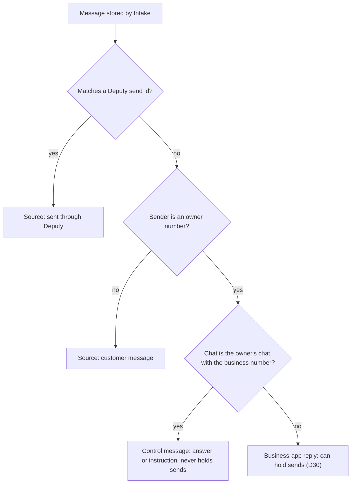
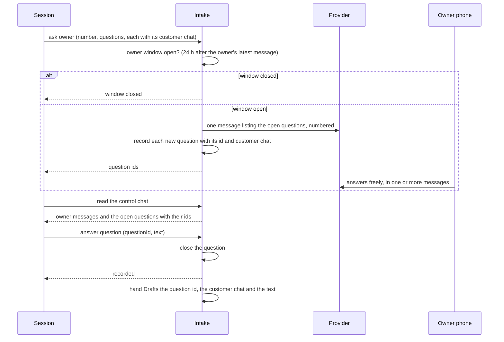

# Technical Proposal: The owner's control chat and the pilot tools (Intake FRD-05)

Status: Draft

## Summary

How Intake serves the local pilot (REQ-15): the owner's own number is a control chat, the open questions go to the owner in one numbered message and the session records each answer, each chat shows its window, and the business number and owner numbers are set without a terminal. The design adds no stored source value and one table, and changes no build today.

Last change: 2026-11-24, each question names its customer chat; before that: batched questions, the session records answers, removing a number deferred

## Context

- Source of requirements: [FRD-05](../frd/FRD-05-pilot-owner-chat-and-tools.md), D32 and D37, REQ-15. Cross-cutting rules: [TP.md](../../tp/TP.md) TD-3 (SQLite), TD-8 (sensitive settings).
- Today a message from an owner number is stored with source `owner_app` and a chat of its own, which is never pending and is marked `normal`, so it never holds a send (Intake TP-04). The hold of D30 comes only from the mark `not_attributable`.
- `SendText` already sends to any chat id. `Provider.businessNumber` exists and `CheckProviderAccess` reads it, but nothing records it. `DescribeNumber` already returns the E.164 form, whether the number is an owner number and its customer message count.

## Decisions

### TD-1: How is the control chat told apart?

- **Option A** By the chat: a chat whose id is the line of an owner number that is not the business number. No new stored value. Cost: a read-time rule. Risk: none for storage.
- **Option B** A new source value `owner_control`. Cost: the `source` column has a CHECK constraint, so a table rebuild, and the Drafts ports that repeat the union change. Risk: a wider change than the pilot needs.
- **Option C** A new mark value. Cost: the same rebuild for the `mark` CHECK.

Chosen: Option A. Messages in the control chat stay `owner_app`, are marked `normal` and never set `lastUnattributedAt`, so FR-INTAKE-05-2 and FR-INTAKE-05-3 already hold for storage; the new rule only labels them for the session and keeps them out of the pending list. ADR: none: it follows TP-04's classification and adds no stored value.

### TD-2: Where are questions kept?

- **Option A** A table `owner_questions` (number, owner chat, customer chat, text, asked at, send id, answer, closed at), a new numbered migration. Cost: one migration. Risk: low.
- **Option B** Derive questions from the outgoing sends to the owner chat. Cost: no table. Risk: a question has no stable id and "open" cannot be stored.
- **Option C** Keep them in memory. Risk: a restart forgets an open question.

Chosen: Option A. ADR: none: a table for one list of rows, as TD-3 of the cross-cutting TP says for Deputy's data.

### TD-3: How does an answer reach a question?

- **Option A** The session reads the control chat together with the open questions, decides which answer belongs to which question, and records it with `answer_question(questionId, text)`. Intake closes the question and hands Drafts the id and the text. Cost: the session does the matching. Risk: a false answer (see the threat model).
- **Option B** Intake reads a number at the start of the reply and links by it. The owner ruled this out: Deputy does not parse numbers.
- **Option C** Intake links every reply to the latest open question. Risk: two open questions get mixed.

Chosen: Option A (FR-INTAKE-05-9, FR-INTAKE-05-10, FR-INTAKE-05-24, FR-INTAKE-05-11, FR-INTAKE-05-22), the check of FR-INTAKE-05-24 keeps it to the owner's words. ADR: none: a rule of two tools.

### TD-4: How is a window known?

- **Option A** Computed on read: the customer window is the customer's latest message time plus 24 hours, and the owner window is the latest message the owner number sent to the business number plus 24 hours. Cost: none stored.
- **Option B** A stored "window closes at" column kept up to date on every message. Risk: a second copy to keep right.

Chosen: Option A. ADR: none: the times are already stored (`lastCustomerAt`, the messages).

### TD-5: When is the business number recorded?

- **Option A** At start, after the provider is chosen: ask the provider once and record the number when none is recorded.
- **Option B** On demand, when the session asks. Risk: the first send fails before anyone asks.

Chosen: Option A (FR-INTAKE-05-15). The write uses the owner-number repository inside one unit of work, logged with the command "provider". ADR: none: it reuses `ApplyPendingChanges`' log.

### TD-6: How does set_owner_numbers confirm?

- **Option A** Two calls: the first returns the parsed form (via `DescribeNumber`) and writes nothing; the second carries the confirmation and writes.
- **Option B** One call that writes at once. Risk: the owner never sees the number back (ADR-012 says it is shown before storing).

Chosen: Option A (FR-INTAKE-05-17 and FR-INTAKE-05-18). ADR: none: ADR-012 already requires showing the E.164 form before storing.

## Architecture

A message in the owner's chat stays `owner_app`; the chat, not a new stored value, makes it a control message.

Asking the owner and recording the answers. The session matches answers to questions; Intake does not.

## Interfaces

Inbound tools (the intake tools file registers them; each calls one use case):

- `ask_owner { number, questions }` (`questions` is a list of `{ chatId, text }`) returns `{ questionIds }` or `{ refused: "window_closed" | "not_an_owner_number" | "not_owner" }` or the send failure of `SendTextResult`. Lease required.
- `answer_question { questionId, text }` returns `{ recorded }` or `{ refused: "unknown_question" | "not_owner_words" | "not_owner" }`. Lease required.
- `list_pending {}` returns `[{ chat, lastCustomerAt, windowClosesAt }]`, newest first. A read, no lease.
- `get_chat` gains `windowClosesAt` for a customer chat and, for the control chat, `openQuestions` next to the messages. A read.
- `set_owner_numbers { number, ownerWords, confirm? }` returns the described number, or `{ added }` with `confirm`. Lease required.

A shared signal `OwnerAnswered { questionId: string; chatId: string; text: string; at }` (in `src/shared/signals.ts`, part of `IntakeEvent`, published after the commit like `OwnerReplyUnlinked`) is the hand-off to Drafts, whose `OwnerAnswer` has the same fields. Drafts' go arrives from the session's `answer_question` call.

Outbound port added: `OwnerQuestionRepository` (`add`, `listOpen`, `answer`), a SQLite adapter, a migration `0008-owner-questions.sql` appended to the list in `src/main/database.ts`.

## Information

One new table, created by a numbered migration (`0008-owner-questions.sql`):

| Column | Meaning |
|---|---|
| `number` | A whole number in one sequence; its decimal text is the question id the session, the owner and Drafts see. |
| `owner_chat` | The chat id of the owner number the question went to. |
| `chat_id` | The customer chat the question is about. |
| `text` | The question text as sent (the session's words). |
| `asked_at` | The time the question was sent. |
| `send_id` | The send id of the outgoing message, so a failed send can be found. |
| `answer` | The text the session recorded as the owner's answer, or empty while the question is open. |
| `closed_at` | The time the answer was recorded, or empty. |

Nothing else changes in storage (TD-1 and TD-4).

## Threat model

- A customer claims to be the owner: the control chat is decided by the owner numbers only (FR-INTAKE-05-1), so a customer message stays a customer message.
- The session is talked into asking a stranger: `ask_owner` sends only to an owner number (FR-INTAKE-05-8), so it cannot be used as a send path to a customer.
- The session is talked into recording an answer the owner never gave, which Drafts would take as a go: Intake refuses unless the text is contained in a message the owner sent in the control chat after the question was asked (FR-INTAKE-05-24), the owner-words rule of docs/adr/ADR-006-draft-send-path.md and Drafts ADR-003, matched on whole tokens. The session can still pick the wrong question for a real owner message; the owner reads the draft before it goes.
- A stolen owner phone sends instructions: out of scope; removing a number is deferred (FR-INTAKE-05-23).

## Testing

- Each use case has an in-memory test first; a control message never sets `lastUnattributedAt`, a Business-app echo still does; `ask_owner` never sends with the window closed and sends one message for all open questions; an answer closes only an open question and publishes once.
- One end-to-end test through the harness: a fake provider, an owner number, a question out, an answer recorded.

## Risks

- A long list of open questions in one message: WhatsApp limits a text part (`MAX_PART`), and `SendText` already splits; the numbered lines stay in order.
- Two owner numbers answering the same question: the first recorded answer closes it, the second is refused (FR-INTAKE-05-10).
- The window rule uses the provider's message time; clock skew is the same as for customer messages (TP-03).

## Open questions

See FRD-05: the business number when the provider offers none.
