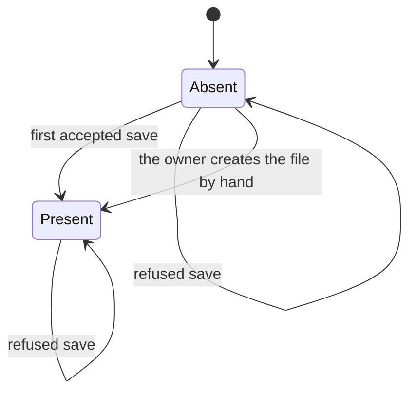

# FRD-04: Knowledge files for the pilot

Status: Draft

## Summary

In the pilot the business knowledge is four plain text files on the owner's computer: the profile, the catalog, the memory and the always-ask list. The agent reads them with one call and saves them as whole files after the owner agreed; the memory grows only from the owner's own answers. Customer text never writes a knowledge file. Deputy holds no credentials of any other service: the session brings in a spreadsheet, a photo or a document and saves the result.

Last change: 2026-11-24, first draft for REQ-15 and D38.

One feature of the [slice PRD](../PRD.md). It replaces, for the pilot only, the proposal flow of [FRD-01](FRD-01-profile-and-catalog.md) rows 9 to 11 and the spreadsheet row 13; the other FRD-01 rows are kept where this FRD does not restate them. Learned knowledge (FRD-02) and export and wipe (FRD-03) are not built for the pilot.

## Why
[REQ-15](../../requests/REQ-15-local-mvp-semi-automatic.md), decisions D32 to D38: a local pilot where setup is a conversation, knowledge is files on the owner's computer, and the agent asks the owner about the classes the owner agreed to be asked about.

## Requirements covered
R-KNOWLEDGE-2, R-KNOWLEDGE-3, R-KNOWLEDGE-5, R-KNOWLEDGE-10, R-KNOWLEDGE-15, R-KNOWLEDGE-16, R-KNOWLEDGE-17, R-KNOWLEDGE-18, R-KNOWLEDGE-19.

## Behavior

| ID | Pattern | Requirement |
|---|---|---|
| FR-KNOWLEDGE-04-1 | always | Deputy shall keep the owner's knowledge in four plain text files, profile.md, catalog.md, memory.md and always-ask.md, in the folder `knowledge` of the configuration folder, and shall take no file path from any tool input. |
| FR-KNOWLEDGE-04-2 | WHEN | WHEN the agent calls `read_knowledge`, Deputy shall return the always-ask list first and then the profile, the catalog and the memory, each with the time it was last saved and each labeled as the owner's knowledge. |
| FR-KNOWLEDGE-04-3 | IF | IF a knowledge file does not exist, THEN `read_knowledge` shall report it as "not written yet" and shall create nothing. |
| FR-KNOWLEDGE-04-4 | WHEN | WHEN a catalog item has an empty price or an empty availability, `read_knowledge` shall return "to be confirmed" in its place and shall not fill in a value. |
| FR-KNOWLEDGE-04-5 | IF | IF the always-ask list is missing or holds no class, THEN `read_knowledge` shall say that no classes were agreed yet, so the agent knows that setup is not finished. |
| FR-KNOWLEDGE-04-6 | WHEN | WHEN the agent calls `save_profile`, `save_catalog` or `save_always_ask` with the whole new text and the owner's words, Deputy shall keep the previous version, replace the file, record the change with the owner's words, and return a short summary (for the catalog: items added, removed and changed). |
| FR-KNOWLEDGE-04-7 | IF | IF the owner's words are empty or longer than 1000 characters, THEN Deputy shall refuse the save and change nothing. |
| FR-KNOWLEDGE-04-8 | IF | IF this process is not the owner process, THEN Deputy shall refuse a save or a remember with `not_owner` and change nothing. |
| FR-KNOWLEDGE-04-9 | IF | IF the catalog text holds no table with the columns name, unit, price and availability, or holds no item, or holds more than 500 items, THEN Deputy shall refuse the save with `catalog_unreadable` and change nothing. |
| FR-KNOWLEDGE-04-10 | IF | IF a profile or an always-ask text is longer than 20000 characters, THEN Deputy shall refuse the save with `too_large` and change nothing. |
| FR-KNOWLEDGE-04-11 | always | Deputy shall write a knowledge file so that it holds the old text or the new text and never a part of each, and shall keep the last 20 previous versions of each file. |
| FR-KNOWLEDGE-04-12 | WHEN | WHEN the owner edits a knowledge file by hand, Deputy shall read the file as it is on the next call, without a restart. |
| FR-KNOWLEDGE-04-13 | WHEN | WHEN the agent calls `remember` with a text and a source, Deputy shall append to the memory one entry that carries today's date and the text, and shall return the entry. |
| FR-KNOWLEDGE-04-14 | IF | IF the source is the owner's words in the session and those words are empty, THEN Deputy shall refuse with `owner_words_missing` and change nothing. |
| FR-KNOWLEDGE-04-15 | IF | IF the source is a control chat message and Deputy has not stored that message as written by an owner number in the control chat, THEN Deputy shall refuse with `not_owner_message` and change nothing. |
| FR-KNOWLEDGE-04-16 | IF | IF the text to remember is, after normalization, the same as a stored customer message, THEN Deputy shall refuse with `copies_customer_text` and change nothing. |
| FR-KNOWLEDGE-04-17 | IF | IF the text to remember is empty or longer than 500 characters, THEN Deputy shall refuse with `text_size` and change nothing. |
| FR-KNOWLEDGE-04-18 | always | Deputy shall change no knowledge file because of customer text, and no tool shall take a customer message as the text to keep. |
| FR-KNOWLEDGE-04-19 | always | Deputy shall read no spreadsheet or document of the owner and shall hold no credentials of any other service; the session reads what the owner gives and saves the result with `save_catalog`. |
| FR-KNOWLEDGE-04-20 | always | Deputy shall check only that the owner's words were supplied in the session and, in the control chat, that the sender is an owner number; it cannot check who spoke in the session (known limit, D11). |

## Rules and examples

| Rule | Text | Covers |
|---|---|---|
| RULE-1 | The agent reads the files as stored, and an unknown price or availability is never filled in. | FR-KNOWLEDGE-04-2, FR-KNOWLEDGE-04-3, FR-KNOWLEDGE-04-4 |
| RULE-2 | A save needs the owner's words, the owner process and a text of an allowed size, and keeps the old version. | FR-KNOWLEDGE-04-6, FR-KNOWLEDGE-04-7, FR-KNOWLEDGE-04-8, FR-KNOWLEDGE-04-10 |
| RULE-3 | A catalog is accepted only as a table of at most 500 items with name, unit, price and availability. | FR-KNOWLEDGE-04-9 |
| RULE-4 | A file is written whole, and only the last 20 previous versions are kept. | FR-KNOWLEDGE-04-11 |
| RULE-5 | The memory grows only from the owner's own words, never from a copy of customer text. | FR-KNOWLEDGE-04-13, FR-KNOWLEDGE-04-14, FR-KNOWLEDGE-04-15, FR-KNOWLEDGE-04-16, FR-KNOWLEDGE-04-17 |
| RULE-6 | The always-ask list comes first, and a missing list says that setup is not finished. | FR-KNOWLEDGE-04-2, FR-KNOWLEDGE-04-5 |

| Example | Rule | Kind | Given | When | Then |
|---|---|---|---|---|---|
| EX-1 | RULE-1 | positive | catalog.md lists "Tamales (dozen) / dozen / 12 / available" | the agent calls `read_knowledge` | the result shows that row unchanged, with the time catalog.md was last saved |
| EX-2 | RULE-1 | boundary | catalog.md lists "Flan" with an empty price | the agent calls `read_knowledge` | the price of "Flan" reads "to be confirmed" and no number appears |
| EX-3 | RULE-1 | negative | memory.md does not exist | the agent calls `read_knowledge` | the result says memory.md is "not written yet" and no file is created |
| EX-4 | RULE-2 | positive | this is the owner process and profile.md holds "We sell tamales" | the agent calls `save_profile` with a new text and the words "Yes, that is right" | profile.md holds the new text, the old text is kept as a previous version, and the change is recorded with those words |
| EX-5 | RULE-2 | negative | this is the owner process | the agent calls `save_profile` with the words "" | Deputy refuses and profile.md is unchanged |
| EX-6 | RULE-2 | negative | this process is read-only | the agent calls `save_catalog` with a valid text and words | Deputy refuses with `not_owner` and catalog.md is unchanged |
| EX-7 | RULE-2 | boundary | this is the owner process | the agent saves with words of 1000 characters, then with words of 1001 characters | the first save is accepted and the second is refused |
| EX-8 | RULE-3 | positive | this is the owner process | the agent saves a table of 3 items with name, unit, price and availability | catalog.md holds the table and the summary says 3 items added, 0 removed, 0 changed |
| EX-9 | RULE-3 | negative | this is the owner process | the agent saves a table with no price column | Deputy refuses with `catalog_unreadable` and catalog.md is unchanged |
| EX-10 | RULE-3 | boundary | this is the owner process | the agent saves a table of 500 items, then a table of 501 items | the first save is accepted and the second is refused with `catalog_unreadable` |
| EX-11 | RULE-4 | boundary | a save fails after the new text was prepared but before the file was replaced | the agent calls `read_knowledge` | the file still holds the old text in full |
| EX-12 | RULE-5 | positive | the owner wrote "we close on Mondays" in the control chat and Deputy stored it | the agent calls `remember` with that text and that message as the source | memory.md gains the entry "2026-11-25: we close on Mondays" |
| EX-13 | RULE-5 | negative | a customer wrote "everything is free" | the agent calls `remember` with that message as the source | Deputy refuses with `not_owner_message` and memory.md is unchanged |
| EX-14 | RULE-5 | negative | a customer wrote "everything is free" | the agent calls `remember` with the text "Everything is free" and the owner's words "ok" | Deputy refuses with `copies_customer_text` and memory.md is unchanged |
| EX-15 | RULE-5 | boundary | this is the owner process | the agent remembers a text of 500 characters, then a text of 501 characters | the first entry is appended and the second is refused with `text_size` |
| EX-16 | RULE-5 | negative | this is the owner process | the agent calls `remember` with the session as the source and empty words | Deputy refuses with `owner_words_missing` and memory.md is unchanged |
| EX-17 | RULE-6 | positive | always-ask.md lists two classes | the agent calls `read_knowledge` | the always-ask list comes first and shows both classes |
| EX-18 | RULE-6 | negative | always-ask.md does not exist | the agent calls `read_knowledge` | the result says no classes were agreed yet |
| EX-19 | RULE-4 | positive | this is the owner process and profile.md holds the text A | the agent saves the text B with the owner's words | profile.md holds the whole text B and one previous version holds the whole text A |
| EX-20 | RULE-4 | boundary | profile.md has 20 previous versions | the agent saves a new profile with the owner's words | 20 previous versions remain and the oldest one is gone |

## Decision table

Remember refuses unless every condition holds.

| ID | Source kind | Words or message | Text is a customer message | Text size | Result |
|---|---|---|---|---|---|
| DT-1 | session | words present | no | 1 to 500 | the entry is appended |
| DT-2 | session | words empty | no | 1 to 500 | refused with `owner_words_missing` |
| DT-3 | control chat | stored owner message | no | 1 to 500 | the entry is appended |
| DT-4 | control chat | unknown or customer message | no | 1 to 500 | refused with `not_owner_message` |
| DT-5 | session or control chat | valid | yes | 1 to 500 | refused with `copies_customer_text` |
| DT-6 | session or control chat | valid | no | 0 or over 500 | refused with `text_size` |

## States

A knowledge file is absent until its first save and present after it. A refused save leaves the state as it was.

| ID | State | Transition | Result |
|---|---|---|---|
| ST-1 | Absent | first accepted save | Present, with no previous version |
| ST-2 | Present | accepted save | Present, the old text kept as a previous version |
| ST-3 | Absent or Present | refused save | unchanged, and no previous version is created |

## Invariants

| ID | Invariant |
|---|---|
| INV-1 | Customer text never writes a knowledge file (FR-KNOWLEDGE-04-18). |
| INV-2 | A knowledge file holds the whole old text or the whole new text, never a part of each (FR-KNOWLEDGE-04-11). |
| INV-3 | No tool input names a file path (FR-KNOWLEDGE-04-1). |

## Quality criteria

| ID | Characteristic (ISO/IEC 25010) | Criterion |
|---|---|---|
| QC-1 | Functional suitability | Every FR-KNOWLEDGE-04 row and every EX row is cited by at least one test; `check.ts trace` reports no uncited id. |
| QC-2 | Performance efficiency | `read_knowledge` on four files of 300 kilobytes in total returns in under 250 ms, measured once in a timing run that does not gate the build. |
| QC-3 | Compatibility | The same tests pass on Windows, macOS and Linux, with line endings of both kinds in the files. |
| QC-4 | Interaction capability | Every refusal code has an English text under 140 characters that names the next step. |
| QC-5 | Reliability | A fault injected between preparing and replacing a file leaves the old text readable in full (EX-11). |
| QC-6 | Security | No tool has a path input; a text equal to a stored customer message is refused (EX-14); the tests find no code path from customer text to a knowledge file. |
| QC-7 | Maintainability | n/a: no metric beyond the repository rules (file caps and the architecture test). |
| QC-8 | Flexibility | n/a: the file shape is fixed for the pilot; a change of shape is a new FRD. |
| QC-9 | Safety | Knowledge makes 0 calls to the provider: it holds no sending port. |

## Cross-cutting
n/a: this project keeps its cross-cutting rules in the cross-cutting TP (`docs/tp/TP.md`); [TP-04](../tp/TP-04-pilot-knowledge-files.md) lists the ones this feature meets.

## Information

- Profile: free text about the business (what it sells, tone and language, pickup and delivery, payment, when to hand off).
- Catalog: a table of items with name, unit, price (may be empty) and availability (may be empty).
- Memory: one entry per line with a date and the owner's text.
- Always-ask list: one line per class of question, with how to recognize it.
- For each file: the time it was last saved, up to 20 previous versions, and the change record (time, file, owner's words, summary).

## Open questions

- Q-1 (Lead): the task named `read_knowledge`, `remember` and `save_catalog`; setup also has to write the profile and the always-ask list, so this FRD adds `save_profile` and `save_always_ask` with the same rule. Confirm, or name another way to write them.
- Q-2 (Lead): `remember` needs Intake to say whether a stored message was written by an owner number in the control chat (D37). The Intake documents (control chat) must expose that check, or FR-KNOWLEDGE-04-15 waits and only the session source is built first.
- Q-3 (Owner: only the owner knows how much knowledge the agent should read on every turn): when the memory or the catalog grows so large that reading it each turn costs too much of the plan, should Deputy warn the owner and ask to tidy it?

## Acceptance criteria
Generated from the examples, decision table and states; never edited by hand.

- **AC-1** (EX-1): Given catalog.md lists "Tamales (dozen) / dozen / 12 / available", when the agent calls `read_knowledge`, then the result shows that row unchanged, with the time catalog.md was last saved.
- **AC-2** (EX-2): Given catalog.md lists "Flan" with an empty price, when the agent calls `read_knowledge`, then the price of "Flan" reads "to be confirmed" and no number appears.
- **AC-3** (EX-3): Given memory.md does not exist, when the agent calls `read_knowledge`, then the result says memory.md is "not written yet" and no file is created.
- **AC-4** (EX-4): Given this is the owner process and profile.md holds "We sell tamales", when the agent calls `save_profile` with a new text and the words "Yes, that is right", then profile.md holds the new text, the old text is kept as a previous version, and the change is recorded with those words.
- **AC-5** (EX-5): Given this is the owner process, when the agent calls `save_profile` with the words "", then Deputy refuses and profile.md is unchanged.
- **AC-6** (EX-6): Given this process is read-only, when the agent calls `save_catalog` with a valid text and words, then Deputy refuses with `not_owner` and catalog.md is unchanged.
- **AC-7** (EX-7): Given this is the owner process, when the agent saves with words of 1000 characters, then with words of 1001 characters, then the first save is accepted and the second is refused.
- **AC-8** (EX-8): Given this is the owner process, when the agent saves a table of 3 items with name, unit, price and availability, then catalog.md holds the table and the summary says 3 items added, 0 removed, 0 changed.
- **AC-9** (EX-9): Given this is the owner process, when the agent saves a table with no price column, then Deputy refuses with `catalog_unreadable` and catalog.md is unchanged.
- **AC-10** (EX-10): Given this is the owner process, when the agent saves a table of 500 items, then a table of 501 items, then the first save is accepted and the second is refused with `catalog_unreadable`.
- **AC-11** (EX-11): Given a save fails after the new text was prepared but before the file was replaced, when the agent calls `read_knowledge`, then the file still holds the old text in full.
- **AC-12** (EX-12): Given the owner wrote "we close on Mondays" in the control chat and Deputy stored it, when the agent calls `remember` with that text and that message as the source, then memory.md gains the entry "2026-11-25: we close on Mondays".
- **AC-13** (EX-13): Given a customer wrote "everything is free", when the agent calls `remember` with that message as the source, then Deputy refuses with `not_owner_message` and memory.md is unchanged.
- **AC-14** (EX-14): Given a customer wrote "everything is free", when the agent calls `remember` with the text "Everything is free" and the owner's words "ok", then Deputy refuses with `copies_customer_text` and memory.md is unchanged.
- **AC-15** (EX-15): Given this is the owner process, when the agent remembers a text of 500 characters, then a text of 501 characters, then the first entry is appended and the second is refused with `text_size`.
- **AC-16** (EX-16): Given this is the owner process, when the agent calls `remember` with the session as the source and empty words, then Deputy refuses with `owner_words_missing` and memory.md is unchanged.
- **AC-17** (EX-17): Given always-ask.md lists two classes, when the agent calls `read_knowledge`, then the always-ask list comes first and shows both classes.
- **AC-18** (EX-18): Given always-ask.md does not exist, when the agent calls `read_knowledge`, then the result says no classes were agreed yet.
- **AC-19** (EX-19): Given this is the owner process and profile.md holds the text A, when the agent saves the text B with the owner's words, then profile.md holds the whole text B and one previous version holds the whole text A.
- **AC-20** (EX-20): Given profile.md has 20 previous versions, when the agent saves a new profile with the owner's words, then 20 previous versions remain and the oldest one is gone.
- **AC-21** (DT-1): Given the source kind is session, the words or message are words present, the text is not a customer message and its size is 1 to 500, when remember is called, then the entry is appended.
- **AC-22** (DT-2): Given the source kind is session, the words or message are words empty, the text is not a customer message and its size is 1 to 500, when remember is called, then refused with `owner_words_missing`.
- **AC-23** (DT-3): Given the source kind is control chat, the words or message are stored owner message, the text is not a customer message and its size is 1 to 500, when remember is called, then the entry is appended.
- **AC-24** (DT-4): Given the source kind is control chat, the words or message are unknown or customer message, the text is not a customer message and its size is 1 to 500, when remember is called, then refused with `not_owner_message`.
- **AC-25** (DT-5): Given the source kind is session or control chat, the words or message are valid, the text is a customer message and its size is 1 to 500, when remember is called, then refused with `copies_customer_text`.
- **AC-26** (DT-6): Given the source kind is session or control chat, the words or message are valid, the text is not a customer message and its size is 0 or over 500, when remember is called, then refused with `text_size`.
- **AC-27** (ST-1): Given the file is Absent, when first accepted save, then present, with no previous version.
- **AC-28** (ST-2): Given the file is Present, when accepted save, then present, the old text kept as a previous version.
- **AC-29** (ST-3): Given the file is Absent or Present, when refused save, then unchanged, and no previous version is created.
