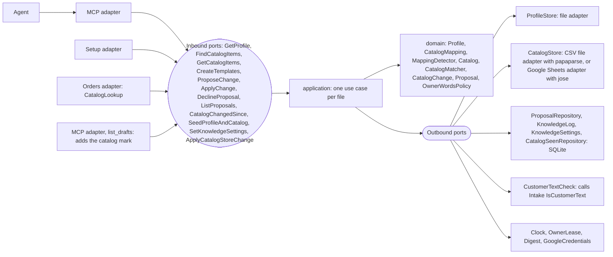

# TP-01-profile-and-catalog: Architecture

Part of [TP-01-profile-and-catalog.md](../tp/TP-01-profile-and-catalog.md). Moved verbatim from there; nothing changed.

## Architecture

Domain (`src/knowledge/domain/`, no I/O, no package):

- `Profile` (value object): parsed from the file text. `sections` (each `{ id, heading, body, state: 'filled' | 'to_be_confirmed' }`), `preamble`, `missing: SectionId[]`. `withSection(id, text)` returns the new file text. A section is empty when its body, after removing HTML comments, heading lines (`^#{1,6} .*$`) and whitespace, is empty. Comments are removed from the text returned to the agent, not from the file.
- `RawTable` and `CatalogMapping` (value objects, below). `CatalogMapping` fields: `version: 1`, `source: 'file' | 'sheet'`, `delimiter: string | null`, `hasHeader: boolean`, `headerRow: string[]` (the header cells themselves, not a hash, so the stale check is an equality), `decimal: '.' | ',' | '٫' | null`, `thousands: string | null`, `columns: { index: number; role: Role; headerText: string }[]` with `Role = 'id' | 'name' | 'unit' | 'price' | 'currency' | 'availability' | 'notes' | 'ignore'`, `availability: { available: string[]; unavailable: string[] }`, `currencySymbols: Record<string, string>`.
- `MappingDetector` (domain service, pure): `detect(table, corrections?) -> { mapping, questions, samples }`. Algorithm below.
- `Catalog` (value object): `Catalog.read(table, mapping, currency) -> CatalogItem[]`. `CatalogItem { row: number; ref: string; name: string; unit: Field; price: PriceField; availability: AvailabilityField; notes: string | null; rowCells: string[] }`.
- `CatalogMatcher` (pure): `fold(text)`, `match(items, query) -> { item, tier }[]`.
- `CatalogChange` (pure): builds `CellOp[]` from a proposal and a `Catalog`; checks values (`value_unsafe`, `value_invalid`).
- `Proposal` (aggregate). Fields: `number`, `kind`, `status`, `target`, `oldValue`, `newValue`, `detail`, `createdAt`, `decidedAt`, `expiresAt`, `supersededBy`. States: `waiting` to `applying` to `applied`; `waiting` to `declined`, `superseded` or `expired`; `applying` back to `waiting` on failure. Invariants: a closed proposal never reopens; `apply` needs words that pass `OwnerWordsPolicy`.
- `OwnerWordsPolicy` (pure): non-empty and at most 1000 characters after trimming; the proposal number is a whole token (rule in TD-3); `normalizeText(words)` equals neither the proposal's `newValue` nor, through the `CustomerTextCheck` port called by the use case, any stored customer message. The whole-token function is copied from Drafts' domain with the same tests until the lead moves it into `src/shared/` (see Open questions).
- Events: `ChangeApplied { proposal, target, at }` and `ChangeApplyFailed { proposal, reason, at }`. No slice subscribes in v1; Knowledge's own log is written from them.

### Mapping detection (the part ADR-012 leaves to this TP)

Input: a `RawTable` with the delimiter guess. Output: a suggested `CatalogMapping` and a list of questions. It is a suggestion; the owner confirms it (D22). The header text is never read for meaning; it is shown next to three sample values per column.

1. Header row. The first row is the header unless some column parses as a number in every other row and also in the first row (then `hasHeader = false`). A one-row file has a header and no items (`catalog_empty`).
2. Per column, over non-blank data cells: `n`, distinct ratio `d`, numeric ratio `r` (share that parses under step 3), mean length, maximum length.
3. Number format of each numeric column (TD-12, step 2, made exact). Strip `\p{Sc}`, letters and whitespace (including U+00A0, U+202F, U+2009); map every `\p{Nd}` digit to ASCII; keep digits and the separators `.` `,` `٫` `٬` `'` and space. Each value votes by its last separator and the digits after it: 1, 2 or 4 or more digits mean decimal mark (`12,50`, `1.234,5`, `1,234.50`, `٣٫٥٠`, `0.0015`); exactly 3 digits mean thousands mark when the value has two different separators or the same separator repeated with every later group 3 digits long (`1.234.567`); a lone separator followed by exactly 3 digits is ambiguous (`1.234`); a space or apostrophe as last separator is a thousands mark; anything else (`12.5.5`, `abc`) is unreadable. Two different separators in one value fix both marks (`1.234,50` gives decimal `,` and thousands `.`). The column's format is the majority of the unambiguous votes. If the unambiguous votes disagree (some `12,50`, some `12.50`) or none exist and an ambiguous value is present, the detector adds a question (`price_format`: "does 1.234 mean 1234 or 1.234?") with the values, and returns no decimal mark. The mapping cannot be applied while a question is open (`mapping_has_questions`). Checked on a prototype in Bun for: `12,50`, `1.234,5`, `1,234.50`, `$ 12.50`, `1 234,50`, `1.234`, `1,234`, `12`, `٣٫٥٠`, `1,23,456.00`, `1.234.567`, `CHF 1'234.50`, `12.5.5`, `abc` and the empty string; the last two are unreadable.
4. Roles, in this order, each column taking the first role it satisfies, one column per role except `ignore` and `notes`:
   - `price`: `r >= 0.8`. If several columns qualify, the one with the highest share of values that have a decimal part wins; the others stay `ignore` and are shown to the owner. A numeric column that is sorted ascending with step 1 is `id`.
   - `currency`: every non-blank cell is an ISO 4217 code (a constant list in the domain, about 180 codes) or is one to three characters of `\p{Sc}`.
   - `availability`: at most 4 distinct values and at least 2 rows.
   - `id`: not numeric, distinct ratio 1, maximum length 24.
   - `name`: among the remaining text columns, the leftmost with `d >= 0.8`.
   - `unit`: text, maximum length 24, `d <= 0.6`.
   - `notes`: text with mean length at least 30.
   - everything else: `ignore`.
   Why these numbers: they only decide the first suggestion; the owner sees all columns with samples and corrects any. They are fixed by the fixture tests (Testing), not tuned elsewhere.
5. Availability vocabulary: the distinct values of the availability column with counts. If there are exactly two, no suggestion is made about which is which (a language-free rule cannot know); both go in a question `availability_words`. The owner's answer lists the available words and the unavailable words.
6. Currency symbols: the distinct symbols of the currency column that are not ISO codes, each in a question `currency_symbol`, unless the owner's `currency` setting is set and the column has a single symbol (then the symbol maps to that currency, shown for confirmation).
6b. No `id` role: when no column has the role `id`, the detector adds the notice question `ref_by_name`: item references then come from the folded name (TD-7), so renaming a product changes its reference. The owner sees it at confirmation and may add an id column.
7. `corrections` (from the agent, after the owner answered): `{ delimiter?, hasHeader?, decimal?, thousands?, roles?: { index, role }[], availability?, currencySymbols? }` override the suggestion; detection is re-run with them and the questions they answer are closed.

### Reading and lookup

`FindCatalogItems` runs these steps in order: the `catalog_store` setting; `CatalogStore.read` with the confirmed delimiter; mapping check; `Catalog.read`; match; cap. Rows with a blank name are ignored. A row shorter than the mapping is padded with blanks (so its missing cells are "to be confirmed"). A price cell is `to_be_confirmed` when empty (`empty`), when it does not parse under the mapping (`unreadable`), or when no currency is known for the row (`no_currency`); in none of these cases is a number returned. The raw cell is returned with every value (`raw`) so the agent sees exactly what the owner stored; the parsed `amount` is a canonical decimal string (`"12.50"`), never a float.

### Apply

`ProposeChange` validates and stores; `ApplyChange` checks words and state, then runs TD-4. For a catalog change the domain re-locates the row: the proposal stores the row's cells as shown (`rowCells`). At apply the current table is searched for rows equal to `rowCells`: none gives `target_changed`; more than one gives `row_ambiguous` (two identical rows; the owner fixes the file); exactly one gives the `CellOp`. For a profile change, the current section body must equal the proposal's `oldValue` or the apply gives `target_changed`.
