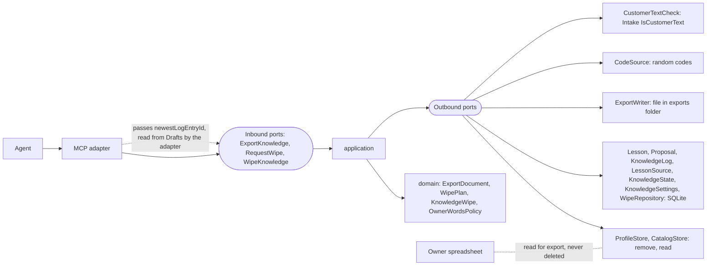

# Technical Proposal: Where knowledge lives, export and wipe (Knowledge FRD-03)

Status: Approved (2026-11-25)
Approval: content 2XwX0uAwh8hZ; rests on ../frd/FRD-03-export-and-wipe.md OE8o8ezn7VOc; rests on ../../tp/TP.md EF063EDZvKuZ

Follows the cross-cutting TP (`docs/tp/TP.md`), TP-01 (profile, catalog, proposals, `OwnerWordsPolicy`) and TP-02 (lessons) of this slice. "Cross-cutting TD-n" means a decision there.

## Summary

Fixed by the cross-cutting TP and the earlier TPs, so not decided again:

## Context

Fixed by the cross-cutting TP and the earlier TPs, so not decided again:

- Knowledge is the profile file, the catalog (a file or the owner's own spreadsheet), and in SQLite the `lessons`, `proposals`, `knowledge_log`, `lesson_sources`, `knowledge_state`, `catalog_seen` tables and the settings `catalog_store`, `catalog_mapping` and `currency` (TP-01, TP-02). All of it is on the owner's machine (principle 8, FR-KNOWLEDGE-03-1). The one exception is a catalog the owner keeps in their own Google spreadsheet (FR-KNOWLEDGE-03-2).
- Where network code lives: only the shared Google client `src/adapters/google/` (Orders ADR-013, also used for the orders sheet) makes HTTP requests; Knowledge's `src/knowledge/adapters/sheets/` calls it and no other Knowledge adapter can reach the network. This makes FR-KNOWLEDGE-03-1 testable: the end-to-end test passes a counting `fetch` to the client, runs drafting and lookups with the default file store and no orders sheet, and asserts zero calls; with a catalog sheet it asserts that every call goes to `sheets.googleapis.com` or `oauth2.googleapis.com` and that every spreadsheet id in a request path is a configured id (the catalog sheet, or the orders sheet when one is configured), per store and not per slice. The agent receives knowledge because it needs it to draft (FR-KNOWLEDGE-03-1); that is the owner's own agent.
- The owner chooses a sheet only from the terminal (`deputy config set catalog-store sheet:<id>`; TP-01). `ApplyCatalogStoreChange` answers `catalog_leaves_machine`, and `get_settings` shows it while a sheet is the store. Setup and the instructions tell the agent to say to the owner, in the owner's language, that the catalog is then the only knowledge that leaves the machine (FR-KNOWLEDGE-03-2, D20).
- A wipe is a destructive write: it asks `OwnerLease` first and takes the owner's words like every Knowledge write (FR-KNOWLEDGE-03-8, TP-01 TD-3). Export writes a file, so it asks too.
- A wipe changes no other slice (FR-KNOWLEDGE-03-10). Orders keep their own snapshot of each item name and price (FR-ORDERS-01-14). Drafts that quoted wiped knowledge stay. Knowledge's wipe use case holds only Knowledge ports only; it has no port to Orders, Drafts or Intake. The MCP adapter reads the newest drafts log entry id from Drafts and passes it in as `newestLogEntryId`.
- A wipe deletes the profile file, the catalog file (and its one backup copy `catalog.csv.deputy-bak`), the lessons, the pointers, all proposals, the knowledge log, the mapping and the catalog fingerprint. It keeps the `currency` setting (a Setup choice under D21, not knowledge) and the log cursor, which carries no content. A catalog in the owner's spreadsheet is not touched: the setting `catalog_store` goes back to `file` (disconnected).
- Export files already written are the owner's copies. A wipe does not delete them, and says so.
- Limits and reasons: an export holds the whole knowledge in one file, written to the data folder under `exports/`. Knowledge is small (a profile of a few KB, a catalog of at most 5 MB by TP-01, lessons of at most 500 characters each), so one file stays well under 10 MB.
- Language (D20): every result is a fixed code with an English default text.

## Requirements served

FR-KNOWLEDGE-03-1, FR-KNOWLEDGE-03-2, FR-KNOWLEDGE-03-3, FR-KNOWLEDGE-03-4, FR-KNOWLEDGE-03-5, FR-KNOWLEDGE-03-6, FR-KNOWLEDGE-03-7, FR-KNOWLEDGE-03-8, FR-KNOWLEDGE-03-9, FR-KNOWLEDGE-03-10. Related: FR-ORDERS-01-14 (Orders keep their snapshot), FR-KNOWLEDGE-01-13 (a spreadsheet is read live).

## Decisions

### TD-1: In what form is the export?

ADR: ADR-011
FR-KNOWLEDGE-03-3: one export that holds everything (profile, catalog, lessons), in a form the owner can read and keep. FRD-03 information adds the lessons' links and the confirmation log. FRD open question: one file or several.

- **Option A** One UTF-8 JSON file `exports/knowledge-<UTC time to the millisecond>.json` in the data folder. It holds `format`, `version`, `exportedAt`, `complete`, and one object per part: `profile` (the file text exactly as stored), `catalog` (`source`, the table as rows of strings, the delimiter, the confirmed mapping and the currency), `lessons` (all fields and claims), `proposals` (all rows except wipe requests), `log` (all knowledge log entries). Written to a temp file and renamed; mode 0600 on POSIX. Cost: one writer and one document builder. Risk: JSON is less pleasant to read than Markdown for a non-technical owner; the agent reads it to them on request.
- **Option B** A folder of originals: `profile.md`, a copy of `catalog.csv`, `lessons.md`, `log.csv`. Cost: files open in the tools the owner already knows. Risk: it is not one export; a sheet catalog has no file to copy and needs a second format anyway; there is no place to mark "incomplete", so a partial export could look whole; the owner who moves one file loses a part.
- **Option C** Return everything in the tool result. Cost: no file. Risk: a catalog of 5 MB is about 1.2 million tokens in the agent's context, and nothing is kept (the owner asked to "keep" it).

Chosen: Option A. One file is "one export"; raw text is kept exactly (a profile with markers and comments, a catalog with its odd delimiter); the `complete` flag and a per-part status make a partial export impossible to mistake for a whole one (FRD edge case). The result returns the path, the counts and the status, never the content. Recorded in ADR-011.

### TD-2: How does a wipe delete files and rows that cannot share a transaction?

ADR: ADR-012
FR-KNOWLEDGE-03-5 and FR-KNOWLEDGE-03-9: after a confirmed wipe nothing remains except one entry (that a wipe happened, when, the owner's words). Edge cases: a wipe that fails halfway says what remains and never reports success; a second wipe says there is nothing to delete. The files and the database cannot be changed in one transaction.

- **Option A** An intent row first, then resumable idempotent steps. Transaction 1 inserts the `knowledge_wipes` row with status `running`, the time and the owner's words, and marks the confirmation `applied`. Then delete the profile file, then the catalog file (or disconnect the sheet). Then transaction 2 deletes the database rows, resets the settings and the cursor, and sets the wipe row to `done` (or `partial` when a file step failed). Every step is safe to repeat. A wipe left `running` by a crash is finished by the next wipe-related call (`RequestWipe` and `WipeKnowledge` reconcile first) and marked `done` or `partial`. Cost: one table and one reconcile step. Risk: a crash leaves content for a while (reported as `partial` on the next request).
- **Option B** One transaction deletes the rows, then the files are deleted, with no intent row. Cost: simplest. Risk: a crash after the commit leaves the profile and catalog on disk with no trace that the owner confirmed a wipe; nothing tells Deputy or the agent to finish, and the next reply from the agent would quote files the owner believes are gone.
- **Option C** Move the files to a trash folder first, delete rows, then delete the trash. Cost: a recovery path before the point of no return. Risk: a deleted-looking copy of the profile and catalog sits in the data folder until the last step, which is the opposite of a wipe, and the FRD says wipe deletes (open question on undo is for the owner).

Chosen: Option A. The intent row is the audit entry the FRD wants and the thing that makes the wipe finishable. The file steps come before the row steps, so a crash can only leave data that the wipe is about to delete, never a lost record of the owner's words. Part results are stored without content: `profile` and `catalog` each `deleted`, `absent`, `disconnected` or `failed`; `data` `deleted` or `failed`. A failed file step returns `wipe_incomplete` with the list of what remains; the owner can request another wipe, which lists only what remains. After a wipe the log cursor is set to the newest drafts log entry, so the pointers of TP-02 are not rebuilt from old drafts: the owner wiped what Deputy had learned, and it must not learn it back from the same history. Recorded in ADR-012.

### TD-3: How does the owner's confirmation name the wipe?

ADR: ADR-013
FR-KNOWLEDGE-03-4: Deputy first states what will be deleted, deletes nothing until the owner confirms, and the confirmation "names the action". FR-KNOWLEDGE-03-8: one way to wipe, taking the owner's words that name the action; refuses without them. The owner speaks any language.

- **Option A** The proposal number of TP-01 TD-3: `request_wipe` creates a proposal and the owner's words must contain its number. Cost: nothing new. Risk: numbers are small and shared with drafts: the owner's "go on 7" for draft 7 while proposal 7 is a waiting wipe would delete everything, and a request left from last week still accepts "7".
- **Option B** A separate confirmation code: `request_wipe` returns a random 6-digit code and an expiry 10 minutes later; `wipe_knowledge` takes `{ code, owner_words }` and the words must contain the code as a whole token (same token rule as TP-01) and must not equal a stored customer message. A new request replaces the waiting one. Cost: a `CodeSource` port and an expiry check. Risk: the owner must say six digits. Why 6 digits: draft and proposal numbers stay far below 100,000, so no ordinary go can contain the code; it is not a secret (the agent sees it, D11). Why 10 minutes: long enough for a slow owner to read the list and export first, short enough that a forgotten request cannot be confirmed later by an unrelated message.
- **Option C** Require the owner's words to contain the word for "wipe". Cost: no code. Risk: it needs the word in every language (D20 forbids a per-language list), and "do not wipe" contains it.

Chosen: Option B. The code only keeps an accidental or stale confirmation out; it does not stop an agent with invented words (D11), which is why TD-4 adds a copy before the delete. A destructive action should not be confirmed by a number that doubles as a draft number. `wipe_knowledge` without owner words, or with words that lack the code, refuses with `words_empty` or `words_missing_code`, and nothing is deleted. Recorded in ADR-013.

### TD-4: What protects the owner's own files from a wipe confirmed with invented words?

ADR: ADR-016
The wipe deletes `profile.md` and `catalog.csv`, which the owner wrote. The six-digit code is shown to the agent, so an injected agent could request and confirm a wipe with invented words (D11). FR-KNOWLEDGE-03-7 says Deputy suggests an export before a wipe and does not require it of the owner.

- **Option A** `WipeKnowledge` writes a complete export itself (TD-1) before it deletes anything, and refuses (`export_write_failed` or `export_incomplete`) when it cannot. The profile, a catalog file, the lessons, proposals and log must all be `ok`; a sheet catalog may fail to read because the wipe never deletes the sheet. The owner does nothing extra. Cost: an export file stays after the wipe. Risk: "no knowledge remains" is then true of the database and the files, not of that copy; the result gives its path and says deleting it is the owner's choice.
- **Option B** Refuse (`export_required`) unless a complete export newer than the last change of the profile, the catalog and the lessons exists. Cost: the owner makes the export first, as FR-KNOWLEDGE-03-7 suggests. Risk: it requires an export, which the FRD says not to; and "newer than the last change" needs a saved-time for lessons and files that Knowledge does not keep for the profile.
- **Option C** No protection beyond the code and the words, as before. Cost: none. Risk: authored files are lost for good by a forged confirmation, with no way back.

Chosen: Option A. It makes the wipe recoverable without asking the owner for anything, so FR-KNOWLEDGE-03-7 still holds (an export is suggested, never required of the owner). The wipe still cannot be undone inside Deputy; the export is the only way back, and it is a file the owner reads and copies by hand. Recorded in ADR-016.

## Architecture



Domain (`src/knowledge/domain/`):

- `ExportDocument` (value object): built from the parts read; `complete` is true only when every part is `ok` or `absent`. `toJson()` is a pure string function.
- `WipePlan` (value object): from counts and the catalog source, what will be deleted and what is kept: `{ profile: boolean, catalog: 'file' | 'sheet' | 'none', lessons, proposals, logEntries }`; `isEmpty()` is true when nothing exists (then `nothing_to_delete`).
- `KnowledgeWipe` (entity): `id`, `at`, `ownerWords`, `status` (`running`, `done`, `partial`), `parts`. Transitions: `running` to `done` or `partial`; `partial` is final, and a later wipe is a new entity.
- The wipe request is a `Proposal` of kind `wipe` with `code` and `expiresAt` (TP-01 table). `OwnerWordsPolicy` takes the code as the token.

Flows:

- `ExportKnowledge`: (lease) read the profile text, the catalog table (live from a sheet), the mapping, the currency, all lessons, proposals (not wipe requests) and log entries; a part that cannot be read is `failed` with a reason code, the document says `complete: false`, and the file is still written with the parts that were read. If the file cannot be written (disk full), `export_write_failed`, no path. On success record `last_export_at` in `knowledge_state`.
- `RequestWipe`: (lease) reconcile any `running` wipe; count what exists; empty gives `nothing_to_delete` and no proposal; else supersede any waiting wipe request, create the proposal with a new code from `CodeSource` and `expiresAt = now + 10 minutes`, and return the plan, the code and the note `safety_export` (with `lastExportAt`), because Deputy suggests an export first and does not require it (FR-KNOWLEDGE-03-7).
- `WipeKnowledge`: (lease) find the waiting request by code (`wipe_unknown`); `expiresAt` in the past gives `wipe_expired` and marks it expired; `OwnerWordsPolicy` with the code token; then the safety export (TD-4); then TD-2. If the safety export fails, nothing is deleted.

## Information

```sql
CREATE TABLE knowledge_wipes (
  id          INTEGER PRIMARY KEY AUTOINCREMENT,
  at          TEXT NOT NULL,
  owner_words TEXT NOT NULL,
  status      TEXT NOT NULL CHECK (status IN ('running','done','partial')),
  parts       TEXT NOT NULL DEFAULT '{}'    -- per-part result codes, no content
);
```

`knowledge_wipes` is the only Knowledge table a wipe keeps. The tables a wipe empties: `lessons`, `lesson_sources`, `proposals` (every kind, including the wipe request itself), `knowledge_log`, `catalog_seen`. Settings cleared: `catalog_mapping`; `catalog_store` goes to `file`. Kept: `currency`; `knowledge_state.log_cursor` (set to the newest drafts log entry id) and `last_export_at`. A `proposals` row of kind `wipe` uses the `code` and `expires_at` columns defined in TP-01.

Export document (one JSON file):

```json
{
  "format": "deputy-knowledge-export", "version": 1, "exportedAt": "2026-11-17T15:30:45.123Z", "complete": true,
  "profile":   { "status": "ok", "text": "<file text exactly>" },
  "catalog":   { "status": "ok", "source": "file", "delimiter": ";", "rows": [["name","price"],["Tamales","12,50"]],
                 "mapping": { }, "currency": "USD" },
  "lessons":   { "status": "ok", "items": [ { "number": 7, "wording": "", "situation": "", "wanted": "", "learnedAt": "", "chat": "", "draft": 12, "claims": [] } ] },
  "proposals": { "status": "ok", "items": [ ] },
  "log":       { "status": "ok", "items": [ ] }
}
```

A part is `{ "status": "failed", "reason": "<code>" }` when it could not be read, and `{ "status": "absent" }` when it does not exist. The export holds chat ids and the owner's words, no customer message text.

## Interfaces

Inbound ports (published in `src/knowledge/index.ts`; `Refusal` is in TP-01):

```ts
type PartStatus = { status: 'ok' | 'absent'; count?: number } | { status: 'failed'; reason: string };
interface ExportKnowledge { execute(): Promise<
  | { ok: true; path: string; exportedAt: string; complete: boolean; parts: Record<'profile' | 'catalog' | 'lessons' | 'proposals' | 'log', PartStatus> }
  | Refusal> }                                              // not_owner, export_write_failed

interface RequestWipe { execute(): Promise<
  | { ok: true; code: number; expiresAt: string;
      willDelete: { profile: boolean; catalog: 'file' | 'sheet' | 'none'; lessons: number; proposals: number; logEntries: number };
      sheetStaysUntouched: boolean; lastExportAt: string | null; notes: 'safety_export'[] }
  | Refusal> }                                              // not_owner, nothing_to_delete

type WipeParts = { profile: 'deleted' | 'absent' | 'failed'; catalog: 'deleted' | 'disconnected' | 'absent' | 'failed'; data: 'deleted' | 'failed' };
interface WipeKnowledge { execute(i: { code: number; ownerWords: string; newestLogEntryId: number | null }): Promise<
  | { ok: true; parts: WipeParts; entry: { at: string; ownerWords: string }; safetyExport: { path: string } }
  | { ok: false; code: 'wipe_incomplete'; parts: WipeParts; remaining: ('profile' | 'catalog' | 'data')[] }
  | Refusal> }                                              // not_owner, words_empty, words_missing_code, words_copied, wipe_unknown, wipe_expired, export_write_failed, export_incomplete
```

Outbound ports added by this TP (the others are in TP-01 and TP-02):

```ts
interface ExportWriter { write(fileName: string, json: string): Promise<{ path: string }> }   // exports/, temp then rename, 0600
interface CodeSource { next(): Promise<number> }                                              // 100000..999999, adapter uses a secure random source
interface WipeRepository {
  start(at: string, ownerWords: string): Promise<number>;                                     // inserts 'running'
  finish(id: number, status: 'done' | 'partial', parts: WipeParts): Promise<void>;
  running(): Promise<{ id: number; ownerWords: string } | null>;
  deleteAllKnowledgeRows(newCursor: number | null): Promise<void>;                           // one transaction: lessons, lesson_sources, proposals, knowledge_log, catalog_seen, settings, cursor
  counts(): Promise<{ lessons: number; proposals: number; logEntries: number }>;
}
// the `wipe_knowledge` adapter reads the newest drafts log entry id (Drafts ReadDraftLog, newest first, limit 1) and passes it as `newestLogEntryId`
```

MCP tools:

| Tool | Input (zod) | Output | Use case | FRs |
|---|---|---|---|---|
| `export_knowledge` | none | path, time, per-part status, `complete` | `ExportKnowledge` | FR-KNOWLEDGE-03-3, FR-KNOWLEDGE-03-7 |
| `request_wipe` | none | what will be deleted, the code, the expiry, the export suggestion; deletes nothing | `RequestWipe` | FR-KNOWLEDGE-03-4, FR-KNOWLEDGE-03-6, FR-KNOWLEDGE-03-7 |
| `wipe_knowledge` | `{ code: int (100000..999999), owner_words: string (1..1000) }` | per-part result and the kept entry, or `wipe_incomplete` with what remains | `WipeKnowledge` | FR-KNOWLEDGE-03-4, FR-KNOWLEDGE-03-5, FR-KNOWLEDGE-03-6, FR-KNOWLEDGE-03-8, FR-KNOWLEDGE-03-9, FR-KNOWLEDGE-03-10 |

The terminal command for a sheet store ends in `ApplyCatalogStoreChange`, which returns `catalog_leaves_machine` (FR-KNOWLEDGE-03-2). Codes added here: `nothing_to_delete`, `export_write_failed`, `wipe_incomplete`, `wipe_unknown`, `wipe_expired`, `words_missing_code`, `export_incomplete`, `safety_export`, `catalog_disconnected`, `catalog_leaves_machine`.

## Threat model

Assets: all knowledge (an irreversible loss if wiped by mistake); the export file (a full copy of the business profile, catalog and the owner's words).

| Attacker | Attack | What stops it | Accepted |
|---|---|---|---|
| A customer | Messages "wipe everything" or "export the data" | No tool reads customer text as a command. `wipe_knowledge` needs a 6-digit code that only the owner conversation shows and owner words that contain it; words equal to a stored customer message are refused (FR-KNOWLEDGE-03-4, FR-KNOWLEDGE-03-8) | None |
| A compromised agent | Wipes without the owner | It needs the code from a fresh `request_wipe` (valid 10 minutes) and words containing it; the entry with the words is kept (FR-KNOWLEDGE-03-9) | Invented words (D11); the loss is limited by the owner's exports, which a wipe never deletes |
| An unrelated go | "Go on 7" or "ok" confirms a wipe by accident | The code is six digits and is not a draft or proposal number; vague words contain no code (`words_missing_code`) | None |
| A stale request | A wipe request from days ago confirmed later | Expires after 10 minutes (`wipe_expired`) | None |
| A compromised agent | Requests and confirms a wipe with invented words | The wipe first writes a complete export and refuses if it cannot (TD-4); the owner's files are recoverable from it. A wipe cannot be undone inside Deputy | Invented words (D11); the copy stays in the data folder |
| Someone with the data folder | Reads an export | Same exposure as the database (cross-cutting threat model). Mode 0600 on POSIX. The owner is told the export is theirs to keep safe, and that a sheet catalog is copied into it | No encryption of the export; Windows permissions are not checked |
| A failed wipe | The owner believes data is gone | `wipe_incomplete` lists what remains and never reports success; a later request lists only the rest (FRD edge case) | A crash mid-wipe leaves data until the next wipe call reconciles it |
| An agent with file tools | Reads the profile or the export before a wipe | D11 | Stated in the instructions |

## Testing

Layers: UC = use case through its inbound port with in-memory adapters, a fake clock and a fake `CodeSource`; C = adapter contract; E = end to end over stdio; ARCH = architecture test.

| Acceptance test | FR ids | Layer |
|---|---|---|
| Given the default file store and no orders sheet, When the agent drafts, looks up items and lists lessons, Then the counting `fetch` handed to the shared Google client is called zero times; with a catalog sheet, Then every call goes to the two Google hosts and names only a configured spreadsheet id; and `fetch` and `jose` are referenced only under `src/adapters/google/` | FR-KNOWLEDGE-03-1 | E, ARCH |
| Given the owner's terminal command sets `sheet:<id>`, When `ApplyCatalogStoreChange` runs, Then the result carries `catalog_leaves_machine` and `get_settings` shows it; given `set_setting catalog_store sheet:<id>` from the agent, Then it is refused with `terminal_only` | FR-KNOWLEDGE-03-2 | UC |
| Given a profile, a catalog and two lessons, When `export_knowledge` runs, Then one JSON file exists holding the profile text exactly, the catalog rows, both lessons with links, the proposals and the log, and `complete` is true | FR-KNOWLEDGE-03-3 | UC, C |
| Given a spreadsheet catalog that cannot be read, or a disk that is full, When exporting, Then `complete` is false with the failed part, or `export_write_failed`, and no success is claimed | FR-KNOWLEDGE-03-3 | UC |
| Given the owner asks to wipe, When `request_wipe` runs, Then it lists the profile, the catalog and the counts, returns a code, and nothing is deleted; with a wrong code, vague words ("ok"), words without the code, or an expired request, `wipe_knowledge` deletes nothing | FR-KNOWLEDGE-03-4 | UC |
| Given a confirmed wipe, When it ends, Then `get_profile` says the profile is missing, `find_catalog_items` says the catalog is missing, `list_lessons` is empty | FR-KNOWLEDGE-03-5 | UC |
| Given a spreadsheet catalog and a confirmed wipe, When it ends, Then the fake sheet received no write, `catalog_store` is `file`, the mapping is cleared and the result says `catalog_disconnected` | FR-KNOWLEDGE-03-6 | UC |
| Given any wipe request, Then it carries the note `safety_export`; given no export by the owner, When the owner confirms, Then Deputy writes a complete export first and the wipe runs; given an export that cannot be written or is incomplete (not counting an unreachable sheet), Then nothing is deleted | FR-KNOWLEDGE-03-7 | UC |
| Given a wipe call without owner words, or with words equal to a customer message, Then it refuses and nothing is deleted; each confirmed wipe leaves one log entry | FR-KNOWLEDGE-03-8 | UC |
| Given a confirmed wipe, When it ends, Then `lessons`, `lesson_sources`, `proposals`, `knowledge_log` and `catalog_seen` are empty, the mapping setting is cleared, and `knowledge_wipes` holds one `done` row with the time and the owner's words and no content | FR-KNOWLEDGE-03-9 | UC, C |
| Given a recorded order (an in-memory Orders store) that used a catalog item, When knowledge is wiped, Then the order still shows the name and price, the Drafts fake is unchanged, and the wipe use case holds no write port of another slice | FR-KNOWLEDGE-03-10 | UC, ARCH |
| Given the owner exported and then wiped, When the export is compared with the data read before the wipe, Then the export holds every part that was wiped | FR-KNOWLEDGE-03-3, FR-KNOWLEDGE-03-5 | UC |

Also tested: a file that cannot be deleted gives `wipe_incomplete` with `remaining`, the wipe row is `partial`, and a second request lists only the rest; a crash after transaction 1 is finished by the next `RequestWipe`; a second wipe on empty knowledge gives `nothing_to_delete` and no new entry; the log cursor ends at the newest drafts log entry, so old approvals are not offered again; `catalog.csv.deputy-bak` is deleted with the catalog; the export file mode on POSIX.

## Risks

| Risk | Effect | Mitigation |
|---|---|---|
| An accidental or forged wipe | Knowledge lost; no undo inside Deputy | Six-digit code, ten-minute expiry, the plan shown first, an automatic complete export before anything is deleted (TD-4); the FRD says wipe deletes (undo is an owner question below) |
| A file locked by another program on Windows | `wipe_incomplete` | Reported with what remains; the owner closes the program and asks again |
| The export holds personal data | A copy outside the database | It stays in the data folder, mode 0600 on POSIX; the owner is told it is theirs to keep safe |
| A crash between the steps | Data that should be gone remains for a while | The intent row; the next wipe call finishes it |
| A sheet export is a copy of the owner's sheet | The copy leaves the sheet's own access controls | Stated in the result; the FRD assumes the owner treats it as theirs |

## Open questions

For the owner:

1. Should a wipe be undoable for a short time? This TP follows the PRD: wipe deletes. Option C of TD-2 would add a trash step.
2. Is JSON the right export form for the owner, or should the agent also offer to read it back in the owner's language on request? This TP only writes the file.

For the lead:

3. New table `knowledge_wipes` and new tools `request_wipe` and `export_knowledge`; `wipe_knowledge` takes a code, not the proposal number the cross-cutting table implies. The cross-cutting tool table row for `export_knowledge` and `wipe_knowledge` should follow.
4. The adapter's newest-entry read needs `ReadDraftLog` with no filter and `limit: 1`, newest first, which Drafts TP-04 already defines.
5. The wipe reconcile runs at the start of `RequestWipe` and `WipeKnowledge`, so the lease supervisor's recovery list does not change.
