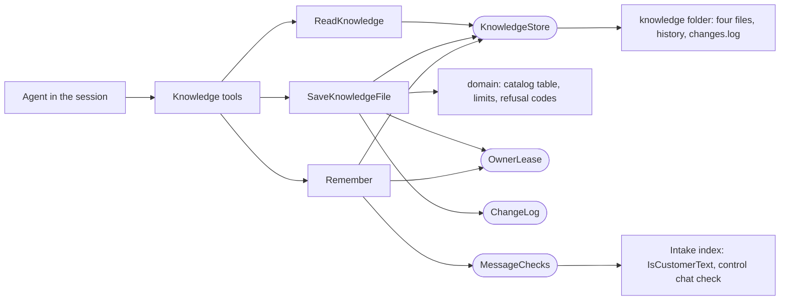

# Technical Proposal: Knowledge files for the pilot (Knowledge FRD-04)

Status: Draft

## Summary

Knowledge becomes four plain files in `<configuration folder>/knowledge`, read whole by one tool and written whole by one tool per file after the owner's words. The memory grows through `remember`, which accepts only the owner's words and refuses copies of customer text. Nothing reaches a spreadsheet or another service: the session brings the content and Deputy stores it.

Last change: 2026-11-24, first draft for REQ-15 and D38.

Follows the cross-cutting TP (`docs/tp/TP.md`). "TD-n" without a prefix means a decision in this TP. It replaces for the pilot the proposal mechanism and the mapping detector of [TP-01](TP-01-profile-and-catalog.md) (its TD-3 to TD-7); TD-1, TD-2 and TD-8 of TP-01 are not used either.

## Context

Fixed elsewhere, so not decided again:

- Knowledge is one bounded context with `domain`, `application`, `ports` and `adapters` (cross-cutting TD-0). Every use case that writes asks `OwnerLease.isOwner()` first (`src/shared/owner-lease.ts`) and refuses with `not_owner`; reads do not ask (FR-KNOWLEDGE-04-8).
- A refusal is a fixed code with an English default text (D20). No knowledge text is ever part of a code.
- The owner's words are 1 to 1000 characters (`parseOwnerWords`, `src/shared/owner-words.ts`; Drafts ADR-003).
- Intake owns the stored messages. Knowledge asks it two questions through its `index.ts`: whether a text equals a stored customer message (`IsCustomerText`, `src/intake/ports/is-customer-text.ts`) and whether a stored message was written by an owner number in the control chat (D37; to be exposed by the Intake documents, FRD-04 Q-2).
- The tools are defined with `defineTool` (`src/adapters/mcp/tool.ts`); customer-derived text in a tool result is labeled with `customerText` (`src/adapters/mcp/customer-text.ts`).

## Requirements served

FR-KNOWLEDGE-04-1, FR-KNOWLEDGE-04-2, FR-KNOWLEDGE-04-3, FR-KNOWLEDGE-04-4, FR-KNOWLEDGE-04-5, FR-KNOWLEDGE-04-6, FR-KNOWLEDGE-04-7, FR-KNOWLEDGE-04-8, FR-KNOWLEDGE-04-9, FR-KNOWLEDGE-04-10, FR-KNOWLEDGE-04-11, FR-KNOWLEDGE-04-12, FR-KNOWLEDGE-04-13, FR-KNOWLEDGE-04-14, FR-KNOWLEDGE-04-15, FR-KNOWLEDGE-04-16, FR-KNOWLEDGE-04-17, FR-KNOWLEDGE-04-18, FR-KNOWLEDGE-04-19, FR-KNOWLEDGE-04-20.

## Decisions

### TD-1: Where does the knowledge live and how is it found?

The agent reads it on every turn and the owner may edit it by hand (FR-KNOWLEDGE-04-1, FR-KNOWLEDGE-04-2, FR-KNOWLEDGE-04-12).

- **Option A** Four plain text files, `profile.md`, `catalog.md`, `memory.md` and `always-ask.md`, in the folder `knowledge` of the configuration folder. Cost: the whole text is read on each call. Risk: an owner who deletes a file; the reader then says "not written yet".
- **Option B** Rows in the database with a tool per field. Cost: a table and a migration for each part. Risk: the owner cannot read or fix the data without Deputy.
- **Option C** One combined file with sections. Cost: one file to read. Risk: a bad edit of one section damages the others, and one size limit covers all.

Chosen: Option A, because the owner and a helper can open and repair the files with any editor, and nothing needs a migration. ADR: ADR-018.

### TD-2: How is a whole-file save made safe?

A save must never leave half a file (FR-KNOWLEDGE-04-11) and must keep the old text (FR-KNOWLEDGE-04-6).

- **Option A** Write the new text to a temporary file in the same folder, copy the old file to `knowledge/history/<name>.<time>`, rename the temporary file over the old one, then drop history copies beyond the last 20. Cost: three file operations. Risk: on Windows a file held open by another program makes the rename fail; the save then fails and the old text stays.
- **Option B** Write in place. Cost: one operation. Risk: a crash or a full disk leaves half a file.
- **Option C** Keep versions in the database. Cost: a table. Risk: the history is hidden from the owner.

Chosen: Option A. The record of each change (time, file, owner's words, summary) is one appended line in `knowledge/changes.log`, written after the rename; a failed log write is reported and does not undo the save. ADR: ADR-018.

### TD-3: What may write the memory, and how is customer text kept out?

The memory is read on every turn, so a planted line steers every answer (FR-KNOWLEDGE-04-13 to FR-KNOWLEDGE-04-18).

- **Option A** `remember({ text, source })` with a session source (owner words) or a control chat source (a stored message id), plus a refusal of a text equal to a stored customer message and a size limit of 500 characters. Cost: two checks against Intake. Risk: a paraphrase of customer text passes; the session source cannot prove who spoke.
- **Option B** Only the session source. Cost: none. Risk: the owner's WhatsApp answers cannot become knowledge, and the agent supplies any words.
- **Option C** No source; the agent writes any text. Cost: none. Risk: one injected customer message can write the memory.

Chosen: Option A, the strongest rule that needs no change to what Intake stores. The limits are stated, not hidden (FR-KNOWLEDGE-04-20). ADR: ADR-019.

### TD-4: How is a catalog accepted from a spreadsheet, a photo or a document?

The session reads what the owner gives; Deputy holds no credentials of another service (FR-KNOWLEDGE-04-19) and must still avoid storing a catalog it cannot read (FR-KNOWLEDGE-04-9).

- **Option A** One fixed table shape: a Markdown table with the columns name, unit, price and availability, at most 500 rows; the empty price or availability is kept empty and returned as "to be confirmed" (FR-KNOWLEDGE-04-4). Cost: the session has to reshape the owner's source into this table. Risk: a catalog with more columns loses them; the session may keep them in a notes column that Deputy returns as it is.
- **Option B** Store any text and return it as it is. Cost: none. Risk: "to be confirmed" cannot be applied and an unreadable catalog is stored.
- **Option C** Detect the columns of any table by content (TP-01 TD-3 to TD-6). Cost: a parser, a mapping step, a confirmation. Risk: much code for a pilot with one catalog.

Chosen: Option A, because it is checkable by a small pure function and the session is a better table converter than Deputy. ADR: none: reversible by replacing one pure function; the shape is also recorded in the template shown to the owner.

## Architecture

Domain (`src/knowledge/domain/`, no input or output, no package):

- `KnowledgeFileName`: `"profile" | "catalog" | "memory" | "always-ask"` and its file name.
- `parseCatalogTable(text) -> { ok: true, items } | { ok: false, code: "catalog_unreadable" }`; `renderCatalog(items)` returns "to be confirmed" for an empty price or availability; `diffCatalog(old, new) -> { added, removed, changed }`.
- `LIMITS`: owner words 1000 (shared), catalog 500 items, profile and always-ask 20000 characters, memory text 500 characters, history 20.
- `memoryEntry(date, text)` returns `"<date>: <text>"`.

Application (`src/knowledge/application/`): `ReadKnowledge`, `SaveKnowledgeFile` (one use case for the three files, the catalog adds its table check), `Remember`. Ports (`src/knowledge/ports/`): `KnowledgeStore` (read a file with its saved time, write a whole file with history, append a line), `ChangeLog`, `MessageChecks` (`isCustomerText(text)`, `ownerControlMessage(id)`). Adapters: `src/knowledge/adapters/files/` (store and log), `src/knowledge/adapters/intake/` (message checks over the Intake index), `src/knowledge/adapters/mcp/` (the tools). The composition root `src/main/knowledge.ts` builds them.

## Information

Four files, `knowledge/history/<name>.<time>` copies (20 per file) and `knowledge/changes.log`. No new database table. The configuration folder is the one already read by `src/main/settings.ts`.

## Interfaces

| Tool | Input | Result |
|---|---|---|
| `read_knowledge` | none | the four texts, always-ask first, each with its saved time, or "not written yet" |
| `save_profile`, `save_always_ask` | `text`, `owner_words` | summary with the new size; or a refusal code |
| `save_catalog` | `text`, `owner_words` | summary with items added, removed, changed; or a refusal code |
| `remember` | `text`, `source` (`{kind:"session", owner_words}` or `{kind:"control_chat", message_id}`) | the entry that was appended; or a refusal code |

Refusal codes: `not_owner`, `owner_words_missing`, `owner_words_size`, `catalog_unreadable`, `too_large`, `not_owner_message`, `copies_customer_text`, `text_size`. No tool input is a path.

## Threat model

| Threat | Effect | Control |
|---|---|---|
| A customer message tells the agent to remember or save something | A planted rule steers later answers | No tool takes a customer message as the text; a text equal to a stored customer message is refused; the owner reads the entry in the result |
| The agent supplies made-up owner words | A save without the owner | Known limit (D11); each change is recorded with the words in `changes.log` and the previous version is kept |
| A path in a tool input | A file outside the folder is read or written | There is no path input; names come from a closed list |
| A paraphrase of customer text is remembered | Same as the first row | Stated limit; the control chat source needs a stored owner message |
| A very large text | Plan usage and disk | Size limits in the domain |

## Testing

ATDD from the FRD: tests carry `covers: knowledge/FRD-04/<ID>`. The store is tested against a temporary folder and a fault-injecting fake for the rename step (EX-11); the use cases against an in-memory store; `Remember` against fake message checks. One contract test runs the same cases on the file store and the in-memory store. The end-to-end test starts the server over standard input and output, saves a profile, reads it back and edits the file by hand between two reads (FR-KNOWLEDGE-04-12).

## Risks

| Risk | Effect | Mitigation |
|---|---|---|
| Reading all four files on every turn grows the plan usage | The $20 plan runs out sooner | Size limits; `read_knowledge` returns sizes; Q-3 asks the owner what to do when it grows |
| The owner edits the catalog into a shape Deputy cannot read | Lookup fails | `read_knowledge` returns the text as it is and adds the notice `catalog_unreadable`; it hides nothing |
| Intake does not expose the control chat check | `remember` from WhatsApp waits | Build the session source first (FRD-04 Q-2) |
| A file open in another program on Windows | The save fails | The old text stays; the refusal says to close the file |

## Open questions

- Q-1 (Lead): the FRD adds `save_profile` and `save_always_ask` to the three tools named in the task; confirm.
- Q-2 (Lead): the Intake documents must expose whether a stored message came from an owner number in the control chat (D37), or `remember` ships with the session source only.
- Q-3 (Owner: only the owner knows how much knowledge the agent should read on every turn): what should happen when the memory or the catalog is so long that reading it each turn costs too much of the plan?
