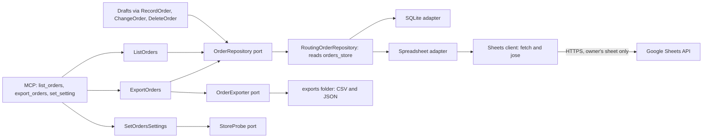

# Technical Proposal: Where orders live, and export (Orders FRD-03)

Status: Approved (2026-11-18)

Builds on TP-01 (the `OrderRepository` port and `StoreResult`) and TP-02 (history, delete, outbox). "Cross-cutting TD-n" means a decision in `docs/tp/TP.md`.

## Context

Fixed by the cross-cutting TP:

- Orders sit behind one repository port with two adapters: SQLite (default) and the owner's spreadsheet (cross-cutting TD-3, ADR-003). Behavior is the same in both (R-ORDERS-10).
- The Google service-account sign-in uses `jose` 6.2.17, a signed RS256 JWT (cross-cutting TD-12). The service-account file path is a secret in the OS credential store or the fallback file (cross-cutting TD-8). Orders never takes a secret from a tool.
- The spreadsheet has the tabs `Orders` and `Order history` (cross-cutting Information). The setting `orders_store` belongs to Orders (cross-cutting TD-8).
- Libraries live in adapters only (cross-cutting ADR-000). The CSV writer is `papaparse` (already chosen for the catalog reader), used here only in the export adapter.
- Order data goes to no service other than the owner's agent and, if chosen, the owner's own spreadsheet (D7, R-ORDERS-11).

What the Google Sheets API gives (checked against the docs on 2026-11-17):

| Fact | Source | Effect |
|---|---|---|
| Quotas: 300 read and 300 write requests per minute per project, and 60 per minute per user per project. Beyond that: HTTP 429. The docs advise exponential backoff and recommend a payload of at most 2 MB. | https://developers.google.com/workspace/sheets/api/limits | Each use case makes at most 2 requests. List reads once. Retry rule in TD-3. |
| `spreadsheets.batchUpdate`: if one request fails, none of the other changes are written. | https://developers.google.com/workspace/sheets/api/guides/batchupdate | An order row and its history rows go in one request, so they are written together or not at all. |
| `values.append` with `valueInputOption=RAW` stores `=1+2` as text. In `ExtendedValue`, `stringValue` and `formulaValue` are separate fields. | https://developers.google.com/workspace/sheets/api/guides/values, `ExtendedValue` reference | Orders writes only `stringValue` and `numberValue`, never `formulaValue`. A customer note that starts with `=` stays text. |
| `values.append` is not documented as idempotent. | same | Idempotency comes from the lookup (TP-01 TD-6), not from the API. |

Consequences stated without a TD:

- When the spreadsheet cannot be reached, a record, change or delete fails and says so; a list says the orders could not be read and never shows an old copy. Orders keeps no cache of the spreadsheet (FR-ORDERS-03-5).
- The two adapters pass one shared contract test suite. The spreadsheet adapter runs it against an in-memory fake of the Sheets API.
- Settings: `orders_store` is `machine` or `spreadsheet`. TD-5 says where the spreadsheet id comes from.

## Requirements served

FR-ORDERS-03-1, FR-ORDERS-03-2, FR-ORDERS-03-3, FR-ORDERS-03-4, FR-ORDERS-03-5, FR-ORDERS-03-5a, FR-ORDERS-03-5b, FR-ORDERS-03-6, FR-ORDERS-03-7. Requirements R-ORDERS-10, R-ORDERS-11, R-ORDERS-12, R-ORDERS-15.

## Decisions

### TD-1: How do two stores behave the same?

- **Option A** One `OrderRepository` port (TP-01) with whole-order operations (`findByDraftRef`, `get`, `readAll`, `insert`, `update`, `remove`, `count`). A `RoutingOrderRepository` adapter reads `orders_store` on each call and forwards to the SQLite or the spreadsheet adapter. Filtering, sorting and paging happen once, in the `ListOrders` use case, on the result of `readAll`. Cost: every list reads all orders. Risk: a very large order book; at 5,000 orders of about 1 KB the read is 5 MB, past the 2 MB advice for a Sheets payload.
- **Option B** The port has query methods (`listByStatus`, `listByCustomer`, `listByDate`). Each adapter implements them in its own way (SQL `WHERE` against filtering rows in memory). Cost: faster SQL queries. Risk: two implementations of every filter that must agree, so R-ORDERS-10 rests on tests, not on construction.
- **Option C** SQLite is always the primary and the spreadsheet is a mirror written after each change. Cost: fast local reads. Risk: two copies. A list from the local copy could show orders the owner edited or deleted in the sheet, which breaks "never shows an old copy as current" (FR-ORDERS-03-5) and "the list shows what is there" (FRD-02 edge case).

Chosen: Option A. One filter code means the same behavior in both stores by construction. The size risk is bounded: a small business with a few orders a day stays far below it, and the list pages its output (TP-02). When `readAll` of a spreadsheet exceeds 2 MB, the adapter still works (the API has no hard limit) and the open question below asks if an archive is wanted. Recorded in ADR-011.

### TD-2: How is an order laid out in the spreadsheet, and how are hand edits handled?

- **Option A** Two tabs. `Orders`: one row per order, 17 columns with fixed header codes in row 1: `id, draft_ref, created_at, status, customer_name, chat, fulfillment, address, wanted_date, wanted_time, total, currency, total_tbc, notes, items, items_json, source_messages`. `Order history`: one row per change: `order_id, at, field, old_value, new_value, owner_words`. `items` is a readable line (`2 x tamales (pork) @ 120.00; 1 x salsa [not in catalog]`) made on every write; `items_json` is the source of truth. All writes go in one `spreadsheets.batchUpdate`: `AppendCells` for a new order, `UpdateCells` for the row of a change plus `AppendCells` for its history rows, `DeleteDimension` (rows deleted from the bottom up) for a delete. Cost: two columns hold the items. Risk: an owner who edits only `items` by hand; detected (below).
- **Option B** A third tab `Order items`, one row per item. Cost: owner-friendly items. Risk: the cross-cutting TP names two tabs, and one atomic write would span three tabs with row shifting in each.
- **Option C** One tab, items as lines in one cell with no JSON. Cost: one column. Risk: parsing a human-edited cell back into quantity, unit, price and snapshot is guesswork, and Deputy never guesses a price.

Chosen: Option A. Reading rules, so a hand edit never shows wrong data as right (FR-ORDERS-03-5a):

1. Row 1 of each tab must equal the expected header exactly, else the whole read or write fails with `layout_mismatch` and nothing is written into an unknown layout. If the `Orders` tab does not exist or is completely empty when the owner switches to the spreadsheet, the adapter creates the tabs and headers once (TD-5); an existing tab with other content is never touched.
2. A row is read through `Order.restore`, which checks the same invariants as a record. A failure makes the row `unreadable` with `rowRef` (`Orders!12`), the id if present, a reason code (`status_invalid`, `address_missing`, `items_json_invalid`, `items_text_edited`, `duplicate_id`, `total_edited`, `wanted_invalid`, `quantity_invalid`) and the raw values of `id`, `customer_name`, `status` as `known`. The list still shows every other order.
3. The status is read trimmed and lower case. `wanted_date` and `wanted_time` accept the text form or the serial number the sheet produces when an owner retypes a date (serial days since 1899-12-30, a fraction of a day for time); the sheet's serial rule is the one in the `DateTimeRenderOption` documentation.
4. If `items` does not equal the line made from `items_json`, the row is unreadable with `items_text_edited` (the owner changed the readable text, and Deputy will not guess which side is right). Blank rows are skipped.
5. Reads use `valueRenderOption=UNFORMATTED_VALUE` so a number stays a number. The `total` cell is written in major units as a number (minor units divided by 10 to the exponent; a total is at most 12 digits, exact in a double), so the owner can sum a column. `items_json` holds quantity as text and prices in minor units. On read, the total is recomputed from `items_json`; a `total` cell that differs is `total_edited`, like `items_text_edited`.

Dates in text cells keep the form `YYYY-MM-DD`. The status codes are English fixed codes (D20); the agent says them in the owner's language, and the sheet shows the codes. Recorded in ADR-012.

### TD-3: How does Orders talk to Google Sheets?

- **Option A** A small client over `fetch` and `jose`: sign a JWT (`SignJWT`, `importPKCS8`, RS256, scope `https://www.googleapis.com/auth/spreadsheets`, audience `https://oauth2.googleapis.com/token`, lifetime 1 hour, the most Google allows), exchange it for an access token, keep the token in memory until 5 minutes before expiry, and call these endpoints, the contract of the shared client: `spreadsheets.get` (tab ids), `values:batchGet` with a render option (`UNFORMATTED_VALUE` for Orders, `FORMATTED_VALUE` for Knowledge's catalog read), `spreadsheets.batchUpdate` (cells; Orders only) and `values:batchUpdate` with an input option (`USER_ENTERED` single-cell update, Knowledge only, so `15,50` becomes a number). Orders never uses `USER_ENTERED`: it would turn a note starting with `=` into a formula. About 150 lines with no new package beyond `jose`. Cost: Deputy owns the request building. Risk: Google changes a shape; the client is one file with a contract test against the fake.
- **Option B** `@googleapis/sheets` 18.1.3 (published 2026-11-12). Measured: 45 installed packages and 14 MB in `node_modules` (through `googleapis-common`, `google-auth-library` 11 and `gaxios` 8), against 1 package and 1 MB for `jose` alone. `bun build --compile` works: the binary signs the token, calls a local fake Sheets server and reaches Google's token endpoint (answer `invalid_grant`, so the signature path ran); 144 bundled modules and 115.81 MB, +0.53 MB over the `jose`-only binary (115.28 MB). It exposes `spreadsheets.batchUpdate`, so atomic writes are possible. Cost: typed calls and built-in token refresh. Risk: 45 packages of supply chain in the binary that holds the service-account key and every order, and a second token implementation next to `jose` (cross-cutting TD-12).
- **Option C** `google-spreadsheet` 5.3.0 (published 2026-06-03). Measured: 26 installed packages and 27 MB with its `google-auth-library` peer (needed for service-account sign-in). `bun build --compile` works: it reached Google's token endpoint (`invalid_grant`); 520 bundled modules and 116.39 MB, +1.11 MB. Cost: a row-oriented API. Risk: the same supply-chain and token-path cost as B with a row model that does not match one atomic write of an order row plus its history rows.

Chosen: Option A. Measured on 2026-11-17 with Bun 1.4.4 on Windows 11: a script that makes one Sheets call and one service-account token request, run from source and from `bun build --compile`. Both libraries compile and run, and the binary grows by only 0.5 to 1.1 MB, so size and compile support are not the reason. The reason is the number: 45 or 26 packages of third-party code against 1 (`jose`, already chosen) in a binary that holds the service-account key and every order, for three endpoints Deputy calls (`spreadsheets.get`, `values:batchGet`, `spreadsheets.batchUpdate`), plus exact control of the retry rule below. If the client grows past about 300 lines, revisit Option B. Numbers, each with its reason:

- Request timeout 8 seconds: a Sheets call normally returns in under 2 seconds; with 3 attempts and the waits below the use case ends in under 30 seconds, inside the 60-second default tool timeout of Codex (cross-cutting `agents.md` Q2).
- Reads retry up to 3 attempts on HTTP 429, 500 and 503 or a network error; waits 1 second then 2 seconds (truncated exponential backoff as the Google limits page advises).
- Writes retry on HTTP 429 only, with the same waits: 429 means the request was not processed. A timeout or 5xx on a write is never retried inside the adapter; it ends as `outcome_unknown` and the use case checks the store (TP-01 TD-6).
- 403 or 404 on the sheet maps to `unreachable` with the detail `not_shared_or_missing`; the probe (TD-5) prints the service-account email so the owner can share the sheet with it.

The client keeps no rows and logs no cell values or tokens (logs go to stderr and hold only status codes). The token and HTTP client live in the shared `src/adapters/google/` (lead's decision; Knowledge uses the same sign-in for its catalog sheet). The Orders-specific part, layout and row mapping, stays in `src/orders/adapters/sheets/` and imports the client from there. Recorded in ADR-013.

### TD-4: What is the export?

- **Option A** A folder `<data>/exports/orders-<UTC date and time>/` with `orders.csv`, `order_items.csv`, `order_history.csv`, a lossless `orders.json` (money as minor units and as decimal text, all fields, history, export time) and, when any row is unreadable, `orders_unreadable.csv`. CSV is written by `papaparse` `unparse` in the export adapter with `escapeFormulae` on (a cell that starts with `=`, `+`, `-` or `@` gets a leading `'`, checked in Bun 1.4.4: `=1+1` became `'=1+1`), a UTF-8 byte-order mark, and a delimiter and decimal mark taken from the system: `;` and `,` when `Intl.NumberFormat().formatToParts(1.1)` shows a comma decimal, else `,` and `.`. Cost: five files. Risk: the system locale guess is wrong for one owner; `export_orders` takes an optional `delimiter` (`,`, `;`, `tab`).
- **Option B** One JSON file. Cost: simplest. Risk: a small-business owner cannot open it in a spreadsheet, which is the point of an export they can "read and keep" (FR-ORDERS-03-6).
- **Option C** An `.xlsx` workbook through a library. Cost: one file the owner opens directly. Risk: a heavy dependency for a one-off file; the maintained options carry their own zip and XML stack, and a binary file is harder to test than CSV.

Chosen: Option A. The delimiter rule is the real failure it removes: Excel in a locale with a decimal comma reads a comma-separated file as one column. Owner decision D26: the export leaves cancelled orders out by default and reports how many (`cancelledLeftOut`); the rows stay in the store, and including them becomes an owner setting later (not in v1). `ExportData` holds only orders whose status is not `cancelled`; an order's history is exported with it. The export is complete or failed: files are written into a temporary folder and renamed as one step, so a failure leaves nothing that looks like an export (FR-ORDERS-03-7). If rows were unreadable, the result is `complete: false` with the count and `orders_unreadable.csv` holds their raw values, so the owner has them. The result gives the location and counts, never the content, so no order data reaches the agent through an export (principle 8). The export holds the owner's words from the history; it is the owner's file on the owner's machine. Recorded in ADR-014.

### TD-5: How does the owner choose the store, and what happens to old orders?

- **Option A** The owner enters the spreadsheet in the terminal: `deputy config set orders-spreadsheet <id or URL>` (an id is 20 or more of `A-Z a-z 0-9 _ -`; a URL is reduced to its id). Switching between `machine` and `spreadsheet` is then done by talking: the `orders_store` setting, through `set_setting`. A switch to `spreadsheet` first runs a probe (token, access, layout, tab creation if empty) and is refused with a code if it fails. On any switch Deputy counts the orders in the place being left and stores it. Cost: one terminal step for the sheet. Risk: a non-technical owner types a command; Setup shows the exact command (as for other sensitive settings, cross-cutting TD-8).
- **Option B** Everything by talking, including the spreadsheet id. Cost: no terminal. Risk: a note or message that talks the agent into `set_setting orders_store spreadsheet:<attacker's sheet>` would send every new order to a sheet the attacker shares with the service account. The id is a destination for personal data and must be an owner decision (D7).
- **Option C** Everything in the terminal. Cost: safest. Risk: the owner cannot say "use the machine for now" in a conversation, which the FRD expects (FR-ORDERS-03-2).

Chosen: Option A. It adds one connection key, `orders-spreadsheet`, in `~/.deputy/config.json`, to the sensitive list of cross-cutting TD-8; flagged to the lead. The switch notice (FR-ORDERS-03-5b): Deputy does not move or copy orders. `SetOrdersSettings` counts the old place with `count()` (an unreachable old place counts as `null`, "unknown") and saves `order_store_switch(left_place, left_count, at)`. `ListOrders` returns `oldPlace: {place, remaining}` while that row exists and the current place differs; switching back clears it. A copy tool is out of v1 (FRD open question), so the notice is all Deputy offers. Recorded in ADR-015.

## Architecture



New and extended ports: `OrderExporter`, `StoreProbe`, `OrdersSettingsRepository`, `StoreSwitchRepository`, `OrdersSpreadsheetConfig`. Domain additions: `UnreadableOrder`, `ExportData`.

## Information

```sql
CREATE TABLE order_store_switch (          -- one row: the last place the owner left
  id         INTEGER PRIMARY KEY CHECK (id = 1),
  left_place TEXT NOT NULL CHECK (left_place IN ('machine', 'spreadsheet')),
  left_count INTEGER,                      -- NULL = could not be counted
  at         INTEGER NOT NULL
);
```

The setting `orders_store` is in `settings` (key owned by Orders); its value is `machine` or `spreadsheet`. The spreadsheet id is in `~/.deputy/config.json` as `orders-spreadsheet`, read through `OrdersSpreadsheetConfig`; it is not a secret. The service account (email and private key) comes from the secret store through the adapter's `ServiceAccountKeys` loader, wired in `main.ts`; the key is never logged or returned.

The spreadsheet layout is in TD-2. Export file columns: `orders.csv` has the `orders` columns plus `total_tbc`; `order_items.csv` has `order_id, position, catalog_ref, name_written, quantity, unit, snap_name, snap_unit, snap_price_minor, snap_currency`; `order_history.csv` has the history columns. The export folder name is `orders-YYYYMMDD-HHMMSS` in UTC.

## Interfaces

```ts
interface ExportOrders {                    // MCP export_orders
  run(q: { delimiter?: ',' | ';' | 'tab' }): Promise<
    | { ok: true; complete: boolean; location: string; counts: { orders: number; history: number; unreadable: number; cancelledLeftOut: number } }
    | { ok: false; reason: 'store_unavailable' | 'layout_mismatch' | 'write_failed' | 'not_owner' }>;   // no orders: ok, counts all 0, location null
}
interface SetOrdersSettings {               // routed from set_setting for the key orders_store
  run(q: { key: 'orders_store'; value: 'machine' | 'spreadsheet'; ownerWords: string }): Promise<
    | { ok: true; store: 'machine' | 'spreadsheet'; leftCount: number | null }
    | { ok: false; reason: 'not_owner' | 'words_empty' | 'value_invalid' | 'spreadsheet_not_configured'
                         | 'sheet_not_shared' | 'layout_mismatch' | 'unreachable'; command?: string; serviceAccountEmail?: string }>;
}
interface OrderExporter { write(data: ExportData, o: { delimiter?: ',' | ';' | 'tab'; at: number }): Promise<{ ok: true; location: string } | { ok: false }> }
interface StoreProbe { probe(): Promise<{ ok: true } | { ok: false; reason: 'spreadsheet_not_configured' | 'sheet_not_shared' | 'layout_mismatch' | 'unreachable'; serviceAccountEmail?: string }> }
```

`ListOrders` (TP-02) also returns `oldPlace: { place: 'machine' | 'spreadsheet'; remaining: number | null } | null`. `set_setting` refuses `orders_store: spreadsheet` with `spreadsheet_not_configured` and `command: 'deputy config set orders-spreadsheet <id or URL>'` when no id is set.

Tools: `export_orders` `{ delimiter? }` returns the result above (plain text plus structure, no order content); `list_orders` is TP-02. No tool takes a spreadsheet id or any secret.

Spreadsheet adapter flow per operation: `ensure(sheetIds)` (cached per process, invalidated on a 400 about a sheet id); one `batchGet` of both tabs; header check; parse; then for a write, find the row by `id` in the data just read and send one `batchUpdate`. A write is checked against the row id read a moment earlier; an owner who sorts the sheet inside that window could still misplace a write (Risks).

## Threat model

Assets: all orders; the service-account key; the spreadsheet.

| Attacker | Attack | What stops it | Accepted |
|---|---|---|---|
| Customer text | `=HYPERLINK(...)` or `=IMPORTXML(...)` in a name or note, to run a formula in the owner's sheet or CSV in Excel | Sheets: only `stringValue` and `numberValue` are written, never `formulaValue`. CSV: `escapeFormulae` | The owner can still retype a cell as a formula by hand |
| Prompt injection | Points orders at an attacker's sheet | The id comes only from the terminal (TD-5); `set_setting` can only flip between the two | An agent with file tools could edit `config.json` (cross-cutting TD-8 suggests a deny rule) |
| Network | Order data to another service | The default adapter has no network code; the sheets client calls only `oauth2.googleapis.com` and `sheets.googleapis.com` with the configured id; an e2e test fails on any other host | |
| Log or error text | A cell value or token in logs | The client logs status codes only | |
| Owner edits the sheet by hand | A bad status, a deleted column | Unreadable row or `layout_mismatch`; never a write into an unknown layout (TD-2) | |
| Anyone with the spreadsheet link | Reads the orders | The sheet is the owner's; Deputy tells the owner at switch time that orders live there (FR-ORDERS-03-2) | Sharing is the owner's setting |
| Google | Keeps deleted rows in version history | | Told to the owner on delete (TP-02) |

## Testing

One contract suite runs against both repositories (SQLite in memory, spreadsheet against a fake Sheets API with the documented `batchUpdate` all-or-none rule and quotas). The fake can fail, time out after storing, return 429, and be edited by hand. Layers: UC use case with in-memory adapters, AC adapter contract, E2E stdio server.

| FR | Acceptance test | Layer |
|---|---|---|
| FR-ORDERS-03-1 | Given a fresh install, When orders are recorded, Then the setting reads `machine` and the SQLite file holds them | UC, E2E |
| FR-ORDERS-03-2 | Given the id configured, When the owner switches to `spreadsheet`, Then the probe runs, the tabs and headers exist, the next record lands in the sheet and the list shows it; given no id, Then `spreadsheet_not_configured` with the command | UC, AC |
| FR-ORDERS-03-3 | Given the same script of record, list with filters, change, history, cancel and delete, When it runs against both repositories, Then every result is equal | AC |
| FR-ORDERS-03-4 | Given the default store, When record, list, change, delete and export run with a `fetch` that fails on any call, Then all succeed; given the spreadsheet store, Then only the two Google hosts are called, with the configured id | E2E, AC |
| FR-ORDERS-03-5 | Given the fake sheet is unreachable, When the owner gives the go, Then `store_unavailable` and nothing is listed; When the owner lists, Then `store_unavailable` and no rows; a 429 on a read is retried and succeeds; a 429 on a write is retried; a timeout after storing is not retried and the lookup finds the order | AC, UC |
| FR-ORDERS-03-5a | Given a row with status `donee`, a row with `items` edited by hand and a row with a retyped date, When listed, Then the first two are `unreadable` with their ids and the other orders and the retyped date are listed; given a changed header, Then `layout_mismatch` and no write | AC |
| FR-ORDERS-03-5b | Given three orders on the machine, When the owner switches to the spreadsheet, Then the list shows none and `oldPlace.remaining` is 3; switching back clears the notice; an unreachable old sheet gives `remaining: null` | UC |
| FR-ORDERS-03-6 | Given five orders with history and a note starting with `=`, When exported, Then the folder holds five orders in every CSV and the JSON (with one of the five cancelled, four and `cancelledLeftOut: 1`), the note is prefixed, the delimiter follows the system decimal mark and `delimiter: tab` overrides it | UC, AC |
| FR-ORDERS-03-7 | Given the write fails halfway, When exported, Then `write_failed` and no export folder exists; given an unreadable row, Then `complete: false`, the count and `orders_unreadable.csv`; given no orders, Then counts are 0 | UC, AC |

Also tested: the atomic write (the fake rejects the second request of one `batchUpdate`; the row and its history are both absent); a cell `=1+1` round-trips as text. A live check at launch: one real token request and one real append and read from the compiled binary against a test spreadsheet, the same live check as cross-cutting TD-12.

## Risks

| Risk | Effect | Mitigation |
|---|---|---|
| The owner sorts the sheet during a write | a write lands on another row | one read right before each write; single owner process; the row is found by id from that read; open question below |
| The order book grows past 2 MB in the sheet | slower lists | paged output; an archive is the open question |
| Rate limit of 60 requests per minute per user | a burst of changes is refused | at most 2 requests per operation, 429 retried after 1 and 2 seconds |
| `items_text_edited` surprises the owner | a row shows as unreadable | the row says why; the agent fixes it on the owner's words |
| The system locale guess for the CSV is wrong | one column in Excel | `delimiter` override in `export_orders` |

## Open questions

1. Should Deputy offer to copy orders when the owner switches stores? Not in v1; the FRD only asks for a warning.
2. Later, not in v1 (D26): an owner setting to include cancelled orders in the export. v1 has one `delimiter` option only.
3. Should an archive tab take old delivered orders once the sheet is large? Not decided; no number is set.
4. `orders-spreadsheet` is a terminal-only key (lead's decision, cross-cutting TD-8).
