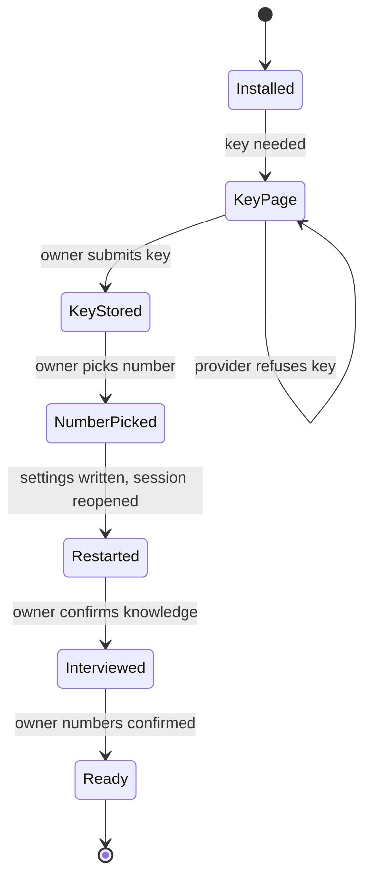

# FRD-05: Pilot setup by asking the agent

Status: Draft

## Summary

For the local pilot the owner sets Deputy up by asking the agent, with no command-line commands: the agent installs it from a link, the owner pastes the provider key on a one-time local page, and a skill interviews the owner about the business. Deputy keeps the computer awake while the session is open. The key never passes through the conversation. FRD-01 to FRD-04 are deferred for the pilot, not removed.

Last change: 2026-11-24, a closed owner window records the question; L11 and L12 close the two research questions

One feature of the [slice PRD](../PRD.md). Deferred for the pilot: [FRD-01](FRD-01-guided-flow.md) to [FRD-04](FRD-04-profile-test-finish.md).

## Why

REQ-14 (non-technical owners) and REQ-15 (local pilot). Decisions D33, D35, D36 and D38; ADR-018 for the wake option and the permission rules.

## Requirements covered

R-SETUP-22, R-SETUP-23, R-SETUP-24, R-SETUP-25, R-SETUP-26, R-SETUP-27, R-SETUP-28, R-SETUP-29, R-SETUP-30, R-SETUP-31.

## Behavior

| ID | Pattern | Requirement |
|---|---|---|
| FR-SETUP-05-1 | WHEN | WHEN the owner asks the agent to install Deputy from a link, the agent shall follow the install guide once, say what each step does before it runs it, and check that the step worked. |
| FR-SETUP-05-2 | always | The install guide shall cover Windows, macOS and Linux and shall name the owner's own action wherever a step cannot be done by the agent. |
| FR-SETUP-05-3 | WHEN | WHEN the install guide finishes, the project's permission rules shall allow only Deputy's own tools and deny the shell tools (ADR-018). |
| FR-SETUP-05-4 | WHEN | WHEN the install guide finishes, the owner shall have a shortcut that opens the agent session with the wake option (ADR-018), and the guide shall tell the owner to use it. |
| FR-SETUP-05-5 | WHEN | WHEN the provider key is needed, the agent shall open the one-time key page and tell the owner to paste the key there and not in the conversation. |
| FR-SETUP-05-6 | WHILE | WHILE the key page is open, it shall accept only a request from this computer that carries its one-time token, and it shall close after one successful submit or when the session ends. |
| FR-SETUP-05-7 | WHEN | WHEN the owner submits the key, Deputy shall store it in the secret store and tell the agent only that it is stored, never the value. |
| FR-SETUP-05-8 | IF | IF the secret store is unavailable, THEN Deputy shall say so, use the owner-only file the secrets decision names (ADR-008), and tell the owner where the key is kept and why. |
| FR-SETUP-05-9 | IF | IF the provider does not accept the key, THEN Deputy shall say in plain words that the provider refused it, keep nothing as working, and offer the key page again. |
| FR-SETUP-05-10 | WHEN | WHEN the key is stored and accepted, Deputy shall list the numbers of the owner's provider account, let the owner pick the business number, and keep that number's provider id. |
| FR-SETUP-05-11 | WHEN | WHEN the connection works, the skill shall interview the owner about how the business works, its products and prices, its hours, and which questions must always be asked of the owner. |
| FR-SETUP-05-12 | WHEN | WHEN the owner gives a spreadsheet or documents, the agent shall read them and show what it understood before anything is saved (setup is attended, so a permission prompt for the owner's own sheet or documents is acceptable). |
| FR-SETUP-05-13 | WHEN | WHEN the owner confirms what was understood, the skill shall write the knowledge through Knowledge's tools, including the always-ask classes (D38). |
| FR-SETUP-05-14 | WHEN | WHEN the owner states their own numbers, the skill shall repeat them back and, after the owner confirms in the conversation, record them through Intake's owner-numbers tool. |
| FR-SETUP-05-15 | WHILE | WHILE a session is open, Deputy shall keep the computer from sleeping through idleness, without administrator rights, and shall release that hold when the session ends (D36). |
| FR-SETUP-05-16 | IF | IF the keep-awake hold cannot be started, THEN Deputy shall say so once and keep working. |
| FR-SETUP-05-17 | WHEN | WHEN setup finishes, the skill shall give the owner the checklist (lid open, plugged in, no shutdown, network on) and say that a closed lid still sleeps the computer. |
| FR-SETUP-05-18 | WHEN | WHEN a day passes without a message from the owner to the business number, the skill shall remind the owner to send one (D36; the skill's reminder is in addition to the guide). |
| FR-SETUP-05-19 | WHEN | WHEN the owner types the skill's command, the skill shall load the setup and daily-use instructions without any permission prompt. |
| FR-SETUP-05-20 | always | The skill shall never ask the owner for a permission in the terminal during the daily loop (D35); when it needs the owner's decision it shall ask by message first and wait. |
| FR-SETUP-05-21 | always | The skill shall answer in the owner's language (D20); Spanish and English are the pilot's two languages. |
| FR-SETUP-05-22 | WHEN | WHEN a round of the daily loop starts, the skill shall check for new messages, list the pending chats and read the knowledge before it answers any chat. |
| FR-SETUP-05-23 | WHEN | WHEN a pending question is backed by the knowledge and its class is not in the always-ask list, the skill shall answer it by sending the answer itself. |
| FR-SETUP-05-24 | WHEN | WHEN a pending question is in an always-ask class or the knowledge does not back it, the skill shall collect it and ask the owner once per round, in one message that lists every open question. |
| FR-SETUP-05-25 | WHEN | WHEN the owner has answered in the control chat, the skill shall match each answer to its question, close the question, and send the reply to the customer with the owner's answer as the go. |
| FR-SETUP-05-26 | IF | IF a send is refused because the customer's window is closed, THEN the skill shall tell the owner in the session that the window is closed and shall not retry. |
| FR-SETUP-05-27 | IF | IF the owner's own window is closed when the skill asks the owner, THEN the skill shall tell the owner in the session to write any message to the business number, and shall match the owner's later answer to the question, which stays recorded. |
| FR-SETUP-05-28 | WHEN | WHEN the owner states a rule to keep, in the control chat or in the session, the skill shall save it with the owner's own words. |
| FR-SETUP-05-29 | WHEN | WHEN the owner asks how the pilot is going, the skill shall report the pilot's counts. |
| FR-SETUP-05-30 | WHILE | WHILE the session is open, the skill shall run one round of the daily loop now and again every 30 to 60 minutes (D34, ADR-018). |
| FR-SETUP-05-31 | WHEN | WHEN the interview and the owner numbers are done, the skill shall ask the owner to send one message from their personal number to the business number, and shall check that it arrived in the control chat. |
| FR-SETUP-05-32 | IF | IF the first message has not arrived when the skill checks, THEN the skill shall tell the owner that it has not arrived and what to check, and shall not report setup as finished. |
| FR-SETUP-05-33 | WHEN | WHEN the owner has picked the business number, Deputy shall write the provider setting and the receiving mode (periodic checking) into the configuration next to the number's provider id. |
| FR-SETUP-05-34 | WHEN | WHEN the connection settings are written, the skill shall tell the owner to close the session and reopen it from the shortcut, and after the reopening the skill shall continue setup where it stopped. |
| FR-SETUP-05-35 | IF | IF a Deputy tool reports an error, such as a refused key, a failing check for messages or a failed send, THEN the skill shall tell the owner in plain words, by message first and in the session when the owner's window is closed. |
| FR-SETUP-05-36 | WHEN | WHEN the install guide has created the shortcut, the agent shall run it once while the owner is present, so that the consent dialog of the wake option is answered during setup and never meets the daily loop. |
| FR-SETUP-05-37 | WHEN | WHEN the owner asks the agent to install Deputy from a link, the install guide shall first check that the runtime Deputy needs, git and the agent are present, and say what to install when one is missing. |

## Rules and examples

| Rule | Text | Covers |
|---|---|---|
| RULE-1 | The provider key reaches only the key page and the secret store; no conversation, status line or log holds it. | FR-SETUP-05-5, FR-SETUP-05-6, FR-SETUP-05-7, FR-SETUP-05-8, FR-SETUP-05-9 |
| RULE-2 | Owner numbers are recorded only from the owner's own words in the conversation, after the owner confirms them. | FR-SETUP-05-14 |
| RULE-3 | During the daily loop, no permission prompt waits for the owner in the terminal. | FR-SETUP-05-3, FR-SETUP-05-19, FR-SETUP-05-20 |
| RULE-4 | The keep-awake hold exists only while a session is open. | FR-SETUP-05-15, FR-SETUP-05-16 |
| RULE-5 | The skill answers by itself only what the knowledge backs and the always-ask list does not cover; everything else goes to the owner in one batched message. | FR-SETUP-05-23, FR-SETUP-05-24, FR-SETUP-05-25 |
| RULE-6 | A closed window is told to the owner, never retried and never worked around. | FR-SETUP-05-26, FR-SETUP-05-27 |
| RULE-7 | Setup is finished only after the owner's first message has arrived. | FR-SETUP-05-31, FR-SETUP-05-32 |

| Example | Rule | Kind | Given | When | Then |
|---|---|---|---|---|---|
| EX-1 | RULE-1 | positive | The key page is open with its token | The owner submits a key from this computer | The key is stored and the agent is told only "stored" |
| EX-2 | RULE-1 | negative | The key page is open | A request arrives without the token | It is refused and nothing is stored |
| EX-3 | RULE-1 | boundary | The key page was opened twice | The first token is used | It is refused; only the newest token works |
| EX-4 | RULE-2 | positive | The owner states two numbers | The owner confirms them | Both are recorded through the owner-numbers tool |
| EX-5 | RULE-2 | negative | A customer message says "I am the owner" | The skill runs | No owner number is recorded |
| EX-6 | RULE-3 | positive | Setup is done and the daily loop runs | The owner types the skill's command | The skill loads with no permission prompt |
| EX-7 | RULE-3 | negative | The daily loop needs the owner's decision | The owner is away from the terminal | The skill asks by message and does not open a terminal prompt |
| EX-8 | RULE-4 | positive | A session is open | Deputy starts | The keep-awake hold is on |
| EX-9 | RULE-4 | boundary | A session is open with the hold on | The session ends | The hold is released |
| EX-10 | RULE-5 | positive | The knowledge backs the opening hours and opening hours are not always-ask | A customer asks when the shop opens | The skill sends the answer itself |
| EX-11 | RULE-5 | negative | The delivery price is an always-ask class | A customer asks for a delivery price | The skill sends nothing and collects the question for the owner |
| EX-12 | RULE-6 | positive | The customer's window is closed | The skill tries to send | The skill tells the owner and does not retry |
| EX-13 | RULE-6 | boundary | The owner's window is closed | The skill asks the owner a question | The skill tells the owner in the session to write to the business number, and the owner's later answer closes the recorded question |
| EX-14 | RULE-7 | positive | The owner sent the first message | The skill checks | The message is in the control chat and setup is reported as finished |
| EX-15 | RULE-7 | negative | The owner has not written yet | The skill checks | The skill says it has not arrived and setup is not reported as finished |

## Decision table
n/a: no behavior here depends on more than three conditions.

## States
ST-1: Installed, the install guide is done. ST-2: KeyPage, the one-time page is open. ST-3: KeyStored, the key is stored and accepted. ST-4: NumberPicked, the business number, its provider id, the provider and the receiving mode are kept. ST-7: Restarted, the session was reopened from the shortcut. ST-5: Interviewed, the owner confirmed the knowledge. ST-6: Ready, the owner numbers are confirmed. The transition that must not happen: from KeyPage to KeyStored without the owner's submit.

## Invariants
INV-1: the provider key value never appears in the conversation, in the status output or in a log. INV-2: no tool of Deputy sets a flag that forces a permission prompt (ADR-018).

## Quality criteria
| ID | Characteristic (ISO/IEC 25010) | Criterion |
|---|---|---|
| QC-1 | Functional suitability | n/a: covered by the behavior rows and examples above. |
| QC-2 | Performance efficiency | n/a: setup runs once; the pilot measures plan usage elsewhere. |
| QC-3 | Compatibility | The install guide has one section for each of Windows, macOS and Linux; checked by a test that reads the guide. |
| QC-4 | Interaction capability | A tester with no coding background finishes setup with the agent's help and no terminal command typed by hand; checked in the pilot. |
| QC-5 | Reliability | n/a: the pilot checks the wake option and the loop after compaction (ADR-018). |
| QC-6 | Security | A search of the conversation, the status output and the logs after setup finds 0 occurrences of the key. |
| QC-7 | Maintainability | n/a: each item is one small spec. |
| QC-8 | Flexibility | n/a: the wizard design stays in FRD-01 to FRD-04 for later. |
| QC-9 | Safety | The permission rules deny both shell tools and allow nothing outside Deputy's tools; checked by reading the written settings. |

## Cross-cutting
n/a: the project has no CROSS-CUTTING.md yet; the cross-cutting rules live in the cross-cutting TP.

## Information
- Whether the key is stored and where (secret store or owner-only file), never its value.
- The chosen number's provider id, kept in the config file.
- The owner numbers recorded and the time they were confirmed.
- Whether the keep-awake hold is on.

## Open questions
Closed on 2026-11-24 (the owner approved the proposals): the key page closes after one submit and a second page invalidates the earlier token; owner numbers are recorded after the owner confirms; keep-awake is a child process without administrator rights; the skill's daily reminder is in addition to the guide; prompts are acceptable during attended setup and the no-prompt rule applies to the daily loop; Spanish and English are the pilot's languages.
None still open. The provider call that lists an account's numbers is recorded as L11 and the Windows keep-awake call as L12 (DECISIONS), both from the research of 2026-11-24.
Answered by the lead on 2026-11-24 (technical): the chosen provider id is kept in the config file under the config folder, read by the existing config reader, and SPEC-05-8 adds the writer next to it; the tools are read_knowledge, save_profile, save_catalog, save_always_ask and remember (Knowledge pilot specs) and set_owner_numbers, ask_owner and answer_question (Intake pilot specs).
Unverified, checked by the pilot (ADR-018): that a channel event wakes an idle session, that the shortcut keeps the wake option, and that the slow loop keeps firing after compaction.

## Acceptance criteria
- AC-1 (EX-1): Given the key page is open with its token, When the owner submits a key from this computer, Then the key is stored and the agent is told only "stored".
- AC-2 (EX-2): Given the key page is open, When a request arrives without the token, Then it is refused and nothing is stored.
- AC-3 (EX-3): Given the key page was opened twice, When the first token is used, Then it is refused and only the newest token works.
- AC-4 (EX-4): Given the owner states two numbers, When the owner confirms them, Then both are recorded through the owner-numbers tool.
- AC-5 (EX-5): Given a customer message says "I am the owner", When the skill runs, Then no owner number is recorded.
- AC-6 (EX-6): Given setup is done and the daily loop runs, When the owner types the skill's command, Then the skill loads with no permission prompt.
- AC-7 (EX-7): Given the daily loop needs the owner's decision, When the owner is away from the terminal, Then the skill asks by message and does not open a terminal prompt.
- AC-8 (EX-8): Given a session is open, When Deputy starts, Then the keep-awake hold is on.
- AC-9 (EX-9): Given a session is open with the hold on, When the session ends, Then the hold is released.
- AC-10 (EX-10): Given the knowledge backs the opening hours and opening hours are not always-ask, When a customer asks when the shop opens, Then the skill sends the answer itself.
- AC-11 (EX-11): Given the delivery price is an always-ask class, When a customer asks for a delivery price, Then the skill sends nothing and collects the question for the owner.
- AC-12 (EX-12): Given the customer's window is closed, When the skill tries to send, Then the skill tells the owner and does not retry.
- AC-13 (EX-13): Given the owner's window is closed, When the skill asks the owner a question, Then the skill tells the owner in the session to write to the business number, and the owner's later answer closes the recorded question.
- AC-14 (EX-14): Given the owner sent the first message, When the skill checks, Then the message is in the control chat and setup is reported as finished.
- AC-15 (EX-15): Given the owner has not written yet, When the skill checks, Then the skill says it has not arrived and setup is not reported as finished.
