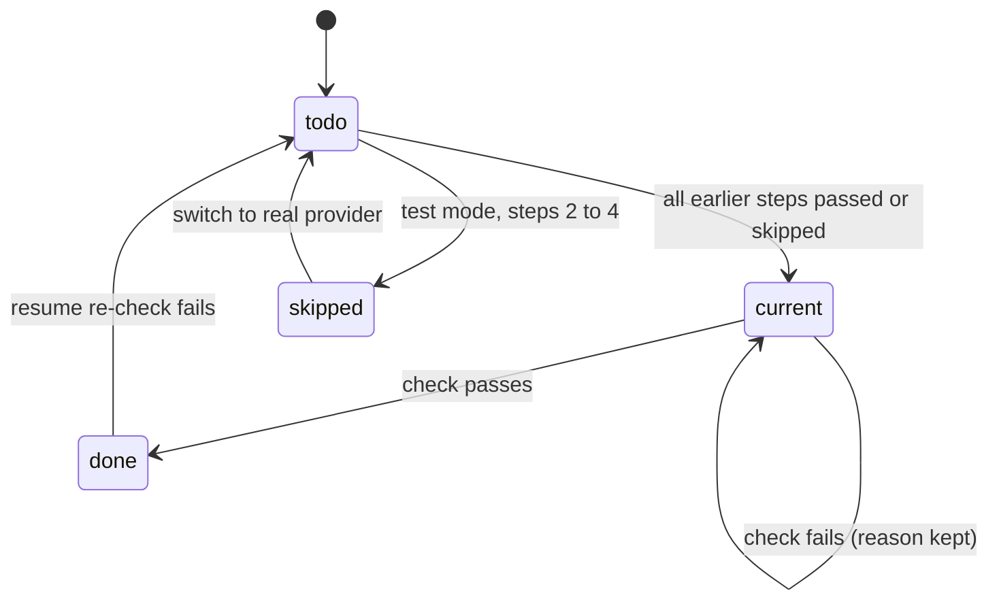

# TP-01-guided-flow: Architecture

Part of [TP-01-guided-flow.md](../tp/TP-01-guided-flow.md). Moved verbatim from there; nothing changed.

## Architecture

State of a step, and the run:



Parts:

| Folder | Holds |
|---|---|
| `domain/` | `SetupProgress` (aggregate), `Step`, `StepId`, `Mode`, `CheckResult`, `Reason` (code, English text, what to do), `Timing` (pure function over activity and wait rows), events `StepPassed`, `StepFailed`, `SetupCompleted` |
| `application/` | `GetSetupStatus`, `RunSetupCheck`, `ResumeCheck` (shared by both), one `StepCheck` per step, plus the use cases of TP-02 to TP-04 |
| `ports/` | inbound: the use-case interfaces. Outbound: below |
| `adapters/` | SQLite repository, Intake and Knowledge and Drafts adapters (call published `index.ts` only), `ConnectionConfigReader`, `SecretVault`, `RequiredTools`, the CLI install adapter, the MCP tool mapping |

Domain rules (`SetupProgress`):
1. Steps are `install`, `costs`, `connect`, `credentials`, `profile`, `test`, in that order. In test mode `costs`, `connect` and `credentials` are `skipped` (FR-SETUP-04-7).
2. A step may be recorded as passed only when every earlier step is passed or skipped.
3. The current step is the first step that is neither passed nor skipped. The remaining count is the steps after it that are not skipped.
4. A passed step whose check fails on resume goes back to `todo` with the reason, and every later passed step is marked `recheck` and checked in order after it passes again (FRD edge case).
5. `test` is never re-run on resume. Its stored result stands.
6. Who acts: each step carries an `actor` per instruction, `owner` or `agent`. An instruction that involves a password, a code, a payment, a terminal command or a phone screen is `owner` by construction (a table in the domain, not set by callers), so a step the owner must do is never marked as the agent's (FR-SETUP-01-2).

Outbound ports owned by Setup (all Promise-returning; shared kernel `Clock`, `OwnerLease`):

```ts
interface SetupProgressRepository {
  loadCurrent(): Promise<SetupProgress | null>;
  save(p: SetupProgress): Promise<void>;                    // one transaction: steps, facts, waits
  startRun(mode: Mode, carry: StepId[]): Promise<SetupProgress>;   // TP-04
}
type ProbeResult =
  | { ok: true; businessNumber: string | null }             // E.164 when the provider offers it
  | { ok: false; reason: 'credentials' | 'unreachable' | 'quota' | 'usage_limit' | 'timeout' };
interface ProviderProbe { check(): Promise<ProbeResult> }   // Intake CheckProviderAccess
interface SyncStatusReader { read(): Promise<{ status: 'complete' | 'failed'; running: boolean;
  historyMaybeSyncing: boolean; lastSuccessAt: Instant | null }> }   // Intake GetSyncStatus
interface OwnerNumbersReader { list(): Promise<{ number: string; kind: 'business' | 'extra' }[]> } // Intake GetOwnerNumbers
interface ConnectionConfigReader { read(): Promise<{ provider: string | null; receivingMode: string | null;
  kapsoPhoneNumberId: string | null; pushOn: boolean }> }  // reads config.json only
interface RequiredTools { names(): string[] }               // the MCP adapter's registry
interface AgentInstaller { install(agent: AgentId): Promise<{ command: string; ran: boolean; error: string | null }> }
```

Step checks:

| Step | Check | Kind on resume |
|---|---|---|
| 1 install | the agent passes the names of the tools it lists (`seenTools`); passes when every name in `RequiredTools.names()` is in the list. An empty list or no Deputy name fails with `deputy_not_installed`; a partial list fails with `tools_missing` and the names | live |
| 2 costs | costs shown, and a warning confirmation recorded after the warning was shown (TP-02) | stored |
| 3 connect | the owner stated the number is connected; the connection config reads back `provider = kapso` and a phone number id; an owner number of kind `business` exists (TP-02). No provider call here, see Context point 1 | live on config, stored on the statement |
| 4 credentials | the key is present; `ProviderProbe` is ok; the sync is complete (TP-03) | live |
| 5 profile | the owner confirmed the profile and catalog (TP-04) | stored |
| 6 test | the round trip is complete (TP-04) | stored, never re-run |
