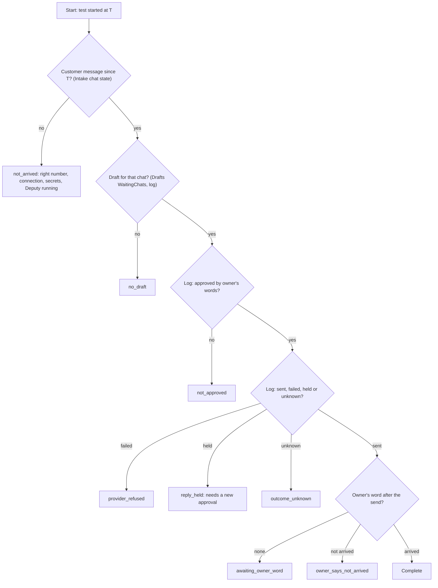

# TP-04-profile-test-finish: Architecture

Part of [TP-04-profile-test-finish.md](../tp/TP-04-profile-test-finish.md). Moved verbatim from there; nothing changed.

## Architecture

Round-trip evidence (step 6), read on every check:



Domain additions (`src/setup/domain/`):
- `ProfileQuestion` is Knowledge's `SectionId` limited to the four sections Setup asks: `description` (what it sells, hours, area), `pickup_delivery` (delivery and area rules), `payment`, `tone_language` (the topics of FR-SETUP-04-1). `may_do`, `must_not_do` and `handoff` are left to Knowledge (the FRD asks for a small first profile). `nextQuestion(answers)` returns the first unanswered one in that order, so there is exactly one question at a time.
- `ProfileDraft { revision, answers, items[] }` where an item is `{ name, price, unit, available, notes }`. `price` is a plain decimal string (digits, optionally `.` and 1 to 4 decimals) written by the agent from the owner's words; Setup validates the shape and never interprets a locale format (D22 belongs to Knowledge's file import).
- `ProfileRevision { revision, shownAt, confirmedAt | null, ownerWords | null, seededAt | null }`. Invariants: a revision is confirmed only after it was shown; any change to answers or items creates revision + 1; a seed call is made only for a confirmed revision.
- `RoundTrip` is a pure function `evaluate(evidence): RoundTripState` over the evidence below, with the part names as a closed union. It holds no state of its own beyond `startedAt`, `chat` once found, and the owner's word facts.
- `Completion { total, working, calendar, providerWait }` comes from `Timing` (TP-01).

Use cases (`application/`): `AnswerProfileQuestion`, `AddCatalogItem`, `RemoveCatalogItem`, `ShowProfileDraft`, `ConfirmProfile` (confirm, set the currency, one seed call, then the step 5 pass), `SuggestCurrency`, `ConfirmCurrency`, `StartRoundTrip`, `InjectTestMessage` (test mode only), `CheckRoundTrip` (step 6), `RecordReplyArrival`, `SwitchToReal`, `GetCompletionSummary`, `ReopenStep`.

Outbound ports added by this TP (all Promise-returning; all read-only except `KnowledgeSeeder` and `TestMessageInjector`):

```ts
interface KnowledgeSeeder {                                                      // Knowledge SetKnowledgeSettings, SeedProfileAndCatalog
  seed(q: { currency: string; profile: Partial<Record<ProfileQuestion, string>>;
    items: { name: string; price?: string; unit?: string; available?: boolean; notes?: string }[]; ownerWords: string;
    revision: number }): Promise<{ ok: true; unchanged: boolean } | { ok: false; reason: 'already_exists' | 'seed_modified' | 'revision_stale' | 'invalid' | 'not_owner' }>;
}
interface CurrencySuggester { forCountry(iso2: string): string | null }          // adapter: country-to-currency
interface ChatEvidence {                                                          // Intake ListChats
  chatsSince(t: Instant): Promise<{ chat: string; lastCustomerAt: Instant | null; lastAnswerAt: Instant | null;
    lastAnswerSource: 'owner_app' | 'sent_through_deputy' | null }[]>;
  messageStoredAt(chat: string): Promise<Instant | null>;                        // storedAt of the newest customer message, via ReadChat
}
interface DraftEvidence {                                                         // Drafts WaitingChats, ReadDraftLog; no write method
  waiting(): Promise<{ number: number; chat: string; kind: 'reply' | 'order'; state: string }[]>;
  logSince(chat: string, t: Instant): Promise<{ id: number; at: Instant; kind: string; draft: number | null; ownerWords: string | null }[]>;
}
interface TestMessageInjector { send(text: string): Promise<{ ok: true } | { ok: false; reason: 'not_dev' }> }   // Intake DeliverDevMessage
interface DataLocationReader { dataDir(): string }                                // the resolved data folder from main.ts
```

`DraftEvidence` has no method that creates, changes or approves a draft, so Setup cannot send or approve (FR-SETUP-04-5). An architecture-style test lists its methods.

Step checks owned here:
- Step 5 passes when the latest revision is confirmed, the seed ended `ok`, `already_exists` or `seed_modified`, and the currency is confirmed. `already_exists` means Knowledge holds a profile or catalog that no seed wrote (the owner's own files); `seed_modified` means the seeded files were edited after the seed. In both Setup keeps what is there, tells the owner so, and says it can be improved through Knowledge (`propose_change`). Reasons: `profile_not_confirmed`, `currency_not_confirmed`, `seed_failed` (`invalid`, with the field).
- Step 6 passes when `evaluate` gives `Complete` (diagram). It is never re-run on resume (TP-01): its stored pass stands.
