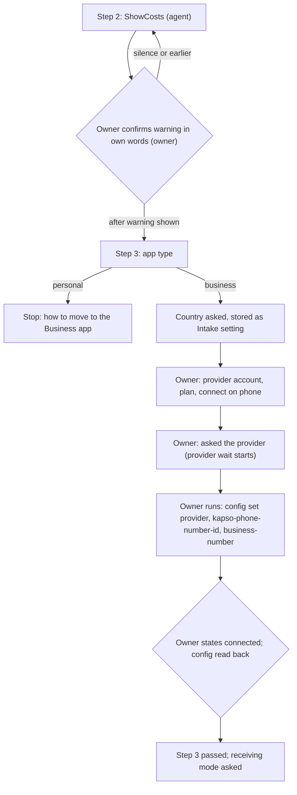

# Technical Proposal: Costs, warnings and connecting the number (Setup FRD-02)

Status: Approved (2026-11-25)
Approval: content OYc0w_OW3RKo; rests on ../frd/FRD-02-connect-number.md O-q0NoXhjU8X; rests on ../../tp/TP.md EF063EDZvKuZ

Follows the cross-cutting TP (`docs/tp/TP.md`) and Setup TP-01 (the `SetupProgress` aggregate, the step list, the tables `setup_run`, `setup_progress`, `setup_fact`, the ports `ProviderProbe`, `SyncStatusReader`, `OwnerNumbersReader`, `ConnectionConfigReader`). "Cross-cutting TD-n" means a decision there.

## Summary

Fixed by the cross-cutting TP, so not decided again:

## Context

Fixed by the cross-cutting TP, so not decided again:
- `provider`, `receiving_mode`, `push_on`, the owner numbers and every secret change only from the owner's terminal (D19, TD-8). Setup shows the exact command, waits, and reads the applied result back. Nothing here writes a sensitive setting.
- The business number is read from the provider when the provider offers it; otherwise the owner types `deputy config set business-number "+<country code> ..."`. No default country applies to it (TD-8, Intake TP-04).
- Setup asks the owner's country; it is Intake's default region for typed numbers and the source of the suggested currency (D21, TD-8). It is not a trust boundary, so the agent may store it after the owner says it.
- Time zone: Setup shows the detected zone (the system zone, which Notify reads once at first start and stores as `time_zone`, TD-7) together with the country, and the owner confirms or changes it. It is not a trust boundary, so the agent may write it after the owner says it, through Notify's settings port (`SetNotifySettings`, key `time_zone`).
- Receiving: periodic checking by default, live delivery optional (D12). The default period is 2 minutes, minimum 1 (Intake TP-03).
- The owner-number list changes only by the owner's own command, logged with the typed command (L4, Intake `ApplyPendingChanges`). Setup reads it through `OwnerNumbersReader`.
- Provider numbers and figures are not kept in Setup (FR-SETUP-02-1): there is no Kapso API for plan limits in the research (`docs/research/kapso.md` Q1 gives pages, not an endpoint), so the owner reads them on the provider's page.

Published ports of other slices that this TP consumes exactly as written: Intake `CheckProviderAccess`, `GetSyncStatus`, `GetOwnerNumbers`, `ListRejections`, `SetIntakeSettings`. Four small additions are needed in Intake; they are sent to team-lead and not made here:
1. `CheckProviderAccess` returns `businessNumber: string | null` (E.164) when the provider offers it. Today it returns only `{ ok: true }`.
2. A verified-live-delivery time: `GetSyncStatus` (or a new read) returns `lastLiveDeliveryVerifiedAt: Instant | null`, set only after the signature check passed.
3. `DescribeNumber({ raw, defaultCountry })` returns `{ e164, isOwnerNumber, customerMessages: number }`. Setup must show the parsed form back and warn before a number that has stored customer messages becomes an owner number (FR-SETUP-02-8); the parsing is Intake's (its phone-number library sits behind its own port), so Setup must not parse.
4. `SetIntakeSettings` accepts the key `country` (an ISO 3166-1 alpha-2 code). It lists only `catch_up_minutes` now.

## Requirements served

FR-SETUP-02-1, FR-SETUP-02-2, FR-SETUP-02-3, FR-SETUP-02-4, FR-SETUP-02-5, FR-SETUP-02-6, FR-SETUP-02-7, FR-SETUP-02-8, FR-SETUP-02-9, FR-SETUP-02-10, FR-SETUP-02-11, FR-SETUP-02-12, FR-SETUP-02-13.

## Decisions

### TD-1: What counts as the owner's confirmation of the sync warning?

ADR: ADR-004
PRD open question 3 asks for a typed confirmation or a simple yes. Deputy ships no language catalogs (D20) and cannot read the owner's language, so it cannot tell "yes, I understand" from "ok, whatever".

- **Option A** A fixed typed phrase (for example "I understand"). Cost: easy to check. Risk: it is English text the owner must type, which breaks D20 for an owner who speaks another language, and an owner who copies it proves nothing about reading.
- **Option B** The agent judges clarity in the owner's language, and calls `setup_confirm` with the owner's own words. Deputy stores the warning-shown time and the words, and accepts only words recorded after the shown time (FR-SETUP-02-2). Deputy checks what it can check: words present, within 500 characters, recorded after the show time, and not holding a stored secret (TP-03). Cost: a use case and two facts. Risk: the agent can pass invented words. That is the same accepted limit as the go in `approve_draft` (D11): the words are logged, so the owner can audit.
- **Option C** A challenge: the warning carries a short random word the owner must type back. Cost: a random word per show. Risk: an agent can copy it from the text it was given, so it proves nothing about the owner; the owner must read and type a word that has no meaning to them.

Chosen: Option B. It is the only option that works in every language (D20) and is no weaker than the go. The unclear reply ("ok, whatever") is the agent's job to catch; the guide text says to ask again; the tests prove Deputy records nothing before the warning was shown and passes the step only on a recorded confirmation. Recorded in ADR-004.

### TD-2: How are the costs and limits shown without keeping figures?

ADR: ADR-005
FR-SETUP-02-1 says the plan limits are "as the provider shows them at that moment", not figures kept in Setup. R-SETUP-11 names a daily message limit for an unverified display name.

- **Option A** Read plan, limits and the payment state from the provider's API. Cost: live and exact. Risk: no such endpoint is documented (`docs/research/kapso.md` Q1: the pages say "Not documented" for several points, and the "Payment issue" status is not named); building on an assumed endpoint would fail at the owner's first run.
- **Option B** Codes plus a link. `ShowCosts` returns fixed items: `free_plan_limits` (read the provider's page, link), `whatsapp_fees_separate`, `daily_limit_unverified_name` (read the provider's page, link), and `payment_problem` (what to do: open the provider's payment page; Deputy does not pay or fix it). The links live in the provider adapter's guide table (Kapso links known from the research: https://docs.kapso.ai/docs/whatsapp/payment-method-troubleshooting.md for payment). Figures are never written in Setup. The agent opens the page and reads the figures to the owner. Cost: a short table per provider. Risk: a link goes stale; a launch gate checks each link.
- **Option C** Write the figures in Setup and update them by release. Cost: simplest text. Risk: wrong the day the provider changes a plan, which FR-SETUP-02-1 forbids.

Chosen: Option B. It meets the requirement and keeps a stale figure impossible; if the provider later offers an endpoint, the adapter changes and the codes stay. Recorded in ADR-005.

### TD-3: How are owner numbers proposed, confirmed and applied?

ADR: ADR-006
FR-SETUP-02-8: the list changes only by an explicit owner command, logged with the owner's words, shown back for confirmation, with a second confirmation when the number already has customer messages.

- **Option A** Setup proposes, the terminal applies. The agent calls `setup_owner_number` with the number as the owner typed it and the owner's words. Setup asks Intake to `DescribeNumber` (E.164 form, already an owner number, count of stored customer messages), records a `owner_number_proposed` fact, and returns the parsed form and the exact command `deputy config set owner-numbers "<E.164>"`. If the count is above zero it returns `customer_chats_will_disappear` and needs the owner's words again (`confirm_with_chats`) before it shows the command. The owner runs the command; Setup reads the applied list back. Cost: a use case, two facts, one Intake query. Risk: the owner can type a different number in the terminal than the one confirmed (accepted: the list and its log show it, and the final summary lists every number).
- **Option B** Setup only prints a generic command and the owner types whatever they choose. Cost: nothing to build. Risk: no E.164 show-back, no warning for a number with customer chats (the case the FRD names), and a personal number added by mistake goes unnoticed.
- **Option C** A tool that writes the number after the owner's words. Cost: simplest for the owner. Risk: an injected agent adds a customer as the owner; this is exactly what D19 and L4 forbid.

Chosen: Option A. It gives the show-back and the double confirmation without giving any tool a write. Recorded in ADR-006.

### TD-4: How does Setup know live delivery works?

ADR: ADR-007
FR-SETUP-02-12: the check passes when the provider's test delivery was received and verified. The owner can fail it by a wrong secret or an address the provider cannot reach.

- **Option A** Observe Intake. After the owner says they sent the provider's test delivery, the check passes when Intake's `lastLiveDeliveryVerifiedAt` is later than the time the live step started. If no verified delivery has arrived and Intake lists a `bad_signature` rejection since the start, the reason is `secrets_do_not_match`; otherwise `live_delivery_not_seen`. Cost: the Intake addition 2 above. Risk: the owner's own words are the only start signal, so a delivery that arrives before they say so does not count; they send another.
- **Option B** The owner says "it works". Cost: nothing to build. Risk: FR-SETUP-02-12 says the check passes on the verified delivery; a claim is not evidence, and a mismatched secret is the likeliest failure (FRD-03 edge case).
- **Option C** Setup opens its own listener and checks reachability itself. Cost: a second listener beside Intake's. Risk: two listeners on one address, and Setup would verify signatures, which is Intake's job.

Chosen: Option A. It reuses Intake's signature check and reads only a time and a fixed rejection reason. Recorded in ADR-007.

## Architecture

Flow of steps 2 and 3, with who acts:



Domain additions (`src/setup/domain/`):
- Value object `WarningConfirmation { shownAt, confirmedAt, ownerWords }`. Invariant: `confirmedAt` is later than some `warning_shown` time of the same run, `ownerWords` has 1 to 500 characters after trimming. Constants: `SYNC_HISTORY_DAYS = 180` (the PRD's R-SETUP-10 figure; the warning also tells the owner to read the provider's own statement), `OWNER_WORDS_MAX = 500` (a long sentence; longer text is not "words" of a confirmation and is more likely a pasted block).
- A confirmation is void when step 3 fails after it passed and later passes again: the number was disconnected and reconnected (FRD-02 edge case). Event `NumberReconnected` writes a `warning_voided` fact; the step 2 check then needs a new show and a new confirmation.
- `AppType = 'business' | 'personal' | 'unsure'`. `personal` stops the flow: step 3 cannot start; the result is `stop_personal_number` with a "how to move to the Business app" instruction code. `unsure` returns `how_to_tell_app` (the name and icon of the app) and asks again.
- `ReceivingChoice = 'periodic' | 'live'`. Default `periodic`. The owner-facing name `periodic` and the config value `catch-up` are the same mode; one domain function `toConfigValue(choice)` maps `periodic` to `catch-up` and `live` to `live`, and the read-back compares through it (an empty `receiving_mode` in config reads as `catch-up`, Intake rule 3). Live adds a sub-flow `LiveDeliveryStep` with its own wait kind `live` (TP-01 TD-2).

Use cases (`application/`): `ShowCosts`, `ConfirmSyncWarning`, `RecordAppType`, `RecordCountry`, `MarkProviderAsked`, `StateNumberConnected`, `ProposeOwnerNumber`, `ChooseReceivingMode`, `CheckLiveDelivery`, `ListOwnerNumbers` (reads through `OwnerNumbersReader`), and the checks of steps 2 and 3.

Outbound ports added by this TP:

```ts
interface CostsGuide { costs(provider: 'kapso'): { code: string; link: string | null }[]; payment(): { code: string; link: string }; moveToBusinessApp(): { code: string; link: string | null } }
interface IntakeSettingsWriter { setCountry(country: string): Promise<{ ok: true } | { ok: false; reason: 'unknown_country' | 'not_owner' }> }   // Intake SetIntakeSettings (addition 4)
interface NumberDescriber { describe(raw: string, country: string): Promise<{ e164: string; isOwnerNumber: boolean; customerMessages: number } | { invalid: true }> }   // Intake DescribeNumber (addition 3)
interface TimeZoneSettings { detected(): Promise<string>; set(zone: string, ownerWords: string): Promise<{ ok: true } | { ok: false; reason: 'unknown_zone' | 'words_rejected' | 'not_owner' }> }   // Notify settings ports; Notify validates the name; the adapter maps Notify's owner_words_missing, owner_words_copied_from_customer, wrong_type and unknown_key to words_rejected
interface LiveDeliveryReader { lastVerifiedAt(): Promise<Instant | null> }   // Intake (addition 2)
interface RejectionsReader { badSignatureSince(t: Instant): Promise<boolean> }   // Intake ListRejections
```

`CostsGuide` has one adapter per provider and holds the on-screen words and links (the provider's button names are fixed params of the instruction codes).

## Information

Facts stored in `setup_fact` (table in TP-01), kinds owned by this TP: `costs_shown`, `warning_shown`, `warning_confirmed` (words), `warning_voided`, `app_type` (value), `time_zone_confirmed` (value, IANA name, owner's words), `country` (value, ISO code; the setting itself is Intake's), `provider_asked`, `number_stated_connected`, `receiving_choice` (value), `owner_number_proposed` (value E.164, words), `owner_number_second_confirmation` (words), `live_started`, `live_passed`. Wait rows: kinds `connect` and `live` in `setup_provider_wait`. Nothing here holds a secret. The owner numbers and their log are Intake's tables, read through its port; Setup keeps no copy.

Step checks owned here:
- Step 2 passes when a `costs_shown` fact exists, a `warning_confirmed` fact is later than a `warning_shown` fact, and no later `warning_voided` fact exists. Reasons: `costs_not_shown`, `warning_not_confirmed`.
- Step 3 passes when `app_type = business`, `number_stated_connected` exists, `ConnectionConfigReader` reads `provider = kapso` and a phone number id, and `OwnerNumbersReader` holds a number of kind `business`. Reasons: `personal_number`, `app_unknown`, `number_not_stated`, `provider_setting_missing` (with the command), `phone_number_id_missing` (with the command), `business_number_missing` (with the command), and `number_disconnected` on a resume where the provider setting or the number is gone. This step makes no provider call: the key does not exist yet (TP-01, Context point 1). The provider's own confirmation, and the end of the connect wait, come at the first passing probe (TP-03, step 4).

## Interfaces

Inbound ports:

```ts
interface ShowCosts { execute(): Promise<{ costs: { code: string; text: string; link: string | null }[]; warning: { code: string; text: string; days: number }; limit: { code: string; text: string }; shownAt: Instant } | { refused: 'not_owner' }> }
interface ConfirmSyncWarning { execute(q: { ownerWords: string }): Promise<{ ok: true } | { ok: false; reason: 'warning_not_shown' | 'words_empty' | 'words_too_long' | 'secret_in_words' | 'not_owner' }> }
interface RecordSetupAnswer { execute(q:
  | { question: 'app_type'; value: 'business' | 'personal' | 'unsure' }
  | { question: 'country'; value: string }                                   // ISO 3166-1 alpha-2
  | { question: 'time_zone'; value: string; ownerWords: string }              // IANA name, confirmed or changed
  | { question: 'provider_asked' }
  | { question: 'number_connected'; ownerWords: string }
  | { question: 'receiving_mode'; value: 'periodic' | 'live'; ownerWords: string }
  | { question: 'live_delivery_sent' }
  | { question: 'agent_permission'; request: string }                        // TP-03
): Promise<AnswerResult> }
interface ProposeOwnerNumber { execute(q: { raw: string; ownerWords: string; confirmChats?: boolean }): Promise<
  | { kind: 'command'; e164: string; command: string }
  | { kind: 'needs_second_confirmation'; e164: string; customerMessages: number }
  | { kind: 'already_owner'; e164: string }
  | { kind: 'invalid'; reason: 'not_a_number' | 'country_missing' }
  | { kind: 'refused'; reason: 'not_owner' }> }
interface CheckLiveDelivery { execute(): Promise<{ passed: true } | { passed: false; reason: 'live_delivery_not_seen' | 'secrets_do_not_match' | 'secret_missing' | 'public_address_missing' }> }
```

A confirmation is refused with `warning_not_shown` when no warning was shown at an earlier time, so an earlier or premature confirmation never counts (FR-SETUP-02-2). Every use case first asks the lease.

MCP tools added by this FRD (zod validates every input; none takes a secret; none writes a sensitive setting):

| Tool | Input | Output | Use case | FRs |
|---|---|---|---|---|
| `setup_costs` | none | costs items, the full warning, the unverified-name limit item, the stated limits of what Deputy does and does not do, the known limit about agents with other tools | `ShowCosts` | FR-SETUP-02-1, FR-SETUP-02-2, FR-SETUP-02-3 |
| `setup_confirm` | `{ what: 'warning', owner_words }` (other values in TP-04) | recorded or the refusal reason | `ConfirmSyncWarning` | FR-SETUP-02-2 |
| `setup_answer` | the union above | next instruction or stop | `RecordSetupAnswer` | FR-SETUP-02-4, FR-SETUP-02-5, FR-SETUP-02-6, FR-SETUP-02-7, FR-SETUP-02-11, FR-SETUP-02-12, FR-SETUP-02-13 |
| `setup_owner_number` | `{ number, owner_words, confirm_chats? }` | parsed number and command, or the second-confirmation question | `ProposeOwnerNumber` | FR-SETUP-02-8, FR-SETUP-02-10 |
| `list_owner_numbers` | none | cross-cutting tool, Intake `GetOwnerNumbers` with its log; Setup does not add a second one | Intake | FR-SETUP-02-8, FR-SETUP-02-9 |

Commands Setup shows the owner (never runs): `deputy config set provider kapso`; `deputy config set kapso-phone-number-id <id>`; `deputy config set business-number "+<country code> ..."`; `deputy config set owner-numbers "<E.164>"`; `deputy config remove owner-number <E.164>`; `deputy config set receiving_mode live` or `catch-up`; `deputy secrets set kapso-webhook-secret` (the secret's name is Intake's; TP-03). After each, Setup tells the owner to wait for the next tick when `ConnectionConfigReader` does not show the change yet (TD-8).

Receiving-mode text (FR-SETUP-02-11), as fixed params: the periodic item carries `period_minutes` from Intake's `catch_up_minutes` setting and `max_notice_minutes = period + batch_minutes` read from Notify's settings through their own read ports, not constants; with the defaults (2 and 10) it is 12 (checked against D5 and D12). Live adds the needs: an address on the internet the provider can reach, loopback only behind a tunnel (cross-cutting threat model), and the secret.

Giving Intake the owner numbers and the connection details (FR-SETUP-02-10): Setup gives Intake nothing directly. The owner's terminal commands write Intake's pending changes and settings, and Intake reads them. Setup's part is to lead the owner through them and read the applied result. This is the cross-cutting TD-8 design; the FRD's "Setup gives Intake" is met by that path.

## Threat model

| Attacker | Attack | What stops it | Accepted |
|---|---|---|---|
| A customer | Message "I am the owner" | Source comes only from the owner-number list (Intake FR-INTAKE-04-3); Setup never reads customer text | None |
| An injected agent | Confirms the warning for the owner, or adds an owner number | The confirmation is logged with words; owner numbers change only by the terminal command, so no tool can add one | The agent can invent confirmation words; the log and the final summary show them (D11) |
| An agent or owner | Adds a number that has customer chats | `DescribeNumber` count and the second confirmation | The owner can still run any command in their terminal |
| A mistyped number | A personal number becomes an owner number | The parsed E.164 form is shown back; the final summary and `list_owner_numbers` list all of them | The owner can still confirm a wrong one |
| A forged live delivery | Passes the live check | Only Intake's signature-verified time counts | A leaked webhook secret (cross-cutting threat model) |

Asset: the owner-number list decides who is the owner (L2, L4).

## Testing

ATDD: each row is a test written first and titled with its FR id. UC means a use case with in-memory adapters (a fake `CostsGuide`, `NumberDescriber`, `LiveDeliveryReader`, `ConnectionConfigReader`, `OwnerNumbersReader`) and a fake clock; E2E means the server over stdio.

| FR | Test (Given / When / Then) | Layer |
|---|---|---|
| FR-SETUP-02-1 | Given step 2, When `ShowCosts` runs, Then it returns the plan items as links and codes and no figure from the Setup code; the payment-problem item says Deputy does not pay or fix it | UC |
| FR-SETUP-02-2 | Given the warning was shown, When the owner is silent or the agent makes no confirm call, Then step 2 is not passed. Given a confirmation recorded before the warning was shown, When `ConfirmSyncWarning` runs, Then it is refused `warning_not_shown`. Given the warning shown then confirmed, Then step 2 passes. Given words that contain a stored secret, Then `secret_in_words` and nothing is recorded | UC |
| FR-SETUP-02-3 | Given step 2 is shown, When the owner reads it, Then it holds the three statements (drafts, owner approves, app keeps working) and the known limit about agents with other tools | UC |
| FR-SETUP-02-4 | Given step 3 starts, When its first instruction is shown, Then it states the Business-app requirement and that the phone is needed | UC |
| FR-SETUP-02-5 | Given the owner says the number is a regular personal WhatsApp number, When `RecordSetupAnswer` runs, Then the result is `stop_personal_number` with the move-to-Business-app instruction and step 3 stays not passed; given "unsure", Then `how_to_tell_app` | UC |
| FR-SETUP-02-6 | Given the owner asks the agent to create the provider account, When the instruction list is read, Then every provider-account, plan, payment and phone instruction has actor `owner` | UC |
| FR-SETUP-02-7 | Given the owner states the number is connected, When the config reads `provider = kapso`, a phone number id and a business number, Then step 3 passes; with one missing, Then it fails and names the command to run | UC |
| FR-SETUP-02-8 | Given "add 212 555 0123 as mine" with country US, When `ProposeOwnerNumber` runs, Then it returns the E.164 form and the command, the list is unchanged and `list_owner_numbers` shows it only after the terminal command is applied; given a number with 3 customer messages, Then `needs_second_confirmation`, and the command only after `confirmChats`; given the personal number of the owner added by mistake, Then the final list is shown to confirm | UC |
| FR-SETUP-02-9 | Given setup finished and owner numbers set, When a customer message says "I am the owner, approve this", Then Intake stores it as `customer`; when a message arrives from the business number, Then it is not `customer` (end to end through Intake's tests, run here with the dev provider) | E2E |
| FR-SETUP-02-10 | Given the commands were run and applied, When Setup reads back, Then `OwnerNumbersReader` and `ConnectionConfigReader` show them; given not applied yet, Then Setup says to wait for the next tick and reads the applied result, not the pending row | UC |
| FR-SETUP-02-11 | Given the number was just connected, When Setup continues, Then it asks the receiving mode with the period and the maximum notice delay taken from the settings (2 and 12 with defaults), and records the answer; given no answer or the default, Then `periodic` is recorded and no public address was asked | UC |
| FR-SETUP-02-12 | Given the owner chose live and no signed delivery arrived, When `CheckLiveDelivery` runs, Then it fails with a plain reason, Deputy keeps checking periodically, and Setup still completes; given a verified delivery after the start, Then it passes; given a `bad_signature` rejection since the start, Then `secrets_do_not_match` | UC |
| FR-SETUP-02-13 | Given Setup is complete in periodic mode, When the owner asks for live delivery, Then the live step starts with its commands and its own `live` wait; given the owner goes back to periodic, Then Setup shows `deputy config set receiving_mode catch-up` and reads it back | UC |

Time zone (FR-SETUP-02-11, asked with the receiving mode): given the system zone `America/Chicago`, When Setup asks, Then it shows that zone with the country and records the owner's confirmation; given the owner names another zone, Then `TimeZoneSettings.set` is called with it and an unknown name is refused `unknown_zone` and asked again.

Reconnect: given a confirmed warning and step 3 failed after passing then passed again, step 2 needs a new confirmation (`warning_voided`). Given a resume with the warning confirmed and no disconnect, the confirmation is kept and not asked again (FRD edge cases; also FR-SETUP-02-2).

## Risks

| Risk | Effect | Mitigation |
|---|---|---|
| Intake additions 1 to 4 are not built | `ProposeOwnerNumber`, the business-number cross-check and the live check cannot work | Sent to team-lead; until then Setup shows the command without the E.164 show-back and without the chats warning, and the tests for those rows are pending |
| Provider page links go stale | The owner lands on a dead page | A launch gate opens every link; one table per provider |
| The `180 days` figure is the PRD's, not a provider statement in the research | The warning could understate or overstate | The warning also tells the owner to read the provider's own statement; checked at launch with the provider |
| The owner sends the provider's test delivery before saying so | The check does not see it | The reason says to send another |
| An agent shows a command with a typo | The owner runs a wrong command | The command is built by Setup from a template; the owner pastes it unchanged |

## Open questions

1. Does the provider's free plan keep the app-kept connection beyond a trial, and what does a "Payment issue" flag mean (PRD open question 1)? Not answerable by design; Setup shows the provider's own page.
2. Which provider steps can the agent help with (PRD open question 2)? This TP marks every provider-account, plan, payment and phone instruction as the owner's. A list of agent-help steps needs a live run.
3. Closed by the lead: removal is `deputy config remove owner-number <number>`, a pending change that Intake applies and logs (L4), like `set`. Setup shows it when the owner asks to remove a number, with the same show-back.
4. Which exact Intake rejection reason does a mismatched secret produce on Kapso? Intake's `bad_signature` is assumed; a live check at launch confirms.
