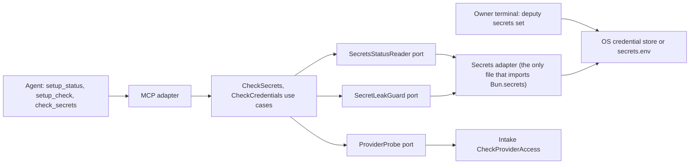

# Technical Proposal: Credentials and safety (Setup FRD-03)

Status: Approved (2026-11-18)

Follows the cross-cutting TP (`docs/tp/TP.md`) and Setup TP-01 and TP-02. "Cross-cutting TD-n" means a decision there.

## Context

Fixed by the cross-cutting TP, so not decided again:
- Secrets are entered with `deputy secrets set <name>` in the owner's terminal. The command prompts without echo and stores the value in the OS credential store (`Bun.secrets`, service `deputy`), or in `~/.deputy/secrets.env` (mode 0600 on POSIX) when the store throws. Reads try the store, then the file. A value is in one place only (TD-8). This answers FRD-03 open question 1: the "local place" is the OS credential store, and the fallback file when that is not available. The owner never opens a file in the normal case.
- No MCP tool takes a secret. `check_secrets` reports present and accepted, and the last four characters of long secrets, never a value (TD-8, FR-SETUP-03-4, FR-SETUP-03-6).
- "Accepted": the provider key passes one cheap authenticated call through Intake's `CheckProviderAccess`; the webhook secret cannot be probed, so it is "present, well formed", and only a signed live delivery proves it (TD-8, Setup TP-02 TD-4).
- Deputy checks the mode of the secrets file at start on POSIX and warns when it is looser than owner-only (TD-8). Windows file permissions are not checked (cross-cutting threat model).
- The send rule is not configurable: Deputy has no send path except an approved draft (D1, D11, FR-DRAFTS-02-7). Setup changes no agent setting.
- Known limit (D11): an agent with a shell or file tools runs as the same user, so it could read the fallback file, the database or the OS store, or run the commands. Setup says so.
- Libraries stay behind ports (ADR-000 of the cross-cutting set). `Bun.secrets` is used only inside the secrets adapter, which the command line and Setup's read-only port share.

Secrets Setup knows by name (the names are Intake's connection settings, Intake TP-01): `kapso-api-key`, and `kapso-webhook-secret` only when the receiving mode is live. The Google service account path belongs to Knowledge and Orders, not to Setup.

Two points for team-lead (not changed here):
1. FRD-03 test "the locked-down agent profile deny list covers the path" refers to `operator/`. The cross-cutting TD-9 removes `operator/`. This TP tests the deny-rule snippet that Setup shows instead (TD-2).
2. The command line needs a read-only `deputy secrets list` (names, where each is kept, present or absent, no value) so the owner sees which entries to fill (FR-SETUP-03-2). The cross-cutting TP lists only `deputy secrets set`. The same adapter serves `check_secrets`.

## Requirements served

FR-SETUP-03-1, FR-SETUP-03-2, FR-SETUP-03-3, FR-SETUP-03-4, FR-SETUP-03-5, FR-SETUP-03-6, FR-SETUP-03-7, FR-SETUP-03-8.

## Decisions

### TD-1: How much of a secret may be shown?

FR-SETUP-03-4: "the last four characters for long secrets, nothing but present or absent for short ones". The FRD does not say where "long" starts. A leaked fragment of a short secret helps a guess.

- **Option A** Show the last four characters only when the secret has at least 20 characters; below that, only present or absent. Four of 20 hide 16 characters, so a fragment does not shrink the search in a useful way; any real API key or HMAC secret is longer. Cost: one constant. Risk: a provider key shorter than 20 characters is never shown, which is safe.
- **Option B** Never show any part. Cost: strongest. Risk: the owner cannot tell which of two keys they stored, or whether a rotation took effect, which is the point of the partial form (FRD-03 edge case "owner rotates a secret").
- **Option C** Show the last four of every secret whatever its length. Cost: simplest. Risk: a 6-character secret then shows two thirds of itself.

Chosen: Option A, with the threshold 20 and the reason above. The display function is pure, in `domain/`, and tested at lengths 0, 1, 19, 20 and 64. Recorded in ADR-008.

### TD-2: How does Setup keep the agent away from Deputy's files?

FR-SETUP-03-2: the agent must not read the secrets, and with any agent other than the locked-down profile the owner must restrict the path. The `operator/` profile is removed (cross-cutting TD-9).

- **Option A** Setup shows a deny rule the owner can paste into the agent's own settings, and says what it does not cover. For Claude Code it is `Read(~/.deputy/**)` in `permissions.deny` (path syntax with `~/` is documented at https://code.claude.com/docs/en/permissions; Read and Edit deny rules apply to the built-in file tools and to file commands Claude Code recognizes in Bash such as `cat` and `sed`, not to an arbitrary script that opens the file; the documented OS-level option is the sandbox). For Codex, Cursor and Gemini CLI no verified rule syntax exists in this research, so Setup says in plain words to restrict the folder `~/.deputy` in the agent's own permission settings and that Deputy cannot check it. Cost: text per agent. Risk: the owner may skip it; the status says it is not verified.
- **Option B** `deputy install` writes the deny rule into the agent's settings. Cost: the owner does nothing. Risk: it edits the agent's permission file, which R-SETUP-15 and FR-SETUP-03-7 tell Setup to stay away from, and a bad merge could disable the owner's other rules.
- **Option C** Nothing; rely on the OS store. Cost: none. Risk: the file fallback and `config.json` stay readable by an agent's file tools, and the fallback file is the case where the store fails, which is the common case on a headless Linux box.

Chosen: Option A. It adds protection without Setup changing the agent's settings, and it states the limit honestly (D11). Setup also tells the owner that the OS store is not readable by the agent's file tools. Recorded in ADR-009.

### TD-3: What does Setup do when a secret is pasted into the conversation?

FR-SETUP-03-3: the agent should refuse and tell the owner to replace the secret; the FRD says Deputy cannot detect it.

- **Option A** Guide text only. Cost: none. Risk: relies on the agent noticing.
- **Option B** Guide text plus an exact-match guard inside Deputy. Every Setup tool that accepts the owner's words (`setup_confirm`, `setup_answer`, `setup_owner_number`, `setup_profile`) asks a read-only port `SecretLeakGuard.contains(text)`. The adapter compares the text with the stored secrets and returns only true or false, so Setup never sees a value. A hit refuses the call with `secret_in_words` and stores nothing. It also tells the agent to say the secret must be replaced on the provider's page. Cost: one port and one adapter method. Risk: it catches only an exact paste of a stored secret, not a verification code or a reformatted key.
- **Option C** Pattern rules for code-like strings (six digits, long tokens). Cost: broad. Risk: false hits on prices, phone numbers and order quantities in the catalog flow, which would block ordinary words.

Chosen: Option B. It adds a cheap, testable layer that cannot be wrong in the harmful direction, and it keeps the claim honest: Deputy does not detect passwords or codes it never stored (the guide still teaches the agent). Recorded in ADR-010.

## Architecture



Outbound ports added by this TP (read-only; none returns a value):

```ts
type SecretName = 'kapso-api-key' | 'kapso-webhook-secret';
type SecretStatus = {
  name: SecretName;
  present: boolean;
  where: 'os-store' | 'file' | null;       // never the path of a value, only the place
  lastFour: string | null;                 // only when the secret has at least 20 characters
  wellFormed: boolean | null;              // webhook secret only: no whitespace, at least 16 characters
  fileModeLoose: boolean;                  // POSIX file fallback only
};
interface SecretsStatusReader { status(names: SecretName[]): Promise<SecretStatus[]> }
interface SecretLeakGuard { contains(text: string): Promise<boolean> }
```

Why 16 for "well formed": a signing secret under 16 characters is short enough to guess, and a space or line break almost always means a bad paste. The check only says "present, well formed"; it does not claim the provider accepts it.

Domain (`domain/`): `maskSecret(length, lastFourOrNull)` (pure, the TD-1 rule), the `GUARDED_SETTINGS` set (`always_allow`, `bypass_permissions`, `auto_approve_tools`) that no step may require, and the instruction table where every instruction touching a password, a code, a payment or a secret carries `where: 'provider_screen' | 'phone_screen' | 'terminal'` and `actor: 'owner'` by construction.

Use cases: `CheckSecrets` (the tool `check_secrets`), `CheckCredentials` (the step 4 check), `RefuseAgentPermissionChange` (reached through `setup_answer` with `question: 'agent_permission'`).

Step 4 check (`CheckCredentials`), in order:
1. `kapso-api-key` absent: fail `provider_key_missing`, with `deputy secrets set kapso-api-key` and where to find the key on the provider's page.
2. `ProviderProbe.check()`. `credentials`: `provider_rejects_key` ("the provider does not accept the key", enter a new one in the same way). `unreachable` or `timeout`: `provider_unreachable`. `quota` or `usage_limit`: `provider_busy`, retry later. None of these shows the key or the provider's own error text.
3. The probe returned `businessNumber`: if no owner number of kind `business` is recorded, show `deputy config set business-number "<number>"` prefilled; if it differs from the recorded one, fail `business_number_mismatch` with the two numbers (not secrets) and the command.
4. `SyncStatusReader`: when the first import is still running, or `historyMaybeSyncing` is true, the step stays not passed with `history_still_copying` (provider wait continues). When the status is `failed`, `sync_failed` with Intake's fixed reason code.
5. When all pass: the `connect` provider wait ends at the time of this probe (TP-01, TD-2), and the step passes.
6. When the mode is live, `kapso-webhook-secret` must be present and well formed, else `secret_missing`; the proof it matches the provider's is the live check (TP-02, TD-4). When the mode is periodic, the webhook secret is not asked.

A rotated secret is the same check run again (FRD-03 edge case).

## Information

No new table. The step 4 result is in `setup_progress` (`reason_code`, `reason_params` with fixed names and numbers only). Secrets live in the OS store or the fallback file, never in the database, the logs or `setup_fact`. `SecretStatus` is computed on each call and not stored. The time each secret was last checked is `setup_progress.checked_at` of step 4 (FRD-03 Information); the last four characters are never stored.

## Interfaces

Inbound ports:

```ts
interface CheckSecrets { execute(): Promise<{ secrets: { name: SecretName; present: boolean; where: 'os-store' | 'file' | null;
  accepted: 'yes' | 'no' | 'not_checked'; display: string; wellFormed: boolean | null; checkedAt: Instant | null }[];
  warnings: ('file_mode_loose' | 'stored_in_file')[] }> }       // pure read, no lease
interface CheckCredentials { execute(): Promise<{ passed: true } | { passed: false; reason: Reason }> }
interface RefuseAgentPermissionChange { execute(q: { request: string }): Promise<{ refused: true; code: 'approval_is_the_go' }> }
```

`display` is `"present"`, `"absent"` or `"present, ends ...abcd"` (last four only for 20 characters or more). `accepted` for the webhook secret is `not_checked` until a signed delivery was seen (TP-02, TD-4).

MCP tool:

| Tool | Input | Output | Use case | FRs |
|---|---|---|---|---|
| `check_secrets` | none | per secret: present, where, partial display, accepted, warnings; never a value | `CheckSecrets` | FR-SETUP-03-4, FR-SETUP-03-6 |

Commands shown to the owner: `deputy secrets set kapso-api-key`, `deputy secrets set kapso-webhook-secret` (live only), and `deputy secrets list` (the added read-only command above). Setup states the limits: an agent with file tools or a shell could read the fallback file; the OS store is out of reach of file tools but not of a shell (D11). The deny-rule text for Claude Code is `permissions.deny: ["Read(~/.deputy/**)"]`; for other agents the text asks the owner to restrict `~/.deputy` themselves and says Deputy cannot verify it.

Agent guide rules (part of the setup guide the agent reads; the first lines are repeated in the `setup_status` tool description so an agent that ignores server `instructions` still sees them): never ask the owner for a password, a verification code or a payment detail; never ask the owner to paste a key into the conversation; if the owner pastes one, do not use it, tell the owner to ignore a code or replace a key on the provider's page, and say nothing of its value.

## Threat model

| Attacker | Attack | What stops it | Accepted |
|---|---|---|---|
| A careless owner | Pastes a key or a code into the chat | The guide tells the agent to refuse and say to replace it; `SecretLeakGuard` refuses an exact paste of a stored secret and stores nothing | A code Deputy never stored cannot be detected; the owner is told to request a new one |
| An injected agent | Reads the fallback file or the config folder | The OS store is primary; the shown deny rule; `check_secrets` says where each is kept | An agent with a shell runs as the same user and can read both (D11) |
| An injected agent | Asks Setup to loosen the agent's permissions ("always allow") | `RefuseAgentPermissionChange` refuses; no Setup tool changes an agent setting; no step requires a guarded setting (FR-SETUP-03-7, FR-SETUP-03-8) | An owner can change their own agent's settings themselves; Setup says the approval is the go in the conversation |
| A screenshot of the setup | A secret leaks to a third party | The status shows at most the last four of a 20-character-or-longer secret | Four characters of a long secret |
| A log or shared document | Holds a secret | Logs go to stderr, never hold values; no tool takes or returns a value; `Secret` objects print `[secret]` (Intake TP-01) | None |
| A wrong webhook secret | Forged or lost live messages | The live check names `secrets_do_not_match` | A leaked secret lets forged live messages through until replaced (cross-cutting threat model) |

Assets: the provider key and the webhook secret (asset 3 of the cross-cutting threat model), and the owner's own passwords, codes and payment details, which Deputy never holds at all.

## Testing

ATDD. UC means a use case with in-memory adapters (a fake `SecretsStatusReader`, `SecretLeakGuard`, `ProviderProbe`, `SyncStatusReader`) and a fake clock. E2E runs the server over stdio with the dev provider and a sentinel secret value. AC means the secrets adapter contract against a fake store that works and one that throws.

| FR | Test (Given / When / Then) | Layer |
|---|---|---|
| FR-SETUP-03-1 | Given the full tool list, When every input schema is read, Then no field accepts a secret, a password, a code or a payment detail; given the instruction table, Then every instruction that involves them names its screen (`provider_screen`, `phone_screen` or `terminal`) and has actor `owner`. Given an end-to-end run with a sentinel key set in the store, When all tool outputs, stderr and the database are searched, Then the sentinel appears nowhere | UC and E2E |
| FR-SETUP-03-2 | Given the owner entered the key with the command, When `setup_status` runs, Then it says the key is present, where, and at most its last four characters; the instruction names `deputy secrets set kapso-api-key` and where to find the key on the provider page; `deputy secrets list` shows the entries to fill with no value; the deny-rule text for Claude Code contains `Read(~/.deputy/**)` and the text for other agents says the owner must restrict the folder and that Deputy cannot verify it | UC |
| FR-SETUP-03-3 | Given the guide text, When it is read, Then it holds the rule to refuse a pasted secret and to say to replace it; given words equal to a stored secret, When `setup_confirm` runs, Then `secret_in_words` is returned and no fact is stored | UC |
| FR-SETUP-03-4 | Given secrets of length 6, 19, 20 and 64, When `CheckSecrets` runs, Then the 6 and the 19 show only present, the 20 and the 64 show the last four; given the store throws, Then the file fallback is used and `where` is `file`; given a mode looser than 0600 on POSIX, Then the warning `file_mode_loose` | UC and AC |
| FR-SETUP-03-5 | Given setup is complete, When status output, tool results and logs are searched for the secrets, Then neither appears in the clear; and no tool result is addressed to a customer | E2E |
| FR-SETUP-03-6 | Given the key was revoked, When step 4 is checked, Then it fails `provider_rejects_key` ("the provider does not accept the key"), without the key; given the key present and accepted, Then the check reports present and accepted; given a webhook secret, Then it reports `not_checked` until a signed delivery was seen | UC |
| FR-SETUP-03-7 | Given the owner asks to let the agent send without asking, When `setup_answer` with `agent_permission` runs, Then the result is `approval_is_the_go` and nothing changes; given the full tool list, Then no tool writes an agent setting | UC |
| FR-SETUP-03-8 | Given every step plan and instruction in the domain table, When it is scanned, Then none requires a guarded setting; given a plan that did, Then the use case refuses to run the step and says why (the test builds such a plan to prove the refusal) | UC |

Also tested here: the step 4 order (key missing, rejected, unreachable, busy, number mismatch, history still copying, passed) with the connect wait ending at the first pass; and the live-mode requirement for the webhook secret.

## Risks

| Risk | Effect | Mitigation |
|---|---|---|
| `Bun.secrets` is experimental and fails without a secret service (cross-cutting Risks) | Secrets land in the file fallback | `check_secrets` says where each is; the deny rule and the mode check; live check on a Linux container before launch |
| The deny rule syntax for Codex, Cursor and Gemini CLI is not verified here | Those owners get a plain-words instruction only | Said in the text; a live check per agent adds a verified rule |
| A deny rule does not cover arbitrary scripts that open the file | An agent with a shell reads it anyway | Stated to the owner (D11); the documented OS-level option is the agent's sandbox |
| `SecretLeakGuard` reads secrets in the adapter on each call | A longer exposure of values in memory | The adapter compares and returns a boolean; values are not stored or logged |
| A pasted code or password is not detectable | It stays in the conversation | The guide tells the owner to ignore or replace it; Setup records no copy |

## Open questions

1. What are the real key and webhook-secret lengths and formats on Kapso? The 20 and 16 thresholds hold for any realistic secret, but the provider's format could tighten the "well formed" test. Checked at the live run.
2. Is a verified deny-rule syntax available for Codex, Cursor and Gemini CLI? Not found in current docs read for this TP.
3. Should `deputy secrets list` be part of the cross-cutting command set? Sent to team-lead.
