# TP: the local pilot end to end

Part of [TP.md](../tp/TP.md). Added 2026-11-24 for the local pilot (REQ-15, D31 to D38). It draws how the pieces already specified work together; it decides nothing new.

Sources: Intake FRD-05, TP-05 and SPEC-05-x; Setup FRD-05 and SPEC-05-x; Knowledge FRD-04 and SPEC-04-x; ADR-018; Drafts pilot specs SPEC-05 to SPEC-13 and Drafts ADR-013 (PR #202, branch docs/drafts-pilot, not merged when this was written).

Spec ids in the drawings use one letter for the slice: I = Intake, D = Drafts, K = Knowledge, S = Setup. `I05-6` is Intake SPEC-05-6; `I03` is Intake SPEC-03 (catch-up); `D07` is Drafts SPEC-07. An arrow with no spec that builds it says GAP, and the GAP list at the end repeats each one.

## 1. Components

What runs where. The owner talks to Claude Code, the session calls Deputy's tools over stdio, and Deputy talks to Kapso. Nothing else leaves the computer.

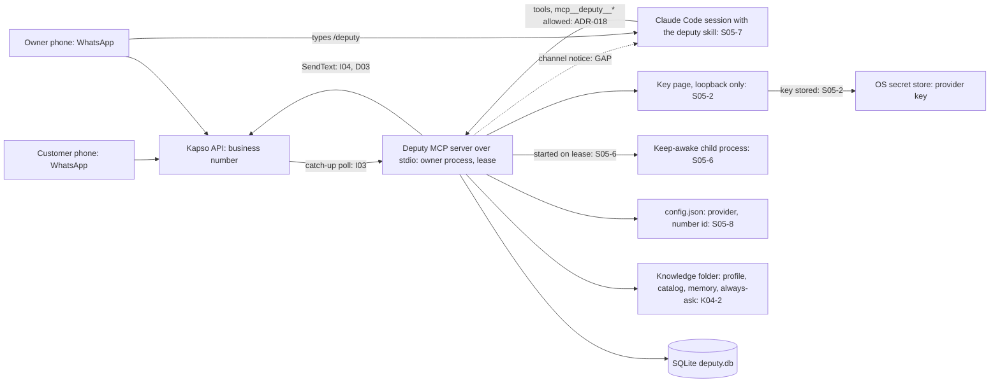

The slices inside the server, the tables each owns, and how they call each other. A slice imports another only through its `index.ts` (ADR-000).

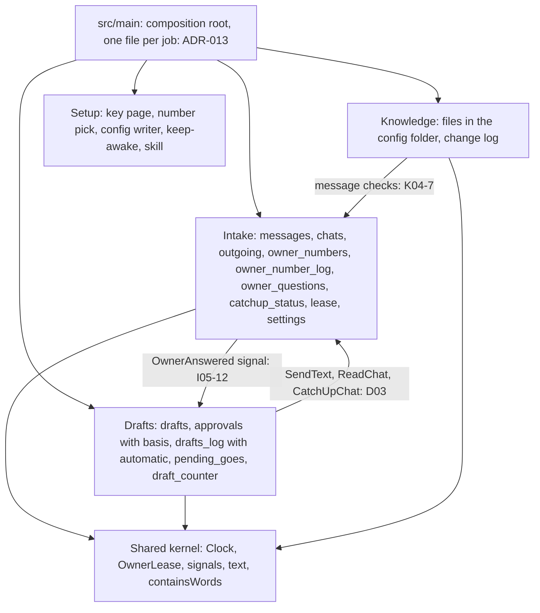

## 2. Sequences

Each message names the tool, the spec and the table. "Session" is Claude Code with the skill.

### (a) Install and setup interview

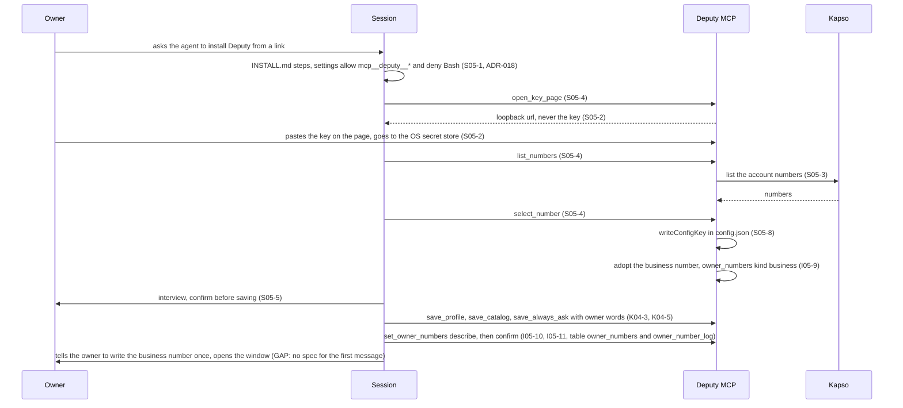

### (b) Customer message to a knowledge-backed automatic answer

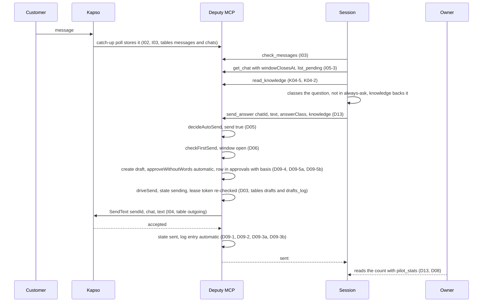

### (c) Always-ask or unknown: ask the owner, take the answer as the go

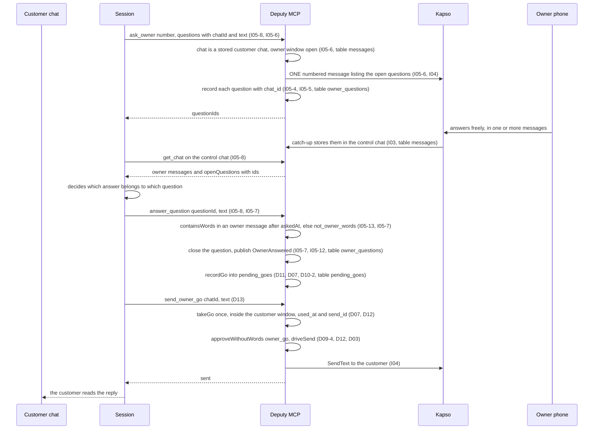

### (d) The owner's window is closed: ask in the Claude app

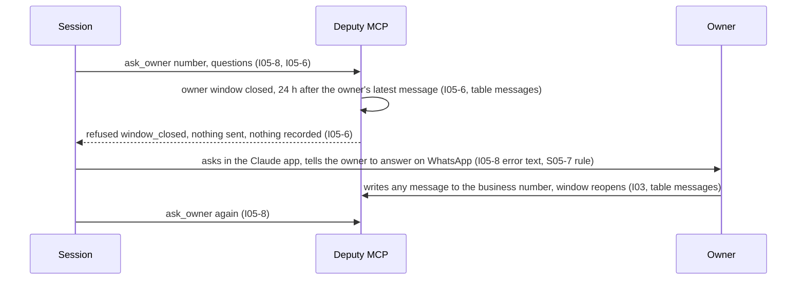

### (e) The customer window is closed: no send, tell the owner

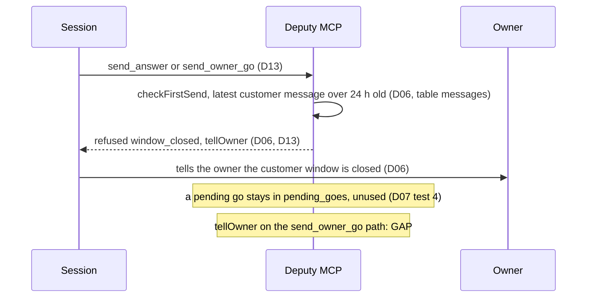

### (f) Crash in the middle of a send

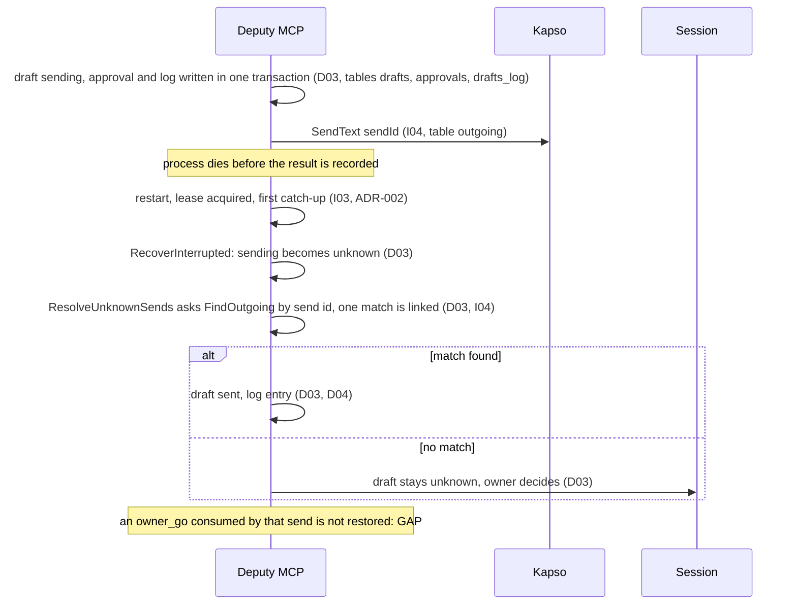

### (g) Restart with a pending go

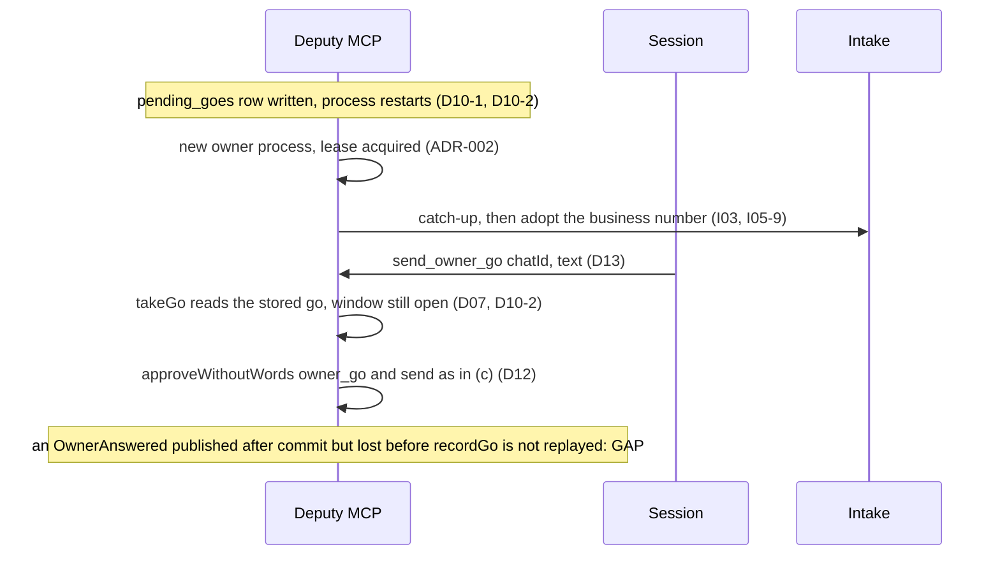

### (h) Remember from the control chat

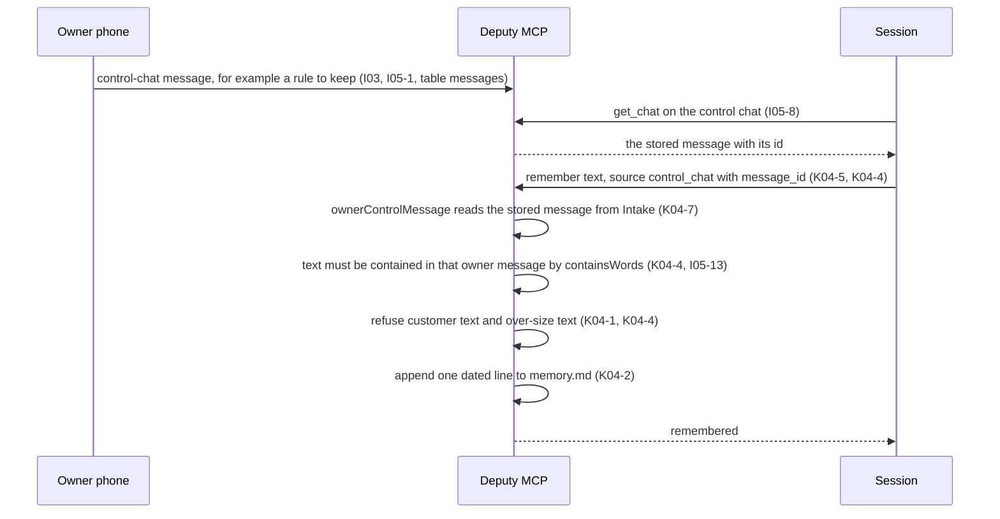

### (i) Wake: channel notice, slow loop and catch-up poll

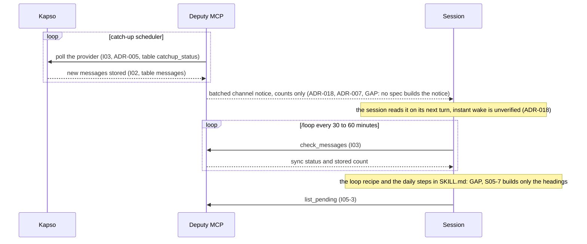

## 3. States

The draft, with the basis of its approval. `waiting` to `sending` is the one send path; the three bases differ only in how the approval was allowed (D09-4, D09-5a).

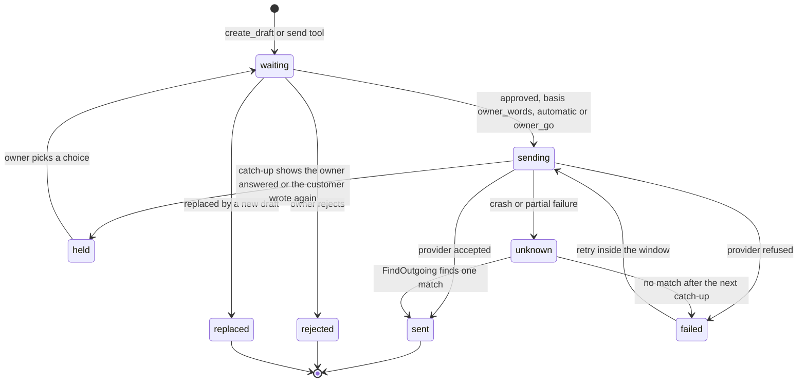

The owner question, from Intake FRD-05 and SPEC-05-4 to SPEC-05-7.

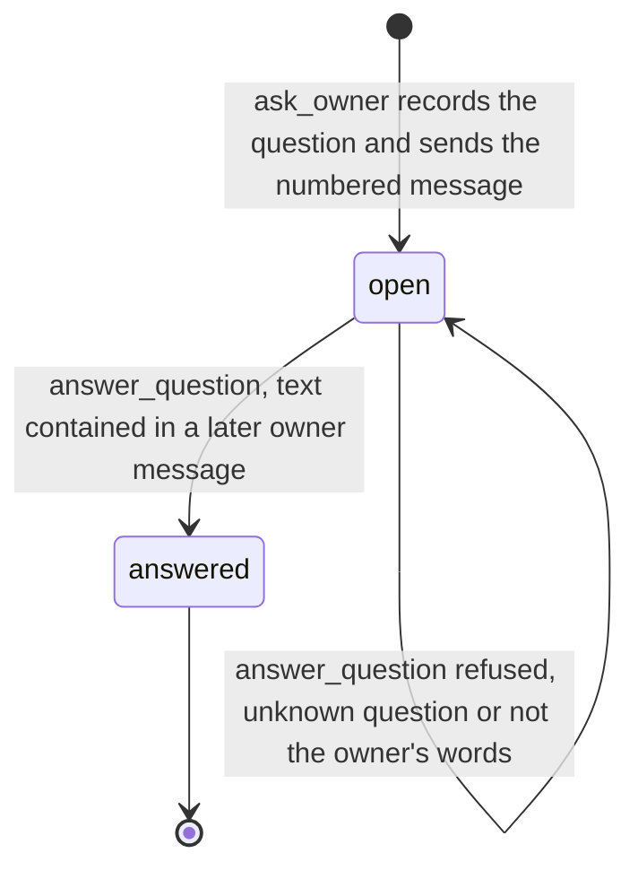

The pending go, from Drafts SPEC-07 and SPEC-10-2.

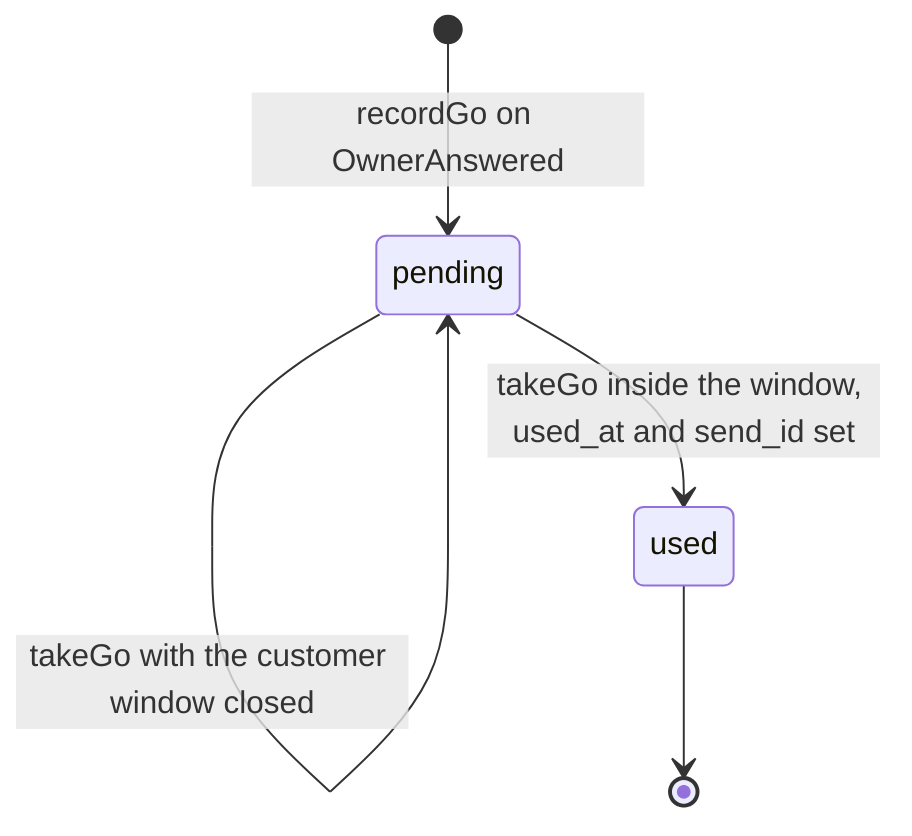

## 4. Data

The new tables and the columns the pilot adds to existing ones. Existing tables are shown only where the pilot touches them.

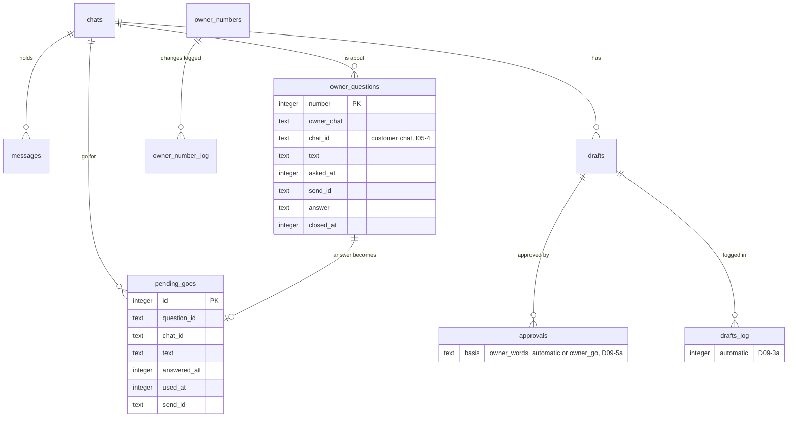

## 5. GAP list

An arrow in a drawing that no spec builds. Each is stated as found; none is decided here.

1. Channel notice. ADR-018 expects a batched notice through the channel, and Intake SPEC-01 only declares the capability. No spec emits the notice (Notify has no spec in the pilot). The `/loop` fallback does not depend on it.
2. Skill daily loop. Setup SPEC-05-7 builds the headings of SKILL.md and leaves the daily steps (check, classify, `send_answer`, `ask_owner`, `answer_question`, `send_owner_go`) and the `/loop` recipe to "the Drafts pilot specs", and those specs hold no skill text.
3. First owner message. The owner window opens only when the owner writes to the business number (FR-INTAKE-05-7). No spec has the setup interview ask for that first message, so the first `ask_owner` after setup can return `window_closed`.
4. A consumed go. Drafts SPEC-07 `takeGo` marks the go used before the send runs; if the send then fails or the process crashes (diagram f), no spec returns the go or tells the session.
5. A lost signal. `OwnerAnswered` is published in process after the commit (Intake SPEC-05-7); a crash between that commit and Drafts SPEC-11 `recordGo` leaves a closed question with no pending go, and nothing replays it at start (diagram g).
6. Closed window on the go path. Drafts SPEC-06 sets `tellOwner` for `send_answer`; `send_owner_go` with a closed window returns nothing sent, and no spec says it tells the owner (diagram e).
