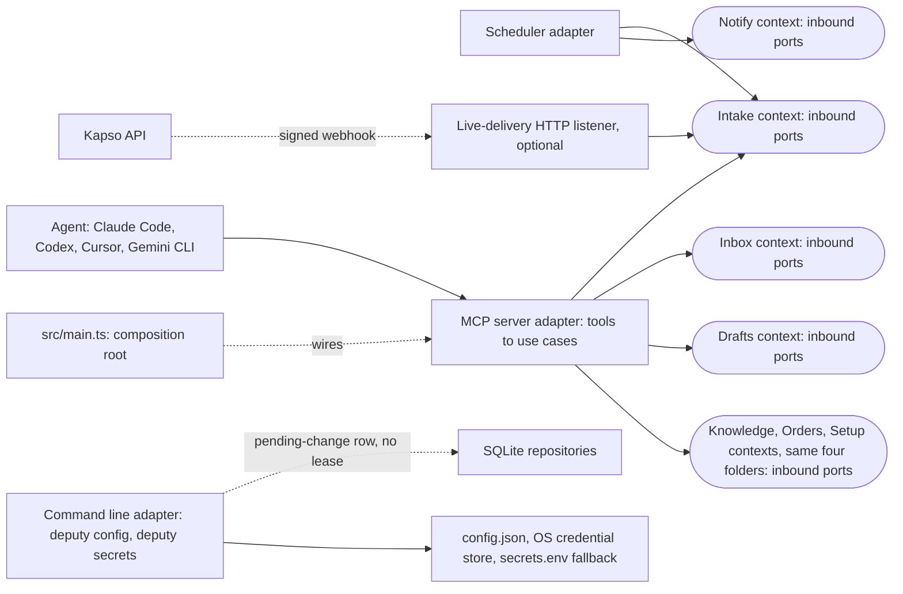
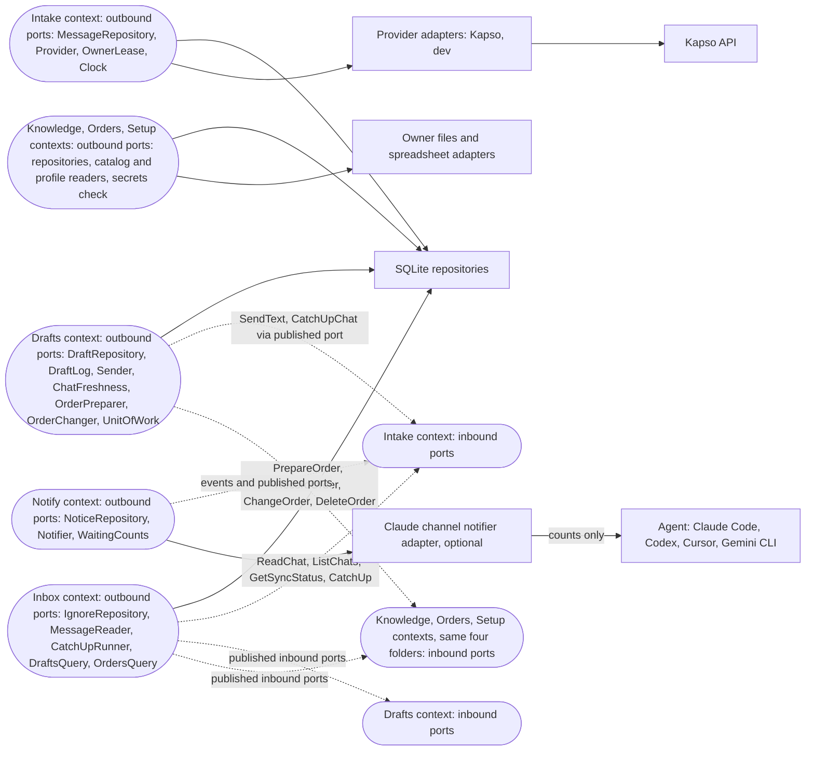

# Technical Proposal: Deputy v1 (cross-cutting)

Status: Approved (2026-11-18)., for owner review (amended 2026-11-18 for L7 and L8). Written 2026-11-17 after the FRDs. Each decision (TD) has one ADR in `docs/adr/`. Per-FRD TPs and specs follow this one.

## Context
Moved verbatim to [TP-context.md](../tp-detail/TP-context.md) and [TP-requirements-served.md](../tp-detail/TP-requirements-served.md).
## Decisions
### TD-0: Architecture style

- **Option A** Ports and adapters (hexagonal) with DDD. Each slice is a bounded context with `domain`, `application`, `ports` and `adapters` folders. A small shared kernel. One composition root wires adapters to ports. An architecture test enforces the dependency rule. Cost: more files and interfaces than the current 330-line server; a rewrite. Risk: ceremony beyond what v1 needs (mitigated: one use case per file, no generic frameworks, no event bus library).
- **Option B** Keep the current layered layout (`server.ts`, `providers/`, `store/`) and add slice folders. Cost: least work. Risk: the MCP server holds the rules, so tests need a real server and a real provider, and the send rule of D1 is scattered.
- **Option C** Vertical slices without ports (each slice calls SQLite and the provider directly). Cost: less indirection. Risk: no in-memory tests of use cases, and the provider and storage are hard to swap (Kapso, dev, spreadsheet).

Chosen: Option A, by owner decision D14. It fits the product: the provider (Kapso or dev), the storage (SQLite or spreadsheet), the agent (MCP) and the push channel are all things that change, and the FRDs' Given/When/Then lines are rules that should run without any of them. The aggregates are Message, SyncState, RejectionNote and OwnerNumbers (Intake; `Chat` is a small projection, not an aggregate holding messages); IgnoreList and InboxSettings (Inbox); Draft, with its approvals, and DraftLog (Drafts); NoticeState and NotifySettings (Notify); Proposal and LearnedItem (Knowledge; the profile and the catalog are owner files behind ports); Order (Orders); SetupProgress (Setup). The Information section gives the one list with repositories. Recorded in ADR-000.

### TD-1: How does the agent talk to Deputy?

- **Option A** One MCP server over stdio. The core is tools plus server `instructions`. Works in Claude Code, Codex, Cursor and Gemini CLI. Claude Code channel push is an optional extra behind a setting. Cost: low, it is what the repo already has. Risk: an agent that ignores `instructions` (Cursor and VS Code pages do not state support). Mitigation: the key rules sit in tool descriptions too.
- **Option B** A CLI the agent shells out to. Cost: every agent needs a shell. Risk: the agent then has a shell, which is the bypass D11 warns about, and every call needs a permission prompt.

Chosen: Option A. The MCP server is one inbound adapter over the use cases (TD-0). It is the only path that works across agents (principle 4) and keeps working with push off. The permission relay is removed: the go is given in the conversation (D1), and a permission dialog never replaces it (FR-DRAFTS-02-7). Research gave no reason to depart from the lean. Recorded in ADR-001.

### TD-2: One process, one owner

- **Option A** A lease row in the SQLite file: `lease(token, holder_started, heartbeat)`. The owner renews it every 10 seconds. A process takes it over in one SQL statement (`UPDATE ... WHERE token = :seen AND heartbeat < now - 30 s`), so only one takeover wins. No pid, so no pid reuse and no stale file. The owner polls, listens, sends. A second process serves reads and says so. Cost: one small write every 10 seconds; the loser keeps a read-write connection (its write use cases refuse). Risk: a blocked event loop longer than 30 seconds loses the lease (safe: the owner finds out at its next write check).
- **Option B** A lock file `owner.lock` with `{pid, startedAt}`. Cost: a small lock adapter. Risk: pid reuse after a crash; takeover races between two losers (one can delete the other's fresh lock); the owner can delete the file and create two owners; a read-only open of a WAL database needs the `-shm` file, unverified on Windows.
- **Option C** A separate always-on daemon that owns everything; MCP processes are thin clients. Cost: install, start-up and a second thing to run. Risk: against "not always on" and the 30-minute setup target (PRODUCT section 8).

Chosen: Option A. It needs no daemon, has no pid or stale-file failure, and is atomic because SQLite serializes the update. Takeover is atomic, as required: one UPDATE, the same guarantee as an exclusive file create. Departure from the lean (lock file with pid): the review found the takeover race, the deleted-file case and the pid-reuse case in Option B, and the lease row removes all three. The lease token is a random value held in memory. `OwnerLease.isOwner()` reads the row on every write check and compares the token, so a lost lease is seen at once. The send step (TD-6) includes the token check in its own transaction, so a process that lost the lease cannot mark an approval used. Read-only is enforced in the application layer: every use case that writes or sends asks the `OwnerLease` outbound port (a shared-kernel port, like `Clock`; adapter: the lease row) and refuses with a plain reason ("another Deputy session owns this data") when this process is not the owner. The MCP adapter, the scheduler and the listener therefore get the same rule, and it is unit-tested with an in-memory lease. A `LeaseSupervisor` in `src/main.ts` checks the lease every 10 seconds: when this process becomes owner it first runs recovery on every acquisition (Intake `MarkInterruptedSends`, Drafts `RecoverInterrupted`, then the order re-drive `RedriveRecording`, Orders' `RedriveOutbox` and Notify's `StartNoticeSession`, which reads the time zone and opens the notice clock), and only then starts the scheduler and the listener (the port is bound only after the lease is won and recovery is done); when it loses the lease it stops them. A loser that takes over later therefore starts them. Release happens on stdin close, SIGINT and SIGTERM by clearing the heartbeat. Why 10 and 30 seconds: a renewal is one tiny write, so six a minute cost nothing; the lease is three renewals long, so a stall of up to 20 seconds (garbage collection, a busy disk, a short pause) does not lose it, while a dead owner is replaced in at most 30 seconds, well under the default 2-minute catch-up period, so no catch-up run is lost. Both are domain constants, not settings. Recorded in ADR-002.

### TD-3: Where does data live?

- **Option A** One local SQLite file (`bun:sqlite`, WAL) for messages, drafts, approvals, the drafts log, ignore list, settings, lessons, proposals, orders and their history, the lease, setup progress. The business profile stays a Markdown file and the catalog a table file (or the owner's spreadsheet). Cost: schema and migrations to write (mechanism below). Risk: a binary file the owner cannot read; Deputy therefore offers exports (FR-KNOWLEDGE-03-3, FR-ORDERS-03-6).
- **Option B** One JSON file per aggregate, written by temp file and atomic rename, with a lock file as the only-writer rule. Cost: no schema or migrations, and the owner can read every file. Risk: no multi-file transaction (the send step then depends on one draft file holding approval, state and a log pointer); the append-only log and "latest message per chat" need hand-built indexes; the old design's 500-id seen list is a known failure (C15).

- **Option C** Turso's local database (`@tursodatabase/database`, SQLite-compatible, file on disk), which later turns into a synced database through `@tursodatabase/sync` (local reads and writes, explicit `push()` and `pull()` to Turso Cloud). Cost: a new dependency instead of a built-in one. Risk: the engine is newer than SQLite, and support for features this TP relies on (triggers, WAL concurrency with a second read-only process) must be verified before use.

Chosen: Option A, written so that Option C stays one adapter away. Repository adapters use plain SQLite SQL through a small `SqlDatabase` port in the shared kernel (`query`, `run`, `transaction`). Its SQLite adapter sets `PRAGMA secure_delete = ON` when it opens a file, so deleted rows are overwritten and an erased order's text does not stay in free pages (FR-ORDERS-02-10a; Orders ADR-010). Every port returns a Promise, including every repository and `SqlDatabase`, so a sync-capable adapter fits without changing a caller; only its adapter imports `bun:sqlite`. No `bun:sqlite`-only feature is used. A sync adapter (Turso or another) can then replace that one adapter without touching any repository. Sync itself is out of v1: it sends data off the owner's machine, which needs the owner's choice under D7. It also needs a design for the lease and the append-only log across devices. It would come with its own ADR. `Message` is its own aggregate, keyed by provider and provider message id, holding a `ChatId` reference. A unique `(provider, provider_message_id)` makes storing idempotent (FR-INTAKE-02-7). One transaction records the approval (born used) and sets the draft "sending" before the provider call (FR-DRAFTS-02-12). An "approved" state is never stored: approval and "sending" are one step. Triggers reject UPDATE and DELETE on the drafts log (FR-DRAFTS-04-7), with one narrow exception: the order scrub of L6 (FR-DRAFTS-04-10). The scrub is a single named function inside Drafts. It also clears the order text kept in drafts and approvals (`drafts.current_text`, `drafts.order_payload`, `approvals.text` of the order's drafts) in the same Drafts transaction; the draft rows stay. It is not in the same transaction as the order delete: Orders may live in a spreadsheet, and no transaction crosses slices. Orders deletes the order and writes an `OrderDeleted` event `{eventId, orderId, draftNumber, chat}` into its own outbox in one Orders write. Drafts handles the event idempotently and scrubs its log in a Drafts-only transaction. Orders re-sends any outbox row still pending at start. The owner accepted this one narrow, tested exception (D15). Migrations: the schema version is `PRAGMA user_version`, and the schema is ordered `.sql` files. Each slice keeps its own files in its SQLite adapter (`src/<slice>/adapters/sqlite/migrations/`), so only a slice's adapter holds that slice's tables. The composition root holds one ordered list of all the files, and a file's position in that list is the global number that `user_version` records, so two slices never number their own. The files are embedded in the binary with `import sql from "./0001-init.sql" with { type: "text" }` (checked: Bun 1.4.4 runs it, and inside a `bun build --compile` binary, with a trigger migration and a rolled-back `user_version`). At start, before the lease, a process runs `BEGIN IMMEDIATE`, reads `user_version`, runs every file numbered above it in order, sets `user_version` to the last number and commits: all pending files in one transaction, so a failed file leaves the old version untouched (SQLite DDL and `user_version` are transactional; checked). A second process waits on the write lock (`busy_timeout`), re-reads the version inside its own transaction and finds nothing to do. Before it changes an existing file, it copies the database to `deputy.db.bak-v<N>` (data-loss guard; the copy is kept until the next successful start of a newer version). A database whose `user_version` is newer than the binary knows is not opened: the process says "update Deputy" and exits, so an old binary cannot damage a newer schema. The append-only triggers belong to the schema: any migration that rebuilds `drafts_log` (SQLite cannot alter a column in place) drops and re-creates the triggers and the scrub's guard in the same file. Tests: for each released version keep a fixture database (`test/fixtures/db/v<N>.sqlite`, made by that release's own migrations and filled with rows); the upgrade test opens each, migrates to the latest, and asserts the rows are intact, `user_version` equals the newest file, an UPDATE and a DELETE on `drafts_log` are rejected, and the L6 scrub still works; one more test fails a migration halfway and asserts the version and the data are unchanged. The rule for a release: add the new version's fixture in the same change that adds its migration. Recorded in ADR-003. Each aggregate has a repository port in its slice and a SQLite adapter; a `UnitOfWork` port per slice gives the one-transaction steps. Orders are rows in SQLite unless the owner chose a spreadsheet (FR-ORDERS-03-2); that is a second adapter of the same `OrderRepository` port. Recorded in ADR-003.

### TD-4: Provider adapter

- **Option A** Intake owns the provider connection. Outbound port `Provider`: list conversations active since a time, list messages of a conversation (paged), send text, and optional live-delivery parse plus verify. Kapso and dev implement it. Intake publishes `SendText` as an inbound port; Drafts' `Sender` outbound port is implemented by an adapter that calls it. The Meta provider is deleted. Cost: a small rewrite of `types.ts` and `providers/`. Risk: Kapso's REST shape changes; it is isolated in one file.
- **Option B** Drafts has its own sender adapter beside Intake's provider. Cost: no cross-slice call for sending. Risk: two Kapso clients each pace themselves and together break the 100 requests per minute limit; one adapter would import two slices' outbound ports.
- **Option C** The Kapso SDK. Cost: a dependency and its normalizer (it sets `kapso.source`, which the platform API does not). Risk: hides the raw `origin` field Intake needs (FR-INTAKE-04-12).

Chosen: Option A. One client in one slice means one place paces every request, sends included (FR-INTAKE-03-18). `SendText({sendId, chat, text})` first records the send id and the pending outgoing text, then sends, then stores the provider message id by an upsert. The `Provider` call is `sendText({to, text})`, one part of at most 4000 characters, and returns `{providerMessageId, serverTime}`; the stored send time is that `serverTime`. Echo matching (L2) therefore lives in one slice. Resolving an unknown outcome uses Intake's `FindOutgoing({sendId, chat, since, text})` (see TD-6). It keeps dev and Kapso indistinguishable to other slices (FR-INTAKE-01-4). `graph.ts` keeps `splitText` and the send helper; `meta.ts` goes (FR-INTAKE-01-1). Recorded in ADR-004.

### TD-5: The catch-up loop

- **Option A** Two sweeps on the provider's clock, each paged in full over a time window and de-duplicated by message id. Sweep 1: conversations active since `mark - overlap`, then each one's messages. Sweep 2: the number's outbound messages (`direction=outbound`), which carry owner echoes. Cost: a few more requests per run. Benefit: owner echoes do not depend on whether an echo moves a conversation's `last_active` (unverified, see Risks).
- **Option B** One sweep: conversations by `last_active_after`, then their messages. Cost: fewest requests. Risk: an owner echo that does not move `last_active` is missed, and Deputy could then answer over the owner (principle 2).
- **Option C** A mark from the local clock instead of the provider's. Cost: low. Risk: clock skew larger than the overlap loses messages, and a run that fails never advances the mark.

Chosen: Option A. Details:
- **Schedule.** On start and every N minutes (default 2, minimum 1, FR-INTAKE-03-21), and when asked. At most one catch-up runs at a time: a single-flight lock in Intake covers the timer and `check_messages`; the second caller waits for the running one and returns its result. The pre-send `CatchUpChat` waits for a running catch-up, then does one chat-scoped read of that conversation (it moves no mark and never waits for a rate limit; on `429` it fails and Drafts holds the send). It keeps the 20 second limit (TD-6). A process that is not the owner runs none (TD-2, D16: a second session is read-only, with no drafting).
- **Never stop at the first known message.** Each sweep pages its whole time window (messages newest first, 100 per page, until a message is older than `mark - overlap`) and de-duplicates by `(provider, message id)`. A message stored live earlier cannot hide older unstored ones.
- **Marks.** Each sweep keeps its own mark, a provider timestamp, never the local clock: one for conversations (sweep 1) and one for outbound messages (sweep 2). Sweep 1 sorts the conversations in memory, oldest `last_active` first, and moves its mark as each conversation finishes. Sweep 2 (the outbound listing) is newest first, so a mark cannot move per page without leaving a hole: it saves a resume cursor and its window after each page, and moves its mark only when the sweep ends. A run cut short by `429` or a timeout therefore resumes where it stopped. `catchup_status` has one row per provider, so a switch from dev to Kapso starts its own first import. The overlap (default 10 minutes) covers provider lag only.
- **Where each run starts.** The first connect imports the whole retention window the provider offers, flagged as history (FR-INTAKE-03-1, FR-INTAKE-03-11). After that, every run reads from `mark - overlap`, however long Deputy was off, so every message not stored yet is covered (principle 3). The inbox window (D3) never limits catch-up: it only decides what counts as pending. Raising it needs no backfill, because the history is already stored.
- **Rate limits.** Read `X-RateLimit-Remaining` and slow down when low. On `429`, wait `Retry-After`, mark the run incomplete, retry (FR-INTAKE-03-20). Incomplete is stored as status "failed" with reason "rate limited, retrying", because the FRDs define only two values (FR-INTAKE-03-6).
- **Other.** A timeout ends the run as failed (FR-INTAKE-03-14). One "message stored" signal per run that stored something (FR-INTAKE-03-5). History messages emit none (FR-INTAKE-03-12). Sends share the same request budget (TD-4).

Tests: a live-delivered message is stored while two earlier ones are missing, and catch-up stores both; a run killed by `429` after half the units resumes from the advanced mark; a provider clock an hour off loses nothing; an echo that does not move `last_active` is still found by sweep 2; Deputy is off for 10 days with a 7-day inbox window and nothing is lost; raising the window triggers no extra reads. Recorded in ADR-005.
ADR: ADR-005

### TD-6: Drafts and the single send path

- **Option A** Tools to create, list, change and reject a draft (reply and order share one numbering, L5), plus `approve_draft`, which takes the draft number, the exact text shown and the owner's words. One call does the whole send path (below). Cost: the most code in v1. Risk: the agent can pass invented "owner words" (accepted, D11; the log keeps them).
- **Option B** Transactional outbox: `approve_draft` records the approval and queues the send; a separate sender step in the owner process runs the catch-up check and calls the provider. Cost: a queue and a worker, and an approval can sit queued for a while. Risk: the owner is told "approved" before anything is checked; a queued send can fire after the owner changed their mind. Its one gain, a crash-safe retry of the check step, is already covered by "outcome unknown".

Chosen: Option A. The rules live in the `Draft` aggregate (approval, hold, one-use) and the `ApproveDraft` use case; the provider is behind the `Sender` port (TD-4) and the chat check behind `ChatFreshness`. One departure from the lean: the tool takes the text shown, not a hash of it. FR-DRAFTS-02-3 says the agent gives "the text the owner was shown", and an agent cannot compute a hash reliably. Deputy hashes the text itself for the log. The send path for a reply:
1. Refuse unless: this process holds the lease; the text equals the draft's current text; the owner's words contain the draft number as a whole token; and the draft's current version was returned by `list_drafts` after its last change (the `shown_version` mark).
2. One transaction (which includes the lease-token check): record the approval (born used), set the draft "sending", write the log (FR-DRAFTS-02-12). No "approved" state is stored.
3. Run `CatchUpChat` (it waits for a running catch-up, then reads that one conversation), with a time limit (20 seconds). If it fails or the limit expires (result "held, catch-up failed"), or the owner answered from the app, or the customer wrote again since the draft: set the draft "held", void the approval, log it, return the three choices. A timeout never leads to a send.
4. Re-check the lease token in a transaction right before the provider call; if the lease was lost, hold the send (the process that took over then owns the draft). Then call `SendText({sendId, chat, text})`. The window between this check and the HTTP request is one network call and is accepted. Intake records the send id and pending outgoing text first, sends, then upserts the provider's message id, so an echo stored first is reclassified as "sent through Deputy", not duplicated (FR-INTAKE-04-13).
5. Record the `SendText` result as accepted, failed (with a reason code), rate limited (with the provider's retry time) or unknown. Any partial failure of a split reply is unknown. A rate-limited send waits in a per-chat queue, is retried at the provider's time with steps 3 and 4 run again, and fails at once when that time is outside the customer's 24-hour window (owner decision D29, Drafts TP-03 TD-3).

Notes. The whole-token and `list_drafts` checks are a typo and ordering guard, not authorization: "ok, 3 kilos is fine" contains "3". What stops a wrong send is that the owner saw this text and answered in the conversation; Deputy cannot verify who spoke (D11). `create_draft` checks that the chat exists in Intake (through `ChatReader`) and that, with a real provider, it has a non-dev message (FR-DRAFTS-01-8). Unknown outcomes are resolved by a `ResolveUnknownSends` use case in Drafts. It asks Intake's `FindOutgoing({sendId, chat, since, text})` through the `OutgoingFinder` port, which links exactly one match to the send id. It runs after the next catch-up: at start, after the first catch-up, and on every `CatchUpFinished` event that stored messages (FR-DRAFTS-03-13). The `RecoverInterrupted` use case runs on every lease acquisition, before the scheduler starts and so before the first catch-up: a draft left "sending" becomes "unknown"; one left "recording" is re-driven. For an order draft, step 4 is `RecordOrder` instead of a send. The approval is marked used and the draft "recording" in step 2; `RecordOrder` is idempotent on the draft number (FR-ORDERS-01-7, FR-ORDERS-01-16), reading before it appends on a spreadsheet; then the draft is marked recorded. A draft left "recording" at start is re-driven, which is safe, unlike a send. A draft left "sending" at start shows "outcome unknown" (FR-DRAFTS-02-12). After a hold, the approval is void and the owner's new go goes through the same tool (FR-DRAFTS-03-5, FR-DRAFTS-03-11). One call approves one draft; an owner sentence naming three drafts means three calls, each logging the same words (FR-DRAFTS-02-3). Order drafts are prepared at `create_draft` by Orders' `PrepareOrder` (through the `OrderPreparer` port): it checks required details, resolves items against the catalog, takes price snapshots and computes the total (FR-ORDERS-01-5, FR-ORDERS-01-14, FR-ORDERS-01-15). `OrderPreparer` also has `revalidate(payload)` returning `{catalogChanged}`, which `ListDrafts` uses for the "catalog changed" mark (FR-KNOWLEDGE-01-14). Changing or deleting a recorded order (`change_order`, `delete_order`) maps to the Drafts use case `ApproveOrderCommand`: it runs the owner-words checks, writes the log entry first, then calls Orders through the Drafts-side port `OrderChanger`. Orders exposes no tool of its own for this and never calls Drafts; its only path back is the `OrderDeleted` event. `ListDrafts` writes the `shown_version` mark, so it runs only in the owner process (D16). Recorded in ADR-006.
ADR: ADR-006

### TD-7: Notices and reminders

- **Option A** The owner process runs a scheduler adapter that calls Notify's `Tick` use case; the use case builds counts-only notices from Intake's "message stored" event and the inbox. It batches (default 10 minutes), reminds (default 30 minutes), keeps quiet periods and sends the outage notice. It delivers through the Claude channel when that is on. Otherwise nothing is pushed and the `inbox` tool covers it. Cost: a small timer module. Risk: depends on the research-preview channel; a push has no acknowledgement (FR-NOTIFY-03-6).
- **Option B** A long-poll tool, `wait_for_messages`, that the agent calls and that returns when notable messages arrive. Cost: works in any MCP agent, with no research-preview channel. Risk: it holds the agent's turn, tool timeouts differ (Codex defaults to 60 seconds), and the owner cannot use the session for other work while it waits. Not chosen as the default; it stays a later option for agents without push.

Chosen: Option A. The `Notifier` outbound port has a Claude channel adapter and a null adapter. Notices are fixed codes with an English default text, filled with numbers only, so no customer text can enter one (FR-NOTIFY-01-5). Language (D20): Deputy ships no language catalogs; a notice, hold reason, refusal or status reason is a code, the English default text and its numbers, and the server `instructions` tell the agent to say it in the owner's language. Time zone: `time_zone` defaults to the system zone, `Intl.DateTimeFormat().resolvedOptions().timeZone`, read once at first start and stored; the owner can change it by talking (`set_setting`). Quiet periods are wall-clock hours in that zone, evaluated with `Intl.DateTimeFormat` for the zone on each tick, never by adding hours to a UTC offset. DST test (America/New_York, quiet 22:00 to 07:00, checked in Bun): on 2026-03-08 the local time is 01:59 at 06:59Z and 03:01 at 07:01Z (no 02:xx), and the period ends at 11:00Z (07:00 local), so the period that began at 22:00 the evening before lasts 8 real hours; on 2026-11-01 the period ends at 12:00Z (07:00 local) and the period lasts 10 real hours, 01:30 occurs at 05:30Z and at 06:30Z and both are quiet. `Tick` reads the ignore list from Inbox on every notice (FR-NOTIFY-02-10) and the source of each message from Intake (FR-NOTIFY-03-1). A notice written with no error counts as delivered; with no session or an error, it counts as failed and its messages are counted again next time (FR-NOTIFY-03-7). With push off, no notice is sent (FR-NOTIFY-03-4). Recorded in ADR-007.

### TD-8: Secrets and configuration

- **Option A** Secrets and connection settings in a file in the owner's config folder (`~/.deputy/`), which the owner edits by hand. Cost: low. Risk: a poor fit for a non-technical owner and the 30-minute target; a wrong file mode goes unnoticed.
- **Option B** Terminal commands the owner runs themself: `deputy secrets set <name>` (prompts without echo, stores the value, prints none; where it stores it is Option C and the fallback below) and `deputy config set <key> <value>` (writes `~/.deputy/config.json`). The agent conversation never sees them. Deputy reads the files. Cost: a small command-line adapter. Risk: the owner must open a terminal; an agent with file tools could still read the files (Setup suggests a deny rule).
- **Option C** The OS credential store through `Bun.secrets` (built into Bun, no dependency): macOS Keychain, libsecret on Linux, Windows Credential Manager (Bun docs, https://bun.com/docs/runtime/secrets). Checked on Windows 11 with Bun 1.4.4: `set`, `get` and `delete` work from source and from a `bun build --compile` binary. Not checked by me on macOS or Linux. Cost: none beyond the call. Risk: the docs call the API experimental and say a secret service must be running on Linux; the docs do not say what happens without one, and a third-party report (NixOS discourse, Proton Drive CLI thread) shows a compiled Bun binary failing with `libsecret not available`. A headless Linux box or container often has no secret service, so the store cannot be the only place.

Chosen: Option B for how the owner enters things (D19), with Option C as the primary store of secrets and a file as the fallback. The earlier text rejected the keychain because Bun had no keychain API and a native dependency was needed; both facts are outdated, since `Bun.secrets` exists. The rule: `deputy secrets set <name>` calls `Bun.secrets.set({ service: "deputy", name, value })`; if the call throws for any reason (no secret service, no libsecret, a locked or denied store), it writes `~/.deputy/secrets.env` instead (`KEY=value`, mode 0600 on POSIX) and prints that the value is in a file and why. Reads try the OS store first and then the file. A value is in one place only: `set` removes the other copy. `check_secrets` says where each secret is ("OS store" or "file"), never the value. Tests: a fake store that works; a fake store that throws (the file is written, mode checked on POSIX, the reason is printed); the read order; the migration of a secret from file to store when the store becomes available. Live checks (launch gate): Windows (done above), macOS and a Linux desktop with GNOME Keyring, and a Linux container without a secret service, from the compiled binary. It meets D6 and FR-SETUP-03-1, and it keeps trust-boundary settings out of any tool the agent can call. The command line is another inbound adapter (`src/adapters/cli/`); it is not part of the MCP server. It never calls a lease-guarded use case, because it may run when no process owns the lease or while another one does. It writes one pending-change row (table `pending_changes`: key, value, the typed command, time) in SQLite, or the config or secrets file, and exits. Neither write needs the lease. The owner process applies pending changes on its next tick without a restart: the scheduler calls Intake's lease-guarded `ApplyPendingChanges`, which applies and logs each owner-number change with the typed command (L4; an add through `set`, a removal through `remove`), and Knowledge's lease-guarded `ApplyCatalogStoreChange`, which applies a `catalog-store` row, clears the catalog mapping and logs the typed command, and the `LeaseSupervisor` re-reads `config.json` for the connection settings. With no owner process, they are applied at the next start.

Sensitive settings are not settable through any MCP tool: `provider`, `receiving_mode`, `push_on`, the owner numbers and every secret. `provider = dev` would open unsigned test entry points; an owner number decides which messages count as the owner's. The owner changes them only from the terminal:
- `deputy config set provider kapso`, `deputy config set receiving_mode catch-up`, `deputy config set push on`, `deputy config set owner-numbers "+505 8888 0000"`, `deputy config set business-number "+505 8888 1111"`, `deputy config set kapso-phone-number-id <id>`, `deputy config set orders-spreadsheet <id or URL>`, `deputy config set catalog-store sheet:<id>`;
- `deputy config remove owner-number "+505 8888 0000"` (a pending change, applied and logged like `set`, L4; the business number is not removed this way);
- `deputy secrets set kapso-api-key`, and the read-only `deputy secrets list` (each secret's name, where it is kept, present or absent, never a value).

The terminal-only keys also include the orders spreadsheet (`orders-spreadsheet`) and a spreadsheet catalog store (`catalog-store sheet:<id>`): each names a destination for personal data that only the owner may choose (D7). The `orders_store` and `catalog_store` settings can be set by talking only to `machine` or `spreadsheet` (with a sheet the owner already entered) and `file`.

How Setup leads without changing anything itself (FR-SETUP-01-11, FR-SETUP-02-8, FR-SETUP-02-13): Setup asks the owner which provider and receiving mode they want and explains the difference. Setup also asks for the owner's country. The country is the default region for parsing typed phone numbers (Intake ADR-012) and the source of the suggested currency (D21: Setup suggests it, the owner confirms; it is stored as Knowledge's `currency`). It is stored as Intake's `country` setting through `SetIntakeSettings`; it is not a trust boundary, so the agent may write it after the owner says it. The business number is read from the provider when the provider offers it; otherwise Setup shows `deputy config set business-number "+<country code> ..."` and the owner must type it with `+` and the country code (no default country applies to it). It shows the exact command and waits. After the owner runs it, Setup reads the result back through a read-only port (`ConnectionConfigReader`, `OwnerNumbersReader`) and confirms it. Setup reads the applied result, not the pending row, and tells the owner to wait for the next tick if it is not applied yet. The owner can also ask the agent which numbers count as the owner's: the read-only tool `list_owner_numbers` (Intake `GetOwnerNumbers`, with the log of typed commands) serves L4. Setup leads the change; the owner's own command makes it.

`check_secrets` reports present and accepted, and the last four characters of long secrets, never a value (FR-SETUP-03-4, FR-SETUP-03-6). "Accepted": the provider key passes one cheap authenticated call through Intake's `CheckProviderAccess` (a conversation listing with limit 1); the Google service account fetches a token and reads the sheet; the webhook secret cannot be probed, so it is "present, well formed", and only the optional live-delivery test (a signed delivery) proves it. Deputy checks the secrets file mode at start on POSIX, when the file fallback is in use, and warns if it is looser than owner-only.

Settings the owner changes by talking are in the database, one owning slice per key: `catch_up_minutes`, `country` (Intake); `pending_window_days` (Inbox); `batch_minutes`, `reminder_minutes`, `reminders_paused`, `quiet_periods`, `time_zone`, `notices_on` (Notify); `orders_store` (Orders); `catalog_store`, `currency`, `catalog_mapping` (Knowledge). `set_setting` routes by key to the owning slice and refuses the sensitive keys with a message that names the terminal command. `.env` stays only as a fallback for `DEPUTY_DATA_DIR`.

Recorded in ADR-008.
ADR: ADR-008

### TD-9: What is removed

- **Option A** Remove: `operator/` and `scripts/operator.sh` (owner decision, PRODUCT section 6), the permission relay and `lang`, `notify_owner` to WhatsApp, per-message push with customer text, the Meta provider, `reply`, `create_order`, `handoff` and `resume`, the echo pause, `conversations.ts` and `state.json`. Cost: lost behavior that the FRDs contradict. The old structure is not kept; only small pieces move into adapters (`splitText`, rewritten to cut on grapheme boundaries (Intake TP-04), and the HMAC check; the CSV parser and the Google JWT helper are replaced by libraries, TD-12). Risk: tests that assert it must change.
- **Option B** Migrate in steps: keep the old tools and the operator profile until each slice's replacement passes its acceptance tests, then delete them. Cost: two models of sending exist for a while, which D1 and FR-DRAFTS-02-7 forbid in a release. Risk: a half-migrated build could ship a direct send path. Acceptable only on a branch that is never released.

Chosen: Option A. Each removal maps to a conflict in `codebase.md`: C1 and C2 (`reply`), C3 (`create_order`), C4 (`notify_owner`), C5 and C19 (relay, `lang`), C6 (pause, handoff), C7 (per-message push), C9 (Meta), C18 (operator allow-list). Tests that change: `test/e2e.test.ts` is rewritten per slice; its five tests assert removed behavior (`reply` sends at once, handoff pause, permission relay), so the relay and Meta tests are deleted, the dev-flow test is rewritten around a draft and a go, and the Kapso test is ported to signature check plus catch-up. The harness (`start`, `sseCollector`, `post`, `call`) is kept. `test/unit.test.ts` stays (CSV, `splitText`). `README.md`, `README.es.md` and `CLAUDE.md` change with the code (C20). Recorded in ADR-009.

### TD-10: Runtime, packaging and conventions

- **Option A** Run from source: Bun and TypeScript with no build step, installed with one command that needs Bun on the owner's machine. Cost: none new. Risk: a non-technical owner must install Bun first, which strains the 30-minute setup target.
- **Option B** Ship a compiled binary built with `bun build --compile`; development still runs `src/` directly with no build step (`bun test`, `bun run typecheck`). `zod` validates every tool input. Each slice follows TD-0 (`src/<slice>/{domain,application,ports,adapters}` and an `index.ts`). Cost: a release build per OS and a packaging pipeline. Risk: the SQLite and file paths must work inside the compiled binary; a release can break while development works.

Chosen: Option B, by owner decision D17. The owner installs one binary; no runtime to install. The same binary carries the subcommands of TD-8 (`deputy config`, `deputy secrets`) and the MCP server (`deputy serve`). The package name stays open until launch (D17). `zod` is already a dependency and tool arguments are untrusted input (`codebase.md`: arguments are cast `as Record<string, any>` today). A slice talks to another only through its `index.ts` (for example Inbox's adapter calls Drafts' `WaitingChats` port, FR-DRAFTS-01-4). The release build runs the whole test suite against the compiled binary too, so a binary-only failure is caught. Recorded in ADR-010.

### TD-11: Testing (ATDD)

- **Option A** For each FRD, its Given/When/Then become executable tests first. Use cases are tested with in-memory adapters; acceptance tests drive the use cases through inbound ports; an architecture test enforces the dependency rule. End-to-end tests start the server over stdio with the dev provider and a fake Kapso HTTP server (rate limits, pagination, echoes, outages). A test names the FR it covers. Cost: a fake Kapso server and a fake clock. Risk: the fake drifts from real Kapso; mitigated by one live check per release.
- **Option B** Contract tests against recorded real Kapso responses (no fake server). Cost: no server to keep in step; replay is exact. Risk: cannot make rate limits, outages or new echo shapes happen on demand, and the recordings go stale.

Chosen: Option A. It follows D13. The FRDs already hold Given/When/Then lines tagged `Tests FR-...`; each becomes a test titled with its FR id, so a missing FR shows as a missing test. The architecture test parses imports and fails when `domain` imports anything outside `domain` and `src/shared/`, when `application` imports `adapters`, or when a slice imports another slice's file other than its `index.ts`. Time-dependent logic (batching, reminders, quiet periods, catch-up period) takes the `Clock` port, with a fake clock in tests. Recorded in ADR-011.

### TD-12: How are the catalog file and the Google sign-in read?

Deputy serves owners in many countries. Their catalog files differ in separator (`,` in the US and Mexico, `;` in much of Europe and Latin America, tab from some exports), in number format (`1.234,50` or `1,234.50`), in header language and in column order. The old reader was hand-written and read only comma files with English and Spanish headers. The Google service-account sign-in was a hand-written JWT helper.

- **Option A** Keep both hand-written helpers. Cost: none now. Risk: a hand-written CSV reader gets quoted separators, embedded newlines, a byte-order mark and delimiter guessing wrong in ways only real files reveal; a hand-written RS256 signer is security code Deputy would own.
- **Option B** `papaparse` 5.7.1 (MIT, last published 2026-11-11) for the table and `jose` 6.2.17 (MIT, last published 2026-11-09, no dependencies) for the sign-in. Papaparse guesses the delimiter among comma, tab, pipe, semicolon and the ASCII separators and reports it in `meta.delimiter`; it strips a byte-order mark and handles quoted separators and newlines. `jose` signs an RS256 JWT (`SignJWT`, `importPKCS8`) for Google's service-account token request and works on Bun. Checked in Bun 1.4.4 on Windows, from source and from a `bun build --compile` binary: `nombre;precio;disponible` with a quoted `"Queso; fresco"` and a quoted embedded newline parsed to the right cells with delimiter `;`; a tab file guessed `	`; a 2048-bit RSA key signed a three-part JWT. Cost: two dependencies.
- **Option C** `csv-parse` 7.0.3 (MIT, last published 2026-09-25) and `google-spreadsheet` with its `google-auth-library` peer. `csv-parse` has no delimiter guessing, so Deputy would write that part by hand. For the Google side Orders measured three ways (Orders TP-03, TD-5): `google-spreadsheet` with `google-auth-library` is 26 installed packages and 27 MB, `@googleapis/sheets` is 45 packages and 14 MB, and `jose` is 1 package; all three compile with `bun build --compile`. Neither library does anything Deputy needs beyond the one token request and a few calls that `jose` and `fetch` cover.

Chosen: Option B. Papaparse guesses the delimiter, which Option C's `csv-parse` does not, and that is the first step of D22. `jose` is the smaller and audited way to sign the one token Deputy needs; Option C's libraries are 26 and 45 packages for one token request and a few calls. Deputy writes only what no library does: the decimal and column detection below. Knowledge's spreadsheet catalog adapter and Orders' spreadsheet adapter share one Google client in `src/adapters/google/` (the `jose` token request and the HTTP calls, with its quota handling), so the sign-in exists once.

Catalog import (D21, D22), done by Knowledge's catalog reader with no header-alias list in any language:
1. Delimiter: papaparse's guess. A file where the guess leaves one column is shown to the owner for correction.
2. Number format, per price column: strip currency symbols, letters and spaces (including no-break and thin spaces), then look at the last separator of each value. A comma or a period followed by one or two digits is the decimal mark (`12,50`, `1.234,5`, `1,234.50`). A separator followed by exactly three digits is a thousands mark (`1.234`) when another value in the column shows the other mark, otherwise it is ambiguous. The column's format is the majority of the unambiguous values. Contradicting values, or only ambiguous ones, are shown to the owner as a question ("does 1.234 mean 1234 or 1.234?"); Deputy never guesses a price.
3. Column roles, from the content and not the header text: name (the leftmost text column with mostly distinct values), price (numeric), availability (few distinct values, or yes/no-like), unit (short repeating text), currency (ISO 4217 codes or symbols such as `$` or `€`), description (long text). The header text is shown to the owner next to three sample values per column, so the owner reads the mapping in their own language.
4. The mapping (delimiter, decimal and thousands marks, role per column, and the header row itself) is shown to the owner. The owner confirms or corrects it once, through the existing proposal flow (`propose_change`, `apply_change`, with the owner's words, FR-KNOWLEDGE-01-9 to 01-11). The confirmed mapping is stored as Knowledge's `catalog_mapping` setting. Until it is confirmed, `find_catalog_items` refuses with the code `catalog_mapping_unconfirmed` and prices are not read. When the header row differs from the stored one (a column added, renamed or moved; the check is an equality of the cells, so no hash is needed), the mapping is proposed again; a stale mapping is never applied to a changed file.
5. Currency (D21): Setup suggests a currency from the owner's country and the owner confirms it; it is stored as `currency`. An optional per-product currency column overrides it for that row. A row with a price but no currency in either place is "to be confirmed", not priced in a guessed currency.
6. A blank or unreadable price or availability is "to be confirmed" (C13), as before.

Tests: the same five-product catalog in four files, comma with a dot decimal, semicolon with a comma decimal and `1.234,50` thousands, tab-separated with a BOM, and a Spanish-header file and an Arabic-header file with different column orders; each detects the same mapping (the header text is ignored by detection), and only after confirmation does `find_catalog_items` return prices; an ambiguous column raises the question and returns no price; a changed header row asks again; a per-product currency column overrides the setting; a signed JWT from `jose` verifies against the public key and has the claims Google requires (issuer, scope, audience, issued at, expiry of at most one hour). Live check at launch: one real Google service-account token request from the compiled binary. Recorded in ADR-012.

## Architecture

Style: ports and adapters (TD-0). Each slice is a bounded context with four folders. The drawing shows one hexagon per slice, its ports on the edge, and the adapters outside.

Inside every context the inbound ports reach its domain and application, and these reach its outbound ports. The first drawing shows what calls in; the second shows the outbound ports, the adapters outside and the calls between contexts.

Moved verbatim to [TP-architecture.md](../tp-detail/TP-architecture.md).
## Information
Moved verbatim to [TP-information.md](../tp-detail/TP-information.md).
## Interfaces
Moved verbatim to [TP-interfaces.md](../tp-detail/TP-interfaces.md).
## Threat model
Moved verbatim to [TP-threat-model.md](../tp-detail/TP-threat-model.md).
## Testing
Moved verbatim to [TP-testing.md](../tp-detail/TP-testing.md).
## Risks
Moved verbatim to [TP-risks.md](../tp-detail/TP-risks.md).
## Open questions

Moved verbatim to [TP-open-questions-closed.md](../tp-detail/TP-open-questions-closed.md).

For the owner:

1. The package name stays open until launch (D17). `deputy` is taken on npm (PRODUCT open question 4).

For later TPs:

2. Which Kapso webhook event carries an owner echo (PRODUCT open question 1). It only matters for live delivery.
3. How learning separates facts, tone and one-customer cases (PRODUCT open question 5). Storage fits any answer.
4. Where approvals live so Codex sees the same state (PRODUCT open question 2). The database file answers it for one machine and one data folder.
5. The retention window of the provider (FR-INBOX-01-7) and the exact Kapso field that reports it.
