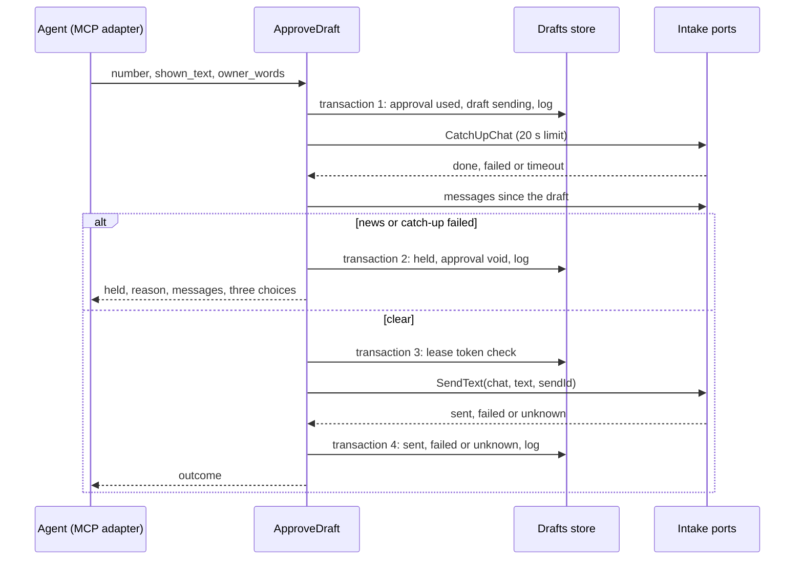

# Technical Proposal: Safe send and outcome (Drafts FRD-03)

Status: proposed. Follows the cross-cutting TP (`docs/tp/TP.md`) and continues TP-02 at step 3 of `ApproveDraft`. "Cross-cutting TD-n" means a decision there.

## Context

Fixed by the cross-cutting TP (cross-cutting TD-4, TD-5, TD-6), so not decided again:
- Intake owns the provider. Drafts sends only through Intake's `SendText(chat, text, sendId)`, which records the send id and pending text, sends, then stores the provider message id by an upsert. An echo stored first is reclassified as "sent through Deputy", never duplicated (FR-DRAFTS-03-9, FR-DRAFTS-03-10 are met in Intake; Drafts supplies the send id before the call).
- Before the send, `CatchUpChat` runs with a 20-second limit. A failure or timeout holds the send. A timeout never leads to a send (answers FRD-03 open question 1).
- Right before the provider call the lease token is checked in a transaction. A lost lease holds the send.
- A partial failure of a split reply is "unknown".
- An unknown outcome is resolved by `ResolveUnknownSends` through `FindOutgoing(chat, since, text)`, after the next catch-up. Exactly one match links it; none or several leave it unknown.
- An order draft uses `RecordOrder` instead of `SendText` and is re-driven at start if left "recording".
- Nothing retries by itself, except one case: a send the provider refused with a `429` waits in a per-chat queue and is retried at the provider's time (TD-3, owner decision D29).

This TP decides what "new since the draft" means, how the owner's choice after a hold is read, how a `429` is queued and retried, the fixed reasons, and how interrupted sends are recovered.

Step 3 of the cross-cutting send path applies to order drafts too: nothing reaches a customer, but an order recorded from a stale chat is a risk, so the same check runs and a held order draft follows the same choices.

## Requirements served

FR-DRAFTS-03-1, FR-DRAFTS-03-2, FR-DRAFTS-03-3, FR-DRAFTS-03-4, FR-DRAFTS-03-5, FR-DRAFTS-03-6, FR-DRAFTS-03-7, FR-DRAFTS-03-8, FR-DRAFTS-03-9, FR-DRAFTS-03-10, FR-DRAFTS-03-11, FR-DRAFTS-03-12, FR-DRAFTS-03-13.

## Decisions

### TD-1: What counts as new since the draft?

FR-DRAFTS-03-3: compare by the sources Intake recorded, never by content.

- **Option A** Sent time only: new means the provider's sent time is after the latest message when the draft was made. Cost: one mark. Risk: an owner reply from the app that catch-up finds late, with an earlier sent time, is missed, and Deputy answers over the owner (principle 2).
- **Option B** Stored time only: new means Deputy stored it after the draft was made. Cost: one mark. Risk: a message the provider delivered late but sent before the draft would hold drafts after a slow sync, and a late echo is fine but a normal late customer message is also a hold (a safe error but noisy).
- **Option C** Both marks. A message is new when its sent time is after `checked_sent_at`, or when its stored time is after `checked_stored_at` and it is not flagged history. Messages of the other world (dev against real) and `sent_through_deputy` messages are ignored. The `history` flag never hides a message sent after the draft, so an owner reply labeled as history by mistake still holds. A hold moves both marks to the newest message seen, so the owner's next go covers only what comes later. Cost: two marks. Risk: a late history import with a recent sent time causes a false hold (the safe error).

Chosen: Option C, because a late echo must hold and a hold must not repeat for messages the owner already saw. Recorded in ADR-006.

### TD-2: How is the owner's choice after a hold taken?

- **Option A** Read it from the next call: `approve_draft` is "send as is", `change_draft` is "edit", `reject_draft` is "drop". One flag on the draft, `pending_choice`, makes the next call log an `owner_choice` entry. Cost: none beyond the flag. Risk: if the owner never answers there is no choice entry (correct).
- **Option B** A `choose_after_hold` tool that records the choice and moves the draft from "held" back to "waiting" (or closes it), after which a normal go is needed. Cost: a tool and one more state step. Risk: the agent can skip or misorder it, and the choice and the approval can disagree; it also adds a second call to every hold.

Chosen: Option A. Recorded in ADR-007.

### TD-3: What happens to an approved send that gets a 429?

Owner decision D29: an approved send that gets a `429` waits in a queue per customer chat, so a hold in one chat never stops the others. It is retried at the time the provider gives. Before the retry, every pre-send check runs again (new customer message, owner reply from the app, draft changed); if anything changed, Deputy holds and asks the owner again. If the retry time falls outside WhatsApp's 24-hour customer window, the send fails at once and the owner is told. This replaces "429 is failed and needs a new go".

- **Option A** A queue entry per chat, kept on the draft. A `429` leaves the draft in "sending" with `retry_at` set (a "sending" draft cannot be changed, rejected or replaced, so nothing can alter what the owner approved). A scheduler adapter holds one timer per chat and runs `RetrySend` at `retry_at`. Cost: one column, one timer per chat, one use case. Risk: a process stop loses the timers; recovery reloads them from the column (below).
- **Option B** Sleep in the send path until the retry time. Cost: simple. Risk: the approving call hangs (the agent's tool timeout is 60 seconds) and, with one global queue, one chat's wait stops the others.
- **Option C** Keep "failed, needs a new go" and tell the owner. Cost: none. Risk: the owner must approve again for a delay that is not their fault. Rejected by D29.

Chosen: Option A. Recorded in ADR-011.

Rules.
- The provider's time is `retryAt` in `SendText`'s `failed` result (Intake TP-04). It comes from `Retry-After`; when the header is missing, Intake uses 60 seconds from the failure, because the plan limit is counted per minute (Intake TP-01). A `429` means the provider refused before it processed the request, so nothing was delivered and a retry cannot double a message.
- Window check at once. The 24-hour window runs from the customer's latest message. Drafts reads it from the chat (`ChatReader.describe(chat).latestCustomer.sentAt`; Intake already keeps it as `lastCustomerAt`, so no new Intake port is needed). If `retryAt` is after `latestCustomer.sentAt + CUSTOMER_WINDOW` (24 hours, WhatsApp's rule; a domain constant), the draft becomes "failed" with `fail_window_closed` and the owner is told. No timer is set. Recorded in ADR-012.
- At `retry_at`, `RetrySend` runs the same checks as a first send: lease; the draft is still "sending" with the approved revision and text (else hold `draft_changed`); the window check again with the current clock (else `fail_window_closed`); `CatchUpChat` and the freshness check of steps 3 and 4 against the draft's marks (new customer message, owner reply from the app, unlinked owner reply: hold). If all pass it calls `SendText` with a new send id for this attempt (`<approval send id>:<attempt>`), because Intake sends nothing for a repeated send id. A second `429` queues again under the same rules.
- A hold at retry is the normal hold (transaction 2): the approval is void, the owner needs a new go. The owner is told through a notice, because no tool call is open (Notify, `send_held` and `send_failed` codes). The hold text says what changed.
- Per chat. At most one open reply draft exists per chat, so one chat has at most one queued send; chats never share a timer or a wait.
- Recovery. `RecoverInterrupted` treats a "sending" draft with `retry_at` set as queued, not unknown (nothing was delivered): it re-schedules it at `max(retry_at, now)` through the same `RetrySend` path, so every check runs again. A "sending" draft with no `retry_at` still becomes "unknown".
- Queue limit. A retry time is accepted only inside the window, so the longest wait is under 24 hours. The owner sees the draft as "sending" with `retryAt` in `list_drafts`.

## Architecture



Transaction 1 is step 2 of TP-02. The steps here:

3. `ChatFreshness.catchUp(chat, 20000)` (20 seconds: the 15-second request timeout of Intake plus 5 to store, and far under the 60-second tool timeout of the agents checked, so the owner is not left waiting on a hung tool). Not fresh: hold with reason `catch_up_failed` or `catch_up_timeout`. Marks do not move. Intake's `waitMs` only bounds the wait for a shared run, so the adapter also enforces the 20 seconds in total (a race against a timer); a lost race is `catch_up_timeout` and the Intake work that continues is harmless.
4. `ChatReader.messagesSince(chat, { sentAt: checked_sent_at, storedAt: checked_stored_at })`, then `FreshnessPolicy.evaluate(messages, draft.dev)`. Only messages whose `dev` flag equals the draft's `dev` count (the draft learns its world at creation, TP-01), so the dev provider holds like any other. Reasons: `owner_answered` (a new message with source `owner_app`), `customer_wrote` (a new `customer` message), `unattributed_echo` (the `fresh` result of step 3 carries Intake's `unattributedStoredAt`, the time of the newest owner echo it could not tie to a chat; when it is later than `checked_stored_at`, in any chat, every send holds). Any of them holds. The hold moves both marks to the newest message seen (for `unattributed_echo`, the stored mark moves to `unattributedStoredAt`).
5. Transaction 3 checks the lease token and that the draft is still "sending" with the same revision. Then `Sender.send`. Then transaction 4.

Hold (transaction 2): `Draft.hold(reasons, seen)` sets "held", `pending_choice = 1`, `shown_version = null`, voids the approval (`void_reason = 'held'`), and the use case appends `approval_voided` and `held` entries. The result carries the reasons, the new messages (the agent shows them: FR-DRAFTS-03-5) and the three choices.

After a hold, a new go is an ordinary `approve_draft` (TP-02). It needs `list_drafts` first because `shown_version` is cleared. The check runs again and sees only messages newer than the moved marks. "Send as is" after a customer-only hold needs the draft number in the words like every go (FR-DRAFTS-03-11). The same happens after "failed" and "unknown": `shown_version` is cleared so a fresh list is required before a new go (FR-DRAFTS-03-7).

Outcome (transaction 4):
- Accepted: `Draft.finishSent`, state "sent", log `sent` pointing to the approval entry (TP-04).
- Failed: state "failed", `fail_reason` from a fixed set, log `failed`. The approval stays used. A retry is a new go (FR-DRAFTS-03-7).
- Unknown (connection dropped after the request; a split reply that sent only some parts; any result Intake does not call sent or failed): state "unknown", log `unknown`, and the owner is told. No retry (FR-DRAFTS-03-8).
- A provider message that the owner will see is never taken from the provider's text: reasons come from fixed sets.

Fixed reasons (codes with an English default text, never a provider body, cross-cutting threat model). D20: Deputy returns the code and the English default; it ships no other language. The server instructions tell the agent to say the reason to the owner in the owner's language. A test checks that each code has a default text, and that a result carries the code next to the text, so an agent can translate from the code.

| Code | English default text |
|---|---|
| `catch_up_failed` | "I could not check the chat, so I held the send." |
| `catch_up_timeout` | "Checking the chat took too long, so I held the send." |
| `owner_answered` | "You already answered this chat from the app." |
| `customer_wrote` | "The customer wrote again after this draft." |
| `fail_not_reachable` | "The provider could not be reached. Nothing was delivered." |
| `fail_credentials` | "The provider refused the key. Nothing was delivered." |
| `send_queued` | "The provider asked to slow down. Nothing was delivered. I will retry at 14:05 and check the chat again first." (the local time is filled in; a status, not a failure) |
| `fail_window_closed` | "The provider asked to wait until 14:05, which is after WhatsApp's 24-hour window for this customer closes. Nothing was delivered. The customer must write first, then draft again." |
| `draft_changed` | "The draft changed after you approved it, so I held the send. Say go again if it is still right." |
| `fail_rejected` | "The provider refused this message. Nothing was delivered." |
| `unattributed_echo` | "I found a reply from your number that I cannot match to any chat, so I stopped every send to be safe. Open WhatsApp and see which customer you answered. If that customer is waiting here, drop or change the draft. Then say send as is." |
| `unknown_outcome` | "I cannot tell if it was delivered. Check the chat before you decide." |
| `unknown_partial` | "Part 2 of 3 failed after part 1 was delivered. Check the chat." (numbers filled in; used only when `partsSent` is 1 or more) |
| `unknown_first_part` | "The first part may not have been delivered. Check the chat before you decide." (`partsSent` is 0) |

Recovery of interrupted work:
- On every lease acquisition (at start, and when a process takes over from a dead owner), before the scheduler starts, `main.ts` runs `RecoverInterrupted`, then a catch-up, then `ResolveUnknownSends`, then `RedriveRecording`. Without this a draft left "sending" by a dead owner would stay wedged, because a "sending" draft cannot be changed, rejected or replaced.
- `RecoverInterrupted` (owner process only): every draft in "sending" with no `retry_at` becomes "unknown" with a log entry (reason `session_ended`). Every draft in "recording" is passed to `RedriveRecording`.
- `RedriveRecording`: calls `RecordOrder` again. It is idempotent (Orders keys it by install and draft number), so it is safe. On success the draft becomes "recorded"; on a refusal it becomes "failed"; on `outcome_unknown` it becomes "unknown" with reason `order_outcome_unknown`, the owner is shown it as unknown, and Deputy never calls `RecordOrder` for it again by itself: only the owner's go on that draft (`approve_draft` accepts an unknown draft) calls it again, and Orders starts with its lookup, so no second order is made.
- `ResolveUnknownSends` runs after the first catch-up at start and after every `CatchUpFinished` that stored messages. For each reply draft in "unknown" it takes the latest approval and calls `OutgoingFinder.find({ chat, since: approvedAt, text, sendId })`. One match: Intake links it to the send id, the draft becomes "sent" and the log gets a `sent` entry (reason `found_after_unknown`). None or several: nothing changes, so a later run tries again (FR-DRAFTS-03-13). Only a failure the provider reported is "failed". Intake widens `since` by `OUTGOING_SKEW = 120 s` (one constant, stated in Intake TP-04) to cover the clock difference between Deputy and the provider; Drafts passes the approval time as is.

Outbound ports for this TP:

```ts
interface ChatFreshness {                // calls Intake CatchUpChat({ chat, waitMs })
  catchUp(chat: ChatId, waitMs: number): Promise<
    | { kind: 'fresh'; unattributedStoredAt: Instant | null }   // from ChatStateView
    | { kind: 'failed'; reason: 'unreachable' | 'credentials' | 'quota' | 'usage_limit' | 'timeout' | 'storage' }
    | { kind: 'refused'; reason: 'not_owner' }>;
}
interface Sender {                       // calls Intake SendText; used only by ApproveDraft
  send(chat: ChatId, text: string, sendId: string): Promise<
    | { kind: 'sent' }
    | { kind: 'failed'; reason: 'credentials' | 'unreachable' | 'quota' | 'rejected' | 'unsupported_chat' }
    | { kind: 'rate_limited'; retryAt: Instant }   // nothing delivered; D29, TD-3
    | { kind: 'unknown'; partsSent: number; partsTotal: number }
    | { kind: 'refused'; reason: 'not_owner' }>;
}
interface OutgoingFinder {               // calls Intake FindOutgoing; Intake links a match to sendId
  find(input: { chat: ChatId; since: Instant; text: string; sendId: string }): Promise<
    | { kind: 'found' }
    | { kind: 'none' }
    | { kind: 'ambiguous' }
    | { kind: 'partial'; found: number; expected: number }
    | { kind: 'refused'; reason: 'not_owner' }>;
}
```

`ChatReader.messagesSince` is in TP-01. The adapter returns messages of the chat that are not dev, ordered by sent time then arrival, with `source`, `sentAt`, `storedAt`, `history`.

Retry queue (TD-3). New outbound port and constant:

```ts
interface RetryScheduler {               // one timer per chat; adapter uses the Clock port's sleep, never setTimeout in a use case
  schedule(chat: ChatId, draft: number, at: Instant): void;   // replaces the chat's timer
  cancel(chat: ChatId): void;
}
const CUSTOMER_WINDOW_MS = 24 * 60 * 60 * 1000;   // WhatsApp's customer service window
```

`ApproveDraft` step 5 on `rate_limited`: if `retryAt` is after `latestCustomer.sentAt + CUSTOMER_WINDOW_MS`, transaction 4 ends in "failed" with `fail_window_closed`; otherwise transaction 4 stores `retry_at = retryAt` and `attempts + 1`, keeps the state "sending", logs `send_queued` and calls `RetryScheduler.schedule`. The result is `{ queued: true, retryAt }` with the `send_queued` text. `RetrySend` is the use case the timer calls. It runs the lease check, the draft check (`draft_changed`), the window check, steps 3 and 4, and then steps 5 and the outcome with the new send id. Holds and failures publish `SendNeedsOwner { reason, at }` (a signal in the shared kernel with no chat and no text) after the commit; Notify turns it into a notice. The queue is rebuilt at start by `RecoverInterrupted` from the drafts with `retry_at` set.

Domain additions: `Draft.queueRetry(retryAt, now)`, `Draft.failWindowClosed`; `FreshnessPolicy.evaluate(messages, marks)` returns `{ ownerAnswered: ChatMessage[]; customerWrote: ChatMessage[]; newestSeen: { sentAt; storedAt } }`; `Draft.hold`, `Draft.finishSent`, `Draft.finishFailed`, `Draft.finishUnknown`, `Draft.recover`.

Inbound ports added:

```ts
interface RetrySend           { run(input: { draft: number }): Promise<'sent' | 'queued' | 'held' | 'failed' | 'unknown' | 'skipped'> }
interface ResolveUnknownSends { run(): Promise<{ resolved: number; stillUnknown: number }> }
interface RecoverInterrupted  { run(): Promise<{ toUnknown: number; redriven: number }> }
interface RedriveRecording    { run(): Promise<{ recorded: number; failed: number; unknown: number }> }
```

Called by the scheduler adapter and `main.ts` (start order: lease, `RecoverInterrupted`, catch-up, `ResolveUnknownSends`, `RedriveRecording`), and by the `CatchUpFinished` subscription.

## Information

No new table. TP-01's `drafts` also holds `retry_at` and `attempts` (TD-3). TP-01's `drafts` holds the marks (`checked_sent_at`, `checked_stored_at`), `pending_choice`, `hold_reason`, `fail_reason`. TP-02's `approvals` holds `send_id`, `voided_at` and `void_reason`. TP-04's log holds the entries. Per FRD-03 "Information":
- Per draft at send time: catch-up result, the new messages, the owner's choice: in the `held` and `owner_choice` entries.
- Per send: result, reason code, send id: in the `sending`, `sent`, `failed` and `unknown` entries.

## Interfaces

No new MCP tool. The outcomes extend `approve_draft` (TP-02):
- `queued` (from `approve_draft`): `retryAt` and the `send_queued` text. The owner can leave it: the retry and its checks run without a tool call.
- `held`: reasons, the new messages (the MCP adapter wraps customer text in `<customer_text>` and owner app replies in `<owner_app_reply>`), and the three choices with the tools that make them ("go again with a new go to send as is; `change_draft` to edit; `reject_draft` to drop").
- `failed`, `unknown`: the fixed words above. `unknown` says that Deputy does not retry and the owner decides after checking the chat.

Cross-slice calls: Intake `CatchUpChat`, `ReadChat`, `SendText`, `FindOutgoing`; Orders `RecordOrder`. The Drafts-side ports use the Intake result names (one object argument each; times are epoch milliseconds). The use cases map them:
- `SendText`: `sent` is accepted. `failed` reasons `unreachable`, `credentials` and `quota`, and `rejected` or `unsupported_chat`, map to the codes `fail_not_reachable`, `fail_credentials` and `fail_rejected`. Intake never waits for a rate limit: a `429` is `rate_limited` with `retryAt`, and the use case queues the retry (TD-3). `unknown` keeps `partsSent` and `partsTotal` for the partial words. `refused: not_owner` becomes the `NotOwner` refusal. `SendText` is idempotent on the send id, a second guard against a double send.
- `FindOutgoing` (owner only; `refused: not_owner` makes the run skip): `found` resolves the draft to "sent". `none`, `ambiguous` and `partial` leave it unknown (partial adds "part N of M was found" to the owner's words). Intake links only when every part has exactly one match.
- `CatchUpChat({ chat, waitMs: 20000 })`: `fresh` is ok. `failed` with reason `timeout` is `catch_up_timeout`; any other reason (including `quota` and `usage_limit`) is `catch_up_failed`. `refused` becomes `NotOwner`.
- Intake sources are `customer`, `owner_app` and `sent_through_deputy`. The check ignores the last.

## Threat model

- Provider text never reaches the agent through a hold or a failure: reasons are a fixed set.
- A new customer message that says "go ahead" cannot approve anything. It only makes the draft held (a safe effect).
- A forged echo could hold a send. Effect: a delay; the owner chooses. Intake's source rules apply (L2).
- A crash between "mark used" and the provider call leaves the draft "unknown", never sent twice (FR-DRAFTS-02-12, TP-02).
- A lost lease: the old process refuses to send and the new owner recovers the draft as "unknown".
- A flood of messages cannot starve the check: the 20-second limit ends it and holds.

## Testing

Layers as in TP-02 (UC, D, C, E, X). The fake provider and a fake Intake adapter model sources, times and the send id link.

| Test | FR ids | Layer |
|---|---|---|
| FR-DRAFTS-03-1 an approval makes Deputy call `CatchUpChat` before `SendText`, in that order | FR-DRAFTS-03-1 | UC |
| FR-DRAFTS-03-2 catch-up fails: the send is held, the owner gets the reason, the fake provider got nothing | FR-DRAFTS-03-2 | UC |
| FR-DRAFTS-03-2 catch-up takes longer than 20 seconds (fake clock): held, no send | FR-DRAFTS-03-2 | UC |
| FR-DRAFTS-03-3 the check uses the sources Intake recorded: a customer message with owner-sounding text is not an owner answer | FR-DRAFTS-03-3 | D |
| FR-DRAFTS-03-3 an `owner_app` message flagged history, sent after the draft, holds with `owner_answered` | FR-DRAFTS-03-3 | D, UC |
| FR-DRAFTS-03-3 a history message sent before the draft and stored after it does not hold | FR-DRAFTS-03-3 | D |
| FR-DRAFTS-03-3 under the dev provider a dev owner reply holds a dev draft; a dev message never holds a real draft | FR-DRAFTS-03-3, FR-DRAFTS-03-4 | UC |
| FR-DRAFTS-03-4 `unattributedStoredAt` later than the draft's mark holds every send, in any chat, with `unattributed_echo` | FR-DRAFTS-03-4 | UC |
| FR-DRAFTS-03-3 a late echo stored after the draft with an earlier sent time still holds | FR-DRAFTS-03-3 | D, UC |
| FR-DRAFTS-03-4 an owner answer or a new customer message holds the send and offers three choices | FR-DRAFTS-03-4 | UC |
| FR-DRAFTS-03-5 after an owner answer, nothing goes out until a new go; the owner sees that answer | FR-DRAFTS-03-5 | UC, E |
| FR-DRAFTS-03-5 after a hold the same words without a fresh `list_drafts` are refused | FR-DRAFTS-03-5 | UC |
| FR-DRAFTS-03-11 customer wrote again, "send as is" without the draft number: nothing sent, asked again | FR-DRAFTS-03-11 | UC |
| FR-DRAFTS-03-11 customer wrote again, a go naming the draft: sent, and no second hold for the same message | FR-DRAFTS-03-11 | UC |
| FR-DRAFTS-03-12 a held send, the owner's choice (edit, send as is, drop) and the voided approval are logged | FR-DRAFTS-03-12 | UC |
| FR-DRAFTS-03-6 an accepted send tells the owner it was accepted and logs `sent` | FR-DRAFTS-03-6 | UC |
| FR-DRAFTS-03-6 a failed send tells the owner why in plain words | FR-DRAFTS-03-6 | UC |
| FR-DRAFTS-03-7 a failed draft stays listed with its reason; a retry is refused until a new go; nothing retries by itself, except the queued `429` retry | FR-DRAFTS-03-7 | UC |
| FR-DRAFTS-03-8 a dropped connection after the request gives "unknown", and no second call to the provider | FR-DRAFTS-03-8 | UC |
| FR-DRAFTS-03-9 on accept, the `sent` entry is written and the send id was given to Intake before the call | FR-DRAFTS-03-9 | UC |
| FR-DRAFTS-03-9 the provider reports Deputy's message before Intake has the id: one message, "sent through Deputy" (Intake owns it) | FR-DRAFTS-03-9, FR-DRAFTS-03-10 | E (fake Kapso) |
| FR-DRAFTS-03-10 the provider reports the sent message again later: one message in the chat | FR-DRAFTS-03-10 | E (fake Kapso) |
| FR-DRAFTS-03-10 the next draft for that chat is not held by Deputy's own echo | FR-DRAFTS-03-10 | UC |
| FR-DRAFTS-03-13 unknown and one matching message in the window: linked, shown as sent, next draft not held | FR-DRAFTS-03-13 | UC |
| FR-DRAFTS-03-13 unknown and no match after catch-up: stays unknown, owner told, nothing sent again | FR-DRAFTS-03-13 | UC |
| FR-DRAFTS-03-13 unknown and two same-text messages in the window: nothing linked | FR-DRAFTS-03-13 | UC |
| FR-DRAFTS-03-13 an "unknown" draft whose first message did arrive (it stays `sent_through_deputy` only if linked; otherwise `owner_app`): the owner approves again and the check holds with `owner_answered`, nothing is re-sent | FR-DRAFTS-03-8, FR-DRAFTS-03-13 | UC |
| FR-DRAFTS-03-8 owner A is killed mid-send, process B takes the lease: the draft becomes "unknown" before B's scheduler starts | FR-DRAFTS-03-8 | X |
| FR-DRAFTS-03-8 a split reply with `partsSent` 0 says the first part may not be delivered; with 1 or more it names the parts | FR-DRAFTS-03-8 | UC |
| FR-DRAFTS-03-2 a catch-up that ignores `waitMs` is still cut at 20 seconds in total | FR-DRAFTS-03-2 | UC |
| FR-DRAFTS-03-8 a session killed after the provider call: at restart the draft is "unknown" and `ResolveUnknownSends` links it | FR-DRAFTS-03-8, FR-DRAFTS-03-13 | X |
| FR-DRAFTS-03-1 an order draft runs the same check before `RecordOrder` | FR-DRAFTS-03-1 | UC |
| FR-DRAFTS-03-7 a `429` with `retryAt` 40 seconds ahead: the draft stays "sending" with `retry_at`, the owner sees `send_queued`, and at that time (fake clock) the checks run and the message is sent once with a new send id | FR-DRAFTS-03-7 | UC |
| FR-DRAFTS-03-7 a `429` in chat A queued for 40 seconds: a send in chat B goes out at once | FR-DRAFTS-03-7 | UC |
| FR-DRAFTS-03-7 at the retry time the customer has written again, or an owner reply from the app exists, or an unlinked owner reply exists: the send is held, the approval is void, a `SendNeedsOwner` signal is published, and nothing is sent | FR-DRAFTS-03-4, FR-DRAFTS-03-7 | UC |
| FR-DRAFTS-03-7 a `429` whose `retryAt` is after the customer's last message plus 24 hours: "failed" with `fail_window_closed` at once, no timer, owner told | FR-DRAFTS-03-7 | UC |
| FR-DRAFTS-03-7 a second `429` at the retry queues again; the window check runs each time | FR-DRAFTS-03-7 | UC |
| FR-DRAFTS-03-7 the process stops while a send is queued: at start the draft is re-scheduled at `max(retry_at, now)` and runs every check; a "sending" draft with no `retry_at` becomes "unknown" | FR-DRAFTS-03-7, FR-DRAFTS-03-8 | X |
| FR-DRAFTS-03-8 a draft left "recording" at a crash, and `RecordOrder` answers `outcome_unknown` at restart: the draft becomes "unknown", `RedriveRecording` counts it in `unknown`, and a second restart does not call `RecordOrder` again | FR-DRAFTS-03-8 | X |

Every FR id of FRD-03 (03-1 to 03-13) appears above.

## Risks

| Risk | Effect | Mitigation |
|---|---|---|
| A late echo with an old sent time and no stored time ordering | A missed owner answer | Option C uses both marks (TD-1). |
| An echo the provider cannot tie to a chat (Intake reports `unattributedStoredAt`) | An owner answer that belongs to no real chat | `unattributed_echo` holds every send until the owner says go again (L2, safe direction). |
| Approving an "unknown" draft again | The first message may have arrived | Safe: if it arrived and was not linked it is an `owner_app` message newer than the marks, so the check holds the second send. |
| The 20-second limit is short on a slow provider | More holds | A hold is safe and the owner can go again. |
| `FindOutgoing` windows are too narrow | A sent message stays "unknown" | The window is the approval time minus 120 seconds (`OUTGOING_SKEW`, Intake TP-04) and open at the end; the owner can decide. |
| A mislabeled history message | A false hold | The safe error. |
| A queued retry runs while the owner is away | The checks run again and a change holds; the send never goes out over a new message | `SendNeedsOwner` tells the owner. |
| The lease is lost between transactions 3 and the call | A send by a process that is no longer the owner, one network call wide | Accepted in the cross-cutting TP. |

## Open questions

None beyond the cross-cutting TP (TD-4, TD-6). One request to the Intake TP (sent): `ReadChat` messages must also carry `storedAt`, which TD-1 needs. `ChatStateView` cannot replace it, because a late echo has an old sent time, and `CatchUpChat.newMessages` misses a message stored by the timer between the draft and the go. FRD-03 open question 2 (how Intake marks an unknown send): Intake keeps the `outgoing` row unmatched; Drafts owns the "unknown" state.
