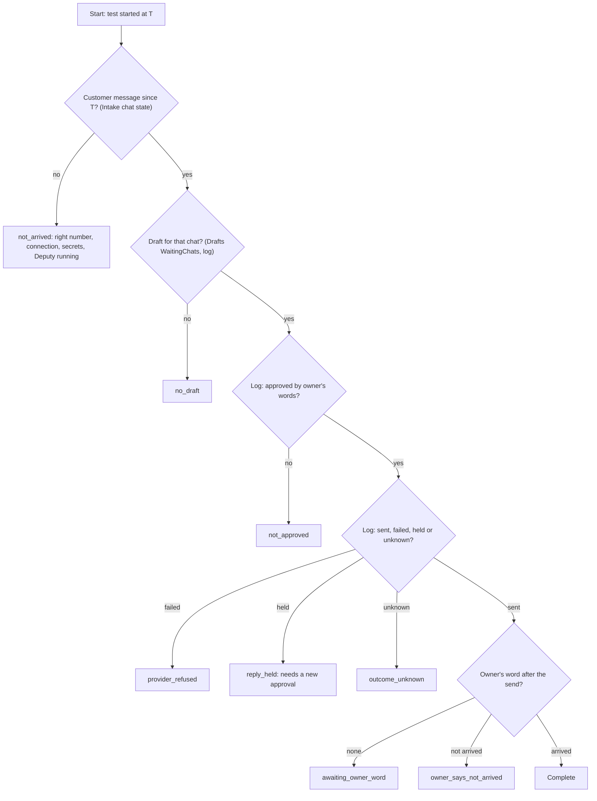

# Technical Proposal: Profile, catalog, test and finish (Setup FRD-04)

Status: Draft

Follows the cross-cutting TP (`docs/tp/TP.md`) and Setup TP-01 to TP-03. "Cross-cutting TD-n" means a decision there.

## Context

Fixed by the cross-cutting TP, so not decided again:
- Setup's one write into Knowledge is `SeedProfileAndCatalog`, after the owner confirms (Interfaces table, FR-SETUP-04-2). The profile is a Markdown file and the catalog a table file or the owner's spreadsheet behind Knowledge's ports; Setup never writes those files.
- The test reply is an ordinary draft. Setup sends nothing and approves nothing (D1, FR-SETUP-04-5). Drafts' published reads (`WaitingChats`, `ReadDraftLog`) are the only ports Setup uses on Drafts.
- Once the provider is not dev, dev messages never count as pending, notified or draftable (L3, Intake FR-INTAKE-01-10). The switch to the real provider needs nothing from Setup for that.
- Setup suggests the currency from the owner's country and the owner confirms it; it is stored as Knowledge's `currency` setting (D21, TD-8, TD-12). Catalog files and their mapping are Knowledge's (D22): Setup collects typed items and never parses a catalog file.
- Language (D20): questions to the owner are fixed codes with an English default text. The agent asks them in the owner's language. The owner's answers are stored as given.
- Dev messages enter Intake only through its inbound port `DeliverDevMessage`, which works only under the dev provider (lead decision; Intake publishes it). It takes the chat, the sender and the text.
- Libraries stay behind ports (ADR-000 of the cross-cutting set).

Published ports of other slices that this TP consumes exactly as written: Intake `ListChats`, `ReadChat`, `GetOwnerNumbers`, `GetSyncStatus`; Drafts `WaitingChats` and `ReadDraftLog` (its `LogEntryView` carries `kind` among `proposed`, `approved`, `held`, `sending`, `sent`, `failed`, `unknown` and others, plus `draft`, `chat`, `at`, `ownerWords`); Knowledge `SeedProfileAndCatalog` and `SetKnowledgeSettings` (Knowledge TP-01):

```ts
type SectionId = 'description' | 'tone_language' | 'may_do' | 'must_not_do' | 'pickup_delivery' | 'payment' | 'handoff';
interface SeedProfileAndCatalog { execute(i: {
  profile: Partial<Record<SectionId, string>>;
  items: { name: string; price?: string; unit?: string; available?: boolean; notes?: string }[];
  revision: number;                                  // integer >= 1, Setup's counter
  ownerWords: string }): Promise<{ ok: true; unchanged: boolean; profileSections: number; catalogRows: number }
    | { ok: false; code: 'not_owner' | 'seed_modified' | 'revision_stale' | 'already_exists' | 'words_empty' | 'value_invalid' | 'value_unsafe'; text: string }> }
interface SetKnowledgeSettings { execute(i: { key: 'catalog_store' | 'currency'; value: string }): Promise<{ ok: true; notes: string[] } | Refusal> }
```

Knowledge says price strings are plain decimals with `.`. The seed is idempotent per `revision`: the same revision writes nothing (`unchanged`); a higher revision replaces the seeded `profile.md` and `catalog.csv` only while they still equal what the seed wrote (Knowledge keeps a fingerprint), else `seed_modified` and nothing is overwritten; a lower revision is `revision_stale`; content that no seed wrote gives `already_exists`. Consequences for Setup: (1) while the owner changes their mind inside step 5, Setup sends the next revision; (2) when the answer is `seed_modified` (the owner or `apply_change` edited the files) or after Setup completes, changes go through Knowledge's `propose_change` and `apply_change`, which carry the owner's words; (3) Setup does not parse prices: the agent turns what the owner says into a plain decimal (asking the owner when `1.234` could be 1234 or 1.234), and Setup only checks the string is digits with an optional `.` and decimals. The currency is set first with `SetKnowledgeSettings` (`currency`, an ISO 4217 code, with the owner's words of the currency confirmation once Knowledge's port takes `ownerWords`; without it prices read as to be confirmed), then the seed is called. Knowledge's refusals carry `code` (not `reason`); the seeder adapter maps `already_exists`, `seed_modified`, `not_owner` and the rest (`revision_stale`, `words_empty`, `value_invalid`, `value_unsafe`) to the port's results. Setup never calls `CreateTemplates` before the seed. The catalog store stays the default file: a spreadsheet store is `deputy config set catalog-store sheet:<spreadsheetId>`, a terminal-only command that Setup does not ask in v1 and that Knowledge owns (the agent can only set `file`).

Points for team-lead (not changed here):
1. FR-SETUP-04-3 and 04-7 say the owner or the agent "simulates a customer message" in test mode. This TP adds a Setup tool `setup_test_message` whose adapter calls Intake's published `DeliverDevMessage` (no HTTP). The port refuses unless the provider is dev (L3), so no message can be injected under a real provider.
2. `ListChats` returns the chat state (last customer time, last answer time and source) but no message text. That is enough here, and Setup never reads customer text.

## Requirements served

FR-SETUP-04-1, FR-SETUP-04-2, FR-SETUP-04-3, FR-SETUP-04-4, FR-SETUP-04-5, FR-SETUP-04-6, FR-SETUP-04-7, FR-SETUP-04-8, FR-SETUP-04-9, FR-SETUP-04-10.

## Decisions

### TD-1: Where do the profile and catalog answers wait until the owner confirms?

FR-SETUP-04-2: Setup hands the profile and catalog to Knowledge only after the owner confirms. The owner may change their mind and confirm again.

- **Option A** Setup keeps the answers in its own tables as a revisioned draft, shows the whole draft, and on the owner's confirmation sets the currency and makes a `SeedProfileAndCatalog` call for that revision. A change makes revision + 1, which is shown, confirmed and seeded again while Knowledge's files still equal the seed; after that (or after Setup completes) a change goes through Knowledge's own propose-and-apply flow. Cost: two small tables and a revision number. Risk: a second copy of the data exists until it is seeded (only the owner's own business answers, no customer data); a seed of a changed revision is refused when the files were edited since (`seed_modified`, handled below).
- **Option B** Each answer goes to Knowledge at once through its propose-and-apply flow. Cost: no Setup tables. Risk: every answer needs the owner's words and a confirmation (about a dozen calls for a profile and a few items), which breaks "one question at a time" and the 30-minute target, and an abandoned run leaves a half-written profile that Knowledge treats as the owner's final text.
- **Option C** The agent writes the Markdown and table files itself. Cost: nothing in Setup. Risk: it bypasses Knowledge's ports, its log and the owner's confirmation (D9), and the owner's spreadsheet option would not work.

Chosen: Option A. It is the only option that meets "hand over only after the owner confirms" and keeps one write path into Knowledge. Recorded in ADR-011.

### TD-2: How does Setup know the round trip happened?

FR-SETUP-04-4: complete only when the message is in the inbox, a draft exists, the owner approved it, the provider accepted the send, and the owner states the reply arrived. FR-SETUP-04-6: a failure names the part.

- **Option A** Derive each part from evidence in the owning slice, read on every check: the message from Intake's chat state, the draft and the approval and the send from Drafts' log, and only the arrival from the owner's own words. Cost: three read adapters and a pure function. Risk: the evidence reads depend on Intake's and Drafts' published shapes.
- **Option B** The agent reports each part. Cost: nothing to read. Risk: a claim is not evidence (FR-SETUP-01-3: the check wins), and an agent that never asked the owner could mark the run complete, which would also fake the proof that the approval path works.
- **Option C** Setup sends the test reply itself after the owner says "go". Cost: fewest steps for the owner. Risk: a second send path outside `approve_draft`, which D1 and FR-SETUP-04-5 forbid.

Chosen: Option A. Only the arrival on the other phone is the owner's word, because Deputy knows only that the provider accepted the send (FR-SETUP-04-4). Recorded in ADR-012.

### TD-3: What does the switch from test mode to the real provider do to the run?

FR-SETUP-04-8: the profile and catalog stay; steps 2, 3 and 4 run again with a new round trip; the 30-minute clock (FR-SETUP-01-9, FR-SETUP-01-10) is for the real setup.

- **Option A** The same run changes mode and resets steps 2, 3, 4 and 6. Cost: one update. Risk: the first-instruction time and the activity rows of the test run are mixed with the real run, so the total shows days and the timing is wrong.
- **Option B** A new run. The test run is marked superseded and kept as history. The new run carries the `install` and `profile` steps (and the confirmed revision) and starts steps 2, 3, 4 and 6 from "to do". Cost: a carry step and a second run row. Risk: a profile that mentions test data stays confirmed; handled by letting the owner or agent reopen step 5.
- **Option C** Wipe Setup state and start again. Cost: simplest. Risk: loses the profile and catalog, which the FRD says to keep.

Chosen: Option B. Timing stays honest, and the old run stays as history. Recorded in ADR-013.

### TD-4: How is the currency suggested from the country?

D21: Setup suggests the currency from the owner's country, the owner confirms. Deputy serves many countries.

- **Option A** The maintained package `country-to-currency` 3.0.2 (MIT, last published 2026-11-10, no dependencies, 251 country codes), behind a `CurrencySuggester` port. Checked in Bun 1.4.4 on Windows, from source and from a `bun build --compile` binary: `NI` gave `NIO`, `MX` gave `MXN`, `AR` gave `ARS`, `US` gave `USD`, `DE` gave `EUR`, and an unknown code gave `undefined`. Cost: one dependency inside one adapter. Risk: a country with more than one used currency (for example some that also use the US dollar) gets one suggestion; the owner confirms, so a wrong suggestion costs a correction.
- **Option B** A hand-written table. Cost: no dependency. Risk: about 250 entries to keep current as currencies change (the ones that changed in recent years are the reason to avoid it).
- **Option C** No suggestion: the owner types a currency code. Cost: nothing to build. Risk: contradicts D21, and a non-technical owner does not know their ISO 4217 code.

Chosen: Option A. It is the smallest correct answer and stays behind a port, so `domain/`, `application/` and `ports/` import no package. Recorded in ADR-014.

## Architecture

Round-trip evidence (step 6), read on every check:



Domain additions (`src/setup/domain/`):
- `ProfileQuestion` is Knowledge's `SectionId` limited to the four sections Setup asks: `description` (what it sells, hours, area), `pickup_delivery` (delivery and area rules), `payment`, `tone_language` (the topics of FR-SETUP-04-1). `may_do`, `must_not_do` and `handoff` are left to Knowledge (the FRD asks for a small first profile). `nextQuestion(answers)` returns the first unanswered one in that order, so there is exactly one question at a time.
- `ProfileDraft { revision, answers, items[] }` where an item is `{ name, price, unit, available, notes }`. `price` is a plain decimal string (digits, optionally `.` and 1 to 4 decimals) written by the agent from the owner's words; Setup validates the shape and never interprets a locale format (D22 belongs to Knowledge's file import).
- `ProfileRevision { revision, shownAt, confirmedAt | null, ownerWords | null, seededAt | null }`. Invariants: a revision is confirmed only after it was shown; any change to answers or items creates revision + 1; a seed call is made only for a confirmed revision.
- `RoundTrip` is a pure function `evaluate(evidence): RoundTripState` over the evidence below, with the part names as a closed union. It holds no state of its own beyond `startedAt`, `chat` once found, and the owner's word facts.
- `Completion { total, working, calendar, providerWait }` comes from `Timing` (TP-01).

Use cases (`application/`): `AnswerProfileQuestion`, `AddCatalogItem`, `RemoveCatalogItem`, `ShowProfileDraft`, `ConfirmProfile` (confirm, set the currency, one seed call, then the step 5 pass), `SuggestCurrency`, `ConfirmCurrency`, `StartRoundTrip`, `InjectTestMessage` (test mode only), `CheckRoundTrip` (step 6), `RecordReplyArrival`, `SwitchToReal`, `GetCompletionSummary`, `ReopenStep`.

Outbound ports added by this TP (all Promise-returning; all read-only except `KnowledgeSeeder` and `TestMessageInjector`):

```ts
interface KnowledgeSeeder {                                                      // Knowledge SetKnowledgeSettings, SeedProfileAndCatalog
  seed(q: { currency: string; profile: Partial<Record<ProfileQuestion, string>>;
    items: { name: string; price?: string; unit?: string; available?: boolean; notes?: string }[]; ownerWords: string;
    revision: number }): Promise<{ ok: true; unchanged: boolean } | { ok: false; reason: 'already_exists' | 'seed_modified' | 'revision_stale' | 'invalid' | 'not_owner' }>;
}
interface CurrencySuggester { forCountry(iso2: string): string | null }          // adapter: country-to-currency
interface ChatEvidence {                                                          // Intake ListChats
  chatsSince(t: Instant): Promise<{ chat: string; lastCustomerAt: Instant | null; lastAnswerAt: Instant | null;
    lastAnswerSource: 'owner_app' | 'sent_through_deputy' | null }[]>;
  messageStoredAt(chat: string): Promise<Instant | null>;                        // storedAt of the newest customer message, via ReadChat
}
interface DraftEvidence {                                                         // Drafts WaitingChats, ReadDraftLog; no write method
  waiting(): Promise<{ number: number; chat: string; kind: 'reply' | 'order'; state: string }[]>;
  logSince(chat: string, t: Instant): Promise<{ id: number; at: Instant; kind: string; draft: number | null; ownerWords: string | null }[]>;
}
interface TestMessageInjector { send(text: string): Promise<{ ok: true } | { ok: false; reason: 'not_dev' }> }   // Intake DeliverDevMessage
interface DataLocationReader { dataDir(): string }                                // the resolved data folder from main.ts
```

`DraftEvidence` has no method that creates, changes or approves a draft, so Setup cannot send or approve (FR-SETUP-04-5). An architecture-style test lists its methods.

Step checks owned here:
- Step 5 passes when the latest revision is confirmed, the seed ended `ok`, `already_exists` or `seed_modified`, and the currency is confirmed. `already_exists` means Knowledge holds a profile or catalog that no seed wrote (the owner's own files); `seed_modified` means the seeded files were edited after the seed. In both Setup keeps what is there, tells the owner so, and says it can be improved through Knowledge (`propose_change`). Reasons: `profile_not_confirmed`, `currency_not_confirmed`, `seed_failed` (`invalid`, with the field).
- Step 6 passes when `evaluate` gives `Complete` (diagram). It is never re-run on resume (TP-01): its stored pass stands.

## Information

Tables owned by this TP (in addition to those of TP-01):

```sql
CREATE TABLE setup_profile_revision (
  run_id       INTEGER NOT NULL REFERENCES setup_run(id),
  revision     INTEGER NOT NULL,
  shown_at     TEXT,
  confirmed_at TEXT,
  owner_words  TEXT,
  seeded_at    TEXT,                      -- set when the seed ended ok or already_exists
  seed_result  TEXT CHECK (seed_result IN ('seeded','kept_existing')),   -- kept_existing for already_exists and seed_modified
  currency     TEXT,                      -- ISO 4217 code the owner confirmed
  PRIMARY KEY (run_id, revision)
);
CREATE TABLE setup_profile_answer (
  run_id   INTEGER NOT NULL,
  revision INTEGER NOT NULL,
  question TEXT NOT NULL CHECK (question IN ('description','pickup_delivery','payment','tone_language')),
  answer   TEXT NOT NULL,
  PRIMARY KEY (run_id, revision, question),
  FOREIGN KEY (run_id, revision) REFERENCES setup_profile_revision(run_id, revision)
);
CREATE TABLE setup_catalog_item (
  run_id     INTEGER NOT NULL,
  revision   INTEGER NOT NULL,
  position   INTEGER NOT NULL,
  name       TEXT NOT NULL,
  price      TEXT,                          -- plain decimal with '.', or NULL
  unit       TEXT,
  available  INTEGER CHECK (available IN (0,1)),
  notes      TEXT,
  PRIMARY KEY (run_id, revision, position),
  FOREIGN KEY (run_id, revision) REFERENCES setup_profile_revision(run_id, revision)
);
CREATE TABLE setup_test (
  run_id                INTEGER PRIMARY KEY REFERENCES setup_run(id),
  started_at            TEXT NOT NULL,
  chat                  TEXT,              -- set when the message is found
  message_sent_stated_at TEXT,             -- the owner said they sent it (starts the delivery wait)
  injected              INTEGER NOT NULL DEFAULT 0 CHECK (injected IN (0,1))
);
```

Facts (`setup_fact`, TP-01) owned here: `reply_arrived` and `reply_not_arrived` (owner's words), `profile_reopened`, `currency_suggested`. A revision keeps its answers when a new one is made (copy then edit), so the history of what the owner confirmed stays.

A new revision copies the previous one's rows and edits them. The old rows stay. Answers hold only what the owner said about their business; the leak guard (TP-03) runs on every answer before it is stored.

Switching to the real provider (`SwitchToReal`): in one transaction, mark the test run `superseded_by` the new run; create the new run with mode `real`; copy the `install` progress row, the confirmed revision (rows, with `confirmed_at` and `seeded_at` kept) and the confirmed currency; nothing is seeded again unless the owner reopens step 5 and the files are still the seed's; steps 2, 3, 4 and 6 start at `todo`; add a `profile_reopened` prompt only when the owner asks. Test messages and chats stay in Intake's history (L3).

## Interfaces

Inbound ports:

```ts
interface AnswerProfileQuestion { execute(q: { question: ProfileQuestion; answer: string }): Promise<{ next: ProfileQuestion | null } | { refused: 'secret_in_words' | 'not_owner' }> }
interface AddCatalogItem { execute(q: { name: string; price?: string; unit?: string; available?: boolean; notes?: string }): Promise<{ items: number } | { refused: 'secret_in_words' | 'price_not_decimal' | 'not_owner' }> }
interface ShowProfileDraft { execute(): Promise<{ revision: number; answers: Record<string, string>; items: { name: string; price: string | null; unit: string | null; available: boolean | null; notes: string | null }[]; currency: { suggested: string | null; confirmed: string | null }; note: 'small_catalog_ok' | null }> }
interface ConfirmProfile { execute(q: { revision: number; ownerWords: string }): Promise<{ ok: true; seed: 'seeded' | 'kept_existing' } | { ok: false; reason: 'not_shown' | 'stale_revision' | 'currency_not_confirmed' | 'seed_invalid' | 'secret_in_words' | 'not_owner' }> }
interface CheckRoundTrip { execute(): Promise<{ passed: true } | { passed: false; part: 'message_not_arrived' | 'sent_from_owner_number' | 'no_draft' | 'not_approved' | 'reply_held' | 'provider_refused' | 'outcome_unknown' | 'awaiting_owner_word' | 'owner_says_not_arrived'; todo: string[] }> }
interface SwitchToReal { execute(): Promise<{ ok: true; runId: number } | { ok: false; reason: 'already_real' | 'not_owner' }> }
interface GetCompletionSummary { execute(): Promise<{ mode: 'test' | 'real'; connected: { provider: string; receiving: 'periodic' | 'live'; push: 'on' | 'off' }; ownerNumbers: { number: string; kind: 'business' | 'extra' }[]; dataDir: string; askPending: { code: string; example: string }; timing: { totalMs: number; workingMs: number; calendarMs: number; providerWaitMs: number }; optional: { code: 'notify_optional'; label: 'optional' }[] } | { refused: 'not_complete' }> }
```

`CheckRoundTrip` `todo` for `message_not_arrived` lists the checks in order (FRD edge case): right number, connection, secrets, Deputy running. Its first evidence step uses `chatsSince(startedAt)`: a chat with `lastCustomerAt` at or after the start. When none exists but a chat has `lastAnswerSource = 'owner_app'` at or after the start, the part is `sent_from_owner_number` and the instruction asks for another phone (FRD edge case: a message from the owner's own number is not a customer message).

Evidence rules, in order, for the found chat and a window from `started_at`:
1. Message: a chat with a customer message at or after `started_at`. The first one found is the test chat and is stored in `setup_test.chat`. The `delivery` wait ends at that message's `storedAt` (TP-01, TD-2).
2. Draft: a waiting draft for the chat, or a log entry `proposed` for it at or after `started_at`. None: `no_draft`.
3. Approval: a log entry `approved` for that draft with owner's words after the draft's `proposed` entry. None: `not_approved`.
4. Outcome: the newest log entry of the draft among `held`, `failed`, `unknown`, `sent`. `held` gives `reply_held` (the owner answered from the app first, or the customer wrote again, FRD edge case; a new approval is needed); `failed` gives `provider_refused`; `unknown` gives `outcome_unknown`; `sent` continues. A retry after `failed` is a new draft and a new approval, as in Drafts.
5. Owner's word: a `reply_arrived` fact later than the `sent` entry completes the run; a `reply_not_arrived` fact later than the `sent` entry gives `owner_says_not_arrived`; with neither: `awaiting_owner_word`. A new `sent` entry later than a `reply_not_arrived` fact makes the next question again.

MCP tools added by this FRD (zod validates every input; the leak guard of TP-03 runs on every free-text input):

| Tool | Input | Output | Use case | FRs |
|---|---|---|---|---|
| `setup_profile` | `{ action: 'answer', question, answer }` or `{ action: 'item', name, price?, unit?, available?, notes? }` or `{ action: 'remove_item', position }` or `{ action: 'show' }` or `{ action: 'currency', code?, owner_words? }` (`owner_words` is the owner's confirmation, stored with the confirmed currency and passed to Knowledge) | the next question, or the draft with the currency suggestion | `AnswerProfileQuestion`, `AddCatalogItem`, `RemoveCatalogItem`, `ShowProfileDraft`, `SuggestCurrency`, `ConfirmCurrency` | FR-SETUP-04-1, FR-SETUP-04-2 |
| `setup_confirm` | `{ what: 'profile', revision, owner_words }`, `{ what: 'reply_arrived' \| 'reply_not_arrived', owner_words }` (the `warning` value is TP-02) | recorded, or the refusal reason | `ConfirmProfile`, `RecordReplyArrival` | FR-SETUP-04-2, FR-SETUP-04-4, FR-SETUP-04-6 |
| `setup_answer` | adds `{ question: 'test_message_sent' }` and `{ question: 'reopen', step: 'profile' }` (after the seed this tells the agent to use Knowledge's `propose_change`) | next instruction | `StartRoundTrip`, `ReopenStep` | FR-SETUP-04-3, FR-SETUP-04-8 |
| `setup_test_message` | `{ text }` (test mode only) | injected or refused `not_dev` | `InjectTestMessage` | FR-SETUP-04-7 |
| `setup_switch_to_real` | none | the new run and its first step | `SwitchToReal` | FR-SETUP-04-8 |
| `setup_summary` | none | the completion summary, or `not_complete` | `GetCompletionSummary` | FR-SETUP-04-9, FR-SETUP-04-10 |

`InjectTestMessage` sends a fixed fictional customer number (a NANP fiction number in the 555-0100 to 555-0199 block, which is reserved for fiction) and the owner's or agent's text, through `DeliverDevMessage`, and refuses with `not_dev` when the provider is not dev. Dev messages are then never pending under a real provider (L3).

Final summary content (FR-SETUP-04-9): what is connected (provider or `test`, receiving mode, push on or off), the owner numbers (read from Intake), where data lives (`DataLocationReader`), how to ask the agent what is pending (code `ask_pending` with an example in the owner's language), and the total time and provider wait. In test mode the mode shows `test`. The summary offers push notices (Notify) as an optional extra, labeled optional, for agents that support it (FR-SETUP-04-10); Setup does not set it up or explain it beyond naming it, and says it completes without it. This answers FRD-04 open question 3: where Notify is set up is Notify's tools, not Setup's.

Questions for the owner (codes with English defaults, spoken in the owner's language by the agent): the four profile questions, "name, price and notes of an item", "which currency: <suggested>?", "send this text to your business number from another phone", "did the reply arrive on that phone?". An owner without a second phone gets the test-mode offer and the "ask someone else" option (FRD open question 2: both are offered, and the guide says the other phone can be a friend's).

## Threat model

| Attacker | Attack | What stops it | Accepted |
|---|---|---|---|
| A customer (test message) | Text in the test message that tries to steer the agent | Setup reads no customer text, only chat state and log entry kinds; the agent sees the message through Inbox's labeled views | The agent may still read it (Inbox's rule) |
| An agent | Marks step 6 complete without the owner | No tool sets a step passed. Evidence comes from Intake and Drafts, and the arrival word needs a recorded fact after the `sent` entry | The agent can invent the arrival words (D11); the log shows who approved |
| An agent | Sends the test reply through Setup | `DraftEvidence` has no write method; Setup has no send port | None |
| An agent | Injects a message under the real provider | `InjectTestMessage` refuses outside dev, and `DeliverDevMessage` refuses unless the provider is dev (L3) | None |
| An agent | Writes profile text into Knowledge unconfirmed | One `seed` call, only for a confirmed revision shown to the owner | The agent can invent the confirmation words; they are logged in Knowledge's log |
| A pasted secret in an answer | A key ends up in the profile file | The leak guard refuses exact pastes (TP-03) | A reformatted key |
| A profile that mentions test data | Real customers see test text in drafts | The owner is asked to review on switch; the agent can reopen step 5 | The owner may skip the review |

Assets: the owner's business profile (it shapes every later draft) and the proof that the approval path works.

## Testing

ATDD. UC means a use case with in-memory adapters: a fake `KnowledgeSeeder` that records calls, fake `ChatEvidence` and `DraftEvidence` driven by a script, a fake `CurrencySuggester`, and a fake clock. E2E runs the server over stdio with the dev provider (the real Intake and Drafts use cases) and drives the whole round trip. AC means the adapter contract (the `country-to-currency` adapter against the real package).

| FR | Test (Given / When / Then) | Layer |
|---|---|---|
| FR-SETUP-04-1 | Given step 5, When the owner answers, Then each call returns exactly one next question in the fixed order, ends with `null` after four, and items are added one at a time | UC |
| FR-SETUP-04-2 | Given answers and items, When the draft is shown, Then the seeder was called zero times; When the owner confirms the shown revision, Then it was called once with that revision's sections and items and the currency was set first; given the owner changes an answer and confirms revision 2 while the files still equal the seed, Then the seed is called with revision 2 and replaces them; given the seed answers `already_exists` or `seed_modified`, Then step 5 passes with `kept_existing` and nothing is overwritten; given the same revision again, Then `unchanged` and no second write; a price `1.234,5` is refused `price_not_decimal`; a draft of zero or one item is accepted with `small_catalog_ok`; a confirmation of a stale revision is refused | UC |
| FR-SETUP-04-3 | Given step 6, When its instruction is read, Then it asks to send a message to the business number from another phone; given the owner has no second phone, Then it offers test mode or asking someone else | UC |
| FR-SETUP-04-4 | Given the message arrived and the draft exists, When the owner has not approved it, Then `CheckRoundTrip` fails `not_approved` and the run is not complete; given approved and `sent`, Then `awaiting_owner_word`; given then `reply_arrived`, Then it passes and the run is complete | UC and E2E |
| FR-SETUP-04-5 | Given the `DraftEvidence` port, When its methods are listed, Then none creates, changes or approves a draft; given a waiting draft with no approval, Then the run is not complete | UC |
| FR-SETUP-04-6 | Given each of: no message, a message from the owner's own number, no draft, no approval, a `held` entry, a `failed` entry, an `unknown` entry, and an owner saying it did not arrive, When the check runs, Then the part name is returned, the todo list is in the fixed order (right number, connection, secrets, Deputy running) for a missing message, and the step stays at 6; given the provider accepted but the owner says it did not arrive, Then it is not complete | UC |
| FR-SETUP-04-7 | Given an owner with no WhatsApp account and the dev provider, When they run test mode with `setup_test_message`, Then Setup completes after the same round trip, the mode shows `test`, and steps 2, 3 and 4 are `skipped` and not counted as remaining; given the provider is not dev, Then `InjectTestMessage` refuses | UC and E2E |
| FR-SETUP-04-8 | Given a completed test mode with a test chat, When `SwitchToReal` runs, Then the profile revision and currency are carried, steps 2, 3, 4 and 6 are `todo`, the test run is superseded and kept, and the first real inbox does not show the test chat as pending (Intake L3, run here end to end); given the owner reopens step 5, Then it needs a new confirmation | UC and E2E |
| FR-SETUP-04-9 | Given setup is complete, When the summary is requested, Then it lists the provider or `test`, the receiving mode, the owner numbers, the data folder, the pending example and the total with the provider wait apart; given not complete, Then `not_complete` | UC |
| FR-SETUP-04-10 | Given the summary, When it is read, Then it names push notices as `optional` and Setup completed without it | UC |

Currency tests (D21, in `FR-SETUP-04-2`): given country `NI` the suggestion is `NIO`, with `MX` it is `MXN`, with an unknown code it is `null` and the owner is asked to name the currency; a confirmed currency different from the suggestion is stored as confirmed. The adapter test runs the real `country-to-currency` package and fails when a code is missing.

## Risks

| Risk | Effect | Mitigation |
|---|---|---|
| The seed refuses when Knowledge already holds content or the seeded files were edited | An owner who started a profile by hand skips Setup's questions | Step 5 passes with `kept_existing` and says so; the owner improves it through Knowledge |
| A country with several used currencies gets one suggestion | The owner sees the wrong default | The owner confirms; a per-product currency column overrides it (D21) |
| The package `country-to-currency` is unmaintained later | A stale mapping | It is behind a port; replaceable by one adapter |
| The owner says the reply arrived but it did not | Setup completes on a false claim | It is the only evidence Deputy cannot have (FR-SETUP-04-4); the log shows the provider accepted the send |
| A real owner message reaches the test chat | The evidence picks a real chat | The chat is the first with a customer message after the start, and the owner chose when to start; the summary and the test text make it visible |
| Intake's chat state does not report an owner reply from the owner's own number | `sent_from_owner_number` is not shown | Falls back to `message_not_arrived` with the same todo list, which includes "send it from another phone" |

## Open questions

1. Can the agent infer part of the profile from the owner's WhatsApp Business profile (FRD-04 open question 1)? Not in v1 Setup: the provider offers no such read in the research, and the owner types the answers. A later slice could add it.
2. Closed: the Knowledge TP published `SeedProfileAndCatalog` (idempotent per `revision`) and `SetKnowledgeSettings`, and this TP follows them.
3. Which fictional number and chat id does `DeliverDevMessage` accept? The values here are a fixed fiction number and a fixed chat name; the exact `chat` format is Intake's.
